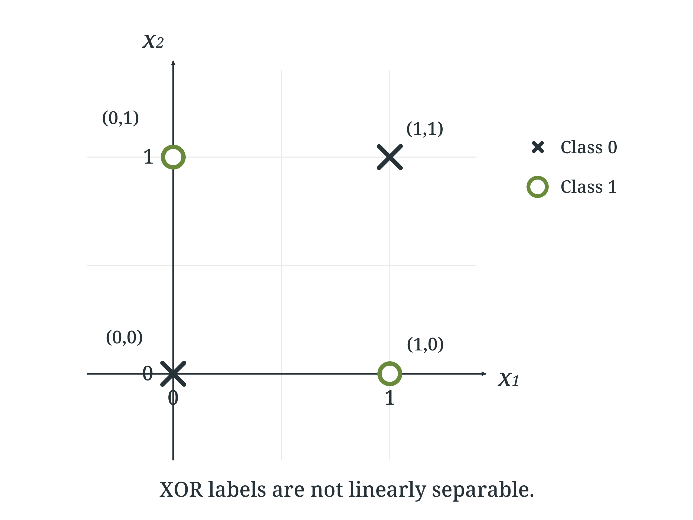

> 작성자 검토 전

## 1.1 From linear predictors to nonlinear models

이번 chapter의 목표는 neural network를 “학습으로 파라미터가 정해지는 함수”로 이해하는 것이다. 그런데 neural network를 처음부터 바로 도입하기보다는, 먼저 이미 익숙한 supervised learning의 예측기에서 출발하는 편이 자연스럽다. 그렇게 보면 neural network가 왜 필요한지도 더 분명하게 드러난다.

supervised learning에서는 입력 \(x\)를 받아 예측값을 내놓는 가설 \(h_\theta\)를 정한다. 예를 들어 linear regression은 입력의 affine combination을 그대로 출력으로 사용한다.

$$
h_\theta(x)=w^T x+b.
$$

여기서 \(w\)는 weight vector, \(b\)는 bias이다. logistic regression도 출발점은 같다. 먼저 affine score \(w^T x+b\)를 만든 뒤, 이를 sigmoid에 넣어 확률처럼 해석되는 값으로 바꾼다.

$$
\begin{aligned}
h_\theta(x)
&=\operatorname{sigmoid}(w^T x+b)\\[4pt]
&=\frac{1}{1+\exp\!\left(-(w^T x+b)\right)}.
\end{aligned}
$$

두 모델은 출력의 의미가 다르다. linear regression은 실수값을 직접 예측하고, logistic regression은 보통 \(P(y=1\mid x;\theta)\)처럼 해석되는 값을 출력한다. 하지만 둘 다 핵심은 **원시 입력(raw input)에 하나의 affine score를 적용한다**는 점에서 같다.

이 점은 binary classification에서 특히 중요하다. logistic regression으로 분류를 한다고 하자. 보통 예측 확률이 0.5보다 크면 class 1, 작으면 class 0으로 분류한다. 그런데 sigmoid 함수는 입력이 0일 때 정확히 0.5를 출력하므로,

$$
\begin{aligned}
&\operatorname{sigmoid}(w^T x+b)=0.5\\
&\Longleftrightarrow\quad w^T x+b=0
\end{aligned}
$$

이다. 즉, 확률 0.5를 기준으로 한 decision boundary는

$$
\{x: w^T x+b=0\}
$$

가 된다. 이것은 입력 공간에서 직선(2차원), 평면(3차원), 더 일반적으로는 hyperplane이다. 다시 말해 **원시 입력에 affine score를 적용하는 분류기는 선형 결정경계(linear decision boundary)** 를 갖는다.

이 한계를 완화하는 전통적인 방법은 먼저 입력을 다른 feature로 바꾸고, 그 feature 위에서 선형 모델을 학습하는 것이다. 즉, 미리 정한 feature map \(\phi\)를 사용해

$$
h_\theta(x)=w^T\phi(x)+b
$$

와 같은 예측기를 만드는 방식이다. polynomial regression이 대표적인 예다. 예를 들어 \(x\)가 스칼라라면

$$
\phi(x)=(x,x^2,x^3)^T
$$

처럼 둘 수 있다. 그러면 모델은 \(x\)에 대해 nonlinear해지지만, 여전히 계수 \(w\)에 대해서는 선형이다.

이 방식은 적절한 feature를 잘 설계할 수 있을 때 매우 강력하다. 문제는 **어떤 feature가 필요한지 학습 전에 사람이 미리 정해야 한다**는 점이다. 입력 차원이 크거나, 어떤 변환이 중요한지 분명하지 않은 문제에서는 이것이 큰 부담이 된다. 이미지의 수많은 pixel, 문장의 맥락에 따라 달라지는 의미, 복잡한 tabular interaction을 생각해 보면 왜 어려운지 금방 알 수 있다.

neural network의 핵심 아이디어는 여기서 나온다. fixed feature map을 사람이 완전히 손으로 정하는 대신, **parameterized feature map**을 도입해 feature 자체도 학습하게 하는 것이다. 즉, 단순히 \(w\)만 학습하는 것이 아니라 입력을 변환하는 과정 안에도 learnable parameter를 넣는다. 그러면 모델은 “주어진 feature 위의 선형 예측기”를 넘어서, **어떤 feature representation이 좋은지도 함께 학습**할 수 있다.

이 차이를 아주 작은 예제로 확인해 보자. 고전적인 예시인 XOR(exclusive-or)이다. 입력은 두 개의 binary 변수 \(x_1,x_2\in\{0,1\}\)이고, 출력은 두 값이 다를 때 1, 같을 때 0이다.

$$
y=x_1\oplus x_2.
$$

가능한 입력과 라벨은 다음 네 개뿐이다.

- \((0,0)\mapsto 0\)
- \((0,1)\mapsto 1\)
- \((1,0)\mapsto 1\)
- \((1,1)\mapsto 0\)

양의 예제(class 1)는 \((0,1)\), \((1,0)\)이고, 음의 예제(class 0)는 \((0,0)\), \((1,1)\)이다. 이를 \(x_1\)-\(x_2\) 평면에 그려 보면 두 class가 서로 대각선 방향으로 섞여 있다.

*그림 DL1.1-1. XOR의 네 점. class 1은 \((0,1)\), \((1,0)\), class 0은 \((0,0)\), \((1,1)\)에 놓이며, 하나의 직선으로 두 class를 정확히 분리할 수 없다.*

왜 이게 문제일까? 앞에서 본 것처럼 affine score를 사용하는 binary classifier는 하나의 직선으로 평면을 둘로 나누는 방식이다. 그런데 XOR의 네 점은 어떤 직선을 그어도 두 positive point를 한쪽에, 두 negative point를 다른 쪽에 동시에 둘 수 없다. 즉, XOR labels are **not linearly separable**.

따라서 \(x_1,x_2\)를 raw input으로 바로 사용하는 perceptron이나 logistic regression은 XOR을 정확히 표현할 수 없다. 이 사실은 “선형 모델의 파라미터 수가 부족하다”는 뜻이 아니다. 본질적인 문제는 **표현(representation)** 에 있다. 현재 표현에서는 하나의 선형 결정경계로는 필요한 구조를 만들 수 없는 것이다.

그렇다면 단순히 affine layer를 여러 번 쌓으면 해결될까? 결론만 먼저 말하면 그렇지 않다. activation function 없이 affine transformation만 여러 번 합성해도 결국 전체는 다시 affine transformation 하나와 같아진다. 이 점은 뒤의 1.6절에서 다시 설명하겠지만, 지금 단계에서는 “선형 연산을 반복한다고 해서 비선형 구조가 저절로 생기지는 않는다”는 동기만 잡아두면 충분하다.

결국 필요한 것은 입력을 더 유용한 intermediate feature로 바꾸는 과정이다. neural network는 바로 그 feature map을 학습한다. 예를 들어 hidden unit들이 서로 다른 half-space를 감지하도록 만들고, 그 출력을 다시 조합하면 XOR처럼 원시 입력에서 선형 분리가 되지 않던 문제도 표현할 수 있다.

즉, neural network를 도입하는 이유는 단순히 연산을 많이 하기 위해서가 아니라, **입력을 학습 가능한 새로운 표현으로 변환한 뒤 그 표현 위에서 예측하기 위해서**이다. 다음 절에서는 이 과정을 가장 작은 단위부터 이해하기 위해, neural network를 computation graph로 보는 관점을 도입한다.
