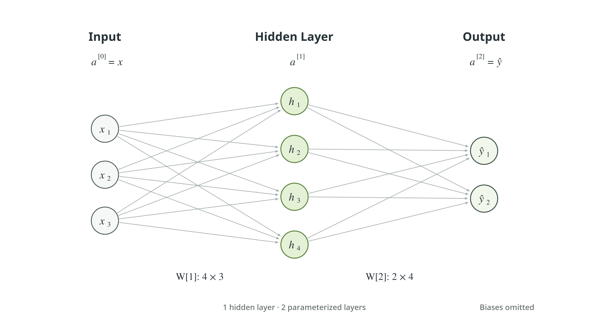

> 작성자 검토 전

## 1.4 One-hidden-layer neural networks

앞 절에서는 여러 neuron을 하나의 Fully Connected Layer로 묶는 방법을 배웠다.

$$
\begin{aligned}
z^{[1]}&=W^{[1]}x+b^{[1]},\\
a^{[1]}&=g^{[1]}(z^{[1]}).
\end{aligned}
$$

이때 $a^{[1]}$은 입력 $x$를 변환해서 얻은 새로운 feature vector라고 볼 수 있다.

그렇다면 이 결과를 다시 다른 layer의 입력으로 사용하면 어떨까?

첫 번째 layer가 입력에서 새로운 feature를 만들고, 두 번째 layer가 그 feature들을 조합해 최종 예측을 수행하도록 할 수 있다. 이것이 가장 기본적인 multilayer neural network의 구조다.

## 하나의 Hidden Layer를 가진 Neural Network

입력 feature가 $n_0$개, hidden neuron이 $n_1$개, output neuron이 $n_2$개인 network를 생각해보자.

먼저 입력을 layer 0의 activation으로 정의한다.

$$
a^{[0]}=x.
$$

이렇게 하면 입력과 각 layer의 출력을 같은 표기법으로 다룰 수 있다.

첫 번째로 입력 $x$가 hidden layer에 들어간다.

$$
\begin{aligned}
z^{[1]}
&=W^{[1]}a^{[0]}+b^{[1]},\\[4pt]
a^{[1]}
&=g^{[1]}(z^{[1]}).
\end{aligned}
$$

첫 번째 식에서는 입력의 affine transformation을 계산한다. 두 번째 식에서는 activation function을 적용해 hidden layer의 출력을 얻는다.

이제 그 결과인 $a^{[1]}$을 두 번째 layer에 전달하자.

$$
\begin{aligned}
z^{[2]}
&=W^{[2]}a^{[1]}+b^{[2]},\\[4pt]
a^{[2]}
&=g^{[2]}(z^{[2]}).
\end{aligned}
$$

마지막 layer의 출력이 모델의 최종 예측값이 된다.

$$
\boxed{\hat y=a^{[2]}}
$$

따라서 전체 Forward Propagation은 다음 순서로 진행된다.

$$
\boxed{
\begin{aligned}
a^{[0]}&=x,\\[3pt]
z^{[1]}&=W^{[1]}a^{[0]}+b^{[1]},\\
a^{[1]}&=g^{[1]}(z^{[1]}),\\[3pt]
z^{[2]}&=W^{[2]}a^{[1]}+b^{[2]},\\
a^{[2]}&=g^{[2]}(z^{[2]})=\hat y.
\end{aligned}
}
$$

결국 하나의 layer에서 사용했던 **affine transformation → activation**이라는 계산을 두 번 반복한 것이다.

그런데 각 layer의 역할에는 차이가 있다.

첫 번째 layer는 입력으로부터 중간 표현을 만들기 때문에 **Hidden Layer**라고 부른다. 반면 두 번째 layer는 최종 예측을 계산하므로 **Output Layer**라고 부른다.

Hidden Layer라는 이름은 그 값이 입력 데이터처럼 직접 관측되는 것도 아니고, 최종 정답으로 주어지는 것도 아니라는 데서 나온다. 모델 내부에서 계산되는 중간 표현인 것이다.

## Layer의 차원과 구조

앞에서 정의한 network의 각 layer는 다음 차원을 갖는다.

첫 번째 layer에서는 $n_0$개의 입력을 받아 $n_1$개의 값을 출력한다.

$$
\begin{aligned}
W^{[1]}&\in\mathbb R^{n_1\times n_0},\\
b^{[1]}&\in\mathbb R^{n_1\times1},\\
z^{[1]},a^{[1]}
&\in\mathbb R^{n_1\times1}.
\end{aligned}
$$

두 번째 layer는 $n_1$개의 hidden activation을 받아 $n_2$개의 예측값을 출력한다.

$$
\begin{aligned}
W^{[2]}&\in\mathbb R^{n_2\times n_1},\\
b^{[2]}&\in\mathbb R^{n_2\times1},\\
z^{[2]},a^{[2]}
&\in\mathbb R^{n_2\times1}.
\end{aligned}
$$

예를 들어 입력이 3개, hidden neuron이 4개, output neuron이 2개인 network를 생각해보자.

구조를 간단하게 나타내면

$$
3\longrightarrow4\longrightarrow2
$$

이다.

*그림 DL1.4-1. 입력 3개, hidden neuron 4개, output neuron 2개로 구성된 Fully Connected Neural Network. 모든 neuron은 이전 layer의 모든 출력과 연결될 수 있으며, bias는 그림에서 생략했다.*

이 구조에서 두 weight matrix의 차원은

$$
\begin{aligned}
W^{[1]}&\in\mathbb R^{4\times3},\\
W^{[2]}&\in\mathbb R^{2\times4}
\end{aligned}
$$

이다.

첫 번째 weight matrix는 3차원 입력을 4차원 hidden representation으로 변환하고, 두 번째 weight matrix는 그 4차원 표현을 다시 2차원 출력으로 변환한다.

여기서 layer를 세는 방법에 주의하자.

이 network에는 Input Layer, Hidden Layer, Output Layer가 각각 하나씩 있다. 하지만 학습 가능한 weight matrix와 bias를 갖는 layer는 Hidden Layer와 Output Layer뿐이다.

따라서 **Hidden Layer는 1개이지만, Parameterized Layer는 2개**다.

이 기준에서는 Input Layer를 layer 0으로 표시하되, 학습 가능한 parameter가 없는 입력 자체는 parameterized layer의 개수에 포함하지 않는다. 그래서 이 구조를 Two-layer Neural Network라고도 부른다.

## Hidden Layer는 무엇을 학습할까?

앞의 구조를 조금 다른 관점에서 생각해보자.

첫 번째 layer에서는 입력 $x$를 받아 새로운 벡터 $a^{[1]}$을 만들었다.

$$
a^{[1]}
=
g^{[1]}(W^{[1]}x+b^{[1]}).
$$

즉, hidden layer는 원래 입력을 예측에 사용할 중간 feature로 변환하는 역할을 한다.

예를 들어 주택가격을 예측하는 모델을 생각해보자.

입력으로 집의 크기, 방의 개수, 주변 환경에 관한 수치 등이 주어질 수 있다. Hidden Layer는 이러한 입력을 조합해 가격 예측에 유용한 새로운 특징을 만들어낼 수 있다.

직관적으로는 집의 수용 능력이나 주거 환경의 질 같은 특징을 떠올릴 수 있다. 하지만 **특정 neuron 하나가 반드시 사람이 이름 붙일 수 있는 개념 하나에 대응하는 것은 아니다.**

Hidden activation은 모델이 학습 과정에서 형성한 수치적 표현이다. 각 neuron에 별도의 정답이 주어지는 것도 아니며, 그 의미가 항상 명확하게 해석되는 것도 아니다.

중요한 것은 hidden layer 전체가 만들어내는 표현이 최종 예측에 도움이 될 수 있다는 점이다.

앞 절의 Fully Connected 구조에서는 각 hidden neuron이 모든 입력을 사용할 수 있다. 따라서 어떤 입력의 조합이 유용한지는 미리 하나씩 지정하기보다 학습을 통해 결정할 수 있다.

이것이 1.1절에서 소개했던 **learnable feature map**의 출발점이다.

## Parameters와 Activations의 차이

마지막으로 network 안에서 사용하는 값들을 두 종류로 구분해보자.

먼저 weight와 bias는 학습을 통해 조정되는 parameter다.

$$
W^{[1]},\ b^{[1]},\
W^{[2]},\ b^{[2]}.
$$

반면 $z^{[1]},a^{[1]},z^{[2]},a^{[2]}$는 주어진 입력을 network에 통과시켜 계산한 값이다.

예를 들어 서로 다른 두 집의 정보를 입력한다고 하자. 두 입력에 같은 network를 적용하므로 weight와 bias는 동일하다.

하지만 입력 데이터가 다르기 때문에 hidden layer의 pre-activation과 activation은 일반적으로 달라진다.

즉, **parameter는 입력들 사이에 공유되지만, activation은 각 입력에 따라 계산된다.**

이 구분을 기억하면 Forward Propagation의 의미도 분명해진다.

Forward Propagation은 현재 정해진 parameter를 이용해 입력에서 출력까지 계산을 진행하는 과정이다. 아직 모델이 예측을 잘하는지 평가하거나 parameter를 수정하는 과정은 포함되지 않는다.

이렇게 network의 계산 구조를 이해하고 나면 다음 질문이 생긴다.

앞에서 두 layer 모두 activation function을 사용했는데, 왜 굳이 affine transformation 사이에 이 함수를 넣어야 할까? 그리고 어떤 함수를 선택해야 할까?

다음 절에서는 neural network에서 자주 사용하는 Activation Function들을 살펴본다. 실제 parameter를 학습하는 방법은 이후 Chapter 2와 Chapter 3에서 다룬다.
