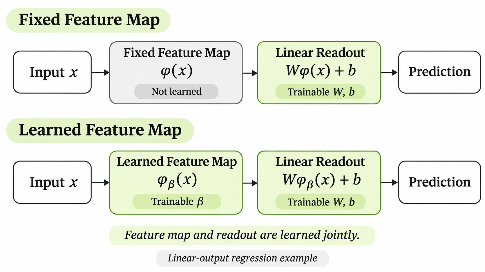

> 작성자 검토 전

## 1.9 Representation learning

1.1절에서는 Neural Network가 기존의 선형 모델과 달리, 입력을 변환하는 Feature Map 자체를 학습할 수 있다는 점을 살펴봤다.

지금까지 배운 Hidden Layer의 역할도 이 관점에서 이해할 수 있다. 각 layer는 이전 layer의 출력을 새로운 feature로 변환하고, 마지막 Output Layer는 그 feature를 이용해 예측값을 계산한다.

이러한 과정을 **Representation Learning(표현 학습)** 이라고 한다.

### Hidden Layer를 Feature Map으로 바라보기

$L$개의 Parameterized Layer를 가진 Neural Network를 생각해보자.

마지막 Output Layer를 제외한 모든 layer의 parameter를 $\beta$라고 묶어 표현하자. 그러면 마지막 Hidden Layer의 출력을 다음과 같은 함수로 나타낼 수 있다.

$$
\boxed{
\phi_\beta(x)=a^{[L-1]}
}
$$

여기서 $\phi_\beta$는 입력 $x$를 마지막 Hidden Representation으로 변환하는 함수다. 아래첨자 $\beta$는 이 변환이 학습 가능한 parameter에 의해 결정된다는 뜻이다.

이제 마지막 Output Layer가 Identity Activation을 사용하는 Regression Model이라고 하자.

최종 예측값은

$$
\begin{aligned}
\hat y
&=W^{[L]}a^{[L-1]}+b^{[L]}\\[4pt]
&=W^{[L]}\phi_\beta(x)+b^{[L]}
\end{aligned}
$$

이므로, 전체 Network를 다음과 같이 표현할 수 있다.

$$
\boxed{
h_\theta(x)
=W^{[L]}\phi_\beta(x)+b^{[L]}
}
$$

이 식을 보면 앞에서 배웠던 선형 모델과 상당히 비슷하다. 입력을 Feature Map으로 변환한 다음, 그 결과에 Weight Matrix를 곱하고 bias를 더하기 때문이다.

하지만 중요한 차이가 하나 있다.

### Fixed Feature Map과 Learned Feature Map

전통적인 Feature-based Linear Model에서는 입력을 변환하는 함수 $\phi$를 미리 정해둔다.

$$
h(x)=W\phi(x)+b.
$$

예를 들어 Polynomial Regression에서는

$$
\phi(x)=(x,x^2,x^3)^T
$$

처럼 feature를 직접 설계할 수 있다.

이 경우 학습을 통해 $W$와 $b$는 달라지지만, 입력을 어떤 feature로 변환할지는 바뀌지 않는다.

반면 Neural Network에서는

$$
h_\theta(x)
=W^{[L]}\phi_\beta(x)+b^{[L]}
$$

의 $\beta$도 학습 대상이다.

즉, 최종 예측에 사용할 feature를 어떻게 조합할지만 배우는 것이 아니라, **어떤 feature를 만들어야 하는지도 함께 학습한다.**

*그림 DL1.9-1. Fixed Feature Map을 사용하는 선형 모델과 Learned Feature Map을 사용하는 Neural Network의 비교. 전자는 미리 정한 feature 위에서 예측기의 parameter만 학습하지만, 후자는 feature를 만드는 변환과 최종 예측기의 parameter를 함께 학습한다.*

이 차이는 입력이 복잡할수록 중요해진다.

예를 들어 이미지에서 물체를 구분한다고 하자. 원시 입력은 수많은 pixel 값이지만, 물체를 인식하는 데 유용한 정보가 각 pixel 값에 그대로 드러나는 것은 아니다.

앞쪽 layer에서는 경계선이나 명암의 변화에 반응하는 표현을 만들고, 뒤쪽 layer에서는 그러한 특징을 조합해 물체의 부분이나 더 복잡한 패턴을 표현할 수 있다.

주택가격 예측에서도 비슷한 직관을 적용할 수 있다. 집의 크기, 방의 개수, 주변 환경에 관한 입력들을 조합해 주거 공간의 수용 능력이나 입지의 특성과 관련된 표현을 만들 수 있을 것이다.

다만 이러한 설명은 Hidden Representation을 이해하기 위한 예시다. **각 neuron이 반드시 경계선, 물체의 부분, 주거 환경처럼 사람이 이름 붙일 수 있는 개념 하나를 담당한다는 뜻은 아니다.**

실제로 Hidden Layer의 출력은 여러 neuron의 activation으로 이루어진 벡터이며, 개별 성분의 의미가 명확하지 않을 수도 있다. 중요한 것은 이 표현 전체가 최종 예측에 유용한 정보를 담을 수 있다는 점이다.

### Representation Learning의 의미

결국 Representation Learning은 사람이 모든 feature를 직접 설계하는 대신, Neural Network가 데이터와 학습 목표에 맞춰 유용한 중간 표현을 형성하도록 하는 방법이다.

다만 Feature Map을 학습할 수 있다고 해서 모델 설계에 관한 모든 가정이 사라지는 것은 아니다. Network의 구조, 학습 데이터, Loss Function, Optimization 방법은 여전히 사람이 선택해야 한다. 따라서 학습된 표현도 이러한 선택의 영향을 받는다.

또한 앞에서 사용한

$$
h_\theta(x)
=W^{[L]}\phi_\beta(x)+b^{[L]}
$$

는 마지막 layer가 Identity Activation을 사용하는 경우의 식이다. Binary Classification이나 Multiclass Classification에서는 이 affine score에 Sigmoid 또는 Softmax를 추가로 적용해야 확률 예측을 얻는다.

그럼에도 Hidden Layer가 학습한 Feature Map 위에서 최종 예측을 수행한다는 기본 구조는 동일하다.

이제 Neural Network를 단순히 Weight Matrix를 여러 번 곱하는 함수가 아니라, **입력을 예측에 유용한 표현으로 차례로 변환하는 함수**로 이해할 수 있다.

다음 절에서는 지금까지 배운 모든 연산을 실제 숫자로 계산해보자.
