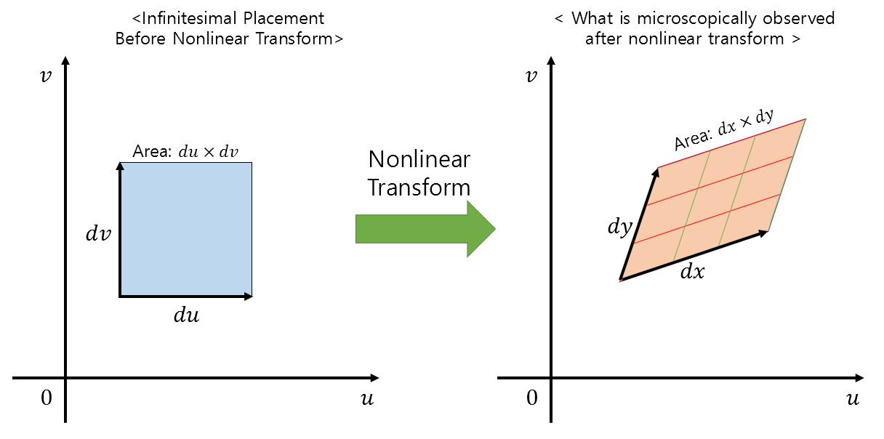

> 작성자 검토 전

앞 절에서는 생성모델을 Explicit Model과 Implicit Model로 구분했다. 어떤 모델은 확률분포를 수식으로 정의하고, 어떤 모델은 데이터를 생성하는 과정을 통해 분포를 정의한다는 차이가 있었다.

그런데 생성모델이 복잡한 데이터를 만들어내는 방법에는 공통적으로 등장하는 아이디어가 있다.

바로 **간단한 확률분포에서 변수를 뽑은 다음, 이를 이용해 복잡한 데이터를 생성하는 것**이다.

예를 들어 표준정규분포에서 무작위로 값을 뽑고, 그 값을 신경망에 입력해 이미지를 생성하는 과정을 생각할 수 있다.

이때 처음 뽑은 변수를 잠재변수(Latent Variable)라고 한다.

이번 절에서는 잠재변수를 활용하는 두 가지 방법인 Latent Variable Model과 Transformation-based Model을 살펴보자.

## Definition 1.11.1 — Latent Variable Model

잠재변수 모델은 직접 관측하지 않는 변수 \(z\)를 이용해 관측 데이터 \(x\)의 분포를 설명하는 모델이다.

예를 들어 손글씨 숫자 이미지를 생성한다고 생각해보자.

숫자의 모양이나 글씨의 기울기처럼 이미지에 영향을 주는 여러 특성을 \(z\)라는 변수에 담는다고 생각할 수 있다. 물론 실제 모델의 잠재변수 각 좌표가 반드시 이런 의미를 갖는 것은 아니다.

잠재변수 모델에서는 먼저 \(z\)를 생성하고, 그 값을 조건으로 관측 데이터 \(x\)를 생성한다.

이를 수학적으로 표현하면 다음과 같다.

\[
\boxed{
\begin{aligned}
z&\sim p_0(z),\\
x\mid z&\sim p_\theta(x\mid z).
\end{aligned}
}
\]

여기서 \(p_0(z)\)는 잠재변수의 분포이고, \(p_\theta(x\mid z)\)는 잠재변수 \(z\)가 주어졌을 때 관측값 \(x\)의 조건부분포다.

따라서 \(x\)와 \(z\)의 결합분포(Joint Distribution)는

\[
\boxed{
p_\theta(x,z)=p_0(z)p_\theta(x\mid z)
}
\]

로 나타낼 수 있다.

그런데 우리가 실제로 관심 있는 것은 잠재변수 \(z\)가 아니라 관측 데이터 \(x\)의 분포다.

이를 구하려면 가능한 모든 \(z\)를 고려해야 한다.

\[
\boxed{
p_\theta(x)
=\int p_0(z)p_\theta(x\mid z)\,\mathrm dz
}
\]

이렇게 결합분포에서 특정 변수를 적분하여 제거하는 것을 **Marginalization(주변화)** 이라고 한다.

이산형 잠재변수라면 적분 대신 합을 사용하면 된다.

### Sampling은 어떻게 할까?

잠재변수 모델에서 Sampling하는 방법은 비교적 간단하다.

먼저 \(p_0(z)\)에서 잠재변수를 하나 뽑는다. 그런 다음 그 \(z\)가 주어졌을 때의 조건부분포 \(p_\theta(x\mid z)\)에서 \(x\)를 뽑으면 된다.

즉,

\[
z\sim p_0(z)
\quad\longrightarrow\quad
x\sim p_\theta(x\mid z).
\]

두 단계의 Sampling을 수행하는 것이다.

그런데 주어진 \(x\)의 확률밀도 \(p_\theta(x)\)를 계산하려면 이야기가 달라진다.

Sampling할 때는 잠재변수 \(z\)를 하나 뽑으면 됐지만, 밀도를 계산할 때는 가능한 모든 \(z\)에 대해 적분해야 한다.

\[
p_\theta(x)
=\int p_0(z)p_\theta(x\mid z)\,\mathrm dz.
\]

잠재변수가 고차원이라면 이 적분을 정확하게 계산하기 어려울 수 있다.

결국 **Sampling은 쉬워도 Marginal Likelihood의 계산은 어려울 수 있다**는 것이다.

이 문제는 이후 Variational Autoencoder(VAE)를 공부할 때 다시 등장한다. 그때는 근사 사후분포(Approximate Posterior) \(q_\phi(z\mid x)\)와 ELBO를 이용해 계산하기 어려운 Likelihood를 다루는 방법을 배울 것이다.

## Transformation-based Model

이번에는 잠재변수를 사용하는 또 다른 방법을 생각해보자.

앞의 잠재변수 모델에서는 \(z\)를 뽑은 다음 조건부분포 \(p_\theta(x\mid z)\)에서 다시 \(x\)를 뽑았다.

그런데 조건부분포에서 새로운 값을 뽑는 대신, \(z\)에 어떤 함수를 적용해 \(x\)를 직접 계산할 수도 있다.

\[
\boxed{
z\sim p_0,\qquad x=T_\theta(z)
}
\]

여기서 \(T_\theta\)는 잠재변수 \(z\)를 관측 데이터 \(x\)로 변환하는 함수다.

이러한 모델을 Transformation-based Model이라고 한다.

앞서 1.4절에서 배웠던 Pushforward와 같은 구조다. 간단한 분포에서 시작해 함수 \(T_\theta\)를 적용함으로써 새로운 확률분포를 만드는 것이다.

그렇다면 이런 모델에서는 확률밀도를 어떻게 계산할 수 있을까?

### 일차원에서의 변수변환

먼저 가장 간단한 경우를 생각해보자.

확률변수 \(z\)를 다음과 같이 변환한다고 하자.

\[
x=2z.
\]

이 변환은 모든 값을 두 배로 늘린다.

예를 들어 \(z\)가 1에서 2 사이에 있었다면, 변환된 \(x\)는 2에서 4 사이에 놓이게 된다.

구간의 길이가 두 배로 늘어난 것이다.

그런데 확률은 어떻게 될까?

변환 전 \(1\leq z\leq2\)에 속할 확률과 변환 후 \(2\leq x\leq4\)에 속할 확률은 같아야 한다.

같은 값들을 단지 다른 위치로 옮겼을 뿐이기 때문이다.

따라서 구간의 길이가 두 배로 늘어나면, 그에 대응하는 확률밀도는 절반으로 줄어들어야 한다.

실제로 \(z=x/2\)이므로 변수변환 공식을 적용하면

\[
\begin{aligned}
p_\theta(x)
&=p_0\left(\frac{x}{2}\right)
\left|\frac{\mathrm dz}{\mathrm dx}\right|\\[4pt]
&=\frac12p_0\left(\frac{x}{2}\right).
\end{aligned}
\]

이것이 일차원에서의 Change of Variables 공식이다.

일반적으로 미분 가능한 일대일 변환 \(x=T(z)\)의 역함수가 존재한다면,

\[
\boxed{
p_\theta(x)
=
p_0(T^{-1}(x))
\left|\frac{\mathrm dT^{-1}(x)}{\mathrm dx}\right|
}
\]

로 나타낼 수 있다.

여기서 절댓값으로 묶인 미분항은 변환 과정에서 구간의 길이가 얼마나 늘어나거나 줄어드는지를 반영한다.

분포를 변환할 때는 값의 위치만 바꾸는 것이 아니라, **전체 확률이 유지되도록 밀도도 함께 조정해야 한다**는 뜻이다.

## Proposition 1.11.2 — Change of Variables

이제 일차원에서 살펴본 내용을 여러 차원으로 확장해보자.

잠재변수 \(z\in\mathbb R^d\)가 분포 \(p_0(z)\)를 따르고,

\[
x=T_\theta(z)
\]

라고 하자.

여기서 \(T_\theta:\mathbb R^d\to\mathbb R^d\)가 적절한 영역에서 미분 가능하고, 역함수도 미분 가능하며, Jacobian Determinant가 0이 아니라고 가정하자.

이때 변환된 확률변수 \(x\)의 밀도는

\[
\boxed{
p_\theta(x)
=
p_0(T_\theta^{-1}(x))
\left|\det J_{T_\theta^{-1}}(x)\right|
}
\]

로 계산할 수 있다.

일차원에서는 미분의 절댓값을 사용했지만, 여러 차원에서는 **Jacobian Determinant**가 그 역할을 한다.

### Jacobian이란?

변환 \(T_\theta\)가 \(d\)차원 벡터를 입력받아 같은 차원의 벡터를 출력한다고 하자.

\[
T_\theta(z)
=
\begin{pmatrix}
T_1(z)\\
\vdots\\
T_d(z)
\end{pmatrix}.
\]

Jacobian Matrix는 각 출력이 각 입력에 대해 얼마나 변하는지를 나타내는 편미분들을 모은 행렬이다.

\[
J_{T_\theta}(z)
=
\begin{pmatrix}
\frac{\partial T_1}{\partial z_1}
&\cdots&
\frac{\partial T_1}{\partial z_d}\\
\vdots&\ddots&\vdots\\
\frac{\partial T_d}{\partial z_1}
&\cdots&
\frac{\partial T_d}{\partial z_d}
\end{pmatrix}.
\]

그렇다면 이 행렬의 Determinant는 무엇을 의미할까?

일차원에서 미분값이 구간 길이의 변화를 나타냈던 것처럼, 여러 차원에서 Jacobian Determinant의 절댓값은 **작은 영역의 부피가 몇 배로 변하는지**를 나타낸다.

특히 2차원에서는 면적의 변화를 나타낸다.

예를 들어 \(|\det J_T(z)|=2\)라면 해당 위치 근처의 작은 면적이 변환 후 약 두 배로 늘어난다는 뜻이다.

반대로 \(|\det J_T(z)|=1/2\)라면 면적이 절반으로 줄어든다.

확률질량은 유지되어야 하므로 면적이 두 배로 늘어나면 밀도는 절반이 되어야 한다.

따라서 밀도를 계산할 때는 역변환의 Jacobian Determinant가 곱해지는 것이다.

*Figure 1.11-1. 변환에 따른 작은 영역의 면적 변화.*

### Change of Variables 공식의 유도

앞의 공식을 조금 더 자세히 살펴보자.

관측 데이터 공간의 어떤 영역 \(A\)를 생각하자.

변환된 값 \(x\)가 \(A\)에 속한다는 것은, 변환 전의 \(z\)가 \(T_\theta^{-1}(A)\)에 속한다는 뜻이다.

따라서

\[
\begin{aligned}
P(x\in A)
&=P(T_\theta(z)\in A)\\[4pt]
&=P(z\in T_\theta^{-1}(A))\\[4pt]
&=\int_{T_\theta^{-1}(A)}p_0(z)\,\mathrm dz.
\end{aligned}
\]

이 적분에서 변수를 \(z\)에서 \(x\)로 바꾸면,

\[
\begin{aligned}
P(x\in A)
&=\int_A p_0(T_\theta^{-1}(x))\\
&\qquad\cdot\left|\det J_{T_\theta^{-1}}(x)\right|
\,\mathrm dx.
\end{aligned}
\]

따라서 변환된 분포의 밀도는

\[
p_\theta(x)
=
p_0(T_\theta^{-1}(x))
\left|\det J_{T_\theta^{-1}}(x)\right|
\]

가 된다.

이 관계를 실제로 Sampling할 때 사용한 \(z\)로 표현할 수도 있다.

\(x=T_\theta(z)\)이고 역함수의 Jacobian은 원래 Jacobian의 역행렬이므로,

\[
\boxed{
\log p_\theta(x)
=
\log p_0(z)
-\log\left|\det J_{T_\theta}(z)\right|
}
\]

이다.

즉, 변환 전의 밀도와 Jacobian Determinant를 알면 변환 후의 Log-Likelihood를 계산할 수 있다.

이것이 **Normalizing Flow의 기본 아이디어**다.

Normalizing Flow는 복잡한 변환을 사용하면서도 역변환과 Jacobian Determinant를 효율적으로 계산할 수 있도록 모델을 설계한다.

## Example 1.11.3 — 다변량 정규분포의 선형변환

이제 실제로 2차원 변환을 계산해보자.

잠재변수 \(z\)가 2차원 표준정규분포를 따른다고 하자.

\[
z\sim\mathcal N(0,I_2).
\]

여기서 \(I_2\)는 \(2\times2\) 단위행렬이다.

이제 다음과 같은 선형변환을 적용하자.

\[
x=Az+b
\]

단,

\[
A=
\begin{pmatrix}
2&0\\
0&\frac12
\end{pmatrix},
\qquad
b=
\begin{pmatrix}
1\\
-1
\end{pmatrix}.
\]

이 변환은 첫 번째 좌표를 두 배로 늘리고, 두 번째 좌표를 절반으로 줄인 다음, 전체 위치를 \(b\)만큼 이동시킨다.

다변량 정규분포에 선형변환을 적용하면 결과 역시 정규분포를 따른다.

\[
x\sim\mathcal N(b,AA^\top).
\]

실제로

\[
AA^\top
=
\begin{pmatrix}
4&0\\
0&\frac14
\end{pmatrix}
\]

이므로,

\[
\boxed{
x\sim\mathcal N\left(
\begin{pmatrix}1\\-1\end{pmatrix},
\begin{pmatrix}4&0\\0&\frac14\end{pmatrix}
\right)
}
\]

이다.

이번에는 Jacobian Determinant를 계산해보자.

선형변환 \(T(z)=Az+b\)의 Jacobian Matrix는 \(A\) 자체다.

따라서

\[
\begin{aligned}
|\det J_T|
&=|\det A|\\[4pt]
&=\left|2\cdot\frac12\right|\\[4pt]
&=1.
\end{aligned}
\]

이 결과가 의미하는 바를 생각해보자.

첫 번째 좌표는 두 배로 늘어났지만 두 번째 좌표는 절반으로 줄어들었다.

따라서 전체 면적은 변하지 않는다.

\[
2\times\frac12=1.
\]

즉, 변환 후 분포의 모양은 달라졌지만 대응하는 작은 영역의 면적은 보존된다.

Change of Variables 공식에 대입하면

\[
p_\theta(Az+b)
=
\frac{p_0(z)}{|\det A|}
=
p_0(z)
\]

를 얻는다.

여기서 두 분포가 같은 모양이라는 뜻은 아니다. 실제로 변환된 분포의 평균과 공분산은 달라졌다.

다만 **변환 전의 점 \(z\)와 그에 대응하는 변환 후의 점 \(x=Az+b\)에서 확률밀도 값이 같다는 것**이다.

## 연습문제 — 균등분포의 변수변환

마지막으로 Jacobian을 이용해 간단한 확률밀도함수를 계산해보자.

서로 독립인 두 확률변수

\[
X,Y\overset{\mathrm{i.i.d.}}{\sim}U(0,1)
\]

를 생각하자.

이제 다음과 같이 변환한다.

\[
U=2X,\qquad V=3Y.
\]

먼저 각 변수의 분포를 생각해보면,

\[
U\sim U(0,2),\qquad V\sim U(0,3)
\]

이다.

따라서 각각의 확률밀도는

\[
f_U(u)=\frac12,\quad 0<u<2
\]

와

\[
f_V(v)=\frac13,\quad 0<v<3
\]

이다.

이제 두 변수의 결합밀도를 직접 계산해보자.

역변환은

\[
x=\frac u2,\qquad y=\frac v3
\]

이다.

따라서 역변환의 Jacobian Matrix는

\[
J=
\begin{pmatrix}
\frac12&0\\
0&\frac13
\end{pmatrix}
\]

이고,

\[
|\det J|=\frac16
\]

이다.

원래 \((X,Y)\)의 결합밀도는 단위정사각형 내부에서 1이므로, Change of Variables 공식에 따라

\[
\begin{aligned}
f_{U,V}(u,v)
&=f_{X,Y}\left(\frac u2,\frac v3\right)
|\det J|\\[4pt]
&=1\cdot\frac16\\[4pt]
&=\frac16.
\end{aligned}
\]

따라서 최종적으로

\[
\boxed{
f_{U,V}(u,v)=
\begin{cases}
\frac16,&0<u<2,\ 0<v<3,\\
0,&\text{otherwise}.
\end{cases}
}
\]

원래 두 확률변수는 \(1\times1\)인 정사각형 영역에 분포했지만, 변환 후에는 \(2\times3\)인 직사각형 영역에 분포한다.

면적이 6배로 늘어났으므로 확률밀도는 \(1/6\)로 줄어든 것이다.

전체 확률을 계산해보면

\[
\int_0^2\int_0^3\frac16\,\mathrm dv\,\mathrm du
=1
\]

이 되어 확률이 보존되는 것도 확인할 수 있다.

---

이번 절에서는 잠재변수를 이용해 복잡한 데이터 분포를 표현하는 두 가지 방법을 살펴봤다.

Latent Variable Model에서는 \(z\)를 먼저 뽑고 조건부분포 \(p_\theta(x\mid z)\)에서 \(x\)를 생성한다. 반면 Transformation-based Model에서는 \(z\)에 함수 \(T_\theta\)를 적용해 \(x\)를 직접 계산한다.

특히 변환이 가역적이고 Jacobian Determinant를 계산할 수 있다면, 생성된 데이터의 확률밀도도 Change of Variables 공식으로 구할 수 있다.

결국 잠재변수에서 데이터를 생성하는 방법뿐 아니라, **그 생성 과정을 거꾸로 추적하고 밀도 변화까지 계산할 수 있는지**가 생성모델의 중요한 특징이 된다.
