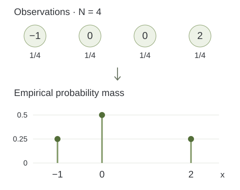

> **작성자 검토 전** · 손글씨 필기를 바탕으로 AI가 설명과 예시를 보완한 초안.

[1.1–1.2](#/notes/newnote1)에서는 실제 데이터 분포 $p_{\mathrm{data}}$를 모델 분포 $p_\theta$로 근사한다는 목표를 세웠다. 그러나 학습할 때 주어지는 것은 $p_{\mathrm{data}}$의 수식이 아니라, 그 분포에서 관측한 유한한 데이터이다.

이번 절에서는 **분포에 대한 계산을 관측값에 대한 계산으로 연결하는 방법**을 살펴본다. 먼저 기댓값을 표본평균으로 근사하고, 이어서 데이터셋 자체를 하나의 확률분포로 표현한다.

## 관측할 수 있는 것은 유한한 표본이다

데이터셋을 다음과 같이 쓰자.

$$
\mathcal D=(x^{(1)},\ldots,x^{(N)}).
$$

$N$은 관측값의 개수이고, $x^{(i)}$는 $i$번째 관측값이다. 같은 값이 여러 번 관측될 수도 있으므로, 각 관측을 구별할 수 있도록 번호를 붙인다.

이 데이터가 만들어지기 전의 확률변수를 $X^{(1)},\ldots,X^{(N)}$라고 하면, 기본적인 가정은 다음과 같다.

$$
X^{(1)},\ldots,X^{(N)}
\overset{\mathrm{i.i.d.}}{\sim}p_{\mathrm{data}}.
$$

**독립·동일분포(independent and identically distributed, i.i.d.)**라는 가정은 각 관측이 같은 분포를 따르며 서로 독립이라는 뜻이다. 예를 들어 같은 모집단에서 다른 관측에 영향을 받지 않도록 표본을 뽑는 상황을 생각할 수 있다.

분포를 안다면 여러 양을 계산할 수 있다. $g$가 관측값을 하나의 실수로 바꾸는 함수일 때,

$$
\mathbb E_{X\sim p_{\mathrm{data}}}[g(X)]
$$

는 실제 분포 전체에서 $g(X)$를 평균 낸 값이다. $g(x)=x$이면 평균이고, $g(x)=x^2$이면 제곱의 평균이다. $g(x)=\mathbf 1_{\{x\in A\}}$이면 사건 $A$가 일어날 확률이다. 여기서 지시함수 $\mathbf 1_{\{x\in A\}}$는 $x$가 $A$에 속하면 1, 그렇지 않으면 0이다.

문제는 실제 분포를 모르므로 이 기댓값을 직접 계산할 수 없다는 데 있다. 대신 데이터에서 $g(x^{(1)}),\ldots,g(x^{(N)})$를 계산할 수 있다.

## 기댓값에서 표본평균으로

관측한 값들의 평균을 이용하면 다음과 같이 근사한다.

$$
\mathbb E_{p_{\mathrm{data}}}[g(X)]
\approx \frac{1}{N}\sum_{i=1}^{N}g(x^{(i)}).
$$

왼쪽은 **모집단의 양(population quantity)**이고, 오른쪽은 현재 데이터로 계산한 **표본평균(sample average)**이다. 이 둘을 연결하는 근거가 **큰 수의 법칙(law of large numbers)**이다.

고정된 함수 $g$에 대해 관측들이 i.i.d.이고 $\mathbb E[|g(X)|]<\infty$이면,

$$
\frac{1}{N}\sum_{i=1}^{N}g(X^{(i)})
\xrightarrow[N\to\infty]{\mathbb P}
\mathbb E[g(X)].
$$

여기서 확률수렴은 표본 수가 커질수록 표본평균이 기댓값에서 일정한 크기 이상 벗어날 확률이 0에 가까워진다는 뜻이다. 유한한 $N$에서 두 값이 반드시 같다는 뜻은 아니다. 표본을 하나 더 얻을 때마다 오차가 항상 감소한다는 뜻도 아니다.

예를 들어 어떤 지역의 하루 강수량을 $X$라고 하자. $g(x)=\mathbf 1_{\{x>0\}}$로 놓으면,

$$
\begin{aligned}
\mathbb E[g(X)] &= P(X>0),\\
\frac{1}{N}\sum_{i=1}^{N}g(x^{(i)})
&=\frac{\text{비가 온 관측일 수}}{N}.
\end{aligned}
$$

즉, 실제로 비가 올 확률을 관측된 비 오는 날의 비율로 추정하는 것이다. 이 예에서는 개념 설명을 위해 독립·동일분포 가정을 사용한다. 실제 연속된 날짜의 날씨에는 계절성과 의존성이 있으므로 이 가정이 그대로 맞는지는 별도로 검토해야 한다.

### 표본 수가 증가하면 무엇이 달라지는가?

$Y^{(i)}=g(X^{(i)})$라고 쓰고, 그 분산이 유한한 값 $v$라고 하자. 독립성 때문에 표본평균의 분산은

$$
\begin{aligned}
\operatorname{Var}\!\left(\frac{1}{N}\sum_{i=1}^{N}Y^{(i)}\right)
&=\frac{1}{N^2}\sum_{i=1}^{N}\operatorname{Var}(Y^{(i)})\\
&=\frac{v}{N}
\end{aligned}
$$

이 된다. 따라서 표본평균의 표준편차는 $\sqrt{v/N}$이다. 표본 수를 4배로 늘리면 이 표준편차는 절반이 된다. 이는 표본평균의 불확실성이 줄어드는 규모를 설명한다. 특정 데이터셋에서 발생한 오차를 정확히 알려주는 공식은 아니다.

생성모델에서는 $g$ 자리에 모델의 손실함수가 들어갈 수 있다. 이때 고정된 모델에 대한 표본평균의 수렴과, 같은 데이터로 수많은 모델 중 하나를 고른 뒤의 일반화 성능은 구분해야 한다. 큰 수의 법칙만으로 학습한 모델의 성능 전체가 보장되는 것은 아니다.

## 정의 1.3.1 — 경험분포

데이터셋을 단순한 값의 목록이 아니라 하나의 확률분포로 표현할 수도 있다. 이를 **경험분포(empirical distribution)**라고 한다.

$$
\widehat P_N=\frac{1}{N}\sum_{i=1}^{N}\delta_{x^{(i)}}.
$$

$\delta_a$는 위치 $a$에 확률질량 1을 모두 놓는 **점질량(point mass)**이다. 이 분포에서 값을 뽑으면 항상 $a$가 나온다. 따라서 $\widehat P_N$은 각 관측에 $1/N$씩 확률을 부여한 분포이다.

어떤 사건 $A$에 대해 경험분포가 부여하는 확률은 다음과 같다.

$$
\widehat P_N(A)
=\frac{1}{N}\sum_{i=1}^{N}\mathbf 1_{\{x^{(i)}\in A\}}.
$$

관측값 중 $A$에 속하는 것의 비율을 계산한 식이다. 여기에는 실제 분포의 수식이 필요하지 않다.

### 같은 값이 여러 번 관측된 경우

설명을 위해 다음 네 관측을 사용하자.

$$
(x^{(1)},x^{(2)},x^{(3)},x^{(4)})=(-1,0,0,2).
$$

각 **관측**의 가중치는 $1/4$이지만, 값 0은 두 번 나타난다. 따라서 같은 위치의 확률질량을 합치면

$$
\begin{aligned}
\widehat P_4
&=\tfrac14\delta_{-1}+\tfrac14\delta_0
  +\tfrac14\delta_0+\tfrac14\delta_2\\
&=\tfrac14\delta_{-1}+\tfrac12\delta_0+\tfrac14\delta_2.
\end{aligned}
$$

| 값 | 관측 횟수 | 경험분포의 확률 |
|---|---|---|
| $-1$ | 1 | $1/4$ |
| $0$ | 2 | $1/2$ |
| $2$ | 1 | $1/4$ |

*Figure 1.3-1. 관측마다 부여한 $1/4$의 질량을 같은 값끼리 합친 경험분포. 점의 높이는 확률질량이며 연속적인 확률밀도가 아니다. 직접 제작.*

경험분포는 원래 데이터가 연속형이더라도 유한 개의 관측 위치에만 질량을 놓는 이산분포이다. $\delta_a$를 보통의 매끄러운 밀도함수처럼 해석해서는 안 된다. 경험분포, 구간별 빈도를 그린 히스토그램, 매끄러운 밀도 추정은 서로 관련되지만 같은 대상은 아니다.

## 경험분포의 기댓값은 표본평균과 정확히 같다

$X\sim\widehat P_N$이면 관측 $x^{(i)}$를 $1/N$의 가중치로 선택하므로,

$$
\mathbb E_{X\sim\widehat P_N}[g(X)]
=\frac{1}{N}\sum_{i=1}^{N}g(x^{(i)}).
$$

이 등식은 근사가 아니라 경험분포의 정의에서 나오는 **정확한 등식**이다. 앞에서 사용한 근사는 $\widehat P_N$의 기댓값을 실제 분포의 기댓값과 연결할 때 등장한다.

$$
\begin{aligned}
\mathbb E_{p_{\mathrm{data}}}[g(X)]
&\approx \mathbb E_{\widehat P_N}[g(X)]\\
&=\frac{1}{N}\sum_{i=1}^{N}g(x^{(i)}).
\end{aligned}
$$

네 관측의 예에서 $g(x)=x$이면,

$$
\mathbb E_{\widehat P_4}[X]
=\frac{-1+0+0+2}{4}=\frac14.
$$

사건 $A=\{x:x\leq0\}$에 대해서는 세 관측이 조건을 만족하므로 $\widehat P_4(A)=3/4$이다. 평균과 사건의 확률을 모두 같은 경험분포로 계산할 수 있다.

## 경험분포에서 샘플을 뽑는다는 것

$\widehat P_N$에서 한 번 샘플링하는 방법은 간단하다. 인덱스 $I$를 $\{1,\ldots,N\}$에서 균등하게 뽑고, 해당 관측값을 반환한다.

$$
I\sim\operatorname{Uniform}\{1,\ldots,N\},
\qquad X_{\mathrm{resample}}=x^{(I)}.
$$

여러 번 독립적으로 뽑을 때는 매번 모든 인덱스 중에서 다시 선택한다. 따라서 같은 관측을 반복해서 뽑을 수 있는 **복원추출(sampling with replacement)**이다. 서로 다른 값들만 균등하게 고르면, 중복 관측의 빈도가 사라져 원래 경험분포와 다른 분포가 된다.

아래 실험은 위의 네 관측을 고정하고 경험분포에서 재표집한다. `Draws`는 새로 뽑은 횟수 $M$이며, 원래 관측 수 $N=4$와 다르다. 윤곽선은 경험분포의 정확한 확률이고, 채워진 막대는 재표집 결과의 상대도수이다.

[demo:empirical-distribution]

$M$이 커지면 상대도수는 각각 $1/4,1/2,1/4$에 가까워지고, 재표집 평균은 $1/4$에 가까워진다. 이때 가까워지는 대상은 **고정된 경험분포**이다. 재표집을 많이 한다고 원래 데이터에 없던 모집단 정보가 추가되거나, $p_{\mathrm{data}}$를 더 정확히 알게 되는 것은 아니다.

## 생성모델은 관측값의 재선택을 넘어야 한다

경험분포에서 샘플링하면 학습 데이터에 있던 값만 다시 나온다. 학습 이미지가 100장이라면 그중 한 장을 선택하는 것과 같다. 이 절차는 데이터셋을 확률적으로 표현하는 데는 유용하지만, 관측하지 않은 새로운 구조를 학습했다는 뜻은 아니다.

생성모델은 관측된 유한한 표본을 이용하면서도 그 표본을 만들어낸 분포의 규칙성을 표현하려 한다. 따라서 관측값에 높은 점수를 주는 것뿐 아니라, 보지 못한 데이터와 생성된 샘플을 통해 학습 결과를 살펴보아야 한다.

다음 [1.4 밀도 계산과 샘플 생성](#/notes/gm-ch01-14)에서는 모델이 분포를 표현한 뒤 수행하는 두 연산을 구분한다.

## 자료와 보완 범위

주 자료는 사용자 제공 손글씨 **Ch1 3.pdf, PDF 2쪽 상단의 §1.3**이다. 표본평균의 근사, 경험분포의 정의, 학습 관측을 무작위로 선택하는 해석, 유한한 데이터 너머의 학습이라는 원본 흐름을 유지했다.

중복 관측 예시, 점질량과 밀도의 구분, $N$과 재표집 횟수 $M$의 구분, 고정된 함수와 학습한 모델의 차이는 설명을 위해 보완했다. 큰 수의 법칙의 가정과 표본평균 분산은 [ProbabilityCourse §7.1.1](https://www.probabilitycourse.com/chapter7/7_1_1_law_of_large_numbers.php)을 대조했다. 그림과 실험은 이 글을 위해 직접 구현했다.
