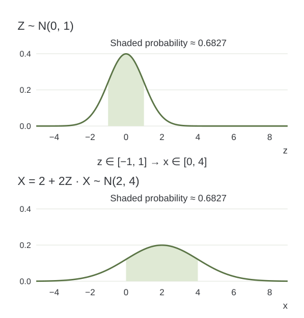

> **작성자 검토 전** · 손글씨 필기를 바탕으로 AI가 설명과 예시를 보완한 초안.

[1.3](#/notes/gm-ch01-13)에서는 유한한 관측값을 경험분포로 표현했다. 이제 어떤 모델 분포 $p_\theta$가 주어졌다고 하자. 이 분포를 가지고 할 수 있는 대표적인 작업은 **주어진 값의 밀도를 계산하는 것**과 **분포에서 새로운 값을 뽑는 것**이다.

두 작업은 같은 분포를 다루지만, 입력과 출력, 필요한 계산이 다르다. 이 차이는 이후 여러 생성모델을 비교할 때 기준이 된다.

## 밀도 계산과 밀도 추정은 다르다

관측값 $x$와 모수 $\theta$가 주어졌을 때 다음 값을 계산하는 연산을 **밀도 계산(density evaluation)**이라고 한다.

$$
p_\theta(x)\qquad\text{또는}\qquad\log p_\theta(x).
$$

여기서는 이미 정해진 모델이 해당 위치에 얼마만큼의 밀도를 부여하는지 계산한다. 연속형 자료에서 $p_\theta(x)$는 $X=x$일 확률이 아니다. 한 점의 확률은 0일 수 있어도 그 점의 밀도는 양수일 수 있다. 구간의 확률을 얻으려면 밀도를 적분해야 한다.

반면 **밀도 추정(density estimation)**은 관측된 데이터로부터 분포를 추정하는 학습 문제이다. 예를 들어 정규분포를 모델로 선택한 뒤 평균과 분산을 데이터로 추정하는 것이 밀도 추정에 해당한다. 추정이 끝난 모수를 사용해 특정 $x$의 밀도를 계산하는 것은 밀도 계산이다.

원본 절의 제목은 *Density Estimation and Sample Generation*이며, 본문에서는 분포가 주어졌을 때의 연산인 density evaluation과 sampling을 비교한다. 두 용어를 구분하면 학습과 사용 단계를 혼동하지 않을 수 있다.

## 샘플링은 새로운 값을 출력하는 연산이다

**샘플링(sampling)**은 모델 분포에서 새로운 확률적 결과를 뽑는 것이다.

$$
X_{\mathrm{new}}\sim p_\theta.
$$

밀도 계산에서는 $x$가 입력이고 숫자 $p_\theta(x)$가 출력이다. 샘플링에서는 분포를 지정한 뒤 난수를 사용하여 새로운 값 $x_{\mathrm{new}}$를 얻는다.

| 연산 | 주어진 것 | 얻는 것 |
|---|---|---|
| Density evaluation | 모수 $\theta$와 값 $x$ | 밀도 $p_\theta(x)$ 또는 로그밀도 |
| Sampling | 모수 $\theta$와 난수 | 모델에서 뽑은 관측값 $x_{\mathrm{new}}$ |

같은 값을 넣으면 밀도 계산 결과는 같지만, 샘플링은 반복할 때 서로 다른 결과를 낼 수 있다. 난수 시드를 고정하면 컴퓨터에서 같은 샘플열을 재현할 수 있지만, 이것이 밀도 계산과 같은 연산이라는 뜻은 아니다.

## 예제 1.4.1 — 정규분포에서는 두 연산이 모두 쉽다

표준정규분포에서 뽑은 확률변수 $Z$를 다음과 같이 변환하자.

$$
Z\sim\mathcal N(0,1),\qquad
X=\mu+\sigma Z,\qquad \sigma>0.
$$

$\mu$는 위치를 이동시키는 모수이고, $\sigma$는 퍼짐을 조절하는 양수이다. 이때

$$
X\sim\mathcal N(\mu,\sigma^2)
$$

이다. 정규분포 표기의 두 번째 항은 표준편차 $\sigma$가 아니라 **분산 $\sigma^2$**이다.

### 샘플링 절차

샘플을 하나 만들려면 다음 두 단계를 수행하면 된다.

1. $z\sim\mathcal N(0,1)$을 하나 뽑는다.
2. $x=\mu+\sigma z$를 계산한다.

예를 들어 $\mu=2$, $\sigma=2$이고 뽑힌 값이 $z=-0.5$라면,

$$
x=2+2(-0.5)=1
$$

이 된다. 이 계산에서는 결과 위치의 밀도 $p_\theta(1)$을 먼저 알아낼 필요가 없다. 표준정규 난수를 원하는 분포의 난수로 변환한 것이다.

### 밀도 계산

같은 모델의 확률밀도함수는 다음과 같다.

$$
p_\theta(x)
=\frac{1}{\sqrt{2\pi}\,\sigma}
\exp\!\left(-\frac{(x-\mu)^2}{2\sigma^2}\right),
\qquad \theta=(\mu,\sigma).
$$

여기서는 새 난수를 뽑지 않고 주어진 $x$, $\mu$, $\sigma$를 식에 대입한다. 예를 들어 $\mu=2$, $\sigma=2$, $x=2$이면,

$$
p_\theta(2)=\frac{1}{2\sqrt{2\pi}}\approx0.1995.
$$

로그밀도는 곱셈과 지수 계산을 덧셈 형태로 다루게 해 준다.

$$
\log p_\theta(x)
=-\frac12\log(2\pi)-\log\sigma
-\frac{(x-\mu)^2}{2\sigma^2}.
$$

작은 밀도들을 많이 곱하면 컴퓨터의 표현 범위 아래로 값이 내려갈 수 있다. 이후 우도 계산에서 로그밀도를 사용하는 이유 중 하나이다. 이 식의 $\log$는 자연로그이다.

## 변환으로 새 분포가 만들어지는 이유

$Z$가 확률적으로 변하면, 고정된 함수에 넣은 $X=T(Z)$도 확률적으로 변한다. 이를 통해 입력의 확률분포가 출력의 확률분포로 옮겨간다. 이 분포를 원래 분포의 **푸시포워드(pushforward)**라고 한다.

정규분포 예에서 $T(z)=\mu+\sigma z$이다. 평균과 분산을 계산하면,

$$
\begin{aligned}
\mathbb E[X]
&=\mu+\sigma\mathbb E[Z]=\mu,\\
\operatorname{Var}(X)
&=\sigma^2\operatorname{Var}(Z)=\sigma^2.
\end{aligned}
$$

평균과 분산이 이렇다는 사실만으로 정규분포라는 결론이 자동으로 나오지는 않는다. 정규분포의 선형변환이 다시 정규분포라는 성질이 함께 사용된다. 아래에서는 밀도 변환으로 그 결과도 확인한다.

*Figure 1.4-1. $X=2+2Z$는 $[-1,1]$을 $[0,4]$로 옮긴다. 음영 구간의 확률은 약 0.6827로 같지만, 구간 폭은 2배이고 대응하는 위치의 밀도는 절반이다. 같은 가로·세로 눈금으로 직접 계산한 그래프.*

그림에서 위 분포는 $\mathcal N(0,1)$, 아래 분포는 $\mathcal N(2,4)$이다. 확률이 사라지거나 새로 생긴 것이 아니라, 같은 확률질량이 더 넓은 구간에 배치된 것이다. 따라서 밀도의 높이가 낮아진다.

### 밀도에 왜 $1/\sigma$가 붙는가?

$\sigma>0$이므로 $x=\mu+\sigma z$의 역변환은

$$
z=\frac{x-\mu}{\sigma}
$$

이다. $F_Z$를 표준정규분포의 누적분포함수(CDF)라고 하면,

$$
\begin{aligned}
F_X(x)
&=P(X\leq x)\\
&=P\!\left(Z\leq\frac{x-\mu}{\sigma}\right)\\
&=F_Z\!\left(\frac{x-\mu}{\sigma}\right).
\end{aligned}
$$

이를 $x$에 대해 미분하고 연쇄법칙을 적용한다. $\phi$를 표준정규분포의 밀도라고 쓰면,

$$
p_\theta(x)
=\frac{1}{\sigma}\,
\phi\!\left(\frac{x-\mu}{\sigma}\right).
$$

여기에 $\phi(z)=(2\pi)^{-1/2}\exp(-z^2/2)$를 대입하면 앞의 정규분포 밀도식이 나온다. $1/\sigma$는 변환으로 늘어난 구간 폭을 보정하여 전체 확률을 1로 유지하는 인자이다.

이 예에서는 변환이 일대일이고 역변환과 미분이 간단하므로 샘플링뿐 아니라 밀도 계산도 쉽다.

## 일반적인 생성기에서는 두 연산의 난이도가 다를 수 있다

생성모델에서는 간단한 **기저분포(base distribution)** $P_0$에서 $Z$를 뽑고, 신경망으로 만든 함수 $G_\theta$에 넣어 데이터를 생성할 수 있다.

$$
Z\sim P_0,\qquad X=G_\theta(Z).
$$

이 절차는 출력의 분포를 정의한다. 어떤 집합 $A$에 대해,

$$
P_\theta(A)=P_0\!\left(G_\theta^{-1}(A)\right).
$$

여기서 $G_\theta^{-1}(A)$는 $A$로 보내지는 모든 입력의 집합, 즉 **역상(preimage)**이다. 역함수가 존재한다는 뜻이 아니다. $G_\theta$가 서로 다른 입력을 같은 출력으로 보내더라도 위의 분포는 정의할 수 있다.

샘플을 얻을 때는 $G_\theta$의 순방향 계산만 하면 된다. 그러나 특정 $x$의 밀도를 계산하려면 그 주변으로 모여드는 입력의 확률과 변환이 공간을 늘이거나 줄이는 정도를 알아야 한다. 복잡한 생성기에서는 이 계산이 어려울 수 있다.

더 나아가 출력 분포가 주변 공간 전체에 대한 보통의 밀도를 갖지 않을 수도 있다. 간단한 극단적 예로 $G(z)=0$이면 출력은 항상 0이며 분포는 점질량 $\delta_0$이다. 샘플링 절차와 분포는 분명히 존재하지만, 실수축에 대한 보통의 연속 밀도함수로 표현되지는 않는다.

반대 방향도 구분해야 한다. 주어진 $x$의 밀도값을 계산하는 방법이 있다고 해서, 그 분포의 독립 샘플을 효율적으로 직접 뽑는 방법까지 자동으로 주어지는 것은 아니다. 밀도 계산을 이용하는 별도의 샘플링 알고리즘이 필요할 수 있다.

따라서 생성모델을 비교할 때는 다음을 따로 살펴본다.

- 주어진 $x$의 밀도 또는 로그밀도를 계산할 수 있는가?
- 어떤 절차와 계산량으로 샘플을 생성하는가?
- 그 표현을 관측 데이터로 학습할 수 있는가?

변환을 같은 차원의 공간 사이에서 매끄럽고 가역적으로 설계하고, 역변환과 야코비안 행렬식(Jacobian determinant)을 효율적으로 계산할 수 있게 하면 두 연산을 함께 다룰 수 있다. 이것이 정규화 흐름(normalizing flow)의 기본 아이디어이며, 자세한 변수변환 공식은 §1.11에서 다룬다.

## 자료와 보완 범위

주 자료는 사용자 제공 손글씨 **Ch1 3.pdf, PDF 2쪽 하단의 §1.4와 Example 1.4.1**이다. 정규분포 샘플링, 밀도 대입 계산, 변환을 통한 분포의 정의, 일반적인 생성기에서 밀도 계산이 어려울 수 있다는 논지를 유지했다.

밀도 추정과 계산의 구분, 수치 예시, CDF를 이용한 $1/\sigma$의 유도, 역상과 역함수의 구분을 보완했다. 정규분포 변환과 CDF 유도는 [ProbabilityCourse §4.2.3](https://www.probabilitycourse.com/chapter4/4_2_3_normal.php) 및 [§4.1.3](https://www.probabilitycourse.com/chapter4/4_1_3_functions_continuous_var.php)을 대조했다. 그림은 직접 제작했다.

이전 글: [1.3 유한한 표본에서 분포를 학습하기](#/notes/gm-ch01-13). 다음 제작 범위는 원본 PDF 3쪽의 §1.5 최대우도추정이다.
