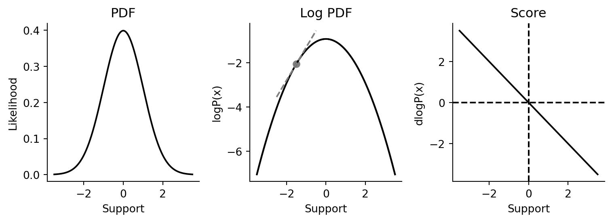
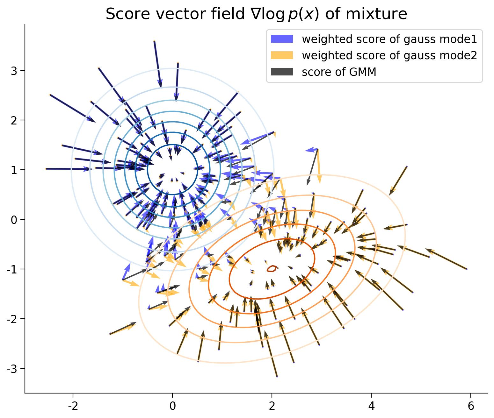

> 작성자 검토 전

앞에서는 KL Divergence를 이용해 두 확률분포를 비교했다. 실제 데이터 분포와 모델 분포가 각 위치에서 얼마나 다른 밀도를 부여하는지 살펴보는 방법이었다.

그런데 확률분포를 이해하는 데 반드시 밀도의 값 자체가 필요한 것은 아니다.

예를 들어 정규분포에서 어떤 값 \(x\)가 주어졌다고 하자. 현재 위치에서 확률밀도가 얼마인지 계산하는 대신, **어느 방향으로 움직여야 밀도가 높아지는지**를 알고 싶을 수도 있다.

이러한 정보를 나타내는 것이 Score Function이다.

이번 절에서는 Score Function을 정의하고, 이를 이용해 두 분포를 비교하는 Fisher Divergence까지 살펴보자.

## Definition 1.8.1 — Data-space Score Function

확률밀도함수 \(p(x)\)가 양수이고 미분 가능하다고 하자.

이때 **Data-space Score Function**은 다음과 같이 정의한다.

\[
\boxed{
s_p(x)
=\nabla_x\log p(x)
=\frac{\nabla_x p(x)}{p(x)}
}
\]

여기서 \(\nabla_x\)는 \(x\)에 대한 기울기(Gradient)를 의미한다.

\(x\)가 하나의 실수라면 일반적인 미분과 같고, \(x\)가 여러 변수로 이루어진 벡터라면 각 변수에 대한 편미분을 모은 벡터가 된다.

그렇다면 이 값은 무엇을 알려줄까?

우선 일차원에서 생각해보자. 확률밀도함수 \(p(x)\)를 그래프로 그리면, Score Function은 로그밀도 \(\log p(x)\)의 기울기를 나타낸다.

- \(s_p(x)>0\): 오른쪽으로 조금 움직이면 밀도가 증가한다.
- \(s_p(x)<0\): 왼쪽으로 조금 움직이면 밀도가 증가한다.
- \(s_p(x)=0\): 현재 위치에서 로그밀도의 기울기가 0이다.

여기서 중요한 점은 Score가 확률밀도 자체를 알려주는 값은 아니라는 것이다.

\(p(x)\)가 현재 위치의 밀도를 나타낸다면, \(s_p(x)\)는 **그 위치에서 밀도가 어느 방향으로 얼마나 빠르게 변하는지에 관한 정보**를 나타낸다.

이 관계는 Taylor Expansion으로도 확인할 수 있다.

\(x\)에서 아주 작은 변화 \(\Delta x\)를 주면

\[
\log p(x+\Delta x)
\approx
\log p(x)+s_p(x)^\top\Delta x
\]

이다.

여기서 \(s_p(x)^\top\Delta x\)는 Score와 이동 방향의 내적이다.

이 값이 양수라면 로그밀도가 증가하는 방향으로 움직인 것이고, 음수라면 감소하는 방향으로 움직인 것이다.

따라서 Score Function은 현재 위치에서 **로그밀도가 가장 빠르게 증가하는 방향**을 알려준다.

다만 이것은 어디까지나 현재 위치 주변에 대한 정보다.

Score가 가리키는 방향으로 움직인다고 해서 반드시 분포 전체에서 밀도가 가장 높은 지점(Global Mode)에 도달하는 것은 아니다.

또한 \(s_p(x)=0\)이라고 해서 그 지점이 반드시 Mode인 것도 아니다. 국소적인 최솟값이나 Saddle Point에서도 기울기는 0이 될 수 있다.

### Remark 1.8.2 — 수리통계학의 Score와는 다르다

여기서 용어를 하나 구분해야 한다.

수리통계학에서도 Score Function이라는 표현을 사용한다. 하지만 그때는 보통 Log-Likelihood를 모수 \(\theta\)에 대해 미분한다.

\[
\nabla_\theta\log p_\theta(x)
\]

반면 지금 정의한 Data-space Score는

\[
\nabla_x\log p_\theta(x)
\]

이다.

두 식 모두 로그밀도의 기울기지만, 미분하는 대상이 다르다.

앞의 식은 모수를 어떻게 바꾸어야 하는지에 관한 정보이고, 뒤의 식은 **데이터 공간에서 \(x\)를 어느 방향으로 움직여야 하는지**에 관한 정보다.

이후에는 혼동을 피하기 위해 Data-space Score를 간단히 \(s_p(x)\)라고 쓰겠다.

## Proposition 1.8.3 — 정규화 상수를 몰라도 Score를 계산할 수 있다

Score Function에는 유용한 성질이 하나 있다.

확률밀도함수는 전체 영역에서 적분하면 1이 되어야 한다.

\[
\int p(x)\,\mathrm dx=1.
\]

그런데 어떤 모델에서는 밀도의 형태를 알고 있어도, 이를 적분해서 1이 되도록 만드는 정규화 상수를 계산하기 어려울 수 있다.

예를 들어 다음과 같이 정의된 분포를 생각해보자.

\[
p_\theta(x)
=\frac{\widetilde p_\theta(x)}{Z_\theta},
\qquad
Z_\theta=\int\widetilde p_\theta(x)\,\mathrm dx.
\]

여기서 \(\widetilde p_\theta(x)\)는 아직 정규화되지 않은 함수이고, \(Z_\theta\)는 이를 확률밀도함수로 만들기 위한 정규화 상수이다. \(0<Z_\theta<\infty\)라고 가정한다.

\(Z_\theta\)를 계산하기 어렵다면 \(p_\theta(x)\) 역시 직접 계산하기 어려울 수 있다.

그렇다면 Score Function도 계산할 수 없는 걸까?

Score의 정의에 대입해보자.

\[
\begin{aligned}
s_{p_\theta}(x)
&=\nabla_x\log p_\theta(x)\\[4pt]
&=\nabla_x
\log\left(\frac{\widetilde p_\theta(x)}{Z_\theta}\right)\\[4pt]
&=\nabla_x\log\widetilde p_\theta(x)
-\nabla_x\log Z_\theta.
\end{aligned}
\]

여기서 \(Z_\theta\)는 모수 \(\theta\)에는 의존하지만, \(x\)에는 의존하지 않는다.

따라서 \(x\)에 대해 미분하면

\[
\nabla_x\log Z_\theta=0
\]

이 되어 다음 결과를 얻는다.

\[
\boxed{
s_{p_\theta}(x)
=\nabla_x\log\widetilde p_\theta(x)
}
\]

즉, **정규화 상수 \(Z_\theta\)를 몰라도 Score Function은 계산할 수 있다.**

이 성질은 Energy-based Model(EBM)에서 특히 유용하다.

예를 들어 EBM에서는 다음과 같은 형태로 분포를 정의할 수 있다.

\[
p_\theta(x)
=\frac{\exp(-E_\theta(x))}{Z_\theta}.
\]

여기서 \(E_\theta(x)\)는 Energy Function이다.

이 분포의 Score를 계산하면

\[
\boxed{
s_{p_\theta}(x)
=-\nabla_x E_\theta(x)
}
\]

가 된다.

정규화 상수를 계산하지 않고도 Energy Function의 기울기만으로 Score를 구할 수 있는 것이다.

따라서 확률밀도를 정확하게 계산하기 어려운 모델에서도, 밀도가 증가하는 방향에 관한 정보는 얻을 수 있다.

## Definition 1.8.6 — Fisher Divergence

이제 Score Function을 이용해 두 확률분포를 비교해보자.

앞에서 배운 KL Divergence는 두 분포의 밀도를 비교했다.

이번에는 밀도 자체가 아니라 **각 위치에서 밀도가 변하는 방향과 정도를 비교**해보는 것이다.

두 분포 \(P,Q\)의 Score Function을 각각 \(s_p(x),s_q(x)\)라고 하자.

이때 Fisher Divergence를 다음과 같이 정의한다.

\[
\boxed{
D_F(P\|Q)
=
\mathbb E_{x\sim P}
\left[
\left\|s_p(x)-s_q(x)\right\|_2^2
\right]
}
\]

여기서 \(\|\cdot\|_2\)는 벡터의 Euclidean Norm이고, 제곱한 값은 두 Score 벡터 사이의 차이를 나타낸다.

일차원에서는 더욱 간단하다.

\[
D_F(P\|Q)
=
\mathbb E_{x\sim P}
\left[
(s_p(x)-s_q(x))^2
\right].
\]

예를 들어 같은 위치 \(x\)에서 두 분포의 Score가 각각 2와 3이라면 그 위치에서 제곱한 차이는 1이다.

반면 두 Score가 2와 \(-3\)이라면 차이는 25가 된다. 두 분포가 밀도가 증가하는 방향조차 다르게 판단하는 상황이기 때문이다.

Fisher Divergence는 이러한 차이를 분포 \(P\)에 따라 평균 낸 값이다.

즉, \(P\)에서 자주 나타나는 위치일수록 Score의 차이가 더 크게 반영된다.

여기서 KL Divergence와 Fisher Divergence의 차이를 정리하면 다음과 같다.

- **KL Divergence:** 두 분포가 부여하는 밀도의 로그비율을 비교한다.
- **Fisher Divergence:** 두 분포의 로그밀도 기울기가 얼마나 다른지 비교한다.

Fisher Divergence는 제곱한 값을 평균 내므로 항상 0 이상이다.

그렇다면 Fisher Divergence가 정확히 0이라는 것은 무엇을 의미할까?

## Proposition 1.8.7 — Fisher Divergence가 0이라면?

두 확률분포 \(P,Q\)가 같은 연결된 열린 영역에서 정의되어 있고, 밀도함수 \(p,q\)가 그 영역에서 양수이며 연속적으로 미분 가능하다고 하자.

또한 두 함수 모두 정규화된 확률밀도함수라고 가정한다.

이 조건에서

\[
D_F(P\|Q)=0
\]

이면 두 분포는 같다.

\[
\boxed{
D_F(P\|Q)=0
\quad\Longrightarrow\quad
p(x)=q(x)
}
\]

왜 그런지 확인해보자.

Fisher Divergence는 Score 차이의 제곱을 평균 낸 값이다. 이 값이 0이고 위의 조건들이 성립한다면 두 Score는 모든 위치에서 같아야 한다.

\[
s_p(x)=s_q(x).
\]

Score의 정의를 대입하면

\[
\nabla_x\log p(x)
=
\nabla_x\log q(x)
\]

이다. 따라서

\[
\nabla_x\left(\log p(x)-\log q(x)\right)=0.
\]

기울기가 모든 위치에서 0이므로, 연결된 영역에서는 두 로그밀도의 차이가 일정한 상수 \(C\)가 된다.

\[
\log p(x)-\log q(x)=C.
\]

이를 정리하면

\[
p(x)=e^Cq(x).
\]

즉, 두 밀도함수는 상수배 관계에 있다.

그런데 두 함수는 모두 확률밀도함수이므로 전체 적분값이 1이어야 한다.

\[
1=\int p(x)\,\mathrm dx
=e^C\int q(x)\,\mathrm dx
=e^C.
\]

따라서 \(C=0\)이며,

\[
p(x)=q(x).
\]

결국 적절한 조건에서는 **두 분포의 Score가 모든 위치에서 같다면 두 확률분포도 같다**는 사실을 알 수 있다.

단, 이러한 결론에는 양의 밀도, 연결된 정의역, 정규화 등의 조건이 필요하다. 서로 분리된 영역에서는 Score가 같더라도 각 영역에 배분된 확률질량이 다를 수 있다.

## Example 1.8.9 — Gaussian Score

이제 실제로 Score Function을 계산해보자.

가장 익숙한 정규분포부터 생각하자.

\[
p(x)=\mathcal N(x;\mu,\sigma^2).
\]

정규분포의 로그밀도는

\[
\log p(x)
=
-\frac12\log(2\pi\sigma^2)
-\frac{(x-\mu)^2}{2\sigma^2}
\]

이다.

이를 \(x\)에 대해 미분하면

\[
\begin{aligned}
s_p(x)
&=\frac{\mathrm d}{\mathrm dx}\log p(x)\\[4pt]
&=-\frac{x-\mu}{\sigma^2}\\[4pt]
&=\frac{\mu-x}{\sigma^2}.
\end{aligned}
\]

따라서

\[
\boxed{
s_p(x)=\frac{\mu-x}{\sigma^2}
}
\]

를 얻는다.

이 식은 간단하지만 Score Function의 의미를 잘 보여준다.

평균보다 왼쪽에 있는 \(x<\mu\)에서는 Score가 양수다. 따라서 오른쪽으로 움직이는 방향을 가리킨다.

반대로 \(x>\mu\)에서는 Score가 음수이므로 왼쪽을 가리킨다.

정규분포의 Score는 어느 위치에서든 평균을 향하는 방향을 나타낸다.

또한 분산 \(\sigma^2\)이 작을수록 평균에서 같은 거리만큼 떨어진 위치에서 Score의 절댓값이 커진다.

분포가 좁게 모여 있을수록 로그밀도가 더 가파르게 변하기 때문이다.

*Figure 1.8-1. 정규분포의 PDF, Log PDF와 Score Function. Score는 평균에서 0이며, 평균의 왼쪽과 오른쪽에서 서로 반대 부호를 갖는다.*

출처: Eric J. Ma, [A Pedagogical Introduction to Score Models — Score Functions](https://ericmjl.github.io/score-models/notebooks/01-score-function.html).

### 정규분포의 Fisher Divergence

이번에는 평균이 다른 두 정규분포를 비교해보자.

\[
P=\mathcal N(0,1),
\qquad
Q=\mathcal N(m,1).
\]

두 분포는 분산이 같고 평균만 다르다.

앞서 구한 정규분포의 Score 공식을 적용하면

\[
s_p(x)=-x,
\qquad
s_q(x)=m-x
\]

이다.

따라서 두 Score의 차이는

\[
s_p(x)-s_q(x)=-m
\]

이다.

이 값은 \(x\)에 의존하지 않는다. 어느 위치에서 비교하든 두 Score의 차이가 같다는 뜻이다.

Fisher Divergence에 대입하면

\[
\begin{aligned}
D_F(P\|Q)
&=\mathbb E_{x\sim P}
\left[(s_p(x)-s_q(x))^2\right]\\[4pt]
&=\mathbb E_{x\sim P}[m^2]\\[4pt]
&=m^2.
\end{aligned}
\]

결국

\[
\boxed{
D_F(P\|Q)=m^2
}
\]

이다.

이 예에서는 두 정규분포의 평균이 멀어질수록 Fisher Divergence가 커지고, 평균이 같아지면 0이 된다.

두 분포의 차이를 밀도함수 자체가 아니라 Score Function의 차이로도 측정할 수 있다는 것을 확인할 수 있다.

## Example 1.8.11 — 혼합분포의 Score

앞의 정규분포에서는 Score가 항상 평균을 향했다.

그렇다면 1.7절에서 다뤘던 것처럼 봉우리가 여러 개인 혼합분포에서는 어떨까?

혼합분포를 다음과 같이 나타내자.

\[
p(x)=\sum_{k=1}^{K}\pi_k p_k(x),
\qquad
\sum_{k=1}^{K}\pi_k=1.
\]

여기서 \(p_k(x)\)는 \(k\)번째 성분 분포이고, \(\pi_k\)는 해당 성분의 혼합비율이다.

Score의 정의에 대입하면

\[
s_p(x)
=\nabla_x\log p(x)
=\frac{\nabla_x p(x)}{p(x)}
\]

이다.

혼합분포의 밀도식을 사용하면

\[
\begin{aligned}
s_p(x)
&=\frac{1}{p(x)}
\sum_{k=1}^{K}\pi_k\nabla_x p_k(x)\\[4pt]
&=\sum_{k=1}^{K}
\frac{\pi_k p_k(x)}{p(x)}
\nabla_x\log p_k(x).
\end{aligned}
\]

여기서

\[
r_k(x)
=\frac{\pi_k p_k(x)}{p(x)}
\]

라고 정의하자.

이 값은 관측값 \(x\)가 주어졌을 때, \(k\)번째 성분에서 생성되었을 조건부 확률을 나타낸다.

이를 Responsibility라고 한다.

그러면 혼합분포의 Score는 다음과 같이 정리된다.

\[
\boxed{
s_p(x)
=\sum_{k=1}^{K}r_k(x)s_{p_k}(x)
}
\]

즉, **혼합분포의 Score는 각 성분 분포의 Score를 Responsibility로 가중평균한 값**이다.

예를 들어 두 정규분포가 섞여 있다고 하자.

어떤 위치 \(x\)가 첫 번째 정규분포의 중심에 가깝다면 첫 번째 성분의 Responsibility가 커지고, 전체 Score에서도 첫 번째 성분의 영향이 커진다.

반대로 두 번째 성분에 가까운 위치에서는 두 번째 성분의 영향이 커진다.

따라서 혼합분포에서는 Score가 모든 위치에서 하나의 평균을 향하지 않는다. 현재 위치에서 어느 성분이 더 중요한지에 따라 Score의 방향과 크기가 달라진다.

*Figure 1.8-2. 두 정규분포가 섞인 분포의 등고선과 Score Vector Field. 성분별 가중 Score와 혼합분포 전체의 Score를 함께 나타낸다.*

출처: Neuromatch Academy · Binxu Wang, [Tutorial 2: Diffusion models](https://deeplearning.neuromatch.io/tutorials/W2D4_DiffusionGenerativeModels/student/W2D4_Tutorial2.html). [CC BY 4.0](https://creativecommons.org/licenses/by/4.0/).

여기서 앞서 언급한 주의사항도 다시 생각할 수 있다.

Score가 0이라는 것은 현재 위치에서 로그밀도의 기울기가 0이라는 뜻이지, 반드시 Mode에 도달했다는 뜻은 아니다.

예를 들어 두 봉우리가 있는 대칭적인 혼합분포에서는, 두 봉우리 사이의 골짜기에서도 서로 반대 방향의 영향이 상쇄되어 Score가 0이 될 수 있다.

따라서 Score Function은 **분포 전체의 모양을 한 번에 알려주는 함수라기보다, 각 위치에서 로그밀도가 어떻게 변하는지를 알려주는 함수**로 이해하는 것이 정확하다.

---

이번 절에서는 확률밀도의 값을 직접 비교하는 대신, 로그밀도의 기울기를 이용해 분포를 이해하는 방법을 살펴봤다.

Score Function은 각 위치에서 밀도가 증가하는 방향을 알려주며, 정규화 상수를 몰라도 계산할 수 있다는 특징이 있다.

또한 Fisher Divergence는 두 분포의 Score를 비교하는 방법이다. 적절한 조건에서 Score가 모든 위치에서 같다면 두 분포도 같다는 사실을 확인했다.

결국 **확률분포를 직접 계산하는 것과 그 분포의 국소적인 변화 정보를 아는 것은 서로 다른 문제**다. 이 구분은 이후 Score-based Generative Model을 이해하는 데 중요한 출발점이 된다.
