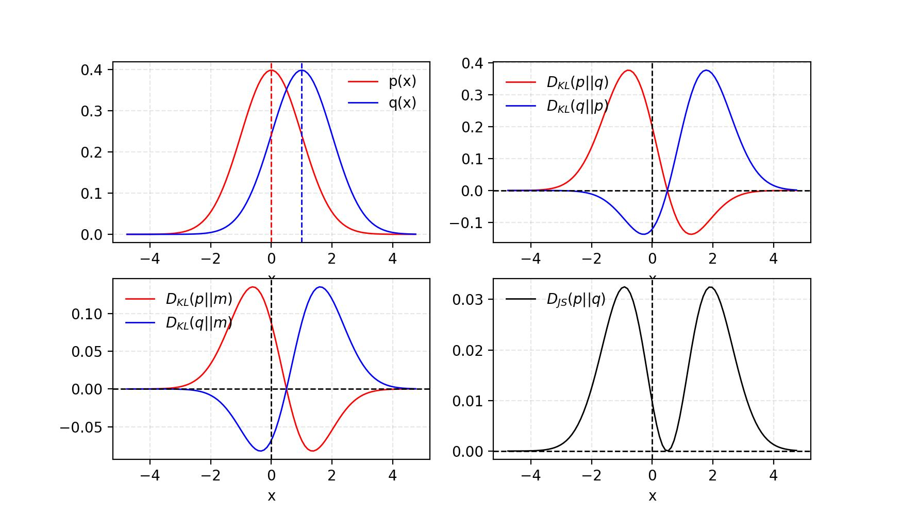
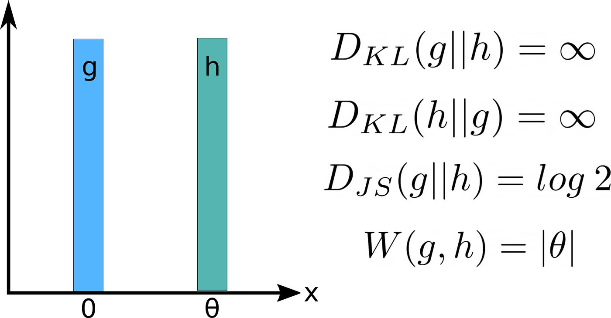

> 작성자 검토 전

앞에서는 두 확률분포의 차이를 측정하는 방법으로 KL Divergence와 Fisher Divergence를 살펴봤다.

KL Divergence는 두 분포가 부여하는 확률밀도를 비교하고, Fisher Divergence는 로그밀도의 기울기를 비교하는 방법이었다.

그런데 두 확률분포를 비교하는 방법이 이것뿐일까?

예를 들어 두 분포에서 같은 사건이 일어날 확률이 얼마나 다른지 비교할 수도 있고, 한 분포를 다른 분포로 바꾸려면 확률질량을 얼마나 멀리 이동해야 하는지 생각할 수도 있다.

결국 **두 확률분포가 얼마나 다른지는 무엇을 기준으로 비교하느냐에 따라 달라질 수 있다.**

이번 절에서는 여러 Divergence를 하나의 수학적 형태로 표현하는 \(f\)-Divergence를 알아보고, Jensen–Shannon Divergence와 Total Variation을 살펴보자.

## Definition 1.9.1 — \(f\)-Divergence

먼저 두 확률분포 \(P,Q\)가 있고, 각각의 밀도함수를 \(p(x),q(x)\)라고 하자.

우리는 1.6절에서 KL Divergence를 다음과 같이 정의했다.

\[
D_{\mathrm{KL}}(P\|Q)
=\mathbb E_{x\sim P}
\left[\log\frac{p(x)}{q(x)}\right].
\]

여기서는 두 밀도의 비율에 로그를 취해 비교했다.

그런데 로그 대신 다른 함수를 사용하면 어떨까?

예를 들어 밀도의 비율을 제곱하거나, 두 밀도의 비율이 1에서 얼마나 벗어났는지를 비교하는 것도 생각할 수 있다.

이러한 방법들을 일반화한 것이 \(f\)-Divergence이다.

함수 \(f:(0,\infty)\to\mathbb R\)가 Convex Function이고 \(f(1)=0\)을 만족한다고 하자.

이때 \(f\)-Divergence는 다음과 같이 정의한다.

\[
\boxed{
D_f(P\|Q)
=
\mathbb E_{x\sim Q}
\left[
f\left(\frac{p(x)}{q(x)}\right)
\right]
}
\]

연속형 분포에서는 다음과 같이 쓸 수도 있다.

\[
D_f(P\|Q)
=
\int q(x)
f\left(\frac{p(x)}{q(x)}\right)\mathrm dx.
\]

우선은 두 밀도가 양수인 경우를 생각하자. 밀도가 0인 영역이 있을 때는 정의를 조금 더 일반화해야 한다.

여기서 \(f\)는 우리가 선택하는 함수다. 어떤 \(f\)를 선택하는지에 따라 서로 다른 Divergence가 만들어진다.

또한 기댓값의 기준이 \(Q\)라는 점에 주의하자. 앞에서 정의한 KL Divergence는 \(P\)를 기준으로 했지만, \(f\)-Divergence의 일반적인 정의에서는 \(Q\)를 기준으로 한다.

### Convex Function은 왜 필요할까?

Convex Function은 간단히 말해 두 점을 잇는 선분이 함수의 그래프보다 아래로 내려가지 않는 함수다. 예를 들어 \(f(t)=t^2\)는 Convex Function이다.

\(f\)-Divergence에서 이러한 조건을 사용하는 이유는 Divergence가 음수가 되지 않도록 하기 위해서다.

이 성질을 Jensen's Inequality로 확인할 수 있다.

## Proposition 1.9.2 — \(f\)-Divergence의 Non-negativity

Jensen's Inequality에 따르면 Convex Function \(f\)에 대해

\[
f(\mathbb E[X])\leq\mathbb E[f(X)]
\]

가 성립한다.

즉, 먼저 평균을 계산한 다음 \(f\)를 적용한 값은, \(f\)를 적용한 다음 평균을 계산한 값보다 크지 않다.

이제 이 관계를 \(f\)-Divergence에 적용해보자.

\[
\begin{aligned}
D_f(P\|Q)
&=\mathbb E_{x\sim Q}
\left[f\left(\frac{p(x)}{q(x)}\right)\right]\\[4pt]
&\geq f\left(
\mathbb E_{x\sim Q}
\left[\frac{p(x)}{q(x)}\right]
\right).
\end{aligned}
\]

그런데 괄호 안의 기댓값을 계산하면

\[
\begin{aligned}
\mathbb E_{x\sim Q}
\left[\frac{p(x)}{q(x)}\right]
&=\int q(x)\frac{p(x)}{q(x)}\,\mathrm dx\\[4pt]
&=\int p(x)\,\mathrm dx\\[4pt]
&=1.
\end{aligned}
\]

마지막 등식은 \(p(x)\)가 확률밀도함수이므로 전체 적분값이 1이기 때문이다.

따라서

\[
D_f(P\|Q)\geq f(1)=0.
\]

결국 다음 결과를 얻는다.

\[
\boxed{D_f(P\|Q)\geq0}
\]

적절한 조건에서 \(f\)-Divergence는 항상 0 이상이다. 또한 \(P=Q\)라면 밀도의 비율이 1이므로 \(D_f(P\|Q)=0\)이 된다.

다만 반대 방향은 주의해야 한다.

\(f\)가 Convex라는 조건만으로 \(D_f(P\|Q)=0\)일 때 반드시 \(P=Q\)라고 할 수는 없다.

예를 들어 \(f(t)=0\)이라는 상수함수도 Convex이고 \(f(1)=0\)을 만족한다. 하지만 이 함수를 사용하면 서로 다른 분포에 대해서도 Divergence가 항상 0이다.

따라서 두 분포가 같을 때에만 Divergence가 0이 되도록 하려면, \(f\)의 Strict Convexity와 같은 추가 조건이 필요하다.

## KL Divergence도 \(f\)-Divergence일까?

이제 \(f\)-Divergence가 왜 유용한 정의인지 살펴보자.

먼저

\[
f(t)=t\log t
\]

라고 선택하자.

\(f\)-Divergence의 정의에 대입하면

\[
\begin{aligned}
D_f(P\|Q)
&=\mathbb E_{x\sim Q}
\left[
\frac{p(x)}{q(x)}
\log\frac{p(x)}{q(x)}
\right]\\[4pt]
&=\int q(x)\frac{p(x)}{q(x)}
\log\frac{p(x)}{q(x)}\,\mathrm dx\\[4pt]
&=\int p(x)\log\frac{p(x)}{q(x)}\,\mathrm dx\\[4pt]
&=D_{\mathrm{KL}}(P\|Q).
\end{aligned}
\]

익숙한 Forward KL이 나왔다.

이번에는

\[
f(t)=-\log t
\]

라고 선택해보자.

\[
\begin{aligned}
D_f(P\|Q)
&=\mathbb E_{x\sim Q}
\left[-\log\frac{p(x)}{q(x)}\right]\\[4pt]
&=\mathbb E_{x\sim Q}
\left[\log\frac{q(x)}{p(x)}\right]\\[4pt]
&=D_{\mathrm{KL}}(Q\|P).
\end{aligned}
\]

이번에는 Reverse KL이다.

즉,

\[
\boxed{
\begin{aligned}
f(t)=t\log t
&\quad\Rightarrow\quad D_{\mathrm{KL}}(P\|Q),\\[4pt]
f(t)=-\log t
&\quad\Rightarrow\quad D_{\mathrm{KL}}(Q\|P).
\end{aligned}
}
\]

서로 다른 두 KL Divergence가 사실은 같은 \(f\)-Divergence의 정의에서 나온다는 것을 알 수 있다.

**어떤 함수 \(f\)를 선택하느냐에 따라 분포 사이의 차이를 평가하는 방식이 달라지는 것이다.**

## Jensen–Shannon Divergence

1.7절에서는 KL Divergence가 대칭적이지 않다는 사실을 배웠다.

\[
D_{\mathrm{KL}}(P\|Q)
\neq
D_{\mathrm{KL}}(Q\|P).
\]

그렇다면 두 분포의 순서에 관계없이 같은 값을 얻는 방법은 없을까?

한 가지 방법은 두 분포를 직접 비교하는 대신, 두 분포를 절반씩 섞은 새로운 분포를 기준으로 비교하는 것이다.

\[
M=\frac12P+\frac12Q.
\]

이 분포는 \(P\)와 \(Q\)를 같은 비율로 섞은 혼합분포다.

예를 들어 두 정규분포 \(P,Q\)가 있다면, \(M\)은 두 정규분포에서 각각 절반의 확률로 값을 뽑는 분포라고 생각하면 된다.

이제 \(P\)와 \(Q\)를 직접 비교하는 대신, 각각을 \(M\)과 비교해보자.

\[
\boxed{
\begin{aligned}
D_{\mathrm{JS}}(P,Q)
&=\frac12D_{\mathrm{KL}}(P\|M)\\[4pt]
&\quad+\frac12D_{\mathrm{KL}}(Q\|M).
\end{aligned}
}
\]

이를 **Jensen–Shannon Divergence(JS Divergence)** 라고 한다. JS Divergence 역시 \(f\)-Divergence의 한 종류다.

*Figure 1.9-1. 두 정규분포와 KL·JS Divergence의 적분항. 우측과 하단 곡선은 각 위치에서 적분되는 항을 나타낸다.*

출처: Lilian Weng, [From GAN to WGAN](https://lilianweng.github.io/posts/2017-08-20-gan/).

### JS Divergence의 특징

먼저 JS Divergence는 대칭적이다.

\[
\boxed{
D_{\mathrm{JS}}(P,Q)
=
D_{\mathrm{JS}}(Q,P)
}
\]

왜냐하면 \(P\)와 \(Q\)의 순서를 바꾸더라도 혼합분포 \(M\)은 달라지지 않고, 두 KL 항의 순서만 바뀌기 때문이다.

또 다른 특징은 JS Divergence가 항상 유한하다는 점이다.

앞에서 KL Divergence는 한 분포가 확률을 부여하는 영역에 다른 분포가 확률 0을 부여하면 무한대가 될 수 있다고 배웠다.

하지만 JS Divergence에서는 \(P,Q\)를 각각 혼합분포 \(M\)과 비교한다.

\[
M=\frac12P+\frac12Q.
\]

따라서 \(P\)가 확률을 부여하는 영역에는 \(M\)도 반드시 확률을 부여한다. \(Q\)에 대해서도 마찬가지다.

실제로 \(m(x)\geq p(x)/2\)이므로 \(p(x)>0\)인 곳에서

\[
\frac{p(x)}{m(x)}\leq2
\]

이다.

따라서

\[
D_{\mathrm{KL}}(P\|M)\leq\log2
\]

이고, \(Q\)에 대해서도 같은 관계가 성립한다.

결국

\[
\boxed{
0\leq D_{\mathrm{JS}}(P,Q)\leq\log2
}
\]

이다. 여기서는 자연로그를 사용했다.

특히 두 분포가 전혀 겹치지 않는다면 JS Divergence는 최댓값인 \(\log2\)가 된다.

이 성질은 KL Divergence와 중요한 차이를 만든다. 두 분포가 완전히 분리되어 있어도 JS Divergence는 무한대로 발산하지 않는다.

## Total Variation Distance

이번에는 조금 다른 관점에서 두 분포를 비교해보자.

어떤 사건 \(A\)가 있다고 하자. 예를 들어 사람들의 키를 비교하는 상황이라면 \(A\)를 '키가 180cm 이상인 경우'라고 정할 수 있다.

두 확률분포 \(P,Q\)가 이 사건에 부여하는 확률은 각각 \(P(A),Q(A)\)이다.

우리는 두 값의 차이를 계산할 수 있다.

\[
|P(A)-Q(A)|.
\]

그렇다면 가능한 모든 사건 중에서 이 차이가 가장 큰 경우는 얼마나 클까?

이를 나타내는 것이 **Total Variation Distance**다.

\[
\boxed{
D_{\mathrm{TV}}(P,Q)
=
\sup_A|P(A)-Q(A)|
}
\]

여기서 \(\sup_A\)는 가능한 모든 사건 \(A\)에 대해 값의 상한 중 가장 작은 것을 구한다는 뜻이다. 이 경우에는 두 분포가 어떤 사건에 부여하는 확률이 최대 얼마나 다를 수 있는지를 나타낸다.

두 분포가 공통 기준에 대한 밀도함수 \(p,q\)를 갖는다면 다음과 같이 표현할 수도 있다.

\[
\boxed{
D_{\mathrm{TV}}(P,Q)
=
\frac12\int|p(x)-q(x)|\,\mathrm dx
}
\]

즉, 두 밀도함수 사이의 절댓값 차이를 전체 영역에서 적분하고 2로 나눈 값이다.

이산분포에서는 적분 대신 합을 사용한다.

### 간단한 예시

동전 두 개의 확률분포를 비교해보자.

첫 번째 동전 \(P\)는 앞면이 나올 확률이 0.8이고, 두 번째 동전 \(Q\)는 앞면이 나올 확률이 0.5라고 하자.

| 결과 | \(P\) | \(Q\) |
|---|---:|---:|
| 앞면 | 0.8 | 0.5 |
| 뒷면 | 0.2 | 0.5 |

Total Variation을 계산하면

\[
\begin{aligned}
D_{\mathrm{TV}}(P,Q)
&=\frac12\left(
|0.8-0.5|+|0.2-0.5|
\right)\\[4pt]
&=\frac12(0.3+0.3)\\[4pt]
&=0.3.
\end{aligned}
\]

앞면이 나오는 사건을 선택하면 두 확률의 차이는 0.3이다. 뒷면이 나오는 사건을 선택해도 차이는 0.3이다.

따라서 이 두 동전의 Total Variation Distance는 0.3이다.

일반적으로

\[
0\leq D_{\mathrm{TV}}(P,Q)\leq1
\]

이며, 두 분포가 같으면 0이고 서로 겹치지 않는다면 1이 된다.

## GAN과의 연결

지금까지는 두 분포의 밀도함수를 이용해 차이를 계산하는 방법을 살펴봤다.

그런데 생성모델에서는 한 가지 문제가 있다. 모델에서 새로운 샘플을 생성할 수 있더라도, 그 샘플의 확률밀도 \(p_\theta(x)\)를 직접 계산하기 어려울 수 있다는 것이다.

1.4절에서 Sampling과 Density Evaluation이 서로 다른 연산이라는 점을 배웠다.

GAN(Generative Adversarial Network)도 이런 상황을 생각해볼 수 있는 모델이다.

GAN에서는 Generator가 새로운 데이터를 생성하고, Discriminator는 실제 데이터와 생성된 데이터를 구분하도록 학습한다.

따라서 모델의 밀도함수를 직접 계산하지 않더라도, **실제 샘플과 생성된 샘플을 얼마나 잘 구별할 수 있는지**를 이용해 두 분포 사이의 차이를 간접적으로 평가할 수 있다.

이러한 접근은 Divergence를 직접 계산하는 것과는 다른 학습 방법을 가능하게 한다.

특히 고전적인 GAN의 목적함수는 이상적인 Discriminator를 가정하면 JS Divergence와 연결된다.

이 관계는 이후 GAN을 본격적으로 공부할 때 다시 살펴볼 것이다.

## Example 1.9.4 — 서로 겹치지 않는 두 분포

마지막으로 지금까지 배운 Divergence들이 어떤 차이를 보이는지 살펴보자.

매우 단순한 두 확률분포를 생각해보자.

첫 번째 분포 \(P\)에서는 항상 0이 나오고, 두 번째 분포 \(Q\)에서는 항상 \(a\)가 나온다고 하자.

\[
P=\delta_0,\qquad Q=\delta_a,
\qquad a\neq0.
\]

여기서 \(\delta_a\)는 위치 \(a\)에 모든 확률질량을 부여하는 점질량(Point Mass)이다.

따라서 \(P\)와 \(Q\)는 서로 다른 위치에 확률질량을 가지고 있으며, 두 분포가 겹치는 영역은 없다.

*Figure 1.9-2. 서로 겹치지 않는 두 분포의 비교. 그림의 g, h, θ는 본문의 P, Q, a에 대응한다.*

출처: Sunil Yadav, [Necessary Probability Concepts for Deep Learning: Part 2](https://medium.com/@sunil7545/kl-divergence-js-divergence-and-wasserstein-metric-in-deep-learning-995560752a53).

### KL Divergence

먼저 KL Divergence를 계산해보자.

\(P\)에서는 0이 반드시 나오지만, \(Q\)에서는 0이 나올 확률이 0이다.

반대 방향에서도 같은 문제가 발생한다.

따라서

\[
\boxed{
D_{\mathrm{KL}}(P\|Q)
=
D_{\mathrm{KL}}(Q\|P)
=
\infty
}
\]

이다.

두 점질량이 서로 다른 위치에 있다는 사실만으로 두 방향의 KL Divergence가 모두 무한대가 된다.

그런데 \(a=0.1\)인 경우와 \(a=100\)인 경우를 생각해보자.

직관적으로는 두 분포 사이의 거리가 상당히 다르다. 하지만 KL Divergence는 두 경우 모두 무한대다.

즉, 이 예에서 KL Divergence는 **두 분포가 겹치지 않는다는 사실은 반영하지만, 실제로 얼마나 멀리 떨어져 있는지는 구분하지 못한다.**

### Jensen–Shannon Divergence

이번에는 JS Divergence를 계산해보자.

혼합분포는 다음과 같다.

\[
M=\frac12\delta_0+\frac12\delta_a.
\]

\(M\)에서는 0과 \(a\)가 각각 절반의 확률로 나온다.

따라서

\[
D_{\mathrm{KL}}(P\|M)=\log2
\]

이고,

\[
D_{\mathrm{KL}}(Q\|M)=\log2
\]

이다.

JS Divergence에 대입하면

\[
\begin{aligned}
D_{\mathrm{JS}}(P,Q)
&=\frac12\log2+\frac12\log2\\[4pt]
&=\log2.
\end{aligned}
\]

결국

\[
\boxed{D_{\mathrm{JS}}(P,Q)=\log2}
\]

이다.

KL Divergence와 달리 무한대가 되지는 않는다.

하지만 두 점질량이 아무리 가까이 있더라도, 위치가 정확히 같지 않은 한 JS Divergence는 항상 \(\log2\)이다.

따라서 JS Divergence 역시 이 예에서는 두 점질량 사이의 실제 거리를 구분하지 못한다.

### Total Variation

Total Variation도 계산해보자.

\(A=\{0\}\)이라는 사건을 선택하면

\[
P(A)=1,\qquad Q(A)=0
\]

이다.

따라서

\[
|P(A)-Q(A)|=1
\]

이며, 확률의 차이는 1보다 클 수 없으므로

\[
\boxed{D_{\mathrm{TV}}(P,Q)=1}
\]

이다.

여기서도 결과는 동일한 문제를 가진다. \(a=0.1\)이든 \(a=100\)이든 두 분포가 겹치지 않으므로 Total Variation은 항상 1이다.

### Wasserstein Distance와 비교

그렇다면 두 분포가 얼마나 멀리 떨어져 있는지를 직접 반영하는 방법은 없을까?

한 가지 방법이 Wasserstein Distance이다.

Wasserstein Distance는 한 분포의 확률질량을 다른 분포로 옮길 때 필요한 이동 비용을 기준으로 두 분포를 비교한다.

일차원에서 이동 거리 자체를 비용으로 사용하는 Wasserstein-1 Distance를 생각해보자.

이번 예에서는 위치 0의 확률질량을 위치 \(a\)로 옮기면 된다.

따라서

\[
\boxed{W_1(\delta_0,\delta_a)=|a|}
\]

가 된다.

이제 두 분포가 멀어질수록 Wasserstein Distance도 커진다.

예를 들어 \(a=0.1\)이면 0.1이고, \(a=100\)이면 100이다.

지금까지의 결과를 정리하면 다음과 같다.

| 비교 방법 | \(P=\delta_0,\ Q=\delta_a,\ a\neq0\) |
|---|---|
| Forward KL | \(\infty\) |
| Reverse KL | \(\infty\) |
| JS Divergence | \(\log2\) |
| Total Variation | \(1\) |
| Wasserstein-1 | \(\lvert a\rvert\) |

앞의 네 가지 방법은 두 점질량이 서로 겹치지 않는다는 사실은 알 수 있지만, 그 사이의 거리가 얼마나 되는지는 구분하지 못한다.

반면 Wasserstein Distance는 실제 이동 거리를 반영한다.

물론 \(a=0\)이면 두 분포가 완전히 같아지므로 모든 값은 0이 된다.

이 예는 분포 사이의 차이를 측정하는 방법을 선택하는 일이 왜 중요한지 보여준다.

어떤 Divergence를 사용하느냐에 따라 같은 두 분포를 비교하더라도 얻을 수 있는 정보가 달라지기 때문이다.

---

이번 절에서는 \(f\)-Divergence를 통해 여러 Divergence를 하나의 형태로 표현할 수 있다는 것을 확인했다.

KL Divergence는 \(f\)-Divergence의 특별한 경우이고, Jensen–Shannon Divergence는 대칭적이며 항상 유한하다는 특징을 가진다. Total Variation은 두 분포가 같은 사건에 부여하는 확률의 최대 차이를 측정한다.

하지만 이러한 방법들이 언제나 우리가 직관적으로 생각하는 분포 사이의 거리를 나타내는 것은 아니다.

특히 서로 겹치지 않는 두 점질량 예제에서는 KL, JS, Total Variation과 Wasserstein Distance가 서로 다른 정보를 제공했다.

따라서 생성모델을 학습할 때는 단순히 두 분포의 차이를 최소화한다는 것뿐 아니라, **어떤 차이를 측정하는 목적함수를 사용하고 있는지**도 중요하게 생각해야 한다.
