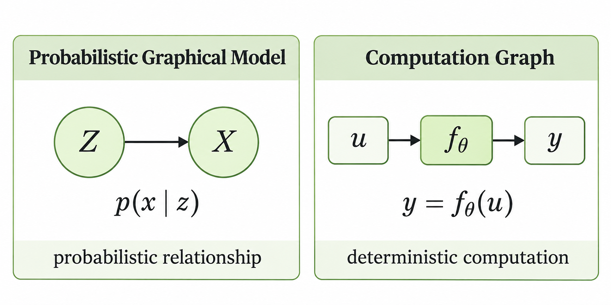

> 작성자 검토 전

## 2.1 Why Graphical Models?

여러 확률변수를 함께 다루다 보면, 각 변수가 어떤 분포를 따르는지만큼이나 **변수들이 서로 어떤 관계를 맺고 있는지**도 중요해진다.

예를 들어 어떤 변수들이 서로 관련되어 있는지, 특정 변수의 값을 알게 되면 다른 변수의 분포가 어떻게 달라지는지 궁금할 수 있다. 이러한 관계를 복잡한 확률식으로만 표현하면 전체 구조를 한눈에 파악하기 어렵다.

**Probabilistic Graphical Model(PGM)**은 확률변수 사이의 관계를 그래프로 표현하는 방법이다. 각 노드는 확률변수를 나타내고, 노드 사이의 연결은 변수들 사이의 확률적 관계를 나타낸다.

간단하게 다음과 같은 그래프를 생각해보자.

$$
Z \longrightarrow X
$$

이 그래프는 $Z$와 $X$ 사이의 관계를 조건부 확률분포 $p(x\mid z)$로 표현할 수 있다는 뜻이다.

즉, $Z=z$라는 값이 주어졌을 때 $X$의 값이 따르는 분포를 나타낸다. 이때 $Z$의 값이 정해졌다고 해서 $X$의 값까지 반드시 하나로 결정되는 것은 아니다.

*Probabilistic Graphical Model은 확률변수 사이의 관계를, Neural Network의 Computation Graph는 값이 계산되는 과정을 표현한다.*

여기서 주의할 점은 이러한 그래프가 Neural Network의 **Computation Graph**와는 다르다는 것이다.

Computation Graph에서 화살표는 어떤 값이 다음 연산에 입력되어 결과를 계산하는 과정을 나타낸다. 반면 Probabilistic Graphical Model의 화살표는 확률변수 사이의 조건부 분포를 구성하는 관계를 나타낸다. 화살표가 있다고 해서 반드시 결정적인 계산 관계이거나 인과관계가 성립한다는 뜻은 아니다.

결국 Graphical Model의 목적은 복잡한 확률분포를 구성하는 **변수들 사이의 관계를 명시적으로 드러내는 것**이다.
