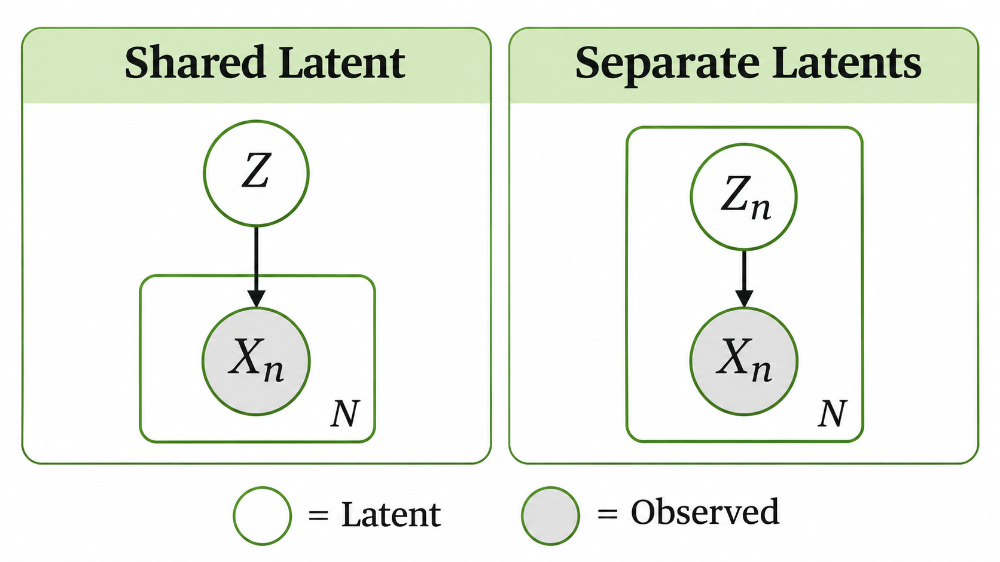

> 작성자 검토 전

## 2.10 Observed and Latent Variables

지금까지 Graphical Model에서는 각 노드를 확률변수로 표현했다. 그런데 모델에 포함된 모든 확률변수의 값을 우리가 실제로 관측할 수 있는 것은 아니다.

예를 들어 여러 사람의 키를 조사했다고 하자. 각 사람의 키는 데이터에 기록되어 있지만, 그 사람이 어떤 집단에 속하는지는 알지 못할 수도 있다.

이처럼 **현재 데이터에서 값이 알려진 변수를 Observed Variable(관측변수)**, 모델에는 존재하지만 값이 관측되지 않은 변수를 Latent Variable(잠재변수)이라고 한다.

관측변수를 $X$, 잠재변수를 $Z$라고 하자. 모델에서 두 변수의 결합분포 $p(x,z)$를 정의했더라도, 실제로 우리가 관측한 것은 $X$의 값뿐이다.

그렇다면 관측한 데이터의 분포 $p(x)$는 어떻게 구할까?

잠재변수 $Z$의 값을 모르므로, $Z$가 가질 수 있는 모든 경우를 반영하면 된다.

$$
\boxed{
p(x)=\sum_z p(x,z)
}
$$

이를 잠재변수에 대한 **Marginalization(주변화)**이라고 한다. 잠재변수의 값은 알 수 없지만, 가능한 모든 값을 합해 관측변수의 분포를 계산하는 것이다.

잠재변수 $Z$가 연속형이라면 합 대신 적분을 사용한다.

$$
p(x)=\int p(x,z)\,\mathrm dz.
$$

이때 $X$도 연속형이라면 $p(x)$는 확률밀도이며, 정확히 $X=x$가 될 확률을 의미하는 것은 아니다.

### Shared Latent Variable과 Separate Latent Variables

여러 개의 데이터를 관측하는 상황에서는 잠재변수를 어떻게 배치하는지도 중요하다.

관측변수 $X_1,\ldots,X_N$이 있다고 하자.

첫 번째 방법은 **하나의 잠재변수 $Z$를 모든 관측값이 공유하는 것**이다.

예를 들어 하나의 공통된 숨은 특성이 여러 관측값의 분포에 영향을 주는 상황을 생각할 수 있다.

이 모델에서 $Z$가 주어졌을 때 관측값들이 서로 조건부 독립이라고 가정하면

$$
p(x_1,\ldots,x_N\mid z)
=
\prod_{n=1}^{N}p(x_n\mid z)
$$

로 표현할 수 있다.

하지만 $Z$를 관측하지 못한다면 이를 주변화해야 한다.

$$
p(x_1,\ldots,x_N)
=
\sum_z p(z)\prod_{n=1}^{N}p(x_n\mid z).
$$

여기서 중요한 점은, $Z$가 주어졌을 때 독립이었던 관측값들이 $Z$를 주변화한 뒤에도 반드시 독립인 것은 아니라는 것이다.

모든 관측값이 같은 잠재변수를 공유하기 때문에, 그 값을 모르는 상황에서는 관측값들 사이에 의존성이 나타날 수 있다.

*하나의 잠재변수를 공유하는 모델과 관측값마다 별도의 잠재변수를 갖는 모델.*

반대로 각 관측값 $X_n$마다 별도의 잠재변수 $Z_n$을 둘 수도 있다.

$$
Z_n\longrightarrow X_n,
\qquad n=1,\ldots,N.
$$

각 $Z_n$을 독립적으로 추출하고, $X_n$도 자신의 $Z_n$을 조건으로 독립적으로 생성한다고 하자. 이때 모든 관측값이 동일한 고정 매개변수 $\theta$를 사용하더라도, 잠재변수를 주변화한 관측값들은 서로 독립이다.

$$
p(x_1,\ldots,x_N\mid\theta)
=
\prod_{n=1}^{N}p(x_n\mid\theta).
$$

즉, 공통 매개변수를 사용한다는 사실만으로 관측값들이 종속적이 되는 것은 아니다.

여러 관측값이 하나의 잠재변수를 공유하는지, 각 관측값이 독립적인 잠재변수를 갖는지에 따라 서로 다른 확률모형이 만들어지는 것이다.

다음 절에서는 관측값마다 별도의 잠재변수를 사용하는 대표적인 예인 Mixture Model을 살펴보자.
