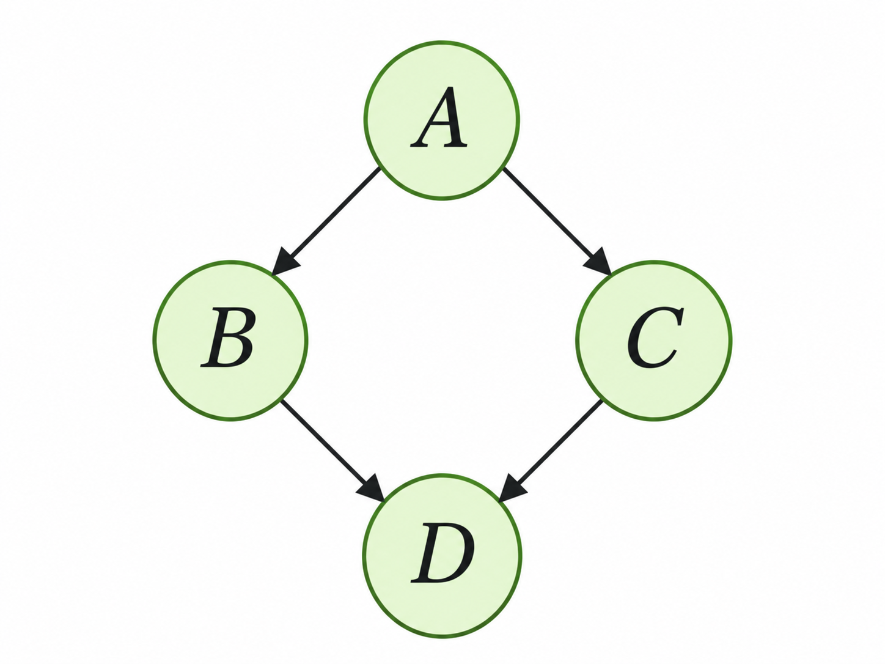

> 작성자 검토 전

## 2.3 DAG (Directed Acyclic Graphs)

앞 절에서는 여러 확률변수를 결합분포와 조건부분포로 표현하는 방법을 살펴봤다. 이제 이 변수들 사이의 관계를 그래프로 나타내보자.

Probabilistic Graphical Model에서는 확률변수를 노드(Node)로 표현하고, 변수들 사이의 관계를 연결선(Edge)으로 나타낸다.

이번 절에서는 그중에서도 화살표로 방향을 표시하는 그래프를 다룬다.

### Definition 2.3.1 — Directed Acyclic Graph

먼저 **Directed Graph**는 각 연결선에 방향이 있는 그래프다.

수학적으로는 다음과 같이 표현한다.

$$
G=(V,E)
$$

여기서 $V$는 노드들의 집합이고, $E$는 방향이 있는 연결선들의 집합이다.

각 노드에는 확률변수를 대응시킬 수 있다. 예를 들어 $A\rightarrow B$라는 연결은 $A$에서 $B$로 향하는 방향이 있는 관계를 나타낸다.

그런데 Directed Graph라고 해서 모두 DAG인 것은 아니다.

DAG는 Directed Acyclic Graph의 약자로, **Directed Cycle이 존재하지 않는 방향 그래프**를 의미한다.

Directed Cycle이란 화살표의 방향을 따라 이동하다가 다시 출발한 노드로 돌아오는 경로다.

예를 들어

$$
A\rightarrow B\rightarrow C\rightarrow A
$$

라는 구조에서는 $A$에서 출발해 화살표를 따라가면 다시 $A$로 돌아올 수 있다. 따라서 이 그래프는 DAG가 아니다.

반대로 화살표를 따라 이동했을 때 어떤 노드에서도 자기 자신으로 돌아오는 경로가 없다면 DAG라고 부른다.

다음과 같은 그래프를 생각해보자.

*네 개의 노드 $A,B,C,D$로 이루어진 DAG. 화살표는 $A\rightarrow B$, $A\rightarrow C$, $B\rightarrow D$, $C\rightarrow D$를 나타낸다.*

이 그래프에서는 $A$에서 $B$나 $C$로 이동하고, 다시 $D$로 이동할 수 있다. 하지만 $D$에서 출발점으로 돌아가는 화살표는 없다. 따라서 Directed Cycle이 존재하지 않는다.

### Definition 2.3.2 — Relatives of a Node

그래프에서 노드 사이의 관계를 표현할 때는 Parent, Child, Ancestor, Descendant라는 용어를 사용한다.

먼저 **Parent(부모)**는 어떤 노드로 직접 화살표가 들어오는 노드를 말한다. 반대로 **Child(자식)**는 해당 노드에서 화살표가 직접 나가는 노드다.

예를 들어 앞의 그래프에서 $D$에는 $B$와 $C$로부터 화살표가 들어온다.

따라서 $D$의 부모 노드 집합은

$$
\mathrm{Pa}(D)=\{B,C\}
$$

이다.

반대로 $A$에서는 $B$와 $C$로 화살표가 나가므로

$$
\mathrm{Ch}(A)=\{B,C\}
$$

이다.

Parent와 Child는 직접 연결된 노드 사이의 관계를 나타낸다.

그런데 한 번의 연결뿐 아니라, 여러 화살표를 거쳐 도달하는 관계도 생각할 수 있다. 이때 사용하는 개념이 **Ancestor(조상)**와 **Descendant(자손)**다.

어떤 노드에서 화살표의 방향을 따라 이동해 다른 노드에 도달할 수 있다면, 출발한 노드는 도착한 노드의 Ancestor가 된다.

예를 들어 $A$에서 $D$로 직접 연결된 화살표는 없지만

$$
A\rightarrow B\rightarrow D
$$

라는 경로가 존재한다.

따라서 $A$도 $D$의 Ancestor다. $B$와 $C$ 역시 $D$에 직접 연결되어 있으므로

$$
\mathrm{Anc}(D)=\{A,B,C\}
$$

가 된다.

반대로 $A$에서 화살표를 따라 도달할 수 있는 노드들은 $A$의 Descendant다.

$$
\mathrm{Desc}(A)=\{B,C,D\}
$$

여기서 중요한 것은 두 관계 모두 **화살표의 방향을 따라가는 경로**로 정의된다는 점이다.

Ancestor를 찾을 때는 다른 노드에서 현재 노드로 들어오는 경로를 확인하고, Descendant를 찾을 때는 현재 노드에서 다른 노드로 나가는 경로를 확인한다. 단순히 연결되어 있다는 이유만으로 조상이나 자손이 되는 것은 아니다.

마지막으로 **Non-descendants**는 자기 자신도 아니고 자신의 Descendant도 아닌 노드들의 집합이다.

노드 $i$의 Non-descendants를 $\mathrm{nd}(i)$라고 하면

$$
\mathrm{nd}(i)
=
V\setminus
\left(\{i\}\cup\mathrm{Desc}(i)\right)
$$

로 표현할 수 있다.

예를 들어 $B$의 Descendant는 $D$뿐이다.

$$
\mathrm{Desc}(B)=\{D\}
$$

따라서

$$
\mathrm{nd}(B)=\{A,C\}
$$

이다.

$A$는 $B$의 Parent이고, $C$는 $B$와 직접 연결되어 있지 않다. 하지만 둘 다 $B$에서 화살표를 따라 도달할 수 있는 노드는 아니므로 Non-descendants에 포함된다.

### Definition 2.3.3 — Topological Ordering

DAG에는 한 가지 유용한 성질이 있다. 노드들을 화살표의 방향에 어긋나지 않도록 순서대로 나열할 수 있다는 것이다.

이를 **Topological Ordering(위상 정렬)**이라고 한다.

구체적으로 모든 화살표 $i\rightarrow j$에 대해, $i$가 $j$보다 먼저 등장하도록 노드들을 나열하는 것이다.

앞의 그래프를 다시 생각해보자.

$A$는 $B$와 $C$보다 먼저 등장해야 하고, $B$와 $C$는 모두 $D$보다 먼저 등장해야 한다.

따라서

$$
A,\ B,\ C,\ D
$$

는 올바른 Topological Ordering이다.

그런데 $B$와 $C$ 사이에는 어느 쪽이 먼저 등장해야 한다는 제약이 없다. 따라서

$$
A,\ C,\ B,\ D
$$

도 가능하다.

즉, **Topological Ordering은 반드시 하나로 결정되는 것은 아니다.**

모든 유한한 DAG에는 적어도 하나의 Topological Ordering이 존재한다. Directed Cycle이 없으므로 부모가 없는 노드를 찾을 수 있고, 그 노드를 먼저 배치하는 과정을 반복할 수 있기 때문이다.

이처럼 DAG에서는 확률변수들을 그래프의 방향에 맞춰 순서대로 배열할 수 있다.

이 성질은 다음 절에서 각 변수의 분포를 부모 변수에 대한 조건부분포로 표현하고, 이를 결합분포와 연결할 때 중요한 역할을 한다.
