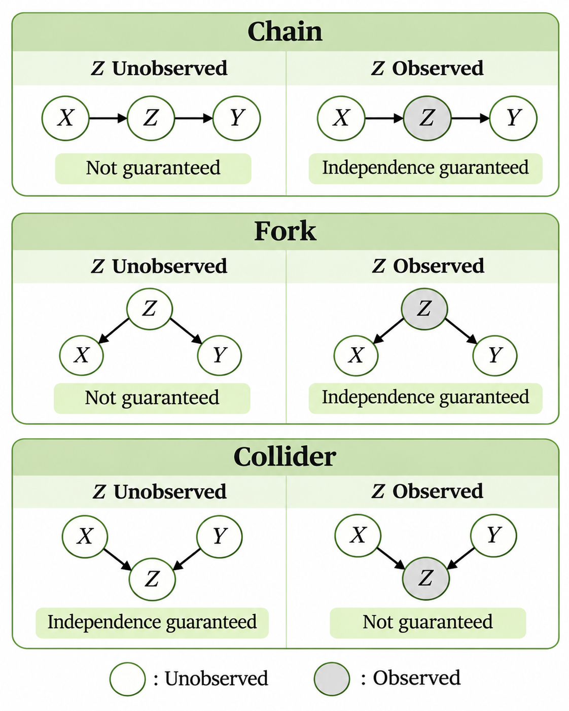

> 작성자 검토 전

## 2.6 The three fundamental structures

앞 절에서는 독립과 조건부 독립이 서로 다른 개념이라는 것을 배웠다. 두 변수가 원래는 독립이 아니더라도 다른 변수의 값을 알고 나면 조건부 독립이 될 수 있고, 반대로 독립이었던 변수들이 조건부에서는 독립이 아닐 수도 있었다.

Graphical Model에서는 이러한 관계를 그래프의 구조를 통해 살펴볼 수 있다.

특히 세 개의 확률변수로 이루어진 가장 기본적인 구조는 Chain, Fork, Collider 세 가지다. 각각의 구조에서 결합분포를 어떻게 표현하는지, 그리고 중간 변수 $Z$를 관측하면 무엇이 달라지는지 살펴보자.

아래 계산은 이산형 변수를 기준으로 하며, 조건부분포는 $p(z)>0$인 $z$에서 계산한다. 연속형에서는 확률밀도와 적분으로 같은 계산을 한다.

### 1. Chain — $X\rightarrow Z\rightarrow Y$

먼저 다음과 같은 그래프를 생각해보자.

$$
X\longrightarrow Z\longrightarrow Y
$$

$X$에서 $Z$로, 다시 $Z$에서 $Y$로 화살표가 이어지는 구조다.

앞 절에서 배운 Factorization을 적용하면 결합분포는 다음과 같다.

$$
\boxed{
p(x,z,y)=p(x)p(z\mid x)p(y\mid z)
}
$$

이제 $Z$를 관측하지 않은 상황에서 $X$와 $Y$의 관계를 생각해보자.

$Z$의 값을 모르므로 결합분포에서 $Z$를 제거하려면 가능한 모든 값에 대해 합해야 한다.

$$
p(x,y)
=p(x)\sum_z p(z\mid x)p(y\mid z).
$$

여기서 합 안의 값은 일반적으로 $x$에 따라 달라질 수 있다. 따라서 $p(x,y)$가 반드시 $p(x)p(y)$로 나누어지는 것은 아니다.

즉, **Chain 구조에서는 $Z$를 관측하지 않았을 때 $X$와 $Y$의 독립성이 보장되지 않는다.**

그렇다면 $Z=z$라는 값을 관측하면 어떻게 될까?

이번에는 조건부분포 $p(x,y\mid z)$를 계산해보자.

$$
\begin{aligned}
p(x,y\mid z)
&=\frac{p(x,z,y)}{p(z)}\\[4pt]
&=\frac{p(x)p(z\mid x)p(y\mid z)}{p(z)}\\[4pt]
&=\underbrace{\frac{p(x)p(z\mid x)}{p(z)}}_{p(x\mid z)}
p(y\mid z)\\[4pt]
&=p(x\mid z)p(y\mid z).
\end{aligned}
$$

마지막 식은 조건부 독립의 정의와 정확히 일치한다.

$$
\boxed{X\perp Y\mid Z}
$$

따라서 Chain에서는 $Z$의 값을 알고 나면 $X$와 $Y$가 조건부 독립이 된다.

직관적으로는 두 변수 사이에 있는 $Z$의 값을 이미 알고 있으므로, $X$에 관한 추가 정보가 $Y$의 조건부분포를 더 이상 바꾸지 않는다고 이해할 수 있다.

### 2. Fork — $X\leftarrow Z\rightarrow Y$

이번에는 두 화살표가 모두 $Z$에서 시작하는 구조를 생각해보자.

$$
X\longleftarrow Z\longrightarrow Y
$$

이 구조에서는 $Z$가 $X$와 $Y$의 공통 부모 노드다.

결합분포는 다음과 같이 표현된다.

$$
\boxed{
p(x,z,y)=p(z)p(x\mid z)p(y\mid z)
}
$$

먼저 $Z$를 관측하지 않은 상황을 살펴보자.

$$
p(x,y)
=\sum_z p(z)p(x\mid z)p(y\mid z).
$$

두 변수의 분포가 모두 $Z$에 따라 달라질 수 있으므로, $Z$를 모르는 상황에서는 $X$와 $Y$가 서로 관련되어 있을 수 있다.

하지만 $Z$의 값을 알고 있다면 이야기가 달라진다.

$$
\begin{aligned}
p(x,y\mid z)
&=\frac{p(x,z,y)}{p(z)}\\[4pt]
&=\frac{p(z)p(x\mid z)p(y\mid z)}{p(z)}\\[4pt]
&=p(x\mid z)p(y\mid z).
\end{aligned}
$$

따라서

$$
\boxed{X\perp Y\mid Z}
$$

가 성립한다.

예를 들어 $Z$가 날씨, $X$가 우산 판매량, $Y$가 빗길 교통량이라고 생각해보자. 두 변수 모두 날씨와 관련되어 있으므로 서로 관계가 나타날 수 있다.

하지만 날씨가 주어졌을 때 두 변수가 조건부 독립이라고 가정한 모델이라면, 날씨를 알고 있는 상태에서 한 변수의 값은 다른 변수의 분포에 추가적인 정보를 주지 않는다.

이처럼 Fork에서는 공통 부모인 $Z$를 조건으로 주면 두 변수 사이의 조건부 독립이 성립한다.

Chain과 Fork는 그래프의 모양은 다르지만, **중간 변수 $Z$를 관측하면 $X$와 $Y$가 조건부 독립이 된다는 점**에서는 같다.

### 3. Collider — $X\rightarrow Z\leftarrow Y$

마지막으로 두 화살표가 모두 $Z$를 향하는 구조를 생각해보자.

$$
X\longrightarrow Z\longleftarrow Y
$$

이처럼 두 화살표가 만나는 중간 노드를 Collider라고 한다.

앞의 두 구조와 달리, 이번에는 결합분포가

$$
\boxed{
p(x,z,y)=p(x)p(y)p(z\mid x,y)
}
$$

로 표현된다.

먼저 $Z$를 관측하지 않은 상황에서 $X$와 $Y$의 결합분포를 구해보자.

$$
\begin{aligned}
p(x,y)
&=\sum_z p(x,z,y)\\[4pt]
&=p(x)p(y)\sum_z p(z\mid x,y)\\[4pt]
&=p(x)p(y).
\end{aligned}
$$

여기서

$$
\sum_z p(z\mid x,y)=1
$$

인 이유는 $p(z\mid x,y)$가 올바르게 정규화된 조건부분포이기 때문이다.

따라서

$$
\boxed{X\perp Y}
$$

를 얻는다.

즉, **Collider 구조에서는 $Z$를 관측하지 않았을 때 $X$와 $Y$가 독립이다.**

그런데 $Z$를 관측하면 어떻게 될까?

$$
p(x,y\mid z)
=\frac{p(x)p(y)p(z\mid x,y)}{p(z)}.
$$

이 식에는 $x,y$를 함께 조건으로 사용하는 $p(z\mid x,y)$가 남아 있다. 따라서 앞의 Chain이나 Fork에서처럼 $p(x\mid z)p(y\mid z)$로 분해된다고 보장할 수 없다.

이 차이를 이해하기 위해 경보가 울리는 상황을 생각해보자.

서로 독립적인 두 요인 $X,Y$가 있고, 각각 경보 $Z$가 울릴 가능성과 관련되어 있다고 하자.

경보가 울렸다는 사실을 모른다면 두 요인은 독립이다.

그런데 경보가 울렸다는 사실을 알고 있다면, 한 요인이 경보를 설명한다는 정보를 얻었을 때 다른 요인에 대한 판단도 달라질 수 있다.

이처럼 관측된 결과를 설명하는 과정에서 한 변수에 관한 정보가 다른 변수의 가능성을 바꾸는 현상을 **Explaining Away**라고 한다.

Collider에서는 $Z$를 직접 관측할 때뿐 아니라, $Z$의 자손 노드를 관측할 때도 이러한 관계가 나타날 수 있다.

*Chain, Fork, Collider에서 중간 변수 $Z$의 관측 여부에 따라 달라지는 독립성의 보장 여부.*

여기서 세 구조의 차이를 정리해보자.

- **Chain:** $Z$를 관측하면 $X\perp Y\mid Z$가 보장된다.
- **Fork:** $Z$를 관측하면 $X\perp Y\mid Z$가 보장된다.
- **Collider:** $Z$를 관측하지 않으면 $X\perp Y$가 보장되지만, $Z$를 관측하면 그 보장이 사라질 수 있다.

이러한 차이를 설명할 때 경로가 Active 또는 Blocked되었다고 표현한다.

다만 **Active Path가 존재한다는 것이 반드시 두 변수가 종속적이라는 뜻은 아니다.** 그래프의 구조만으로 독립성을 보장할 수 없다는 의미이며, 특정한 확률분포에서는 실제로 독립일 수도 있다.

지금까지는 세 변수로 이루어진 간단한 그래프만 살펴봤다. 하지만 실제 Graphical Model에서는 여러 경로가 동시에 존재할 수 있다.

그렇다면 어떤 변수들을 관측했을 때 두 노드 사이의 독립성이 보장되는지는 어떻게 판단할 수 있을까?

다음 절에서는 이러한 문제를 다루는 d-separation을 살펴본다.
