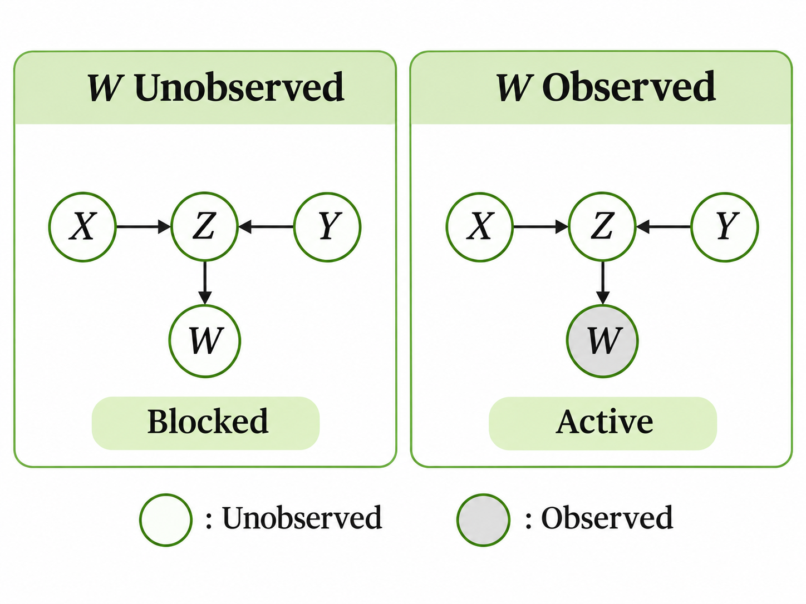

> 작성자 검토 전

## 2.7 d-separation

앞 절에서는 Chain, Fork, Collider라는 세 가지 기본 구조를 살펴봤다.

Chain과 Fork에서는 중간 노드를 관측하면 양 끝 변수가 조건부 독립이 되었다. 반면 Collider에서는 중간 노드를 관측하지 않았을 때 양 끝 변수의 독립성이 보장되었다.

그런데 실제 Graphical Model은 세 개보다 훨씬 많은 노드로 이루어질 수 있다. 두 노드 사이에 여러 경로가 존재할 수도 있고, 각 경로에는 앞에서 배운 세 가지 구조가 섞여 있을 수도 있다.

이런 상황에서 어떤 변수들을 관측했을 때 두 변수의 조건부 독립이 보장되는지를 판단하는 방법이 **d-separation**이다.

### Definition 2.7.1 — Path, Collider, Active Path

먼저 그래프에서 Path가 무엇인지 알아보자.

**Path(경로)**는 서로 연결된 노드들을 차례대로 이어가는 것으로, 여기서는 같은 노드를 반복해서 지나지 않는 경로를 생각한다.

예를 들어

$$
A\rightarrow B\leftarrow C\rightarrow D
$$

라는 그래프가 있다면

$$
A-B-C-D
$$

는 하나의 Path다.

여기서 중요한 점은 **Path를 찾을 때 화살표의 방향을 반드시 따라갈 필요는 없다**는 것이다.

위 그래프에서 $A$에서 $D$로 화살표만 따라 이동할 수는 없지만, 연결된 노드들을 따라가는 Path는 존재한다.

그렇다면 화살표의 방향은 언제 중요할까?

경로에 있는 각 중간 노드가 Collider인지 판단할 때다.

앞 절에서 배운 것처럼

$$
X\rightarrow Z\leftarrow Y
$$

에서 $Z$는 Collider다. 경로의 양쪽 화살표가 모두 $Z$를 향하기 때문이다.

반면

$$
X\rightarrow Z\rightarrow Y
$$

또는

$$
X\leftarrow Z\rightarrow Y
$$

에서는 $Z$가 Collider가 아니다. 이런 중간 노드를 Non-collider라고 부른다.

따라서 Collider인지 여부는 노드 자체에 영구적으로 정해진 성질이 아니라, **지금 살펴보는 경로에서 양쪽 화살표가 어떤 방향으로 연결되어 있는지**에 따라 결정된다.

이제 어떤 변수들을 관측했는지 나타내는 집합을 $S$라고 하자.

경로가 **Active**하다는 것은 다음 두 조건을 모두 만족한다는 뜻이다.

1. 경로에 있는 모든 Non-collider는 $S$에 포함되지 않아야 한다.
2. 경로에 있는 모든 Collider는 자기 자신 또는 자신의 Descendant 중 적어도 하나가 $S$에 포함되어야 한다.

첫 번째 조건은 Chain과 Fork를 떠올리면 이해하기 쉽다.

이 두 구조에서는 중간 노드가 Non-collider였고, 이를 관측하면 경로가 Blocked되었다.

두 번째 조건은 반대로 작용한다.

Collider는 자기 자신이나 그 자손이 관측되지 않으면 경로를 차단한다. 하지만 Collider 자신 또는 자손 중 하나가 관측되면 해당 경로가 Active해질 수 있다.

**두 조건을 모두 만족하는 경로가 Active Path이고, 그렇지 않은 경로는 Blocked Path다.**

### Collider의 자손을 관측하는 경우

Collider의 자손을 관측한다는 것이 무엇을 의미하는지 간단한 그래프로 살펴보자.

$$
X\rightarrow Z\leftarrow Y,
\qquad Z\rightarrow W.
$$

여기서 $Z$는 $X$와 $Y$ 사이의 Collider이고, $W$는 $Z$의 자손이다.

먼저 아무 변수도 관측하지 않았다고 하자.

이때 $X-Z-Y$ 경로의 Collider인 $Z$와 그 자손 $W$는 모두 관측되지 않았다. 따라서 이 경로는 Blocked되어 있다.

이번에는 $Z$를 직접 관측하지 않고 $W$만 관측했다고 하자.

그러면 Collider인 $Z$의 자손이 관측된 것이므로, $X-Z-Y$ 경로는 Active해진다.

*Collider $Z$의 자손 $W$를 관측하면, $X$와 $Y$ 사이의 경로가 활성화될 수 있다.*

이 조건은 $W$가 $Z$의 값을 완벽하게 알려주는 경우에만 적용되는 것이 아니다. 그래프에서 Collider의 자손이 관측되었다는 사실 자체가 경로의 활성 여부를 판정하는 기준이다.

이제 개별 경로가 Active한지 판단할 수 있게 되었다. 이를 이용해 두 노드 사이의 독립성을 살펴보자.

### Definition 2.7.2 — d-separation

그래프에서 서로 겹치지 않는 세 노드 집합 $A,B,S$가 있다고 하자.

우리가 알고 싶은 것은 $S$에 속한 변수들을 관측했을 때, $A$와 $B$에 속한 변수들 사이의 조건부 독립이 보장되는지 여부다.

앞에서 배운 방법으로 $A$와 $B$ 사이의 경로들을 살펴볼 수 있다.

**$A$와 $B$ 사이의 모든 Path가 $S$에 의해 Blocked되어 있다면, $A$와 $B$는 $S$에 의해 d-separated되었다고 한다.**

여기서 중요한 것은 모든 경로를 확인해야 한다는 점이다.

두 노드 사이에 세 개의 경로가 있는데 그중 두 개만 Blocked되었다면, 아직 하나의 Active Path가 남아 있다.

따라서 이 경우에는 d-separated되었다고 할 수 없다.

반대로 가능한 모든 경로가 Blocked되어 있다면 두 노드 사이에는 Active Path가 존재하지 않는다. 이때 d-separation이 성립한다.

즉, 개별 경로의 활성 여부를 판단한 다음, 이를 두 노드 집합 사이의 모든 경로에 적용하는 것이 d-separation의 핵심이다.

### Theorem 2.7.3 — d-separation과 조건부 독립

그렇다면 d-separation이 성립한다는 사실은 확률분포에 대해 무엇을 알려줄까?

DAG $G$에 따라 결합분포가 Factorization된다고 하자.

즉, 2.4절에서 배운 것처럼 각 노드의 부모에 대한 조건부분포들을 곱해 결합분포를 표현할 수 있는 경우다.

이때 서로 겹치지 않는 노드 집합 $A,B,S$에 대해, $A$와 $B$가 $S$에 의해 d-separated되어 있다면

$$
\boxed{
X_A\perp X_B\mid X_S
}
$$

가 성립한다.

여기서 $X_A$, $X_B$, $X_S$는 각각의 노드 집합에 대응하는 확률변수들을 나타낸다.

즉, **그래프에서 모든 경로가 차단되어 있다는 사실만으로 해당 확률변수들의 조건부 독립을 보장할 수 있다.**

이것이 d-separation이 중요한 이유다.

복잡한 결합분포를 직접 계산하지 않더라도, 그래프의 구조와 어떤 변수들이 관측되었는지를 이용해 조건부 독립 관계를 확인할 수 있기 때문이다.

결국 d-separation은 앞 절의 Chain, Fork, Collider 규칙을 여러 경로가 존재하는 그래프로 확장한 개념이다.

각 경로에서 Collider와 Non-collider를 구분하고 관측 여부를 확인한 다음, 모든 경로가 Blocked되었는지 판단하면 된다.
