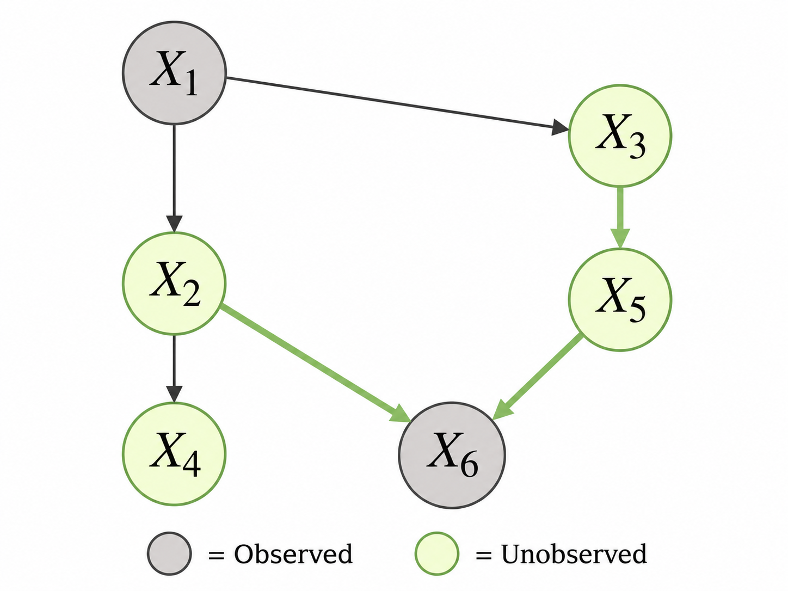
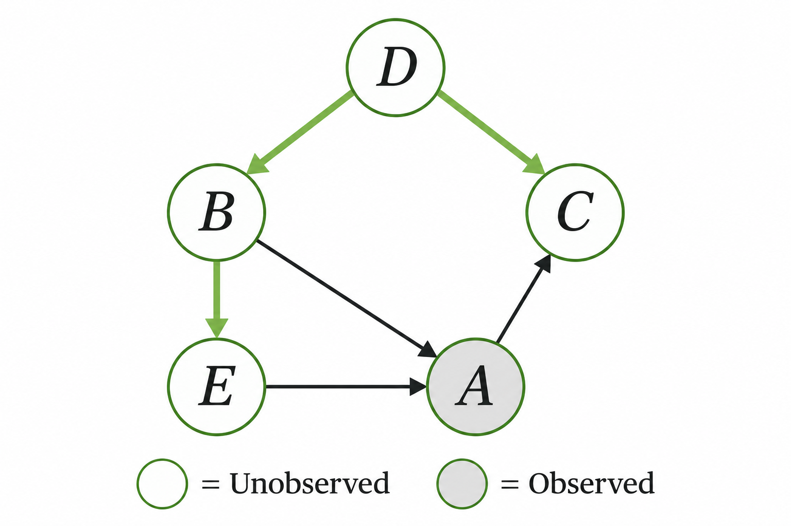

> 작성자 검토 전

## 2.8 Bayes-Ball Reasoning

앞 절에서는 d-separation을 이용해 그래프에서 조건부 독립이 보장되는지 판단하는 방법을 배웠다.

핵심은 두 노드 사이의 모든 경로가 관측된 변수들에 의해 차단되는지 확인하는 것이었다. 그런데 실제 그래프에서는 여러 경로가 존재할 수 있고, 각 경로에 Chain, Fork, Collider가 섞여 있을 수도 있다.

이런 상황에서 경로를 따라가며 정보가 전달될 수 있는지 판단하는 방법을 **Bayes-Ball Reasoning**이라고 한다.

우선 어떤 변수들을 관측했는지 표시하고, 독립성을 확인하려는 두 노드 사이의 경로를 찾는다. 그런 다음 각 경로의 중간 노드가 Collider인지 Non-collider인지 확인한다.

앞 절에서 배운 규칙은 다음과 같다.

- 관측된 Non-collider가 있으면 해당 경로는 Blocked된다.
- Collider 자신과 그 자손이 모두 관측되지 않았다면 해당 경로는 Blocked된다.
- Collider 자신이나 자손 중 하나가 관측되면, 그 지점에서 경로가 열릴 수 있다.

마지막으로 모든 경로의 결과를 종합하면 된다. **가능한 모든 경로가 Blocked되었다면 조건부 독립이 보장되고, 하나라도 Active Path가 남아 있다면 독립을 보장할 수 없다.**

실제 그래프에 이 규칙을 적용해보자.

### Example 2.8.1 — 관측 변수를 추가하면 어떻게 될까?

다음과 같은 DAG를 생각해보자.

$$
\begin{gathered}
X_1\rightarrow X_2,\qquad X_1\rightarrow X_3,\\
X_2\rightarrow X_4,\qquad X_2\rightarrow X_6,\\
X_3\rightarrow X_5,\qquad X_5\rightarrow X_6.
\end{gathered}
$$

여기서 알고 싶은 것은 $X_1$과 $X_6$을 관측했을 때, $X_2$와 $X_3$의 조건부 독립이 보장되는지 여부다.

$$
X_2\perp X_3\mid\{X_1,X_6\}\;?
$$

*$X_1$과 $X_6$을 관측한 DAG. $X_2$와 $X_3$ 사이의 경로를 확인한다.*

먼저 $X_2$와 $X_3$ 사이의 경로를 찾아보자.

첫 번째 경로는 다음과 같다.

$$
X_2\leftarrow X_1\rightarrow X_3.
$$

이 경로에서 $X_1$은 두 화살표가 바깥쪽으로 나가는 Fork 구조의 Non-collider다.

그런데 $X_1$은 이미 관측된 변수다. 따라서 이 경로는 Blocked된다.

두 번째 경로는 다음과 같다.

$$
X_2\rightarrow X_6\leftarrow X_5\leftarrow X_3.
$$

이번에는 조금 다르다.

$X_6$에는 양쪽 화살표가 모두 들어오므로 Collider다. 일반적으로 Collider는 경로를 차단하지만, 지금은 $X_6$을 관측했다.

따라서 $X_6$에서는 경로가 열린다.

나머지 중간 노드 $X_5$는 Non-collider이고 관측되지 않았다. 따라서 이 노드에서도 경로가 차단되지 않는다.

결국 두 번째 경로는 Active Path다.

$$
\boxed{
X_2\not\!\perp_G X_3\mid\{X_1,X_6\}
}
$$

여기서 $\not\!\perp_G$는 그래프에서 d-separation이 성립하지 않는다는 뜻으로 사용했다. 즉, **$X_2$와 $X_3$의 조건부 독립이 그래프만으로는 보장되지 않는다.**

이 예제에서 한 가지 더 생각해볼 부분이 있다.

만약 $X_6$은 관측하지 않고 $X_1$만 관측했다면 어떻게 될까?

첫 번째 경로는 여전히 $X_1$에 의해 차단된다. 그런데 두 번째 경로에서는 Collider인 $X_6$이 관측되지 않았으므로 이 경로도 차단된다.

따라서 이때는

$$
\boxed{X_2\perp X_3\mid X_1}
$$

가 보장된다.

그런데 여기에 $X_6$을 추가로 관측하자 두 번째 경로가 열리면서 조건부 독립의 보장이 사라졌다.

즉, **더 많은 변수를 관측한다고 해서 두 변수가 언제나 더 독립적으로 되는 것은 아니다.** Collider나 그 자손을 관측하면 오히려 차단되어 있던 경로가 열릴 수 있기 때문이다.

### Example 2.8.2 — 여러 경로가 존재하는 경우

이번에는 다섯 개의 노드 $A,B,C,D,E$로 이루어진 DAG를 생각해보자.

$$
\begin{gathered}
D\rightarrow B,\qquad D\rightarrow C,\\
B\rightarrow E,\qquad B\rightarrow A,\\
E\rightarrow A,\qquad A\rightarrow C.
\end{gathered}
$$

여기서 질문은 $A$를 관측했을 때 $C$와 $E$의 조건부 독립이 보장되는지 여부다.

$$
C\perp E\mid A\;?
$$

*$A$를 관측한 DAG. $C$와 $E$ 사이에 Active Path가 남아 있는지 확인한다.*

먼저 가장 짧은 경로를 살펴보자.

$$
C\leftarrow A\leftarrow E.
$$

이 경로에서 $A$는 Non-collider다. 그리고 $A$는 관측되어 있으므로 이 경로는 Blocked된다.

그렇다면 $C$와 $E$는 조건부 독립일까?

아직 결론을 내릴 수 없다. **한 경로가 막혔다고 해서 다른 경로까지 모두 막힌 것은 아니기 때문**이다.

다른 경로를 살펴보자.

$$
C\leftarrow D\rightarrow B\rightarrow E.
$$

이 경로에서 $D$와 $B$는 모두 Non-collider다.

그런데 두 노드는 모두 관측되지 않았다. 따라서 이 경로에는 정보를 차단하는 노드가 없다.

즉, 이 경로는 Active Path다.

따라서

$$
\boxed{
C\not\!\perp_G E\mid A
}
$$

이다.

$A$를 관측하더라도 $C$와 $E$의 조건부 독립은 그래프만으로 보장되지 않는다.

여기서 다른 경로 하나를 더 생각해볼 수 있다.

$$
C\leftarrow D\rightarrow B\rightarrow A\leftarrow E.
$$

이 경로에서 $A$는 Collider다. 두 화살표가 모두 $A$를 향하고 있으며, $A$는 관측되어 있다.

나머지 중간 노드 $D,B$는 관측되지 않은 Non-collider이므로 이 경로 역시 Active하다.

하지만 앞에서 이미 Active Path 하나를 찾았으므로 결론을 내리기 위해 나머지 모든 경로를 계산할 필요는 없다.

---

두 예제에서 사용한 판단 기준은 같다.

먼저 관측된 노드를 표시하고, 두 노드 사이의 경로를 찾는다. 각 경로에서 Collider와 Non-collider의 관측 상태를 확인한 뒤, 경로가 Active한지 Blocked되었는지 판단한다.

그리고 마지막으로 **모든 경로가 Blocked되어야만 d-separation에 의한 조건부 독립을 보장할 수 있다.**

단, Active Path가 존재한다는 것이 두 변수가 반드시 통계적으로 종속적이라는 뜻은 아니다. 특정한 확률분포에서는 우연히 독립일 수도 있다. Active Path는 그래프의 구조만으로 독립을 보장할 수 없다는 의미다.
