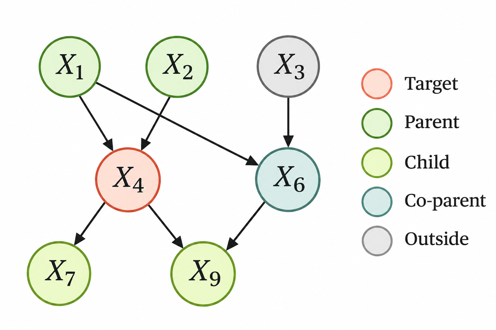

> 작성자 검토 전

## 2.9 Local and Global Markov interpretations

앞 절에서는 Bayes-Ball Reasoning을 통해 그래프에서 조건부 독립이 보장되는지 판단했다.

그런데 2.4절에서 배운 Factorization과 지금까지 살펴본 조건부 독립 관계는 어떻게 연결될까?

Directed Graphical Model에서는 각 변수의 부모에 대한 조건부분포를 곱해 결합분포를 표현했다. 이러한 구조는 동시에 변수들 사이의 조건부 독립 관계도 나타낸다.

이 관계를 설명하는 것이 Local Markov Property와 Global Markov Property다.

### Definition 2.9.1 — Local and Global Markov Property

먼저 **Local Markov Property**를 살펴보자.

어떤 노드 $i$를 생각해보자. 이 노드에는 부모가 있을 수도 있고, 화살표를 따라 도달할 수 있는 자손이 있을 수도 있다.

Local Markov Property는 다음과 같이 표현된다.

**각 변수는 부모 변수들의 값이 주어졌을 때, 부모를 제외한 자신의 Non-descendants와 조건부 독립이다.**

수학적으로는

$$
\boxed{
X_i\perp
X_{\mathrm{nd}(i)\setminus\mathrm{Pa}(i)}
\mid X_{\mathrm{Pa}(i)}
}
$$

로 쓴다.

여기서 $\mathrm{Pa}(i)$는 노드 $i$의 부모 집합이고, $\mathrm{nd}(i)$는 자기 자신과 자손을 제외한 노드들의 집합이다. $X_A$는 노드 집합 $A$에 속한 확률변수들을 함께 나타낸 표기다.

Non-descendants에는 부모도 포함되므로, 독립성을 판단할 대상에서는 부모를 따로 제외한다.

이 식이 의미하는 바를 생각해보자.

어떤 변수의 부모에 해당하는 값들을 이미 알고 있다면, 그 변수의 자손이 아닌 다른 변수들을 추가로 관측하더라도 해당 변수의 조건부분포는 달라지지 않는다는 것이다.

즉, Local Markov Property는 **하나의 노드와 그 주변의 관계를 기준으로 조건부 독립을 설명한다.**

반면 **Global Markov Property**는 그래프 전체의 구조를 이용한다.

2.7절에서 배운 d-separation을 떠올려보자. 두 노드 집합 $A,B$ 사이의 모든 경로가 관측집합 $S$에 의해 차단되어 있다면, 두 집합은 d-separated되었다고 했다.

Global Markov Property는 이러한 그래프의 d-separation 관계가 확률분포의 조건부 독립으로 이어진다는 성질이다.

$$
\boxed{
A\perp_G B\mid S
\quad\Longrightarrow\quad
X_A\perp X_B\mid X_S
}
$$

여기서 $\perp_G$는 DAG $G$에서 d-separation이 성립한다는 뜻이다.

따라서 Local Markov Property가 각 노드를 중심으로 조건부 독립을 설명한다면, Global Markov Property는 그래프의 여러 경로를 이용해 보다 일반적인 조건부 독립 관계를 설명한다.

그렇다면 이 두 성질은 2.4절의 Factorization과 어떤 관계가 있을까?

고정된 DAG에 대해, 그래프에 따라 결합분포가 Factorization된다는 것과 Local Markov Property, Global Markov Property를 만족한다는 것은 서로 연결되어 있다.

$$
\boxed{
\begin{aligned}
\text{Factorization}
&\iff\text{Local Markov}\\[2pt]
&\iff\text{Global Markov}
\end{aligned}
}
$$

즉, Directed Graphical Model의 확률분포를 부모별 조건부분포들의 곱으로 표현하는 것과, 그래프에서 주어지는 조건부 독립 관계를 만족하는 것은 동등한 관점이다.

다만 이 관계는 **고정된 DAG에 대해 확률분포가 그 구조와 양립하는지**를 설명하는 것이다.

특정한 확률분포에서 두 변수가 독립이라는 사실을 발견했다고 해서, 반드시 그래프에서 두 변수가 d-separated되어 있다고 결론 내릴 수는 없다. 그래프의 구조가 요구하지 않는 독립성이 특정한 분포에서 추가로 성립할 수도 있기 때문이다.

### Definition 2.9.3 — Graphical Markov Blanket

Local Markov Property에서는 부모 변수들의 값을 알면 다른 Non-descendants와의 조건부 독립이 성립한다고 했다.

그런데 조금 다른 질문도 생각해볼 수 있다.

**어떤 변수의 분포를 알고 싶을 때, 그래프에 있는 나머지 모든 변수를 확인하지 않고도 충분한 정보만 골라낼 수 있을까?**

이때 사용하는 개념이 Markov Blanket이다.

노드 $i$의 **Markov Blanket**은 다음 세 종류의 노드로 구성된다.

- 노드 $i$의 부모(Parents)
- 노드 $i$의 자식(Children)
- 노드 $i$의 자식들이 가진 다른 부모(Co-parents)

이를 $\mathrm{MB}(i)$라고 쓰면

$$
\boxed{
\begin{aligned}
\mathrm{MB}(i)
&=\mathrm{Pa}(i)\cup\mathrm{Ch}(i)\\[4pt]
&\quad{}\cup\bigcup_{j\in\mathrm{Ch}(i)}
\left(\mathrm{Pa}(j)\setminus\{i\}\right)
\end{aligned}
}
$$

이다.

왜 부모와 자식뿐 아니라 자식의 다른 부모까지 포함해야 할까?

앞에서 배운 Collider 구조를 떠올려보자.

$$
X\rightarrow Z\leftarrow Y
$$

여기서 $X$와 $Y$는 같은 자식 $Z$를 가진다.

$Z$를 관측하면 $X$와 $Y$ 사이의 경로가 활성화될 수 있다. 따라서 자식의 값을 알고 있는 상황에서는 그 자식의 다른 부모도 현재 변수에 관한 정보를 줄 수 있다.

Markov Blanket에 Co-parent가 포함되는 이유가 바로 이것이다.

*$X_4$의 부모, 자식, 자식의 다른 부모로 구성된 Markov Blanket.*

그림에서 $X_4$를 기준으로 살펴보자.

$X_4$의 부모는 $X_1,X_2$이고, 자식은 $X_7,X_9$이다. 또한 $X_9$에는 $X_6$이라는 다른 부모가 있다.

따라서

$$
\boxed{
\mathrm{MB}(X_4)
=
\{X_1,X_2,X_6,X_7,X_9\}
}
$$

이다.

반면 $X_3$은 $X_6$의 부모일 뿐, $X_4$의 부모나 자식도 아니고 $X_4$의 자식이 가진 다른 부모도 아니다.

따라서 $X_3$은 $X_4$의 Markov Blanket에 포함되지 않는다.

Markov Blanket이 중요한 이유는, 이 집합에 속한 변수들의 값을 알고 있다면 나머지 변수들은 해당 변수에 추가적인 정보를 주지 않기 때문이다.

수학적으로는

$$
\boxed{
X_i\perp
X_{V\setminus(\{i\}\cup\mathrm{MB}(i))}
\mid X_{\mathrm{MB}(i)}
}
$$

로 표현한다.

여기서 $V$는 그래프의 전체 노드 집합이다. 즉, Markov Blanket 바깥에 있는 노드들 중 자기 자신을 제외한 모든 변수와 조건부 독립이라는 뜻이다.

결국 Markov Blanket은 그래프 전체를 살펴보지 않고도, **특정 변수의 조건부분포를 결정하는 데 필요한 주변 변수들을 그래프 구조에서 찾을 수 있게 해준다.**

Local Markov Property와 Global Markov Property가 그래프에 담긴 조건부 독립 관계를 설명한다면, Markov Blanket은 이러한 관계를 이용해 특정 변수 주변에서 필요한 정보의 범위를 보여주는 개념이다.
