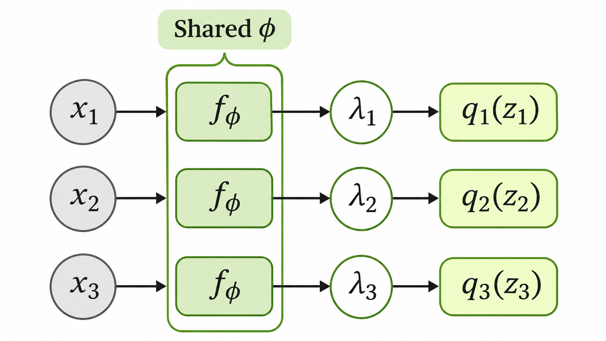

> 작성자 검토 전

## 3.11 Amortized Variational Inference

앞 절에서는 CAVI를 이용해 Mean-Field 근사분포의 각 Factor를 번갈아 최적화하는 방법을 살펴봤다.

그런데 실제 데이터셋에 수많은 관측값이 있다면 문제가 생긴다.

관측값 $x_1,\ldots,x_N$에 각각 잠재변수 $z_1,\ldots,z_N$이 있다고 하자. 기존 Variational Inference에서는 각 관측값의 Posterior를 근사하기 위해 별도의 변분매개변수 $\lambda_i$를 최적화해야 한다.

$$
\boxed{
\lambda_i^*
=
\underset{\lambda_i}{\arg\max}\,
\mathcal L(q_{\lambda_i},\theta;x_i)
}
$$

예를 들어 각 근사분포를 Diagonal Gaussian으로 표현한다면, 관측값마다 평균과 분산에 해당하는 매개변수들을 따로 찾아야 한다.

관측값의 수가 많아질수록 최적화해야 할 매개변수와 계산 비용도 함께 증가한다.

그렇다면 **관측값마다 변분매개변수를 직접 최적화하는 대신, 관측값을 입력받아 적절한 매개변수를 출력하는 함수를 학습하면 어떨까?**

이것이 Amortized Variational Inference의 기본 아이디어다.

먼저 모든 관측값이 공유하는 함수 $f_\phi$를 정의하자. 여기서 $\phi$는 함수의 매개변수다.

각 관측값에 대한 변분매개변수는 다음과 같이 계산한다.

$$
\boxed{
\lambda_i=f_\phi(x_i)
}
$$

즉, $x_i$를 입력하면 해당 관측값에 필요한 변분매개변수 $\lambda_i$가 출력된다.

이를 근사분포의 표기로 나타내면

$$
\boxed{
q_\phi(z\mid x)
=
q_{f_\phi(x)}(z)
}
$$

이다.

여기서 중요한 것은 모든 관측값이 **같은 함수 $f_\phi$와 매개변수 $\phi$를 공유한다**는 점이다.

함수 자체는 공유되지만 입력 $x_i$가 달라지면 출력되는 $\lambda_i$도 달라질 수 있다. 따라서 관측값마다 서로 다른 근사분포를 표현할 수 있다.

*하나의 공유 함수 $f_\phi$가 각 관측값에 대응하는 변분매개변수를 출력하는 구조.*

예를 들어 근사분포로 Diagonal Gaussian을 사용한다고 하자.

공유 함수가 관측값 $x$를 받아 평균벡터와 Log-Variance 벡터를 출력하도록 만들 수 있다.

$$
f_\phi(x)
=
\big(\mu_\phi(x),s_\phi(x)\big).
$$

여기서 $\mu_\phi(x)$는 평균벡터이고, $s_\phi(x)$는 각 좌표의 분산에 로그를 취한 값이다.

따라서 분산벡터는 $\exp(s_\phi(x))$로 표현할 수 있으며, 근사분포는 다음과 같다.

$$
\boxed{
q_\phi(z\mid x)
=
\mathcal N\left(
z;\mu_\phi(x),
\operatorname{diag}(\exp(s_\phi(x)))
\right)
}
$$

지수함수를 사용하므로 각 분산이 양수라는 조건도 만족한다.

이제 관측값마다 별도의 변분매개변수를 직접 최적화하는 대신, 공유 함수의 매개변수 $\phi$를 학습하면 된다.

모델의 매개변수 $\theta$까지 함께 학습한다면 목적함수는 다음과 같이 표현할 수 있다.

$$
\boxed{
\underset{\theta,\phi}{\arg\max}\;
\sum_{i=1}^{N}
\mathcal L\left(
q_\phi(\cdot\mid x_i),\theta;x_i
\right)
}
$$

여기서 $\theta$는 데이터를 생성하는 모델의 매개변수이고, $\phi$는 관측값으로부터 근사 Posterior의 매개변수를 예측하는 함수의 매개변수다.

두 매개변수는 서로 다른 역할을 하지만, 전체 ELBO를 최대화하도록 함께 학습할 수 있다.

이 방식의 장점은 학습이 끝난 뒤 새로운 관측값이 주어져도 매번 별도의 변분 최적화 문제를 풀 필요가 줄어든다는 것이다.

새로운 $x$를 함수 $f_\phi$에 입력하면 해당 관측값에 대한 근사분포의 매개변수를 바로 얻을 수 있기 때문이다.

다만 이렇게 얻은 분포가 각 관측값에 대해 독립적으로 최적화한 분포나 실제 Posterior와 정확히 일치한다는 보장은 없다. 개별 최적화의 일부를 공유 함수의 학습으로 대체하는 만큼, 계산 효율성과 근사 정확도 사이에 차이가 생길 수 있다.

이러한 접근은 Variational Autoencoder(VAE)의 Encoder에서도 사용된다.

결국 Amortized Variational Inference는 **관측값마다 반복하던 최적화 과정을 공유 함수의 학습으로 대체하여, 새로운 데이터에 대한 Posterior 근사를 효율적으로 수행하는 방법**이다.
