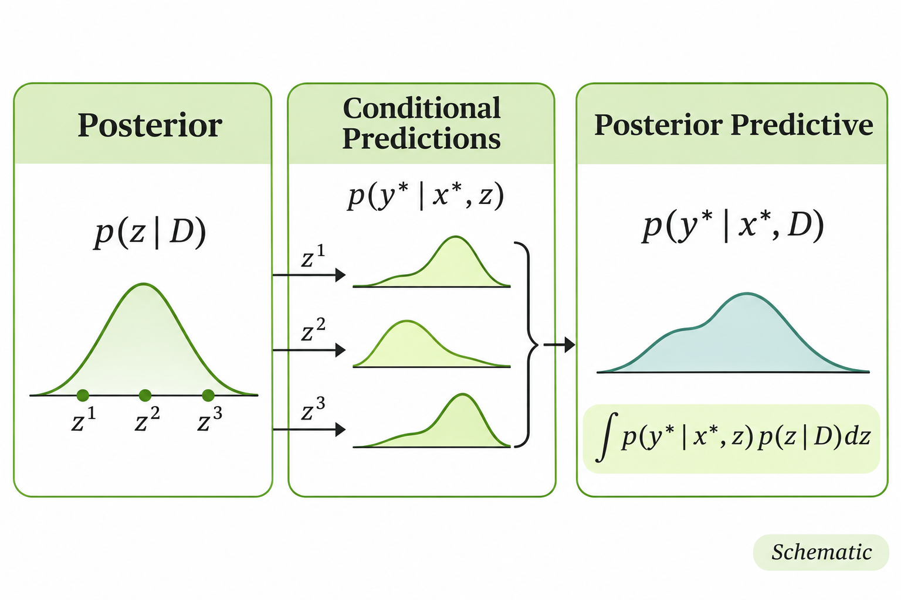

> 작성자 검토 전

확률분포를 알고 있을 때 우리가 계산하고 싶은 것은 무엇일까?

가장 먼저 떠오르는 것은 평균이다. 하지만 평균 외에도 특정 사건이 발생할 확률을 구하거나, 관측된 데이터를 바탕으로 새로운 값을 예측하는 등 다양한 계산이 가능하다.

서로 다른 문제처럼 보이지만, 이러한 계산들은 상당 부분 하나의 수학적 연산으로 표현할 수 있다. 바로 **기댓값(Expectation)**이다.

## Expectations as Integrals

확률변수 \(Z\)가 확률밀도 \(p(z)\)를 따른다고 하자. 우리가 관심 있는 함수가 \(f(z)\)라면, \(f(Z)\)의 기댓값은

\[
\boxed{
\mu
=\mathbb E_{Z\sim p}[f(Z)]
=\int f(z)p(z)\,\mathrm dz
}
\]

로 정의된다.

이 식은 각 \(z\)에서의 함수값 \(f(z)\)를 확률밀도 \(p(z)\)에 따라 가중평균한다는 뜻이다.

어떤 값을 자주 관측하는 분포라면 그 값에서의 \(f(z)\)가 평균에 더 크게 반영되고, 드물게 나타나는 값이라면 상대적으로 작게 반영된다.

여기서 \(f\)를 어떻게 선택하느냐에 따라 계산하는 대상이 달라진다.

예를 들어 \(f(z)=z\)라면

\[
\mu=\mathbb E[Z]
\]

가 되어 확률변수 자체의 평균을 계산한다.

반면 \(f(z)=z^2\)를 선택하면

\[
\mu=\mathbb E[Z^2]
\]

를 얻는다. 이는 두 번째 원점 모멘트(Second Raw Moment)이며, 분산을 계산할 때도 사용되는 값이다.

조금 다른 예를 생각해보자. 확률변수 \(Z\)가 어떤 구간 \(A\)에 속할 확률을 알고 싶다고 하자.

이때 다음과 같은 함수를 정의할 수 있다.

\[
f(z)=\mathbf 1\{z\in A\}.
\]

여기서 \(\mathbf 1\{\cdot\}\)은 조건이 참이면 1, 거짓이면 0을 반환하는 Indicator Function이다.

따라서 \(Z\)가 \(A\) 안에 있으면 함수값은 1이고, 그렇지 않으면 0이다.

이 함수의 기댓값을 계산하면

\[
\begin{aligned}
\mathbb E[\mathbf 1\{Z\in A\}]
&=\int\mathbf 1\{z\in A\}p(z)\,\mathrm dz\\[4pt]
&=\int_A p(z)\,\mathrm dz\\[4pt]
&=P(Z\in A)
\end{aligned}
\]

가 된다.

즉, 어떤 사건이 발생할 확률도 기댓값으로 나타낼 수 있다.

평균과 사건확률은 서로 다른 양이지만, 적절한 함수 \(f\)를 선택하면 모두 같은 기댓값 계산으로 표현되는 것이다.

이제 이 관점을 조금 더 복잡한 문제에 적용해보자.

## Posterior Predictive Distribution

이미 관측한 데이터로 확률모형을 학습했다고 하자.

그렇다면 학습한 모델을 이용해 아직 관측하지 않은 새로운 데이터도 예측할 수 있을 것이다.

그런데 모델에 불확실한 모수나 latent variable이 포함되어 있다면 어떻게 해야 할까?

예를 들어 내일 비가 올 확률을 예측하는 상황을 생각해보자.

현재 관측한 기상 데이터 \(D\)를 바탕으로 두 가지 가능한 모델을 고려하고 있다고 하자.

첫 번째 모델 \(z_A\)는 내일 비가 올 확률을 \(20\%\)로 예측하고, 두 번째 모델 \(z_B\)는 \(80\%\)로 예측한다.

그런데 지금까지 관측한 데이터는 두 번째 모델을 조금 더 강하게 지지한다고 하자.

| | 모델 \(z_A\) | 모델 \(z_B\) |
|---|---:|---:|
| 내일 비가 올 확률 | 0.2 | 0.8 |
| Posterior Probability | 0.25 | 0.75 |

여기서 두 모델의 Posterior Probability는 각각 \(0.25\), \(0.75\)다.

즉, 관측 데이터 \(D\)를 고려했을 때 첫 번째 모델에는 \(25\%\), 두 번째 모델에는 \(75\%\)의 확률을 부여하고 있다는 뜻이다.

그렇다면 최종적으로 내일 비가 올 확률은 얼마라고 예측해야 할까?

한 가지 방법은 Posterior Probability가 더 높은 모델 \(z_B\)만 선택하는 것이다. 이 경우 비가 올 확률은 \(80\%\)라고 예측하게 된다.

하지만 두 모델 중 어느 것이 맞는지 완전히 확신할 수는 없다. 첫 번째 모델에도 여전히 \(25\%\)의 확률이 부여되어 있기 때문이다.

따라서 한 모델만 선택하는 대신, **각 모델의 예측을 Posterior Probability에 따라 가중평균**하는 방법을 생각할 수 있다.

\[
\begin{aligned}
&P(\text{Rain}\mid D)\\[4pt]
&=P(\text{Rain}\mid z_A)P(z_A\mid D)\\
&\quad+P(\text{Rain}\mid z_B)P(z_B\mid D)\\[4pt]
&=0.2(0.25)+0.8(0.75)\\[4pt]
&=\boxed{0.65}.
\end{aligned}
\]

최종적으로 비가 올 확률을 \(65\%\)라고 예측하는 것이다.

물론 여기서 사용한 확률값들은 계산을 설명하기 위한 가상의 예시다.

중요한 것은 **하나의 모델을 선택하는 대신 가능한 모델들의 예측을 모두 반영했다는 점**이다.

이러한 아이디어를 일반화한 것이 Posterior Predictive Distribution이다.

### 수학적으로 표현하기

이제 조금 더 일반적인 상황을 생각해보자.

이미 관측한 데이터셋을 \(D\), 새로운 입력을 \(x^*\), 이에 대응하는 아직 관측하지 않은 출력을 \(Y^*\)라고 하자.

우리가 구하려는 것은 새로운 출력의 예측분포

\[
p(y^*\mid x^*,D)
\]

이다.

모델에 불확실한 변수 \(Z\)가 포함되어 있다고 하자. 앞의 예시에서 \(Z\)는 두 가지 가능한 모델 중 어느 것이 적절한지를 나타내는 변수였다.

연속적인 값을 갖는 \(Z\)도 같은 방법으로 다룰 수 있다.

먼저 \(Z\)의 가능한 모든 값을 고려하기 위해 주변화(Marginalization)를 적용하자.

\[
\begin{aligned}
&p(y^*\mid x^*,D)\\[4pt]
&=\int p(y^*,z\mid x^*,D)\,\mathrm dz\\[4pt]
&=\int p(y^*\mid x^*,z,D)\\
&\qquad\quad\times p(z\mid x^*,D)\,\mathrm dz.
\end{aligned}
\]

두 번째 등식에서는 조건부 확률의 곱셈법칙을 사용했다.

여기서 \(Z\)가 데이터셋 \(D\)로부터 학습한 모델의 불확실한 모수라고 생각해보자.

새로운 입력 \(x^*\) 자체는 \(Z\)에 관한 정보를 추가로 제공하지 않고, \(x^*,z\)가 주어지면 새 출력 \(Y^*\)의 분포는 기존 데이터 \(D\)에 더 이상 의존하지 않는다고 가정하자.

그러면

\[
\begin{aligned}
p(z\mid x^*,D)&=p(z\mid D),\\
p(y^*\mid x^*,z,D)&=p(y^*\mid x^*,z)
\end{aligned}
\]

가 성립한다.

이를 앞의 식에 대입하면

\[
\boxed{
\begin{aligned}
&p(y^*\mid x^*,D)\\[4pt]
&=\int p(y^*\mid x^*,z)p(z\mid D)\,\mathrm dz\\[4pt]
&=\mathbb E_{z\sim p(z\mid D)}
\left[p(y^*\mid x^*,z)\right].
\end{aligned}
}
\]

를 얻는다.

이것이 **Posterior Predictive Distribution**이다.

식이 조금 복잡해 보이지만, 앞에서 계산한 비가 올 확률과 구조가 같다.

- \(p(z\mid D)\)는 관측 데이터를 바탕으로 가능한 \(z\)에 부여한 Posterior Probability다.
- \(p(y^*\mid x^*,z)\)는 \(z\)가 주어졌을 때 새로운 데이터에 대한 예측분포다.

따라서 Posterior Predictive Distribution은 각 \(z\)에서 얻은 예측을 Posterior에 따라 가중평균한 결과다.

앞의 예시에서는 가능한 모델이 두 개뿐이었으므로 두 항을 더했다. 하지만 \(Z\)가 연속적인 값을 갖는다면 가능한 모든 \(z\)를 고려해야 하므로 합 대신 적분을 사용한다.

*각 \(z\)에서의 예측분포를 Posterior가 부여하는 가중치에 따라 평균하여 최종 예측분포를 얻는다.*

이 방법의 중요한 특징은 \(Z\)를 하나의 값으로 확정하지 않는다는 것이다.

관측 데이터만으로는 어떤 모수가 정확한지 알 수 없더라도, 가능한 값들을 모두 고려해 그 불확실성을 예측에 반영할 수 있다.

여기서 하나 주의할 점은, 모든 latent variable model에서 \(p(z\mid x^*,D)=p(z\mid D)\)가 자동으로 성립하는 것은 아니라는 사실이다. 예를 들어 새로운 관측값마다 별도의 latent variable을 도입하는 모델에서는 \(x^*\)에 대한 의존성을 별도로 고려해야 할 수 있다.

또한 \(Y^*\)가 연속형 확률변수라면 \(p(y^*\mid x^*,D)\)는 해당 위치의 확률밀도이지, 정확히 그 값이 나올 확률은 아니다.

---

지금까지 평균, 사건확률, Posterior Predictive Distribution을 살펴봤다.

각각의 계산은 서로 달라 보이지만, 공통적으로 어떤 확률분포에 대한 기댓값으로 표현할 수 있었다.

그런데 확률분포가 복잡해지면 이러한 기댓값을 적분으로 직접 계산하기 어려워진다.

특히 Posterior Predictive Distribution에서는 모든 가능한 \(z\)에 대한 예측을 적분해야 한다. Latent variable이나 모수의 차원이 높아진다면 이 계산은 더욱 어려워질 수 있다.

다음 절에서는 이러한 적분을 정확하게 계산하는 대신, **확률분포에서 얻은 샘플들의 평균으로 근사하는 Monte Carlo 방법**을 살펴본다.