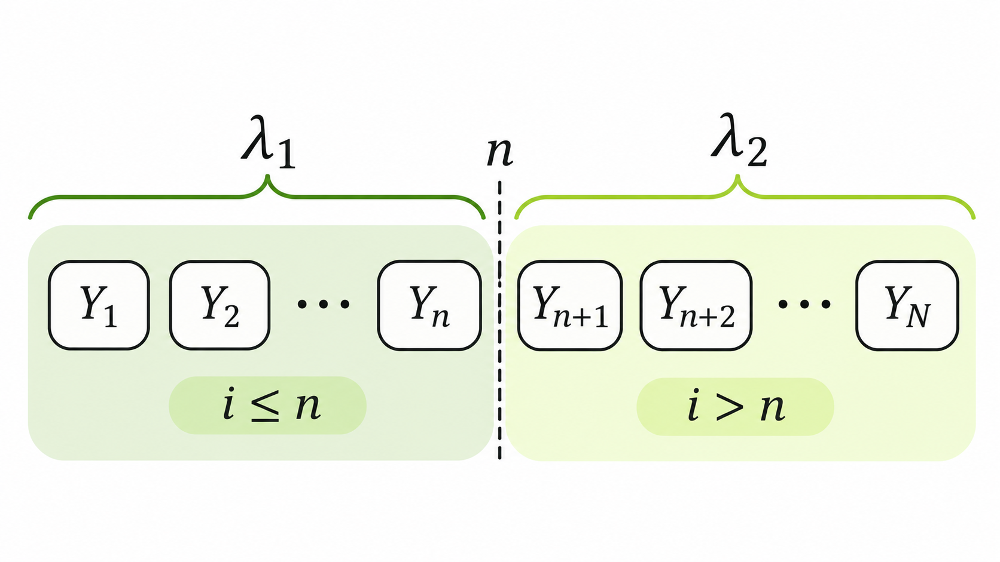

> 작성자 검토 전

## 4.11 Gibbs Sampling

앞 절에서는 Metropolis–Hastings 알고리즘을 이용해 목표분포를 보존하는 Markov Chain을 만드는 방법을 살펴봤다.

현재 상태에서 새로운 후보를 생성하고, Detailed Balance를 만족하도록 설계된 확률로 그 후보를 수용하거나 거절하는 방식이었다.

그런데 목표분포가 여러 확률변수의 결합분포라면 조금 다른 방법도 생각해볼 수 있다.

**전체 변수를 한꺼번에 갱신하는 대신, 하나의 변수만 선택해 그 조건부분포에서 새로운 값을 뽑으면 어떨까?**

이것이 Gibbs Sampling의 기본 아이디어다.

### 1. Gibbs Sampling의 기본 원리

목표분포가 다음과 같은 $M$차원 확률변수의 결합분포라고 하자.

$$
z=(z_1,\ldots,z_M)\sim\pi(z).
$$

여기서 $z_{-j}$는 $j$번째 변수 $z_j$를 제외한 나머지 변수들의 값을 나타낸다.

$$
z_{-j}
=
(z_1,\ldots,z_{j-1},z_{j+1},\ldots,z_M).
$$

Gibbs Sampling에서는 각 변수의 **Full Conditional Distribution**을 이용한다.

$$
\pi(z_j\mid z_{-j}).
$$

이는 나머지 변수들의 값을 모두 알고 있을 때 $Z_j$가 따르는 조건부분포다.

이 조건부분포를 계산할 수 있고 직접 샘플을 생성할 수 있다고 가정하자.

그러면 현재 상태 $z$에서 다른 좌표들은 그대로 두고, $j$번째 좌표만 다음과 같이 갱신할 수 있다.

$$
\boxed{
z'_j\sim\pi(z_j\mid z_{-j})
}
$$

즉, $z_{-j}$는 고정하고 $z_j$만 새로 뽑는 것이다.

예를 들어 $z=(z_1,z_2)$라면 먼저 $z_2$를 고정하고 $z_1$을 갱신한다.

$$
z_1^{(t+1)}
\sim
\pi(z_1\mid z_2^{(t)}).
$$

그다음에는 방금 얻은 $z_1^{(t+1)}$을 이용해 $z_2$를 갱신한다.

$$
z_2^{(t+1)}
\sim
\pi(z_2\mid z_1^{(t+1)}).
$$

여기서 중요한 것은 두 번째 갱신에서 이전 값 $z_1^{(t)}$가 아니라 **가장 최근에 갱신된 값 $z_1^{(t+1)}$을 사용한다는 점**이다.

이렇게 모든 좌표를 한 번씩 갱신하는 과정을 Sweep이라고 한다.

앞서 배운 CAVI에서도 다른 Factor를 고정하고 하나씩 갱신하는 방법을 사용했다. 하지만 Gibbs Sampling은 조건부분포의 평균이나 최적 매개변수를 계산하는 것이 아니라, **실제로 조건부분포에서 무작위 샘플을 추출한다**는 차이가 있다.

이 차이를 이변량 Gaussian 예제로 확인해보자.

실제 목표분포가

$$
\pi(z_1,z_2)
=
\mathcal N\left(
\mathbf 0,
\begin{pmatrix}
1&\rho\\
\rho&1
\end{pmatrix}
\right),
\qquad |\rho|<1
$$

이라고 하자.

이 분포의 Full Conditional은

$$
\begin{aligned}
Z_1\mid Z_2=z_2
&\sim\mathcal N(\rho z_2,1-\rho^2),\\[4pt]
Z_2\mid Z_1=z_1
&\sim\mathcal N(\rho z_1,1-\rho^2)
\end{aligned}
$$

이다.

따라서 Gibbs Sampling에서는 현재 다른 좌표의 값을 이용해 조건부 평균을 계산하되, 그 평균으로 좌표를 단순히 대체하지 않고 정규분포에서 새로운 값을 뽑는다.

여기서 $1-\rho^2$는 조건부 분산이고, 표준편차는 $\sqrt{1-\rho^2}$이다.

[demo:gibbs-gaussian]

초기 상태를 $(1,1)$로 두고 $\rho$를 바꾸거나 갱신을 진행해보자.

한 번에 하나의 좌표만 갱신되며, 두 번째 좌표를 갱신할 때 첫 번째 좌표의 최신 값이 사용되는 것을 확인할 수 있다. 특히 $\rho=0.8$이면 조건부 분산은 $0.36$이지만, 실제로 추출되는 값은 매번 달라질 수 있다.

### 2. Gibbs Sampling이 목표분포를 보존하는 이유

Gibbs Sampling은 각 좌표의 조건부분포에서 새로운 값을 뽑는 방법이다.

그런데 이 방법으로 만든 Markov Chain이 정말 목표분포 $\pi$를 정상분포로 유지할까?

이를 확인하기 위해 현재 상태 $z$가 이미 목표분포를 따른다고 가정하자.

$$
z\sim\pi(z).
$$

이제 $j$번째 좌표만 새로 뽑고 나머지 좌표는 그대로 둔다.

$$
z'_j\sim\pi(z_j\mid z_{-j}).
$$

갱신하지 않은 $z_{-j}$의 주변분포는 여전히 $\pi(z_{-j})$다.

또한 새로 생성한 $z'_j$의 조건부분포는 $\pi(z'_j\mid z_{-j})$이므로, 갱신된 전체 상태의 결합분포는

$$
\begin{aligned}
p(z'_j,z_{-j})
&=\pi(z_{-j})
\pi(z'_j\mid z_{-j})\\[4pt]
&=\boxed{\pi(z'_j,z_{-j})}
\end{aligned}
$$

가 된다.

마지막 줄은 조건부 확률의 곱셈법칙을 적용한 결과다.

즉, 갱신된 전체 상태도 원래 목표분포 $\pi$를 따른다.

따라서 **하나의 Gibbs 좌표 갱신은 목표분포 $\pi$를 보존한다.**

다른 좌표를 갱신해도 같은 논리가 성립하므로, 여러 좌표 갱신을 순서대로 합성한 하나의 Sweep 역시 $\pi$를 보존한다.

다만 이는 $\pi$가 정상분포라는 사실을 보여주는 것이다. 임의의 초기 상태에서 출발한 Markov Chain이 반드시 $\pi$로 수렴한다는 것까지 증명한 것은 아니다.

### 3. Gibbs Sampling과 Metropolis–Hastings의 관계

Gibbs Sampling은 Metropolis–Hastings의 특별한 경우로도 이해할 수 있다.

MH에서는 현재 상태 $z$에서 후보 $z'$를 생성하고 다음 확률로 수용했다.

$$
\alpha(z,z')
=
\min\left(
1,
\frac{
\pi(z')q(z\mid z')
}{
\pi(z)q(z'\mid z)
}
\right).
$$

이번에는 $j$번째 좌표만 바꾸는 Gibbs Update를 생각해보자.

현재 상태와 후보 상태는 각각

$$
\begin{aligned}
z&=(z_j,z_{-j}),\\
z'&=(z'_j,z_{-j})
\end{aligned}
$$

이다.

즉, $z_j$만 달라지고 나머지 좌표는 모두 같다.

Proposal을 Full Conditional로 선택하면

$$
q(z'_j\mid z)
=
\pi(z'_j\mid z_{-j})
$$

이고, 반대 방향의 Proposal은

$$
q(z_j\mid z')
=
\pi(z_j\mid z_{-j})
$$

이다.

이를 MH의 수용비율에 대입하면

$$
\begin{aligned}
R
&=
\frac{
\pi(z'_j,z_{-j})
\pi(z_j\mid z_{-j})
}{
\pi(z_j,z_{-j})
\pi(z'_j\mid z_{-j})
}\\[6pt]
&=
\frac{
\pi(z_{-j})
\pi(z'_j\mid z_{-j})
\pi(z_j\mid z_{-j})
}{
\pi(z_{-j})
\pi(z_j\mid z_{-j})
\pi(z'_j\mid z_{-j})
}\\[6pt]
&=\boxed{1}
\end{aligned}
$$

이 된다.

따라서

$$
\boxed{
\alpha(z,z')=\min(1,R)=1
}
$$

이다.

즉, **정확한 Full Conditional에서 생성한 Gibbs 후보는 항상 수용된다.**

이 결과는 특정 좌표만 갱신하고 나머지 좌표를 고정하는 Proposal에 대해 성립한다. 모든 좌표를 임의의 Proposal로 동시에 바꾸더라도 수용률이 1이 된다는 뜻은 아니다.

또한 Bayesian Network에서는 각 변수의 Full Conditional을 계산할 때 Markov Blanket을 활용할 수 있다.

Markov Blanket은 해당 노드의 부모, 자식, 그리고 자식의 다른 부모로 구성된다.

그래프가 나타내는 Markov Property를 만족하는 분포라면, 나머지 모든 변수의 값을 직접 사용할 필요 없이 Markov Blanket에 속한 변수들의 값으로 해당 노드의 조건부분포를 계산할 수 있다.

이렇게 하면 조건부 Sampling에 필요한 계산을 줄일 수 있다.

그런데 수용확률이 항상 1이라고 해서 Sampling이 반드시 효율적인 것은 아니다.

한 번에 하나의 좌표만 바꾸기 때문에, 변수들 사이의 상관관계가 강하다면 연속한 샘플들이 비슷한 위치에 오래 머무를 수 있다.

이를 구체적인 확률모형에 적용해보자.

### 4. Example — Poisson Change-point Model

어떤 현상을 일정한 시간 간격으로 관측하여 다음과 같은 Count Data를 얻었다고 하자.

$$
y=(y_1,\ldots,y_N).
$$

여기서 $y_i$는 $i$번째 시점에서 관측한 사건의 발생 횟수다.

그런데 어느 시점부터 사건의 평균 발생 횟수가 달라졌을 가능성이 있다고 하자.

변화가 발생한 시점을 $n$이라고 하고, 변화 이전과 이후의 Poisson Rate를 각각 $\lambda_1,\lambda_2$라고 하자.

이제 관측값의 분포를 다음과 같이 정의할 수 있다.

$$
\boxed{
Y_i\mid n,\lambda_1,\lambda_2
\sim
\begin{cases}
\operatorname{Poisson}(\lambda_1),
&i\le n,\\[4pt]
\operatorname{Poisson}(\lambda_2),
&i>n.
\end{cases}
}
$$

여기서 관측값들은 $n,\lambda_1,\lambda_2$가 주어졌을 때 서로 조건부 독립이라고 가정한다.

따라서 $n$까지의 관측값은 Rate $\lambda_1$을 사용하고, $n$ 이후의 관측값은 Rate $\lambda_2$를 사용한다.

*변화점 $n$을 기준으로 Poisson Rate가 $\lambda_1$에서 $\lambda_2$로 달라지는 관측 시퀀스.*

이제 세 잠재변수에 다음과 같은 사전분포를 설정하자.

$$
\boxed{
\begin{aligned}
n&\sim\operatorname{Uniform}\{1,\ldots,N\},\\
\lambda_1,\lambda_2
&\overset{\mathrm{i.i.d.}}{\sim}
\operatorname{Gamma}(a,b).
\end{aligned}
}
$$

여기서 $a>0$는 Gamma Distribution의 Shape Parameter이고, $b>0$는 Rate Parameter다.

Gamma 분포의 밀도는 $\lambda$에 대해 다음과 같은 형태를 갖는다.

$$
p(\lambda)
\propto
\lambda^{a-1}e^{-b\lambda},
\qquad \lambda>0.
$$

세 잠재변수는 사전적으로 독립이라고 가정한다.

우리가 알고 싶은 것은 관측 데이터 $y$가 주어졌을 때의 결합 사후분포다.

$$
p(\lambda_1,\lambda_2,n\mid y).
$$

하지만 이 사후분포 전체에서 한 번에 샘플을 생성하는 것은 어려울 수 있다.

대신 각 변수의 Full Conditional을 구해 Gibbs Sampling을 적용해보자.

먼저 계산을 간단하게 하기 위해 누적 Count를 정의하자.

$$
\boxed{
C_h=\sum_{i=1}^{h}y_i,
\qquad h=1,\ldots,N.
}
$$

여기서 $C_n$은 변화점 이전 구간의 전체 Count이고, $C_N$은 모든 관측값의 합이다.

따라서 변화점 이후 구간의 Count는 $C_N-C_n$이다.

Poisson Distribution의 확률질량함수는

$$
P(Y_i=y_i\mid\lambda)
=
\frac{e^{-\lambda}\lambda^{y_i}}{y_i!}
$$

이므로, 조건부 독립 가정 아래에서 Likelihood는

$$
\begin{aligned}
&p(y\mid n,\lambda_1,\lambda_2)\\[4pt]
&=
\prod_{i=1}^{n}
\frac{e^{-\lambda_1}\lambda_1^{y_i}}{y_i!}\\
&\quad\times
\prod_{i=n+1}^{N}
\frac{e^{-\lambda_2}\lambda_2^{y_i}}{y_i!}.
\end{aligned}
$$

이제 Bayes' Rule에 따라 Likelihood와 Prior를 곱하면 사후분포의 비정규화된 형태를 얻는다.

관측 데이터에만 의존하는 상수와 정규화 상수를 생략하면

$$
\boxed{
\begin{aligned}
&p(\lambda_1,\lambda_2,n\mid y)\\[4pt]
&\propto
\lambda_1^{a+C_n-1}
e^{-(b+n)\lambda_1}\\
&\quad\times
\lambda_2^{a+C_N-C_n-1}
e^{-(b+N-n)\lambda_2}.
\end{aligned}
}
$$

이 식에서 각 잠재변수의 Full Conditional을 구할 수 있다.

**먼저 $\lambda_1$의 Full Conditional을 살펴보자.**

$n,\lambda_2,y$를 고정하면 $\lambda_1$에 의존하는 부분만 남기면 된다.

$$
\begin{aligned}
&p(\lambda_1\mid n,\lambda_2,y)\\[4pt]
&\propto
\lambda_1^{a+C_n-1}
e^{-(b+n)\lambda_1}.
\end{aligned}
$$

이는 Gamma Distribution의 밀도와 같은 형태다.

따라서

$$
\boxed{
\lambda_1\mid n,\lambda_2,y
\sim
\operatorname{Gamma}(a+C_n,b+n)
}
$$

을 얻는다.

즉, 변화점 이전에 관측된 Count가 Shape에 더해지고, 해당 구간의 관측 개수 $n$이 Rate에 더해진다.

**이번에는 $\lambda_2$를 살펴보자.**

같은 방법으로 $\lambda_2$에 의존하는 부분만 남기면

$$
\begin{aligned}
&p(\lambda_2\mid n,\lambda_1,y)\\[4pt]
&\propto
\lambda_2^{a+C_N-C_n-1}\\
&\quad\times e^{-(b+N-n)\lambda_2}
\end{aligned}
$$

이므로

$$
\boxed{
\begin{aligned}
&\lambda_2\mid n,\lambda_1,y\\[4pt]
&\sim
\operatorname{Gamma}\left(
a+C_N-C_n,\,
b+N-n
\right).
\end{aligned}
}
$$

를 얻는다.

이번에는 변화점 이후 구간의 전체 Count와 관측 개수가 각각 Shape와 Rate에 반영된다.

여기서 $n=N$도 가능한 변화점이라는 사실을 확인하자.

이 경우 두 번째 구간에는 관측값이 없으므로

$$
C_N-C_n=0,\qquad N-n=0
$$

이다.

따라서 $\lambda_2$의 Full Conditional은 사전분포 $\operatorname{Gamma}(a,b)$와 같아진다.

**마지막으로 변화점 $n$의 Full Conditional을 구해보자.**

이번에는 $\lambda_1,\lambda_2,y$가 주어져 있다고 하자.

변화점은 $1,\ldots,N$ 중 하나의 값을 갖는 이산변수다.

따라서 가능한 각 변화점 $h$에 대한 확률을 계산한 다음, 이 값들을 정규화하면 된다.

앞에서 구한 사후분포에서 $n=h$를 대입하고, $h$에 의존하는 항만 로그로 정리하자.

$$
\boxed{
\begin{aligned}
\ell_h
&=C_h\log\lambda_1-h\lambda_1\\
&\quad+(C_N-C_h)\log\lambda_2\\
&\quad-(N-h)\lambda_2.
\end{aligned}
}
$$

여기서 $\ell_h$는 $n=h$일 때의 사후 Log-Weight에서 $h$와 무관한 가산상수를 제외한 값이다.

따라서 각 변화점의 비정규화된 확률은 $e^{\ell_h}$에 비례한다.

이를 정규화하면

$$
\boxed{
P(n=h\mid\lambda_1,\lambda_2,y)
=
\frac{e^{\ell_h}}
{\displaystyle\sum_{j=1}^{N}e^{\ell_j}}
}
$$

를 얻는다.

이 확률들은 모두 0 이상이고 합이 1이므로, 변화점 $n$의 Full Conditional은 $N$개 범주에 대한 Categorical Distribution이다.

즉, 모든 후보 변화점의 확률을 계산한 뒤 그중 하나를 Sampling하면 된다.

이제 세 변수의 Full Conditional을 모두 구했으므로 Gibbs Sampling을 수행할 수 있다.

현재 상태가

$$
z^{(t)}
=
(n^{(t)},\lambda_1^{(t)},\lambda_2^{(t)})
$$

라고 하자.

먼저 현재 변화점 $n^{(t)}$를 사용해 첫 번째 Rate를 갱신한다.

$$
\boxed{
\lambda_1^{(t+1)}
\sim
\operatorname{Gamma}\left(
a+C_{n^{(t)}},\,b+n^{(t)}
\right)
}
$$

다음으로 두 번째 Rate를 갱신한다.

$$
\boxed{
\begin{aligned}
\lambda_2^{(t+1)}
\sim\operatorname{Gamma}\big(
&a+C_N-C_{n^{(t)}},\\
&b+N-n^{(t)}
\big).
\end{aligned}
}
$$

여기서 두 Rate의 Full Conditional은 주어진 $n,y$에 대해 서로의 현재 값에 의존하지 않는다.

마지막으로 새로 얻은 두 Rate를 사용해 변화점을 갱신한다.

$$
\boxed{
\begin{aligned}
n^{(t+1)}
\sim
p\big(
n\mid
&\lambda_1^{(t+1)},\\
&\lambda_2^{(t+1)},y
\big).
\end{aligned}
}
$$

이렇게 세 변수를 한 번씩 갱신하면 하나의 Sweep이 끝난다.

이 과정을 반복하면

$$
(n^{(0)},\lambda_1^{(0)},\lambda_2^{(0)}),
(n^{(1)},\lambda_1^{(1)},\lambda_2^{(1)}),
\ldots
$$

라는 Markov Chain을 얻는다.

이 예제에서 중요한 점은 **결합 사후분포 전체에서 직접 샘플을 생성하는 대신, 계산하기 쉬운 Full Conditional들을 번갈아 사용한다는 것**이다.

물론 Full Conditional에서 정확하게 Sampling하더라도, 연속한 상태들이 강하게 상관되어 있다면 목표분포를 효율적으로 탐색하지 못할 수 있다.

그렇다면 MCMC에서 샘플의 개수가 같더라도, 샘플 사이의 상관관계에 따라 추정 정확도가 얼마나 달라질까?

다음 절에서는 Autocorrelation과 Effective Sample Size를 이용해 이 문제를 살펴보자.
