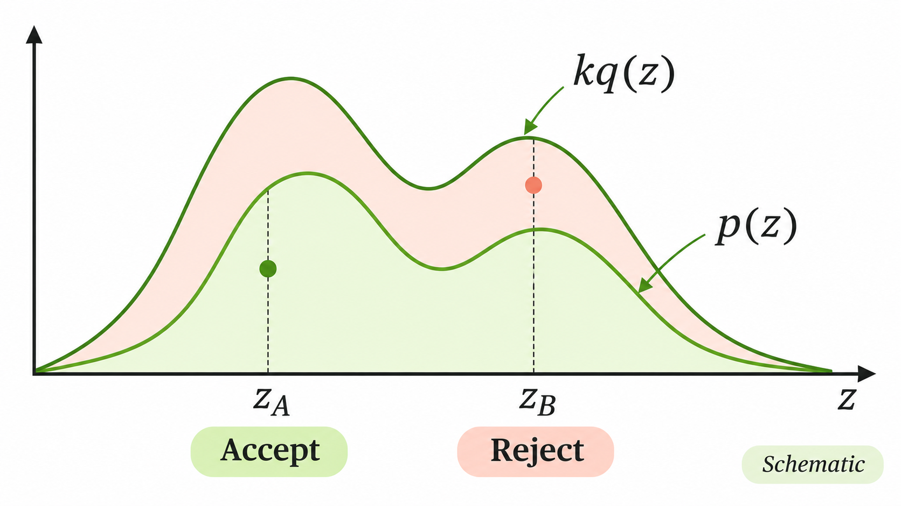

앞에서는 우리가 원하는 분포 \(p(z)\)에서 샘플을 추출할 수 있다고 가정했다. 이렇게 얻은 샘플들의 평균을 이용하면 복잡한 기댓값도 근사할 수 있었다.

그런데 실제로는 **확률분포의 수식을 알고 있어도 그 분포에서 샘플을 직접 생성하기 어려울 수 있다.**

예를 들어 다음과 같은 함수를 생각해보자.

\[
\widetilde p(z)=
\exp\left[-\frac12(z^2-4)^2\right].
\]

이 함수는 \(z=-2\)와 \(z=2\) 근처에서 큰 값을 갖는, 봉우리가 두 개인 형태이고, 함수의 전체 적분으로 나누면 확률밀도함수가 된다.

어떤 \(z\)에서 함수값을 계산하는 것은 어렵지 않다. 수식에 \(z\)를 대입하면 되기 때문이다.

그런데 이 분포에서 무작위로 샘플 1,000개를 생성하라고 한다면 어떨까? 정규분포처럼 익숙한 Sampling 방법을 바로 적용하기는 어렵다. 함수값을 계산하는 방법과 그 분포를 따르는 난수를 생성하는 방법은 서로 다르기 때문이다.

이럴 때 활용할 수 있는 방법 중 하나가 **Rejection Sampling**이다.

핵심은 샘플을 생성하기 쉬운 다른 분포에서 후보를 얻은 다음, 일부 후보를 확률적으로 버리는 것이다.

그런데 후보를 버리기만 해서 어떻게 원하는 분포의 샘플을 얻을 수 있을까?

먼저 간단한 예시부터 살펴보자.

### 1. 샘플 버리기

숫자 \(1,2,3\) 중 하나를 같은 확률로 뽑는다고 하자.

\[
q=(1/3,1/3,1/3).
\]

이 분포에서 샘플을 600개 생성하면, 평균적으로 각 숫자가 200번씩 나타날 것이다.

그런데 우리가 정말 원하는 분포는 다음과 같다고 하자.

\[
p=(0.6,0.3,0.1).
\]

즉, 숫자 1은 전체의 60%, 숫자 2는 30%, 숫자 3은 10% 정도 나타났으면 좋겠다.

여기서 처음 뽑은 600개의 후보를 전부 사용하지 않고, 다음 규칙에 따라 일부만 남겨보자.

| 후보 | 원래 추출 비율 | 남길 확률 |
|---|---:|---:|
| 1 | \(1/3\) | \(1\) |
| 2 | \(1/3\) | \(1/2\) |
| 3 | \(1/3\) | \(1/6\) |

숫자 1은 모두 남기고, 숫자 2는 절반만, 숫자 3은 여섯 개 중 하나꼴로 남기는 것이다.

600개의 후보에 이 규칙을 적용하면 평균적으로 다음과 같은 결과를 얻는다.

- 숫자 1: 200개
- 숫자 2: 100개
- 숫자 3: 약 33개

이제 버린 후보를 제외하고 남은 샘플들의 비율을 계산해보자.

남은 샘플은 대략 \(200:100:33\), 즉 \(6:3:1\)의 비율을 갖는다. 이를 확률로 바꾸면 거의 \((0.6,0.3,0.1)\)이 된다.

처음에는 세 숫자를 똑같은 확률로 뽑았는데, **숫자마다 서로 다른 확률로 후보를 남겼더니 최종적으로 원하는 분포가 만들어진 것**이다.

물론 실제로 600개를 추출한 결과가 정확히 이 비율과 일치하지는 않는다. 여기서는 각 숫자가 평균적으로 몇 개 남는지를 계산한 것이다.

Rejection Sampling은 이러한 아이디어를 일반적인 확률분포에 적용한 방법이다.

이제 어떤 후보를 얼마나 자주 남겨야 하는지 수학적으로 정의해보자.

### 2. Envelope와 Acceptance Probability

우리가 샘플을 생성하려는 목표분포(Target Distribution)를 \(p(z)\)라고 하자.

\(p\)에서 직접 Sampling하는 것은 어렵지만, 각 위치에서 밀도 \(p(z)\)를 계산할 수 있다고 가정한다.

대신 샘플을 생성하기 쉬운 다른 확률분포 \(q(z)\)를 준비하자. 이를 **Proposal Distribution**이라고 한다.

다만 \(q\)에서 생성한 샘플을 그대로 사용하면 당연히 \(q\)를 따르는 샘플을 얻게 된다. 따라서 후보마다 남길 확률을 다르게 정해야 한다.

그 기준은 목표밀도 \(p(z)\)와 Proposal 밀도 \(q(z)\)의 비율에서 얻을 수 있다.

먼저 다음 조건을 만족하는 유한한 상수 \(k\)를 찾았다고 하자.

\[
\boxed{
p(z)\le kq(z)
}
\]

이 부등식은 필요한 모든 영역에서 성립해야 한다.

즉, Proposal 밀도 \(q(z)\)를 \(k\)배 했을 때 그 곡선이 목표밀도 \(p(z)\)를 완전히 감싸도록 하는 것이다.

이때 \(kq(z)\)를 **Envelope(포락선)**이라고 한다.

왜 이런 조건이 필요할까?

우리는 후보를 남길 확률을 다음과 같이 정의하려고 한다.

\[
\boxed{
\alpha(z)=\frac{p(z)}{kq(z)}
}
\]

여기서 \(\alpha(z)\)는 후보가 \(z\)일 때의 Acceptance Probability다.

확률은 0과 1 사이의 값이어야 한다. 그런데 \(p(z)\le kq(z)\)가 성립하므로

\[
0\le\alpha(z)\le1
\]

이 보장된다. 위 비율은 \(q(z)>0\)인 위치에서 계산한다.

이제 식의 의미를 생각해보자.

어떤 위치에서 목표밀도 \(p(z)\)가 Envelope에 가깝다면 \(\alpha(z)\)도 1에 가까워진다. 따라서 그 위치에서 뽑은 후보는 자주 남는다.

반대로 목표밀도가 Envelope보다 훨씬 낮다면 \(\alpha(z)\)는 작아진다. 그런 위치의 후보는 대부분 버려진다.

앞에서 숫자 1, 2, 3을 서로 다른 확률로 남겼던 것과 같은 원리다.

### 3. Rejection Sampling Algorithm

이제 실제로 샘플을 생성해보자.

먼저 Proposal Distribution에서 후보를 하나 뽑는다.

\[
Z\sim q.
\]

그다음 0과 1 사이에서 균등하게 난수를 생성한다.

\[
U\sim\operatorname{Uniform}(0,1).
\]

이때 \(U\)는 후보 \(Z\)와 독립이다.

이제 다음 조건을 확인한다.

\[
\boxed{
U\le\frac{p(Z)}{kq(Z)}
}
\]

조건을 만족하면 후보 \(Z\)를 수용(Accept)하고, 그렇지 않으면 거절(Reject)한다.

거절된 후보는 버리고, 다시 \(q\)에서 새로운 후보를 생성한다. 원하는 개수만큼 수용된 샘플을 얻을 때까지 이 과정을 반복하면 된다.

여기서 수용·거절 과정을 그래프로 생각하면 훨씬 이해하기 쉽다.

*목표밀도 \(p(z)\)와 Envelope \(kq(z)\). 후보가 목표밀도 아래의 영역에 놓이면 수용되고, 그 사이의 영역에 놓이면 거절된다.*

후보 \(Z\)를 뽑은 뒤, 다음과 같은 높이를 하나 생성한다고 생각해보자.

\[
H=U\cdot kq(Z).
\]

\(U\)가 0과 1 사이에서 균등하게 선택되므로, \(H\)는 높이 0부터 \(kq(Z)\) 사이에서 균등하게 선택된다.

이제 후보점 \((Z,H)\)가 목표밀도 곡선 \(p(z)\) 아래에 있는지 확인하면 된다.

\[
\boxed{H\le p(Z)}
\]

이는 앞에서 정의한 Acceptance Probability와 정확히 같은 조건이다.

따라서 그림에서 목표밀도 아래에 있는 점은 수용하고, 목표밀도와 Envelope 사이에 있는 점은 거절하면 된다.

**[INTERACTIVE 4.4-1 — Rejection Sampling Explorer]**

위 시각화에서 후보를 하나씩 생성해보자.

처음에는 Proposal Distribution에서 뽑은 후보들이 나타난다. 각 후보의 높이가 목표밀도보다 낮으면 수용되고, 높으면 거절된다.

수용된 후보들만 모아 히스토그램을 그리면, 샘플이 쌓일수록 그 모양이 목표분포에 가까워지는 것을 확인할 수 있다.

그렇다면 이렇게 얻은 샘플이 단순히 목표분포와 비슷한 정도가 아니라, **정확히 \(p(z)\)를 따르는 이유는 무엇일까?**

### 4. 수용된 샘플이 목표분포를 따르는 이유

후보가 수용되는 사건을 \(A\)라고 하자.

먼저 후보가 \(Z=z\)로 주어졌을 때 수용될 확률은

\[
P(A\mid Z=z)=\frac{p(z)}{kq(z)}
\]

였다.

그런데 후보 자체는 \(q(z)\)를 따른다.

따라서 \(z\) 부근에서 후보가 생성되고 동시에 수용되는 확률밀도는

\[
\begin{aligned}
q(z)P(A\mid Z=z)
&=q(z)\frac{p(z)}{kq(z)}\\[4pt]
&=\boxed{\frac{p(z)}{k}}
\end{aligned}
\]

가 된다.

여기서 중요한 결과가 나왔다.

원래 후보는 \(q(z)\)를 따랐는데, 수용된 후보의 분포는 \(p(z)/k\)에 비례하게 된 것이다.

이제 후보 하나가 수용될 전체 확률을 계산하자.

\[
\begin{aligned}
P(A)
&=\int q(z)P(A\mid Z=z)\,\mathrm dz\\[4pt]
&=\int\frac{p(z)}{k}\,\mathrm dz\\[4pt]
&=\frac1k
\underbrace{\int p(z)\,\mathrm dz}_{=1}\\[4pt]
&=\boxed{\frac1k}.
\end{aligned}
\]

\(p\)는 정규화된 확률밀도이므로 전체 적분값이 1이다.

따라서 후보 하나가 수용될 확률은 \(1/k\)이다.

마지막으로 수용되었다는 조건 아래에서 후보 \(Z\)의 밀도를 구해보자.

\[
\begin{aligned}
p(z\mid A)
&=\frac{q(z)P(A\mid Z=z)}{P(A)}\\[6pt]
&=\frac{p(z)/k}{1/k}\\[4pt]
&=\boxed{p(z)}.
\end{aligned}
\]

결국 **수용된 후보의 조건부분포가 정확히 목표분포 \(p(z)\)와 일치한다.**

앞의 숫자 예제에서는 남은 샘플의 비율이 목표확률에 맞춰졌고, 여기서는 같은 사실을 연속형 확률분포에 대해 증명한 것이다.

매번 새로운 독립적인 후보와 Uniform 난수를 생성한다면, 수용된 샘플들도 서로 독립이며 목표분포 \(p\)를 따른다.

### 5. 정규화 상수를 모르는 경우

앞에서는 정규화된 목표밀도 \(p(z)\)를 계산할 수 있다고 가정했다.

그런데 실제로는 밀도의 상대적인 크기만 알고, 정규화 상수는 모르는 경우가 많다.

도입부에서 본 함수도 그 예다.

\[
\widetilde p(z)
=
\exp\left[-\frac12(z^2-4)^2\right].
\]

이 함수의 값을 계산하는 것은 쉽지만, 확률밀도함수로 사용하려면 먼저 전체 적분으로 나누어야 한다.

일반적으로 다음과 같이 표현하자.

\[
\boxed{
p(z)=\frac{\widetilde p(z)}{Z_p},
\qquad
Z_p=\int\widetilde p(z)\,\mathrm dz
}
\]

여기서 \(\widetilde p(z)\)는 비정규화 밀도이고, \(Z_p\)는 정규화 상수다.

문제는 \(Z_p\)를 계산하기 어려울 수 있다는 것이다.

그렇다면 Rejection Sampling을 사용할 수 없을까?

꼭 그렇지는 않다.

이번에는 비정규화 밀도 \(\widetilde p(z)\)를 감싸는 Envelope를 찾으면 된다.

어떤 유한한 상수 \(C\)에 대해

\[
\boxed{
\widetilde p(z)\le Cq(z)
}
\]

가 성립한다고 하자.

그러면 Acceptance Probability를 다음과 같이 정의할 수 있다.

\[
\boxed{
\alpha(z)
=
\frac{\widetilde p(z)}{Cq(z)}
}
\]

여기에는 알 수 없는 정규화 상수 \(Z_p\)가 등장하지 않는다.

이 방법이 정말 올바른지 확인해보자.

후보 하나가 수용될 전체 확률은

\[
\begin{aligned}
P(A)
&=\int q(z)\frac{\widetilde p(z)}{Cq(z)}
\,\mathrm dz\\[4pt]
&=\frac1C\int\widetilde p(z)\,\mathrm dz\\[4pt]
&=\boxed{\frac{Z_p}{C}}
\end{aligned}
\]

이다.

따라서 수용된 후보의 조건부 밀도는

\[
\begin{aligned}
p(z\mid A)
&=\frac{\widetilde p(z)/C}{Z_p/C}\\[4pt]
&=\frac{\widetilde p(z)}{Z_p}\\[4pt]
&=\boxed{p(z)}
\end{aligned}
\]

가 된다.

즉, **정규화 상수를 직접 계산하지 않아도 정확한 목표분포의 샘플을 얻을 수 있다.**

다만 적절한 Envelope 상수 \(C\)는 별도로 찾아야 한다. 정규화 상수를 모른다는 문제가 사라진 것은 아니지만, Sampling 과정에서 이를 직접 계산할 필요는 없어진 것이다.

### 6. Sampling Efficiency

마지막으로 계산 효율을 생각해보자.

Rejection Sampling에서는 후보를 많이 생성하더라도 그중 상당수가 거절될 수 있다.

앞에서 정규화된 목표분포를 사용할 때의 수용확률은

\[
P(A)=\frac1k
\]

라는 것을 확인했다.

예를 들어 \(k=2\)라면 평균적으로 후보 두 개 중 하나가 수용된다.

반면 \(k=10\)이라면 후보 열 개 중 하나 정도만 수용된다.

따라서 수용된 샘플 하나를 얻기 위해 필요한 Proposal의 평균 개수는

\[
\boxed{
\mathbb E[\text{Proposals per acceptance}]=k
}
\]

이다.

여기서 \(k\)가 작을수록 효율적인 Sampling이 가능하다.

일반적으로 Proposal \(q(z)\)가 목표분포 \(p(z)\)의 모양을 잘 따라가면, 목표밀도를 감싸기 위해 지나치게 큰 \(k\)를 사용할 필요가 줄어든다.

반대로 Proposal과 목표분포의 모양이 많이 다르면 큰 Envelope가 필요해지고, 대부분의 후보가 거절될 수 있다.

따라서 Rejection Sampling에서는 단순히 샘플을 생성하기 쉬운 Proposal을 고르는 것뿐 아니라, **목표분포를 얼마나 효율적으로 감싸는지도 중요하다.**

---

Rejection Sampling은 샘플을 생성하기 어려운 목표분포 대신, 샘플을 생성하기 쉬운 Proposal을 이용하는 방법이다.

후보를 그대로 사용하는 것이 아니라 목표밀도와 Proposal 밀도의 비율에 따라 일부를 수용한다. 이 규칙을 적용하면 남은 샘플들의 분포가 정확히 목표분포를 따르게 된다.

다만 적절한 Envelope를 찾기 어렵거나 수용확률이 지나치게 낮다면 계산이 비효율적일 수 있다.

이후에 살펴볼 Metropolis–Hastings에서는 이러한 수용·거절 아이디어를 사용하지만, 후보가 거절되었을 때 완전히 버리는 대신 현재 상태에 머무르는 Markov Chain을 구성한다.