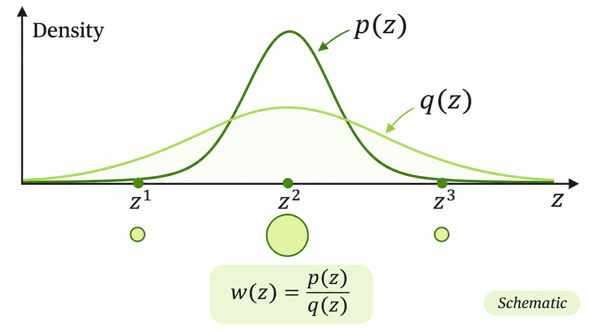

> 작성자 검토 전

## 4.5 Importance Sampling

앞 절에서는 Rejection Sampling을 이용해 복잡한 목표분포에서 샘플을 생성하는 방법을 살펴봤다.

샘플을 생성하기 쉬운 Proposal Distribution에서 후보를 뽑고, 적절한 확률로 일부만 수용하면 목표분포를 따르는 샘플을 얻을 수 있었다.

그런데 우리가 원하는 것이 반드시 목표분포의 샘플 자체일 필요는 없다. 단순히 어떤 함수의 기댓값을 계산하고 싶은 상황이라면 어떨까?

$$
\mu
=
\mathbb E_{Z\sim p}[f(Z)]
=
\int f(z)p(z)\,\mathrm dz.
$$

여기서 $p$는 목표분포이고, $f$는 기댓값을 계산하려는 함수다.

이 적분을 계산하기 어렵고 $p$에서 직접 샘플을 뽑을 수도 없다면, **다른 분포에서 샘플을 생성하되 각 샘플의 중요도를 다르게 반영하는 방법**을 생각할 수 있다.

이것이 Importance Sampling의 기본 아이디어다.

### Importance Weight

먼저 샘플을 생성하기 쉬운 Proposal Distribution $q(z)$를 선택하자.

단, 기댓값을 계산하는 데 필요한 목표분포의 영역을 $q$가 충분히 포함해야 한다. 특히 $p(z)$가 양수이고 기댓값에 기여하는 영역에서 $q(z)=0$이라면, 그 영역의 정보는 Proposal에서 얻을 수 없다.

이제 원래 기댓값에 $q(z)$를 곱하고 나누어보자.

$$
\begin{aligned}
\mu
&=\int f(z)p(z)\,\mathrm dz\\[4pt]
&=\int f(z)\frac{p(z)}{q(z)}
q(z)\,\mathrm dz\\[4pt]
&=\mathbb E_{Z\sim q}
\left[
f(Z)\frac{p(Z)}{q(Z)}
\right].
\end{aligned}
$$

여기서 중요한 것은 적분을 계산하는 기준이 $p$에서 $q$로 바뀌었다는 점이다.

대신 원래 분포와 Proposal의 차이를 보정하기 위해 다음과 같은 가중치를 도입했다.

$$
\boxed{
w(z)=\frac{p(z)}{q(z)}
}
$$

이를 Importance Weight라고 한다.

어떤 위치에서 $p(z)$가 $q(z)$보다 상대적으로 크다면 그 위치의 가중치도 커진다. 반대로 $q(z)$가 상대적으로 크다면 가중치는 작아진다.

즉, Proposal에서 너무 자주 나타나는 영역은 적게 반영하고, 목표분포에 비해 드물게 나타나는 영역은 더 크게 반영하는 것이다.

*Proposal에서 추출한 샘플에 목표밀도와 Proposal 밀도의 비율에 따라 서로 다른 가중치를 부여하는 과정.*

이제 $q$에서 독립적으로 $S$개의 샘플을 생성하자.

$$
Z^{(1)},\ldots,Z^{(S)}
\overset{\mathrm{i.i.d.}}{\sim}q.
$$

각 샘플에서 $f(Z^{(s)})$를 계산하고 Importance Weight를 곱한 뒤 평균을 구하면

$$
\boxed{
\widehat\mu_{\mathrm{IS}}
=
\frac1S\sum_{s=1}^{S}
f(Z^{(s)})w(Z^{(s)})
}
$$

를 얻는다.

이것이 Importance Sampling Estimator다.

Rejection Sampling과 달리 여기서는 후보를 수용하거나 거절하지 않는다. **추출한 모든 샘플을 사용하되, 각 샘플이 평균에 기여하는 정도를 가중치로 조절한다.**

### Unbiasedness와 Variance

이 추정량이 실제 기댓값을 제대로 추정하는지 확인해보자.

필요한 기댓값이 존재한다면

$$
\begin{aligned}
\mathbb E[\widehat\mu_{\mathrm{IS}}]
&=\frac1S\sum_{s=1}^{S}
\mathbb E_q[f(Z^{(s)})w(Z^{(s)})]\\[4pt]
&=\mathbb E_q[f(Z)w(Z)]\\[4pt]
&=\int f(z)p(z)\,\mathrm dz\\[4pt]
&=\boxed{\mu}
\end{aligned}
$$

이다.

따라서 Importance Sampling Estimator는 불편추정량이다.

그렇다면 추정값의 변동은 얼마나 클까?

각 샘플이 독립이고 필요한 이차 모멘트가 유한하다면, 표본평균의 분산은

$$
\begin{aligned}
\operatorname{Var}(\widehat\mu_{\mathrm{IS}})
&=\frac1S\operatorname{Var}_q(f(Z)w(Z))\\[4pt]
&=\frac1S\left\{
\mathbb E_q[f(Z)^2w(Z)^2]-\mu^2
\right\}.
\end{aligned}
$$

여기에 $w(z)=p(z)/q(z)$를 대입하면

$$
\boxed{
\begin{aligned}
&\operatorname{Var}(\widehat\mu_{\mathrm{IS}})\\[4pt]
&=\frac1S\left\{
\int\frac{f(z)^2p(z)^2}{q(z)}
\,\mathrm dz-\mu^2
\right\}.
\end{aligned}
}
$$

를 얻는다.

이 식에서 중요한 부분은 적분 안의 분모 $q(z)$다.

$f(z)p(z)$가 중요한 값을 갖는 영역에서 $q(z)$가 지나치게 작으면, 그 영역의 샘플은 거의 나타나지 않으면서도 한 번 나타났을 때 매우 큰 가중치를 받는다.

그 결과 추정값의 변동이 커질 수 있다. 경우에 따라서는 위 적분이 발산하여 유한한 분산조차 갖지 못할 수 있다.

따라서 Importance Sampling에서는 단순히 샘플을 생성하기 쉬운 Proposal을 고르는 것만으로는 충분하지 않다. **우리가 계산하려는 기댓값에 중요한 영역을 얼마나 잘 탐색하는지**도 고려해야 한다.

### Optimal Proposal

그렇다면 어떤 Proposal을 선택하면 추정량의 분산을 가장 작게 만들 수 있을까?

앞에서 구한 분산식을 다시 보자.

$$
\operatorname{Var}(\widehat\mu_{\mathrm{IS}})
=
\frac1S\left\{
\int\frac{f(z)^2p(z)^2}{q(z)}
\,\mathrm dz-\mu^2
\right\}.
$$

여기서 $p$와 $f$를 고정하고 $q$를 선택한다고 하자.

먼저 $f(z)\ge0$이고 $0<\mu<\infty$인 경우를 생각해보자.

이때 다음과 같이 Proposal을 선택할 수 있다.

$$
\boxed{
q^*(z)
=
\frac{f(z)p(z)}{\mu}
}
$$

분모의 $\mu$는

$$
\mu=\int f(z)p(z)\,\mathrm dz
$$

이므로, $q^*$는 적분값이 1인 확률밀도다.

이 Proposal에서 샘플을 생성하면 $f(z)p(z)>0$인 영역에서

$$
\begin{aligned}
f(z)w(z)
&=f(z)\frac{p(z)}{q^*(z)}\\[4pt]
&=f(z)\frac{p(z)}
{f(z)p(z)/\mu}\\[4pt]
&=\mu
\end{aligned}
$$

가 된다.

즉, 어떤 샘플을 뽑더라도 가중된 함수값이 항상 $\mu$로 일정하다.

따라서 이론적으로

$$
\boxed{
\operatorname{Var}(\widehat\mu_{\mathrm{IS}})=0
}
$$

이 가능하다.

하지만 여기에는 문제가 있다.

최적 Proposal을 정의하려면 정규화 상수인 $\mu$를 알아야 하는데, $\mu$가 바로 우리가 처음부터 계산하려던 기댓값이다.

따라서 이 결과는 Importance Sampling의 이상적인 Proposal이 어떤 형태인지 알려주지만, 일반적으로 즉시 사용할 수 있는 해결책은 아니다.

또한 $f$가 양수와 음수를 모두 가질 수 있다면 일반적인 최소분산 Proposal은 $|f(z)|p(z)$에 비례하며, 이 경우 최소분산이 반드시 0이 되는 것은 아니다.

### Self-normalized Importance Sampling

지금까지는 정규화된 목표밀도 $p(z)$를 계산할 수 있다고 가정했다.

그런데 실제 확률모형에서는 목표밀도의 정규화 상수를 모르는 경우가 많다.

$$
p(z)=\frac{\widetilde p(z)}{Z_p},
\qquad
Z_p=\int\widetilde p(z)\,\mathrm dz.
$$

여기서 $\widetilde p(z)$는 계산할 수 있지만 $Z_p$는 알 수 없다고 하자.

이 경우에는 비정규화된 Importance Weight를 정의할 수 있다.

$$
\boxed{
\widetilde w(z)
=
\frac{\widetilde p(z)}{q(z)}
}
$$

이때는 $\widetilde p(z)>0$인 모든 영역에서 $q(z)>0$이라고 가정한다.

이 가중치의 $q$에 대한 기댓값을 계산하면

$$
\begin{aligned}
\mathbb E_q[\widetilde w(Z)]
&=\int
\frac{\widetilde p(z)}{q(z)}
q(z)\,\mathrm dz\\[4pt]
&=\int\widetilde p(z)\,\mathrm dz\\[4pt]
&=Z_p.
\end{aligned}
$$

따라서 원래 기댓값은 다음과 같이 표현할 수 있다.

$$
\boxed{
\mu
=
\frac{
\mathbb E_q[f(Z)\widetilde w(Z)]
}{
\mathbb E_q[\widetilde w(Z)]
}
}
$$

이제 분자와 분모를 각각 Monte Carlo로 추정하면

$$
\boxed{
\widehat\mu_{\mathrm{SNIS}}
=
\frac{
\sum_{s=1}^{S}
\widetilde w(Z^{(s)})f(Z^{(s)})
}{
\sum_{s=1}^{S}
\widetilde w(Z^{(s)})
}
}
$$

를 얻는다.

이를 Self-normalized Importance Sampling(SNIS)이라고 한다.

각 샘플의 가중치를 전체 가중치의 합으로 나누면

$$
\overline w_s
=
\frac{\widetilde w(Z^{(s)})}
{\sum_{j=1}^{S}\widetilde w(Z^{(j)})}
$$

이므로

$$
\boxed{
\widehat\mu_{\mathrm{SNIS}}
=
\sum_{s=1}^{S}
\overline w_s f(Z^{(s)})
}
$$

로도 표현할 수 있다.

이때 정규화된 가중치들의 합은 1이다. 따라서 SNIS는 추출한 함수값들의 가중평균으로 이해할 수 있다.

물론 분모에 있는 가중치의 합이 양수여야 추정량이 정의된다.

SNIS의 장점은 알 수 없는 정규화 상수 $Z_p$를 직접 계산하지 않아도 된다는 점이다.

다만 일반적인 Importance Sampling Estimator와 달리, SNIS는 유한한 표본에서 일반적으로 편향되어 있다.

그 이유는 **분자의 기대값을 분모의 기대값으로 나눈 것과, 두 표본평균의 비율에 기대값을 취한 것이 일반적으로 같지 않기 때문**이다.

하지만 필요한 적분가능성과 Support 조건이 성립하면, 샘플 수가 증가할수록 분자와 분모의 표본평균이 각각의 기댓값에 수렴한다.

따라서

$$
\boxed{
\widehat\mu_{\mathrm{SNIS}}
\xrightarrow{a.s.}\mu
}
$$

가 성립한다.

즉, SNIS는 유한한 샘플에서 편향이 있을 수 있지만 일치추정량(Consistent Estimator)이다.

결국 Importance Sampling은 목표분포 대신 Proposal에서 샘플을 생성하고, 두 분포의 밀도비로 각 샘플의 기여도를 보정하는 방법이다.

정규화 상수를 알고 있다면 불편추정량을 구성할 수 있고, 정규화 상수를 모르는 경우에도 Self-normalization을 이용해 기댓값을 추정할 수 있다.
