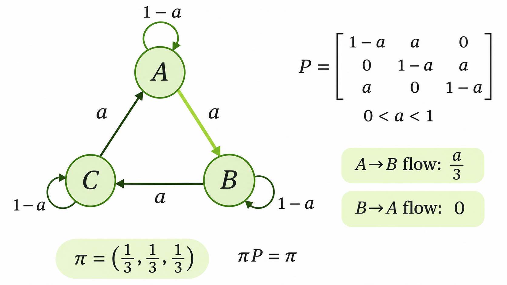

> 작성자 검토 전

## 4.9 Detailed Balance

앞 절에서는 Stationary Distribution을 정의했다.

어떤 확률분포 $\pi$에 Transition Kernel $T$를 적용해도 분포가 변하지 않는다면, $\pi$를 $T$의 정상분포라고 했다.

연속 상태공간에서 전이밀도가 존재할 때는 다음과 같이 표현할 수 있다.

$$
\boxed{
\pi(z')
=
\int \pi(z)T(z'\mid z)\,\mathrm dz
}
$$

여기서 $\pi$는 우리가 유지하고 싶은 목표분포이고, $T(z'\mid z)$는 현재 상태 $z$에서 다음 상태 $z'$로 이동하는 전이 규칙이다.

MCMC에서는 이러한 관계를 만족하는 Transition Kernel을 설계하고 싶다.

그런데 임의의 $T$가 주어졌을 때 위 적분을 직접 계산해 정상분포 조건을 확인하기는 어려울 수 있다.

그렇다면 **복잡한 적분을 직접 계산하지 않고도 목표분포가 정상분포라는 사실을 보장할 방법은 없을까?**

이를 위해 사용하는 조건이 Detailed Balance다.

### Detailed Balance

먼저 서로 다른 두 상태 $z,z'$를 생각해보자.

현재 상태의 분포가 $\pi$라면, $z$에서 $z'$로 이동하는 확률의 흐름은

$$
\pi(z)T(z'\mid z)
$$

로 표현할 수 있다.

$\pi(z)$는 현재 상태가 $z$에 있을 확률밀도이고, $T(z'\mid z)$는 그 상태에서 $z'$로 이동하는 전이밀도다. 두 값을 곱하면 두 상태 사이의 확률 흐름을 나타낼 수 있다.

반대 방향도 생각해보자.

$z'$에서 $z$로 이동하는 확률 흐름은

$$
\pi(z')T(z\mid z')
$$

이다.

**Detailed Balance는 이 두 방향의 확률 흐름이 같아야 한다는 조건**이다.

$$
\boxed{
\pi(z)T(z'\mid z)
=
\pi(z')T(z\mid z')
}
$$

여기서 중요한 것은 양방향의 Transition Kernel 자체가 같아야 한다는 뜻이 아니라는 점이다.

일반적으로

$$
T(z'\mid z)\neq T(z\mid z')
$$

일 수 있다.

대신 각 상태가 나타날 가능성인 $\pi(z)$와 $\pi(z')$까지 고려했을 때, 두 방향으로 이동하는 확률의 흐름이 같아야 한다는 것이다.

### Detailed Balance가 Stationarity를 보장하는 이유

이제 Detailed Balance가 성립하면 $\pi$가 정상분포가 된다는 사실을 확인해보자.

우리가 증명하고 싶은 것은

$$
\pi(z')
=
\int\pi(z)T(z'\mid z)\,\mathrm dz
$$

이다.

여기서 오른쪽의 적분에 Detailed Balance를 적용해보자.

$$
\begin{aligned}
&\int\pi(z)T(z'\mid z)\,\mathrm dz\\[4pt]
&=\int\pi(z')T(z\mid z')\,\mathrm dz\\[4pt]
&=\pi(z')\int T(z\mid z')\,\mathrm dz\\[4pt]
&=\boxed{\pi(z')}.
\end{aligned}
$$

두 번째 줄에서는 Detailed Balance를 사용했고, 세 번째 줄에서는 $\pi(z')$가 적분변수 $z$에 의존하지 않으므로 적분 밖으로 꺼냈다.

마지막 줄에서

$$
\int T(z\mid z')\,\mathrm dz=1
$$

인 이유는 $T(\cdot\mid z')$가 현재 상태 $z'$에서 이동할 수 있는 모든 다음 상태에 대한 확률분포이기 때문이다.

따라서

$$
\boxed{
\text{Detailed Balance}
\;\Longrightarrow\;
\text{Stationarity}
}
$$

가 성립한다.

이산 상태공간에서도 같은 증명을 사용할 수 있다. 적분을 모든 상태에 대한 합으로 바꾸면 된다.

즉, Detailed Balance를 만족하도록 전이 규칙을 설계하면 목표분포 $\pi$가 정상분포임을 보장할 수 있다.

이처럼 Detailed Balance를 만족하는 정상 상태의 Markov Chain은 시간의 진행 방향을 뒤집더라도 확률적 흐름이 동일한 **Reversible Markov Chain**이다.

### Detailed Balance는 반드시 필요한 조건일까?

그런데 정상분포를 유지하려면 모든 상태 쌍 사이의 흐름이 반드시 같아야 할까?

그렇지는 않다.

Stationarity는 각 상태로 들어오는 전체 확률과 나가는 전체 확률이 균형을 이루면 성립한다.

반면 Detailed Balance는 그보다 강하게 **모든 상태 쌍의 양방향 흐름이 각각 같아야 한다**고 요구한다.

따라서 Detailed Balance는 Stationarity의 충분조건이지만 필요조건은 아니다.

이를 세 개의 상태로 이루어진 Markov Chain에서 확인해보자.

### Example — Three-State Cyclic Markov Chain

상태가 $A,B,C$ 세 개이고, 전이행렬이 다음과 같다고 하자.

$$
\boxed{
\begin{aligned}
&P=
\begin{pmatrix}
1-a&a&0\\
0&1-a&a\\
a&0&1-a
\end{pmatrix},\\[4pt]
&0<a<1.
\end{aligned}
}
$$

여기서 행은 현재 상태, 열은 다음 상태를 나타낸다.

각 상태는 확률 $1-a$로 제자리에 머무르거나, 확률 $a$로 다음 상태로 이동한다.

이동 방향은

$$
A\rightarrow B\rightarrow C\rightarrow A
$$

로 이어진다.

*세 상태 사이에 확률이 순환하는 Markov Chain. 정상분포는 유지되지만 Detailed Balance는 성립하지 않는다.*

이제 다음과 같은 균등분포를 생각해보자.

$$
\pi=\left(\frac13,\frac13,\frac13\right).
$$

이 분포가 정상분포인지 확인하려면 $\pi P=\pi$를 계산하면 된다.

$$
\begin{aligned}
\pi P
&=
\frac13(1,1,1)
\begin{pmatrix}
1-a&a&0\\
0&1-a&a\\
a&0&1-a
\end{pmatrix}\\[6pt]
&=\frac13(1,1,1)\\[4pt]
&=\boxed{\pi}.
\end{aligned}
$$

따라서 $\pi$는 정상분포다.

그런데 이번에는 Detailed Balance가 성립하는지 확인해보자.

$A$에서 $B$로 이동하는 확률 흐름은

$$
\pi_A P_{AB}
=
\frac13a
$$

이다.

반대로 $B$에서 $A$로 이동하는 확률 흐름은

$$
\pi_B P_{BA}
=
\frac13\cdot0=0
$$

이다.

따라서

$$
\boxed{
\pi_A P_{AB}
=\frac a3
\neq
0=\pi_B P_{BA}
}
$$

이므로 Detailed Balance는 성립하지 않는다.

그런데도 정상분포는 유지된다. 왜 그럴까?

$A$에서 $B$로 확률이 이동하는 동시에, $C$에서도 $A$로 같은 양의 확률이 들어오기 때문이다.

마찬가지로 $B$에서 $C$로, $C$에서 $A$로 확률이 순환한다.

즉, 개별 상태 쌍에서는 양방향 흐름이 같지 않지만, 각 상태에서 전체적으로 들어오고 나가는 확률은 균형을 이룬다.

이처럼 Stationarity가 성립하더라도 Detailed Balance는 성립하지 않을 수 있다.

결국 Detailed Balance는 **목표분포를 정상분포로 만드는 데 사용할 수 있는 강력한 충분조건**이다.

다음 절에서는 이 조건을 만족하도록 Acceptance Probability를 설계하는 Metropolis–Hastings 알고리즘을 살펴보자.
