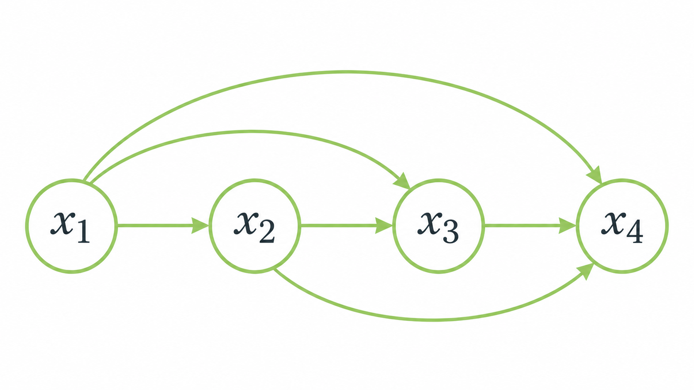

> 작성자 검토 전

# 5.1 The Chain Rule as a Generative Model

생성모델의 목표는 실제 데이터의 확률분포를 학습하는 것이다. 그런데 데이터가 여러 변수로 이루어져 있다면, 그 확률분포를 어떻게 표현할 수 있을까?

예를 들어 흑백 이미지에서 각 픽셀이 검은색(0) 또는 흰색(1) 중 하나의 값만 가진다고 생각해보자.

픽셀이 세 개뿐이라면 가능한 이미지는 다음과 같이 8가지다.

\[
\begin{gathered}
(0,0,0),\ (0,0,1),\ (0,1,0),\ (0,1,1),\\
(1,0,0),\ (1,0,1),\ (1,1,0),\ (1,1,1).
\end{gathered}
\]

각 이미지가 나타날 확률을 알고 있다면 전체 확률분포를 표현할 수 있다.

하지만 픽셀 수가 수백, 수천 개로 늘어난다면 어떨까?

모든 가능한 이미지에 대해 확률을 하나씩 저장하는 것은 현실적으로 불가능해진다.

이 문제를 해결하는 방법 중 하나가 **Autoregressive Model**이다.

## 1. 결합분포의 복잡성

먼저 데이터가 \(D\)개의 이진변수로 이루어져 있다고 하자.

\[
x=(x_1,\ldots,x_D),\qquad x_i\in\{0,1\}.
\]

각 변수는 두 가지 값을 가질 수 있으므로 가능한 데이터의 개수는 \(2^D\)개다.

따라서 아무런 제약이 없는 결합분포(Joint Distribution)를 표현하려면 각 경우에 대한 확률을 지정해야 한다.

다만 모든 확률의 합은 1이어야 한다.

\[
\sum_{x\in\{0,1\}^D}p(x)=1.
\]

따라서 마지막 확률 하나는 나머지 확률들로부터 결정된다.

결국 결합분포를 완전히 표현하는 데 필요한 자유모수(Free Parameter)의 개수는

\[
\boxed{2^D-1}
\]

이다.

예를 들어 변수가 3개라면 \(2^3-1=7\)개이지만, 변수가 20개만 되어도 필요한 자유모수는 100만 개가 넘는다.

즉, **데이터의 차원이 증가할수록 결합분포를 직접 표현하는 데 필요한 정보가 기하급수적으로 증가한다.**

그렇다면 모든 경우의 확률을 직접 저장하지 않고, 결합분포를 다른 방식으로 표현할 수는 없을까?

## 2. Chain Rule Factorization

확률의 Chain Rule을 이용하면 결합분포를 조건부확률들의 곱으로 나타낼 수 있다.

먼저 변수가 세 개인 경우를 생각해보자.

\[
p(x_1,x_2,x_3)
=
p(x_1)p(x_2\mid x_1)p(x_3\mid x_1,x_2).
\]

이 식은 다음과 같이 해석할 수 있다.

먼저 \(x_1\)이 나타날 확률을 생각한다. 그다음 \(x_1\)이 주어졌을 때 \(x_2\)가 나타날 확률을 계산하고, 마지막으로 앞의 두 값이 주어졌을 때 \(x_3\)가 나타날 확률을 계산한다.

이 세 확률을 곱하면 전체 데이터 \((x_1,x_2,x_3)\)가 나타날 확률을 얻는다.

예를 들어

\[
\begin{aligned}
p(x_1=1)&=0.6,\\
p(x_2=0\mid x_1=1)&=0.4,\\
p(x_3=1\mid x_1=1,x_2=0)&=0.8
\end{aligned}
\]

이라고 하자.

그러면 데이터 \((1,0,1)\)이 나타날 확률은

\[
p(1,0,1)=0.6\times0.4\times0.8=0.192
\]

이다.

이 방법을 \(D\)개의 변수로 일반화하면 다음과 같다.

\[
\boxed{
p(x_1,\ldots,x_D)
=
\prod_{i=1}^{D}p(x_i\mid x_{<i})
}
\]

여기서

\[
x_{<i}=(x_1,\ldots,x_{i-1})
\]

는 \(i\)번째 변수보다 앞에 있는 변수들을 의미한다. 첫 번째 항은 조건으로 주어지는 변수가 없으므로 \(p(x_1)\)이다.

*Figure 5.1-1. 앞선 변수들에 대한 자기회귀 의존 관계.*

여기서 중요한 점이 하나 있다.

**Chain Rule은 근사가 아니라 정확한 확률적 항등식(Exact Identity)이다.**

따라서 위와 같이 결합분포를 분해하기 위해 변수들이 독립이라는 가정을 할 필요는 없다.

예를 들어 \(x_3\)는 바로 앞에 있는 \(x_2\)뿐 아니라 \(x_1\)에도 의존할 수 있다. Chain Rule은 이러한 의존성을 그대로 유지한다.

### Chain Rule만으로 모수의 개수가 줄어들까?

그렇다면 이제 결합분포를 조건부분포들로 나누었으니, 앞에서 본 \(2^D-1\)개의 모수 문제도 해결된 걸까?

아직은 아니다.

앞의 세 이진변수 예시를 다시 생각해보자.

첫 번째 조건부분포 \(p(x_1)\)에는 자유모수가 1개 필요하다.

두 번째 조건부분포 \(p(x_2\mid x_1)\)에서는 \(x_1=0\)인 경우와 \(x_1=1\)인 경우를 각각 지정해야 하므로 자유모수가 2개 필요하다.

마지막 \(p(x_3\mid x_1,x_2)\)에서는 앞의 두 변수가 가질 수 있는 조합이 4가지이므로 자유모수가 4개 필요하다.

결국

\[
1+2+4=7
\]

개의 자유모수가 필요하다.

이는 처음에 결합분포를 직접 표현할 때와 정확히 같은 개수다.

일반적인 \(D\)개의 이진변수에서도 마찬가지다.

\[
\begin{aligned}
\#\text{Parameters}
&=\sum_{i=1}^{D}2^{i-1}\\[4pt]
&=1+2+\cdots+2^{D-1}\\[4pt]
&=2^D-1.
\end{aligned}
\]

즉, **Chain Rule로 분해했다는 사실만으로 필요한 모수의 개수가 줄어들지는 않는다.**

다만 이제 하나의 복잡한 결합분포를 직접 표현하는 대신, 여러 조건부분포를 표현하는 문제로 바꿀 수 있게 되었다.

이것이 Autoregressive Model의 출발점이다.

## 3. Neural Parameterization

앞에서는 조건부분포를 표현할 때 가능한 모든 조건에 대해 확률을 하나씩 저장한다고 생각했다.

그런데 꼭 그렇게 해야 할까?

예를 들어 \(p(x_i=1\mid x_{<i})\)를 계산하고 싶다고 하자.

우리가 필요한 것은 앞의 값들 \(x_{<i}\)가 주어졌을 때, 다음 값이 1이 될 확률이다.

그렇다면 이 확률을 직접 표에 저장하는 대신, **앞의 값들을 입력받아 확률을 출력하는 함수**를 만들 수도 있다.

\[
\boxed{
p_\theta(x_i=1\mid x_{<i})
=f_{\theta,i}(x_{<i})
}
\]

여기서 \(f_{\theta,i}\)는 0과 1 사이의 값을 출력하도록 설계한 함수다. 신경망을 이용해 이 함수를 표현할 수도 있다.

\(x_i\)가 이진변수이므로 나머지 확률은 자동으로 결정된다.

\[
p_\theta(x_i=0\mid x_{<i})
=1-f_{\theta,i}(x_{<i}).
\]

이제 모든 가능한 조건에 대한 확률을 별도로 저장할 필요가 없다. 대신 신경망이 이전 변수들과 다음 변수의 관계를 학습하도록 만들 수 있다.

이러한 조건부분포들을 결합하면 Autoregressive Model이 된다.

\[
\boxed{
p_\theta(x)
=
\prod_{i=1}^{D}p_\theta(x_i\mid x_{<i})
}
\]

여기서 \(\theta\)는 각 조건부분포를 표현하는 함수들의 모수를 통틀어 나타낸다.

조건부분포를 신경망으로 표현하는 것이 왜 유용한지도 생각해볼 수 있다.

예를 들어 앞의 변수들이 특정한 패턴을 가지면 다음 변수가 1이 될 확률이 높아진다고 하자.

모든 패턴을 별도의 확률로 저장하는 대신, 신경망이 이러한 규칙을 학습하도록 만드는 것이다.

다만 신경망을 사용한다고 해서 무조건 좋은 근사가 가능한 것은 아니다.

모델이 너무 단순하면 복잡한 조건부확률을 충분히 표현하지 못할 수 있고, 반대로 모델을 지나치게 복잡하게 만들면 계산 비용과 학습해야 하는 모수의 수가 커진다.

따라서 모델의 크기와 표현력(Expressivity) 사이에는 적절한 균형이 필요하다.

또한 신경망을 이용해 모수를 줄이려면 그 구조 자체가 효율적이어야 한다. 단순히 조건부분포마다 거대한 신경망을 따로 만드는 것만으로 문제가 해결되지는 않는다.

이후에는 이러한 조건부분포를 효율적으로 표현하는 여러 신경망 구조를 살펴볼 것이다.

## 4. Normalization — 전체 확률의 합은 1일까?

마지막으로 한 가지를 확인할 필요가 있다.

우리는 조건부분포들을 곱해 새로운 결합분포 \(p_\theta(x)\)를 만들었다.

그런데 이렇게 만든 함수가 실제로 올바른 확률분포가 되려면 모든 가능한 \(x\)에 대한 확률의 합이 1이어야 한다.

\[
\sum_{x\in\{0,1\}^D}p_\theta(x)=1.
\]

조건부분포를 각각 올바르게 정의했다면 이 조건도 자동으로 만족할까?

각 조건부분포가 다음을 만족한다고 가정하자.

\[
\begin{aligned}
p_\theta(x_i\mid x_{<i})&\geq0,\\[4pt]
\sum_{x_i\in\{0,1\}}
p_\theta(x_i\mid x_{<i})&=1.
\end{aligned}
\]

즉, 앞의 값들이 무엇으로 주어지더라도 다음 변수에 대한 조건부확률의 합은 1이다.

이제 전체 결합분포의 확률을 더해보자.

\[
\begin{aligned}
&\sum_{x_1,\ldots,x_D}p_\theta(x_1,\ldots,x_D)\\[4pt]
&=\sum_{x_1,\ldots,x_D}
\prod_{i=1}^{D}p_\theta(x_i\mid x_{<i}).
\end{aligned}
\]

여기서 가장 마지막 변수 \(x_D\)에 대한 합부터 계산해보자.

\[
\begin{aligned}
&\sum_{x_1,\ldots,x_{D-1}}
\left[
\prod_{i=1}^{D-1}p_\theta(x_i\mid x_{<i})
\right]\\
&\qquad\cdot
\underbrace{
\sum_{x_D}
p_\theta(x_D\mid x_{<D})
}_{=1}.
\end{aligned}
\]

마지막 조건부분포의 합이 1이므로 해당 항은 사라진다.

이제 \(x_{D-1}\)에 대해서도 같은 계산을 할 수 있다. 이 과정을 반복하면 모든 조건부분포의 합이 차례로 1이 된다.

따라서

\[
\boxed{
\sum_{x\in\{0,1\}^D}p_\theta(x)=1
}
\]

을 얻는다.

또한 각각의 조건부분포가 음수가 아니므로 그 곱인 \(p_\theta(x)\)도 음수가 아니다.

결국 **모든 조건부분포가 정규화되어 있다면, 이들을 Chain Rule 형태로 곱해 만든 결합분포도 자동으로 정규화된다.**

이 성질 덕분에 Autoregressive Model에서는 복잡한 결합분포의 정규화 상수를 별도로 계산할 필요가 없다.

---

이번 절에서는 높은 차원의 결합분포를 직접 표현하는 대신, Chain Rule을 이용해 여러 조건부분포로 나누는 방법을 살펴봤다.

Chain Rule 자체는 정확한 항등식이므로 추가적인 독립성 가정이 필요하지 않다. 다만 분해만으로 모수의 개수가 줄어드는 것은 아니며, 각 조건부분포를 어떤 함수로 표현할 것인지가 중요하다.

Autoregressive Model은 이 조건부분포들을 신경망 등의 함수로 표현한다. 또한 각 조건부분포가 올바르게 정규화되어 있다면 전체 결합분포도 정규화된다.

이제 이러한 모델을 실제로 학습하려면 주어진 데이터의 Likelihood를 계산할 수 있어야 한다. 다음 절에서는 Chain Rule을 이용해 Exact Likelihood를 계산하는 방법을 살펴본다.
