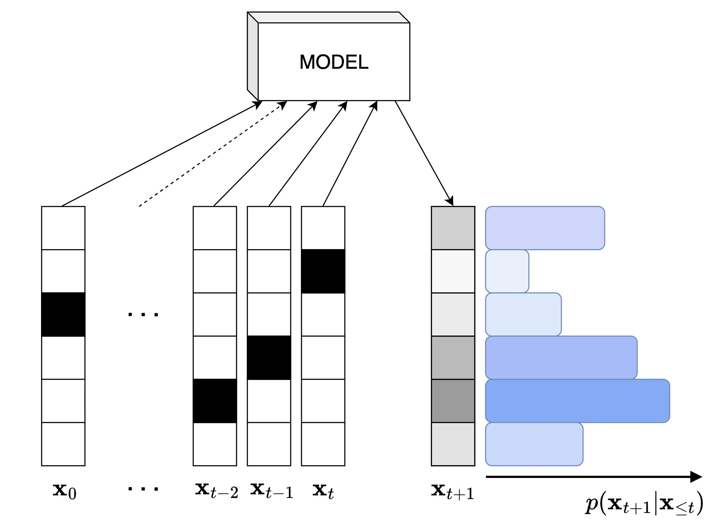

> 작성자 검토 전

# 5.3 Ancestral Sampling

앞 절에서는 Autoregressive Model을 이용해 주어진 데이터의 Likelihood를 정확하게 계산하는 방법을 살펴봤다.

그런데 생성모델의 목적은 관측한 데이터의 확률을 계산하는 것만이 아니다. 학습한 확률분포에서 새로운 데이터를 생성할 수도 있어야 한다.

Autoregressive Model에서는 이 과정도 비교적 간단하다.

앞에서 배운 Chain Rule을 다시 생각해보자.

\[
p_\theta(x)
=\prod_{i=1}^{D}p_\theta(x_i\mid x_{<i}).
\]

전체 데이터의 분포를 여러 조건부분포로 나누어 표현했으므로, 이제 **각 조건부분포에서 값을 순서대로 뽑으면 새로운 데이터를 생성할 수 있다.**

이러한 방법을 Ancestral Sampling이라고 한다.

## 1. Ancestral Sampling

먼저 세 개의 이진변수로 이루어진 데이터를 생각해보자.

\[
x=(x_1,x_2,x_3),\qquad x_i\in\{0,1\}.
\]

우리는 이 데이터의 결합분포를 다음과 같이 표현할 수 있다.

\[
\begin{aligned}
p_\theta(x_1,x_2,x_3)
&=p_\theta(x_1)p_\theta(x_2\mid x_1)\\
&\quad\cdot p_\theta(x_3\mid x_1,x_2).
\end{aligned}
\]

그렇다면 이 분포에서 새로운 데이터를 생성하려면 어떻게 해야 할까?

가장 먼저 \(p_\theta(x_1)\)에서 첫 번째 값을 뽑으면 된다. 아직 생성된 값이 없으므로 첫 번째 변수는 다른 변수에 의존하지 않는다.

\[
x_1\sim p_\theta(x_1).
\]

예를 들어 \(x_1=1\)이 뽑혔다고 하자.

이제 두 번째 변수는 앞에서 생성한 \(x_1=1\)을 조건으로 사용한다.

\[
x_2\sim p_\theta(x_2\mid x_1=1).
\]

이번에는 \(x_2=0\)이 뽑혔다고 하자.

마지막 변수는 앞서 생성한 두 값을 모두 조건으로 사용한다.

\[
x_3\sim p_\theta(x_3\mid x_1=1,x_2=0).
\]

여기서 \(x_3=1\)이 뽑혔다면 최종적으로 생성된 데이터는

\[
x=(1,0,1)
\]

이 된다.

이 과정을 \(D\)개의 변수로 일반화하면 다음과 같다.

\[
\boxed{
\begin{aligned}
x_1&\sim p_\theta(x_1),\\
x_2&\sim p_\theta(x_2\mid x_1),\\
x_3&\sim p_\theta(x_3\mid x_1,x_2),\\
&\ \vdots\\
x_D&\sim p_\theta(x_D\mid x_{<D}).
\end{aligned}
}
\]

즉, 첫 번째 변수부터 순서대로 값을 생성하고, **이미 생성한 값들을 다음 조건부분포의 입력으로 사용한다.**

*Figure 5.3-1. 이전 값들을 조건으로 다음 값의 분포를 계산한다.*

여기서 주의할 점은 각 단계에서 가장 확률이 높은 값을 선택하는 것이 아니라, **조건부분포에 따라 무작위로 Sampling한다**는 것이다.

따라서 같은 모델에서 여러 번 Sampling하더라도 매번 같은 데이터가 생성되는 것은 아니다.

## 2. Ancestral Sampling은 올바른 분포에서 샘플을 생성할까?

앞의 방법이 직관적으로는 자연스럽지만, 한 가지를 확인할 필요가 있다.

조건부분포에서 값을 차례대로 뽑았다고 해서, 그렇게 얻은 데이터가 정말 우리가 정의한 결합분포 \(p_\theta(x)\)를 따르는 걸까?

다시 세 변수의 예시를 생각해보자.

Ancestral Sampling에서 특정 데이터 \((x_1,x_2,x_3)\)가 생성되려면 다음 세 사건이 순서대로 일어나야 한다.

먼저 첫 번째 값으로 \(x_1\)이 뽑히고, 그 값이 주어진 상태에서 \(x_2\)가 뽑힌 다음, 두 값이 주어진 상태에서 \(x_3\)가 뽑혀야 한다.

따라서 이 데이터가 생성될 확률은

\[
p_\theta(x_1)
p_\theta(x_2\mid x_1)
p_\theta(x_3\mid x_1,x_2)
\]

이다.

그런데 이 식은 바로 Chain Rule로 표현한 결합확률과 같다.

\[
\begin{aligned}
p_\theta(x_1,x_2,x_3)
&=p_\theta(x_1)p_\theta(x_2\mid x_1)\\
&\quad\cdot p_\theta(x_3\mid x_1,x_2).
\end{aligned}
\]

일반적인 \(D\)차원에서도 마찬가지다.

Ancestral Sampling으로 특정 데이터 \(x\)가 생성될 확률을 \(p_{\mathrm{gen}}(x)\)라고 하면,

\[
\begin{aligned}
p_{\mathrm{gen}}(x)
&=p_\theta(x_1)
\prod_{i=2}^{D}p_\theta(x_i\mid x_{<i})\\[4pt]
&=\prod_{i=1}^{D}p_\theta(x_i\mid x_{<i})\\[4pt]
&=p_\theta(x).
\end{aligned}
\]

따라서

\[
\boxed{p_{\mathrm{gen}}(x)=p_\theta(x)}
\]

이다.

결국 **각 조건부분포에서 정확하게 Sampling할 수 있다면, Ancestral Sampling으로 생성한 데이터는 모델의 결합분포 \(p_\theta\)를 따른다.**

여기서 정확하다는 것은 실제 데이터 분포 \(p_{\mathrm{data}}\)와 일치한다는 뜻이 아니다. 학습된 모델이 정의한 분포 \(p_\theta\)에서 올바르게 샘플을 생성한다는 뜻이다.

### MCMC와는 무엇이 다를까?

Chapter 4에서 배운 MCMC와 비교하면 이 차이가 조금 더 분명해진다.

MCMC에서는 Markov Chain을 반복적으로 진행하면서 목표 분포에 가까워지도록 한다. 따라서 초기 상태의 영향이나 수렴 여부를 고려해야 했다.

반면 Autoregressive Model에서는 필요한 조건부분포가 이미 주어져 있다.

이를 순서대로 한 번씩 Sampling하면 결합분포에서 하나의 완성된 샘플을 얻을 수 있다.

따라서 **Ancestral Sampling 자체에는 MCMC와 같은 수렴 과정이 필요하지 않다.**

물론 전체 데이터를 생성하려면 \(D\)개의 변수를 순서대로 처리해야 하므로, 데이터의 차원이 크다면 생성 과정이 느려질 수 있다.

## 3. Likelihood Evaluation과 Generation의 차이

여기서 앞 절의 Exact Likelihood와 이번 절의 Ancestral Sampling을 비교해보자.

두 연산은 같은 조건부분포를 사용하지만 계산하는 방식에는 차이가 있다.

### Likelihood Evaluation

Likelihood를 계산할 때는 데이터 \(x\)가 이미 주어져 있다.

\[
\log p_\theta(x)
=
\sum_{i=1}^{D}\log p_\theta(x_i\mid x_{<i}).
\]

여기서는 \(x_1,\ldots,x_D\)의 값을 모두 알고 있다.

따라서 각 조건부분포를 계산할 때 필요한 이전 변수들의 값도 이미 주어져 있다.

모델의 구조에 따라서는 여러 위치의 조건부확률을 병렬적으로 계산할 수도 있다.

### Generation

반면 새로운 데이터를 생성할 때는 아직 \(x\)의 값이 정해져 있지 않다.

먼저 \(x_1\)을 생성해야 \(x_2\)의 조건부분포를 결정할 수 있고, \(x_2\)를 생성해야 \(x_3\)의 조건부분포를 결정할 수 있다.

즉,

\[
x_1\longrightarrow x_2\longrightarrow
\cdots\longrightarrow x_D
\]

라는 순서를 따라야 한다.

여기서 화살표는 앞의 값이 생성되어야 다음 값을 생성할 수 있다는 계산 순서를 나타낸다. 각 변수가 바로 앞의 변수에만 의존한다는 뜻은 아니다.

결국 다음과 같은 차이가 생긴다.

| | Likelihood Evaluation | Generation |
|---|---|---|
| 데이터 \(x\) | 이미 주어짐 | 새로 생성해야 함 |
| 필요한 조건값 | 모두 알고 있음 | 앞에서부터 차례로 생성 |
| 계산 방식 | 모델에 따라 병렬화 가능 | 기본적으로 순차적 |

이것이 Autoregressive Model에서 **Likelihood 계산은 효율적일 수 있지만, Sampling은 상대적으로 느릴 수 있는 이유**다.

## 4. Greedy Decoding과 Sampling

지금까지는 각 조건부분포에서 무작위로 값을 뽑았다.

그런데 무작위로 Sampling하는 대신, 매번 가장 확률이 높은 값을 선택하면 어떻게 될까?

예를 들어 어떤 단계에서 다음 값의 조건부확률이

\[
\begin{aligned}
p_\theta(x_i=0\mid x_{<i})&=0.8,\\
p_\theta(x_i=1\mid x_{<i})&=0.2
\end{aligned}
\]

라고 하자.

일반적인 Sampling에서는 0이 \(80\%\), 1이 \(20\%\)의 확률로 생성된다.

반면 Greedy Decoding에서는 항상 확률이 더 높은 0을 선택한다.

이를 수학적으로 표현하면

\[
\boxed{
x_i^{\mathrm{greedy}}
\in
\underset{a}{\arg\max}\,
p_\theta(a\mid x_{<i}^{\mathrm{greedy}})
}
\]

이다.

이 방식은 각 단계에서 가장 확률이 높은 값을 선택한다는 점에서 직관적이다.

하지만 **Greedy Decoding은 확률분포에 따른 Sampling과는 다르다.**

Sampling에서는 확률이 낮은 값도 생성될 수 있지만, Greedy Decoding에서는 매번 가장 확률이 높은 값만 선택하기 때문이다.

또한 Greedy Decoding으로 얻은 데이터가 반드시 전체 결합확률을 최대화하는 데이터인 것도 아니다.

### Greedy가 전체 확률까지 최대화할까?

간단한 두 이진변수 예시를 생각해보자.

첫 번째 변수의 확률이

\[
p_\theta(x_1=0)=0.6,\qquad
p_\theta(x_1=1)=0.4
\]

라고 하자.

Greedy Decoding은 먼저 \(x_1=0\)을 선택한다.

이때 두 번째 변수의 조건부분포에서

\[
p_\theta(x_2=0\mid x_1=0)=0.6
\]

이라면 Greedy는 다시 \(x_2=0\)을 선택한다.

따라서 생성 결과는 \((0,0)\)이며, 결합확률은

\[
p_\theta(0,0)=0.6\times0.6=0.36
\]

이다.

그런데 다른 경로를 생각해보자.

만약

\[
p_\theta(x_2=1\mid x_1=1)=0.99
\]

라면

\[
p_\theta(1,1)=0.4\times0.99=0.396
\]

이다.

즉,

\[
p_\theta(1,1)>p_\theta(0,0).
\]

Greedy가 선택한 \((0,0)\)보다 \((1,1)\)의 결합확률이 더 높다.

처음 단계에서는 \(x_1=0\)이 더 유리했지만, 뒤에 이어지는 조건부확률까지 고려하면 다른 경로가 더 높은 결합확률을 가질 수 있는 것이다.

따라서 Greedy Decoding은 각 단계에서 국소적으로 가장 확률이 높은 값을 선택할 뿐, 전체 결합확률을 반드시 최대화하지는 않는다.

## 5. 생성된 샘플들은 서로 독립일까?

마지막으로 한 가지를 구분해보자.

Ancestral Sampling에서는 \(x_1\)을 생성한 다음 그 값을 이용해 \(x_2\)를 생성하고, 다시 두 값을 이용해 \(x_3\)를 생성한다.

따라서 **하나의 샘플 안에 있는 변수들은 일반적으로 서로 독립이 아니다.**

그런데 완성된 데이터 하나를 생성한 뒤, 처음부터 Ancestral Sampling을 다시 수행한다면 어떨까?

각 Sampling 과정에서 새로운 독립적인 난수를 사용한다면, 완성된 두 샘플은 서로 독립이다.

이를 조금 더 수학적으로 표현해보자.

각 단계에서 사용하는 독립적인 난수를

\[
U_1,\ldots,U_D
\overset{\mathrm{i.i.d.}}{\sim}U(0,1)
\]

이라고 하자.

조건부분포에서 Sampling하는 과정을 어떤 함수 \(F_i\)로 나타내면

\[
\begin{aligned}
X_1&=F_1(U_1),\\
X_2&=F_2(U_2;X_1),\\
&\ \vdots\\
X_D&=F_D(U_D;X_{<D})
\end{aligned}
\]

처럼 표현할 수 있다.

한 번의 Sampling 과정에서는 앞에서 생성한 값들이 다음 변수에 영향을 준다.

하지만 새로운 샘플을 생성할 때마다 독립적인 난수 \(U_1',\ldots,U_D'\)를 사용한다면, 이전 Sampling 결과에 의존하지 않고 새로운 데이터를 생성한다.

따라서 완성된 샘플들을 \(X^{(1)},\ldots,X^{(N)}\)이라고 하면

\[
\boxed{
X^{(1)},\ldots,X^{(N)}
\overset{\mathrm{i.i.d.}}{\sim}p_\theta
}
\]

가 된다.

여기서 혼동하지 말아야 할 것은 **완성된 샘플들 사이의 독립성과, 하나의 샘플을 구성하는 변수들 사이의 독립성은 서로 다른 문제**라는 점이다.

Autoregressive Model은 변수들 사이의 의존성을 학습하면서도, 서로 독립적인 완성 샘플들을 생성할 수 있다.

---

이번 절에서는 Autoregressive Model에서 새로운 데이터를 생성하는 Ancestral Sampling을 살펴봤다.

각 조건부분포에서 순서대로 값을 뽑으면 모델의 결합분포를 따르는 샘플을 생성할 수 있다. 별도의 수렴 과정은 필요하지 않지만, 앞의 생성값을 다음 단계의 조건으로 사용해야 하므로 기본적인 생성 과정은 순차적이다.

또한 확률분포에서 무작위로 값을 뽑는 Sampling과, 매번 가장 확률이 높은 값을 선택하는 Greedy Decoding은 구분해야 한다.

이제 Autoregressive Model이 Likelihood를 계산하고 새로운 데이터를 생성하는 방법을 모두 알게 되었다.

다음 절부터는 이러한 조건부분포를 신경망으로 어떻게 표현할 수 있는지 구체적인 모델 구조를 살펴본다.
