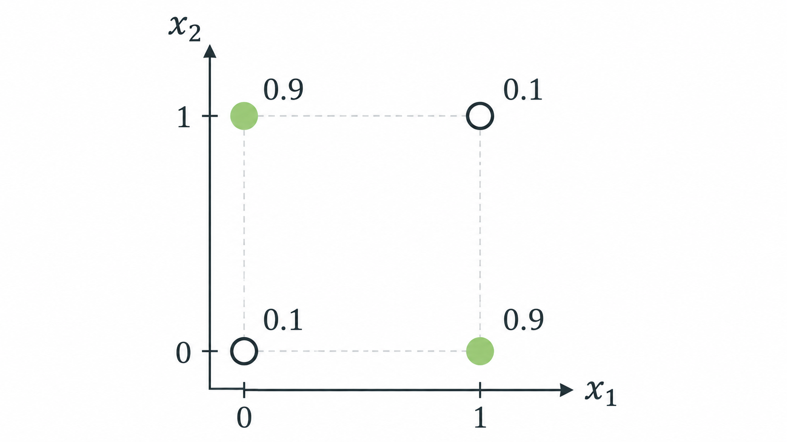

> 작성자 검토 전

# 5.4 Fully Visible Sigmoid Belief Network (FVSBN)

앞에서는 Autoregressive Model을 이용해 결합분포를 여러 조건부분포의 곱으로 표현하고, 이 분포에서 새로운 데이터를 생성하는 방법까지 살펴봤다.

\[
p_\theta(x)=\prod_{i=1}^{D}p_\theta(x_i\mid x_{<i}).
\]

그런데 아직 해결하지 않은 문제가 있다. **각 조건부분포를 실제로 어떻게 계산할 것인가?**

5.1절에서는 신경망과 같은 함수를 사용할 수 있다고 했지만, 구체적인 모델을 정의하지는 않았다.

가장 간단한 방법부터 생각해보자. 데이터가 0과 1로 이루어져 있다면, 각 변수의 조건부분포를 Bernoulli Distribution으로 표현하고, 그 확률을 Logistic Regression으로 계산하면 어떨까?

이것이 Fully Visible Sigmoid Belief Network(FVSBN)의 기본 아이디어다.

## 1. Fully Visible Sigmoid Belief Network

\(D\)개의 이진변수로 이루어진 데이터가 있다고 하자.

\[
x=(x_1,\ldots,x_D),\qquad x_i\in\{0,1\}.
\]

Autoregressive Model에서는 \(x_i\)의 조건부분포를 계산할 때 앞의 변수 \(x_{<i}\)를 사용한다.

FVSBN에서는 이 조건부분포를 다음과 같이 정의한다.

\[
\boxed{
\begin{aligned}
\alpha_i(x_{<i})
&=p_\theta(x_i=1\mid x_{<i})\\
&=\sigma\left(b_i+\sum_{j<i}w_{ij}x_j\right)
\end{aligned}
}
\]

여기서 \(b_i\)는 Bias, \(w_{ij}\)는 앞선 변수 \(x_j\)에 부여하는 Weight이며, \(\sigma\)는 Sigmoid Function이다.

\[
\sigma(t)=\frac{1}{1+e^{-t}}.
\]

Sigmoid는 실수 전체를 0과 1 사이의 값으로 변환한다. 따라서 선형결합 \(b_i+\sum_{j<i}w_{ij}x_j\)가 어떤 값을 갖더라도 올바른 Bernoulli 확률을 얻을 수 있다.

예를 들어 세 번째 변수의 조건부확률은

\[
\alpha_3(x_1,x_2)
=\sigma(b_3+w_{31}x_1+w_{32}x_2)
\]

로 계산한다.

\(b_3=-1,\ w_{31}=2,\ w_{32}=1\)이라고 하자.

앞의 두 변수가 \(x_1=1,\ x_2=0\)이라면

\[
\begin{aligned}
\alpha_3(1,0)
&=\sigma(-1+2(1)+1(0))\\
&=\sigma(1)\approx0.731.
\end{aligned}
\]

즉, 앞의 두 값이 \((1,0)\)일 때 \(x_3=1\)이 될 조건부확률을 약 0.731로 계산한 것이다.

다른 조건이 주어지면 선형결합의 값도 달라지므로, \(x_3=1\)이 될 확률 역시 달라진다.

### 결합분포는 어떻게 표현할까?

각 조건부분포는 Bernoulli Distribution이므로

\[
p_\theta(x_i\mid x_{<i})
=
\alpha_i^{x_i}(1-\alpha_i)^{1-x_i}
\]

로 표현할 수 있다. 여기서 \(\alpha_i=\alpha_i(x_{<i})\)이다.

이 조건부분포들을 Chain Rule에 따라 곱하면

\[
\boxed{
p_\theta(x)
=
\prod_{i=1}^{D}
\alpha_i^{x_i}(1-\alpha_i)^{1-x_i}
}
\]

가 된다.

따라서 FVSBN 역시 앞에서 배운 Autoregressive Model과 마찬가지로 Exact Likelihood를 계산할 수 있다.

또한 각 \(\alpha_i\)를 순서대로 계산하고 Bernoulli Distribution에서 값을 뽑으면 Ancestral Sampling도 가능하다.

여기서 Fully Visible이라는 이름은 모델의 모든 확률변수가 관측 가능한 변수 \(x_1,\ldots,x_D\)라는 뜻이다.

즉, 별도의 숨겨진 확률변수(Latent Variable)를 도입하지 않는다.

## 2. Parameter Complexity

FVSBN에서는 각 조건부분포를 Logistic Regression으로 표현한다. 그렇다면 전체 모델에는 몇 개의 모수가 필요할까?

첫 번째 변수 \(x_1\)은 앞에 주어진 변수가 없으므로 Bias \(b_1\)만 필요하다.

두 번째 변수 \(x_2\)에서는 \(x_1\)에 대한 Weight 하나와 Bias 하나가 필요하다.

세 번째 변수 \(x_3\)에서는 두 개의 Weight와 Bias 하나가 필요하다.

이런 식으로 \(i\)번째 조건부분포에는

- 앞의 \(i-1\)개 변수에 대한 Weight
- 하나의 Bias

를 합해 총 \(i\)개의 모수가 필요하다.

따라서 전체 모수의 개수는

\[
\begin{aligned}
\#\theta
&=\sum_{i=1}^{D}i\\[4pt]
&=\frac{D(D+1)}{2}\\[4pt]
&=O(D^2).
\end{aligned}
\]

5.1절에서 모든 가능한 데이터에 대한 확률을 직접 저장하려면 \(2^D-1\)개의 자유모수가 필요하다고 했다.

반면 FVSBN에서는 모수의 개수가 \(D^2\)에 비례해 증가한다.

예를 들어 \(D=100\)이면 FVSBN의 모수는 5,050개다. 모든 결합확률을 직접 저장하는 방법과 비교하면 훨씬 작은 규모다.

그런데 여기서 한 가지 생각해볼 점이 있다.

**모수의 개수가 크게 줄어들었는데도, 여전히 모든 결합분포를 표현할 수 있을까?**

모수를 줄였다는 것은 모델이 표현할 수 있는 분포의 범위를 제한했을 가능성도 있다는 뜻이다.

실제로 FVSBN에는 중요한 표현력의 한계가 존재한다.

## 3. Log-Odds와 Expressivity

FVSBN의 조건부확률을 다시 살펴보자.

\[
\alpha_i
=\sigma\left(b_i+\sum_{j<i}w_{ij}x_j\right).
\]

이 식은 선형결합에 Sigmoid를 적용한 형태다.

Sigmoid 자체는 비선형함수이므로 조건부확률 \(\alpha_i\)가 입력에 대해 선형이라는 뜻은 아니다.

하지만 **Log-Odds를 살펴보면 모델의 구조적인 제약이 드러난다.**

먼저 Odds는 어떤 사건이 일어날 확률을 일어나지 않을 확률로 나눈 값이다.

\[
\operatorname{Odds}
=\frac{\alpha_i}{1-\alpha_i}.
\]

여기에 로그를 취한 것이 Log-Odds다.

\[
\operatorname{Logit}(\alpha_i)
=\log\frac{\alpha_i}{1-\alpha_i}.
\]

Sigmoid의 정의를 이용하면

\[
\log\frac{\sigma(t)}{1-\sigma(t)}=t
\]

이므로, FVSBN의 Log-Odds는 다음과 같다.

\[
\boxed{
\log\frac{\alpha_i}{1-\alpha_i}
=b_i+\sum_{j<i}w_{ij}x_j
}
\]

즉, **FVSBN의 Log-Odds는 앞선 변수들의 선형함수**다.

이것이 왜 제약이 될까?

각 입력변수의 효과가 서로 더해지는 형태로만 표현되기 때문이다. 예를 들어 \(x_1\)이 0에서 1로 바뀌었을 때 Log-Odds에 더해지는 값은 항상 \(w_{i1}\)이다.

다른 변수들이 어떤 값을 갖는지에 따라 \(x_1\)의 효과가 달라지는 복잡한 상호작용은 직접 표현할 수 없다.

간단한 예시를 통해 확인해보자.

### Example — XOR와 조건부분포

세 개의 이진변수 \(x_1,x_2,x_3\)가 있다고 하자.

이번에는 \(x_1,x_2\)의 값이 서로 다를 때 \(x_3=1\)이 될 확률이 높고, 두 값이 같을 때는 낮다고 가정하자.

예를 들어 우리가 표현하고 싶은 조건부확률이 다음과 같다고 하자.

| \(x_1\) | \(x_2\) | \(p(x_3=1\mid x_1,x_2)\) |
|---|---|---|
| 0 | 0 | 0.1 |
| 0 | 1 | 0.9 |
| 1 | 0 | 0.9 |
| 1 | 1 | 0.1 |

두 입력값이 다를 때 결과가 1이 되는 XOR(Exclusive OR)과 비슷한 패턴이다.

그렇다면 FVSBN이 이 네 가지 확률을 정확하게 표현할 수 있을까?

FVSBN에서 세 번째 변수의 조건부확률은

\[
\alpha_3(x_1,x_2)
=\sigma(b_3+w_{31}x_1+w_{32}x_2)
\]

이다.

Log-Odds를 \(\ell(x_1,x_2)\)라고 정의하자.

\[
\ell(x_1,x_2)
=\log\frac{\alpha_3(x_1,x_2)}
{1-\alpha_3(x_1,x_2)}.
\]

그러면

\[
\ell(x_1,x_2)
=b_3+w_{31}x_1+w_{32}x_2
\]

이므로 네 가지 입력 조합에 대해

\[
\begin{aligned}
\ell(0,0)&=b_3,\\
\ell(1,0)&=b_3+w_{31},\\
\ell(0,1)&=b_3+w_{32},\\
\ell(1,1)&=b_3+w_{31}+w_{32}.
\end{aligned}
\]

여기서 마지막 식을 보면

\[
\boxed{
\ell(1,1)-\ell(1,0)
-\ell(0,1)+\ell(0,0)=0
}
\]

이라는 관계가 반드시 성립한다.

Weight와 Bias를 어떻게 바꾸더라도 이 관계는 달라지지 않는다. FVSBN의 Log-Odds가 입력변수의 선형결합으로 정의되었기 때문이다.

그런데 앞의 XOR 형태의 조건부분포는 어떨까?

확률이 0.9인 경우 Log-Odds는 \(\log9\)이고, 확률이 0.1인 경우에는 \(-\log9\)이다.

따라서

\[
\begin{aligned}
&\ell(1,1)-\ell(1,0)
-\ell(0,1)+\ell(0,0)\\[4pt]
&=-4\log9\neq0.
\end{aligned}
\]

FVSBN이 반드시 만족해야 하는 관계와 모순이 발생한다.

즉, 어떤 Weight와 Bias를 선택하더라도 앞의 조건부확률을 정확하게 표현할 수 없다.

이것이 단순한 Logistic Regression으로 조건부분포를 표현할 때 나타나는 한계다.

*Figure 5.4-1. XOR 형태의 조건부확률.*

XOR 예제를 기하학적으로 바라보면 이 한계가 조금 더 분명해진다.

Logistic Regression은 입력공간에서 선형적인 Decision Boundary를 만든다. 하지만 XOR에서는 높은 확률을 가져야 하는 두 입력 조합이 서로 대각선 방향에 놓여 있다.

따라서 하나의 직선으로 두 경우를 구분할 수 없다.

결국 **FVSBN은 비교적 적은 수의 모수로 결합분포를 표현할 수 있지만, 복잡한 비선형 관계를 가진 조건부분포는 충분히 표현하지 못할 수 있다.**

## 4. 그렇다면 표현력을 높이려면?

문제의 원인은 조건부확률을 계산할 때 선형결합에 Sigmoid를 한 번 적용하는 구조를 사용했다는 데 있다.

그렇다면 여러 층으로 이루어진 신경망을 사용하면 어떨까?

입력변수들을 먼저 비선형적인 Hidden Representation으로 변환한 다음, 이를 이용해 조건부확률을 계산하는 것이다.

이렇게 하면 앞의 변수들 사이의 복잡한 상호작용도 표현할 수 있게 된다.

하지만 조건부분포마다 별도의 신경망을 만든다면 필요한 모수가 다시 크게 증가할 수 있다.

따라서 **조건부분포의 표현력을 높이면서도 모수를 효율적으로 공유하는 방법**이 필요하다.

이 문제를 해결하기 위한 대표적인 모델이 다음 절에서 살펴볼 Neural Autoregressive Density Estimation(NADE)이다.
