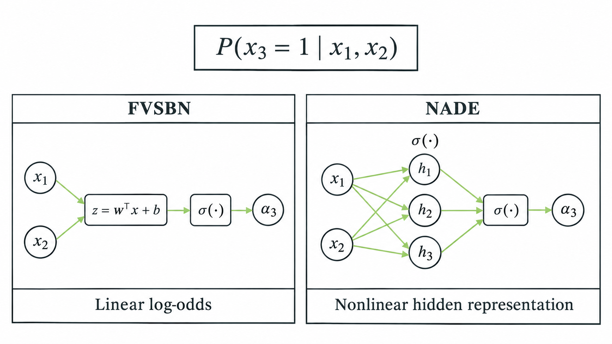
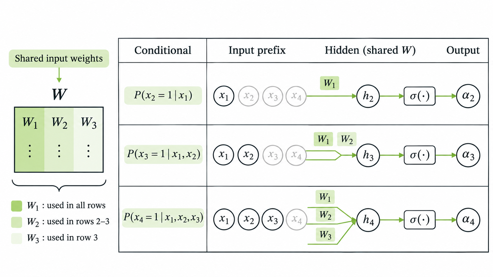
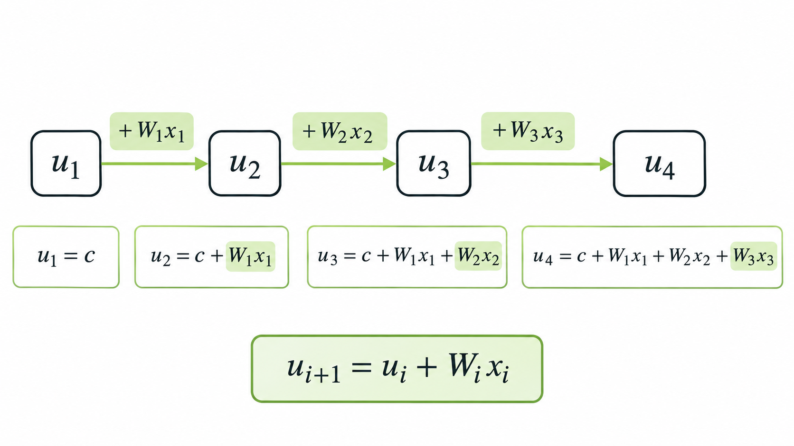

> 작성자 검토 전

# 5.5 Neural Autoregressive Density Estimation (NADE)

앞 절에서 배운 FVSBN은 각 조건부분포를 Logistic Regression으로 표현했다.

\[
p_\theta(x_i=1\mid x_{<i})
=\sigma\left(b_i+\sum_{j<i}w_{ij}x_j\right).
\]

이 방법은 필요한 모수의 수가 비교적 적고, Likelihood도 정확하게 계산할 수 있다는 장점이 있었다.

하지만 XOR 예제에서 확인했듯이, Log-Odds가 앞선 변수들의 선형결합으로 표현되기 때문에 복잡한 비선형 관계를 충분히 표현하지 못한다는 한계가 있었다.

그렇다면 Logistic Regression 대신 Hidden Layer를 가진 신경망을 사용하면 어떨까?

비선형적인 관계를 학습할 수 있으니 표현력 문제는 개선할 수 있을 것이다. 그런데 조건부분포마다 별도의 신경망을 만든다면 이번에는 모수가 너무 많아질 수 있다.

**Neural Autoregressive Density Estimation(NADE)** 은 이러한 문제를 해결하기 위해 신경망의 가중치를 공유하는 방법을 사용한다.

## 1. From FVSBN to NADE

먼저 FVSBN과 Hidden Layer를 사용하는 모델의 차이를 생각해보자.

데이터가 \(D\)개의 이진변수로 이루어져 있다고 하자.

\[
x=(x_1,\ldots,x_D),\qquad x_i\in\{0,1\}.
\]

예를 들어 세 번째 변수 \(x_3\)의 조건부분포를 계산하고 싶다면, 앞의 두 변수 \(x_1,x_2\)를 입력받아 \(x_3=1\)이 될 확률을 출력해야 한다.

FVSBN에서는 이를 다음과 같이 계산했다.

\[
\alpha_3
=\sigma(b_3+w_{31}x_1+w_{32}x_2).
\]

반면 Hidden Layer를 사용한다면 먼저 입력을 비선형적으로 변환할 수 있다.

\[
\begin{aligned}
h_3&=\sigma(A_3x_{<3}+c_3),\\[4pt]
\alpha_3&=\sigma(v_3^\top h_3+b_3).
\end{aligned}
\]

여기서 \(h_3\in\mathbb R^H\)는 \(H\)개의 Hidden Unit으로 이루어진 벡터다.

FVSBN에서는 입력변수들이 Log-Odds에 선형적으로 영향을 주었지만, Hidden Layer를 사용하면 여러 입력변수가 결합된 비선형적인 관계도 표현할 수 있다.

*Figure 5.5-1. FVSBN vs. NADE.*

동일한 입력 \(x_1,x_2\)에서 \(p(x_3=1\mid x_1,x_2)\)를 계산하는 두 구조를 비교한다. FVSBN은 입력에서 직접 Sigmoid를 거치지만, NADE는 Hidden Layer를 거쳐 확률을 출력한다.

그림에서 확인할 수 있듯이 두 모델의 차이는 조건부분포를 계산하는 과정에 있다.

그런데 Hidden Layer를 추가했다고 해서 모든 문제가 해결되는 것은 아니다.

### 모수는 얼마나 필요할까?

\(i\)번째 조건부분포의 입력은 \(i-1\)차원이고, Hidden Unit은 \(H\)개라고 하자.

이때 입력에서 Hidden Layer로 연결되는 Weight Matrix는

\[
A_i\in\mathbb R^{H\times(i-1)}
\]

이다.

만약 모든 조건부분포에 서로 다른 \(A_i\)를 사용한다면, 입력 Weight의 개수만 계산해도

\[
\begin{aligned}
\#\text{Weights}
&=\sum_{i=1}^{D}H(i-1)\\[4pt]
&=H\frac{D(D-1)}2\\[4pt]
&=O(HD^2)
\end{aligned}
\]

개가 필요하다.

즉, 표현력을 높이기 위해 Hidden Layer를 추가했지만, 변수의 개수가 증가할수록 모수가 빠르게 늘어나는 문제가 생긴다.

여기서 한 가지를 생각해볼 수 있다.

각 조건부분포는 입력으로 사용하는 변수의 개수만 다를 뿐, 모두 같은 데이터 \(x\)의 확률분포를 표현하고 있다.

그렇다면 조건부분포마다 완전히 별도의 Weight를 사용하는 대신, **이미 등장한 입력변수에 대한 Weight를 여러 조건부분포에서 공유할 수 있지 않을까?**

이것이 NADE의 핵심 아이디어다.

## 2. Shared Parameterization

NADE에서는 조건부분포마다 별도의 입력 Weight를 사용하는 대신, 하나의 공통된 Weight Matrix를 정의한다.

\[
W\in\mathbb R^{H\times D},
\qquad c\in\mathbb R^H.
\]

여기서 \(W_{:,j}\)는 \(W\)의 \(j\)번째 열벡터로, 입력변수 \(x_j\)가 Hidden Layer에 미치는 영향을 나타낸다.

이제 \(i\)번째 조건부분포를 다음과 같이 계산하자.

\[
\boxed{
\begin{aligned}
u_i&=c+\sum_{j<i}W_{:,j}x_j,\\[4pt]
h_i&=\sigma(u_i),\\[4pt]
\alpha_i&=\sigma(v_i^\top h_i+b_i).
\end{aligned}
}
\]

여기서 \(u_i\)는 Sigmoid를 적용하기 전의 값(Pre-activation), \(h_i\)는 Hidden Representation, \(\alpha_i\)는 \(x_i=1\)이 될 조건부확률이다.

처음에는 식이 복잡해 보이지만, 실제로 어떻게 계산되는지 살펴보면 간단하다.

### 네 개의 이진변수 예시

\(x=(x_1,x_2,x_3,x_4)\)가 있다고 하자.

첫 번째 조건부분포에는 앞에 주어진 변수가 없으므로

\[
u_1=c
\]

이다.

두 번째 조건부분포에서는 \(x_1\)이 추가된다.

\[
u_2=c+W_{:,1}x_1.
\]

세 번째에서는 \(x_1,x_2\)를 사용한다.

\[
u_3=c+W_{:,1}x_1+W_{:,2}x_2.
\]

마지막으로 네 번째에서는

\[
u_4=c+W_{:,1}x_1+W_{:,2}x_2+W_{:,3}x_3
\]

가 된다.

여기서 \(x_1\)에 곱해지는 Weight를 살펴보자.

\(u_2,u_3,u_4\) 모두에서 동일한 \(W_{:,1}\)을 사용한다. 마찬가지로 \(x_2\)에 대한 \(W_{:,2}\)도 \(u_3,u_4\)에서 공유된다.

*Figure 5.5-2. Shared Parameterization.*

\(u_2,u_3,u_4\)가 각각 어떤 입력을 사용하는지 보여준다. 동일한 \(W_{:,1}\)과 \(W_{:,2}\)가 여러 조건부분포에서 재사용된다는 점을 강조한다.

즉, NADE에서는 조건부분포마다 별도의 입력 Weight Matrix를 학습하는 것이 아니라, 같은 Weight를 필요한 위치에서 반복해서 사용한다.

반면 출력에 사용하는 \(v_i,b_i\)는 조건부분포마다 다르게 설정할 수 있다.

공통된 Weight를 사용해 Hidden Representation을 만들면서도, 각 조건부분포는 서로 다른 확률을 출력할 수 있는 것이다.

### 모수의 개수는 얼마나 줄어들까?

입력 Weight Matrix \(W\)에는 최대 \(HD\)개의 모수가 있고, 출력 Weight \(v_i\) 역시 각 위치마다 \(H\)개씩 필요하므로 모두 \(HD\)개다.

여기에 Hidden Bias와 출력 Bias를 추가하더라도 전체 모수의 수는

\[
\boxed{\#\theta=O(HD)}
\]

규모다.

조건부분포마다 별도의 Hidden Layer를 사용했을 때는 \(O(HD^2)\)였지만, Weight Sharing을 사용하면 \(O(HD)\)로 줄어든다.

즉, NADE는 **Hidden Layer로 조건부분포의 표현력을 높이면서도, 가중치를 공유해 모수의 증가를 억제한다.**

## 3. Efficient Prefix Computation

그런데 Weight Sharing의 장점은 모수의 개수를 줄이는 것에서 끝나지 않는다.

앞에서 정의한 Hidden Layer의 Pre-activation을 다시 살펴보자.

\[
u_i=c+\sum_{j<i}W_{:,j}x_j.
\]

이번에는 \(i\)번째 조건부분포를 계산한 다음, \(i+1\)번째 조건부분포를 계산한다고 생각해보자.

\[
u_{i+1}=c+\sum_{j<i+1}W_{:,j}x_j.
\]

두 식을 비교해보면 차이가 크지 않다.

\(u_{i+1}\)에는 \(u_i\)에서 사용했던 항들이 그대로 들어 있고, 새로운 입력변수 \(x_i\)에 대한 항만 추가된다.

따라서

\[
\begin{aligned}
u_{i+1}
&=c+\sum_{j<i}W_{:,j}x_j+W_{:,i}x_i\\[4pt]
&=u_i+W_{:,i}x_i.
\end{aligned}
\]

결국 다음과 같은 관계를 얻는다.

\[
\boxed{
u_1=c,\qquad
u_{i+1}=u_i+W_{:,i}x_i
}
\]

이 식이 의미하는 바는 간단하다.

**이전에 계산한 결과를 버리고 처음부터 다시 계산할 필요가 없다. 새로운 입력변수의 영향만 추가하면 된다.**

*Figure 5.5-3. Efficient Prefix Computation.*

\(u_1=c\)에서 출발해 \(W_{:,1}x_1\), \(W_{:,2}x_2\), \(W_{:,3}x_3\)를 순서대로 더하여 \(u_2,u_3,u_4\)를 계산하는 과정을 보여준다. 이전 결과를 계속 재사용한다는 점을 강조한다.

예를 들어 \(x_1=1,\ x_2=0\)이라고 하자.

\[
u_2=c+W_{:,1}
\]

이고, 다음 단계에서는

\[
u_3=u_2+W_{:,2}(0)=u_2
\]

가 된다.

두 번째 입력이 0이므로 새로운 항이 추가되지 않은 것이다.

물론 \(u_2=u_3\)이라고 해서 두 조건부확률까지 같아지는 것은 아니다. 출력에 사용되는 \(v_2,b_2\)와 \(v_3,b_3\)는 서로 다르기 때문이다.

이처럼 이전 계산 결과를 재사용하는 방법을 **Efficient Prefix Computation**이라고 한다.

각 단계에서는 길이 \(H\)인 벡터 하나만 갱신하면 되므로, 모든 조건부분포의 Hidden Representation을 계산하는 데 필요한 연산량도 \(O(HD)\) 규모가 된다.

NADE는 단순히 모수를 공유하는 것뿐 아니라, 그 구조를 이용해 중복 계산까지 줄일 수 있는 것이다.

## 4. Exact Likelihood

마지막으로 한 가지를 확인해보자.

NADE에는 Hidden Layer가 등장한다. 그렇다면 잠재변수 모델처럼 Hidden Variable을 적분해야 하므로 Exact Likelihood를 계산하기 어려워지는 것은 아닐까?

여기서는 그렇지 않다.

**NADE의 Hidden Layer는 확률적으로 Sampling하는 잠재변수가 아니라, 입력 \(x_{<i}\)로부터 결정되는 함수값이기 때문**이다.

\[
h_i=\sigma\left(c+\sum_{j<i}W_{:,j}x_j\right).
\]

따라서 앞의 변수들이 주어지면 \(h_i\)를 직접 계산할 수 있고, 그 값으로부터 조건부확률 \(\alpha_i\)도 얻을 수 있다.

각 조건부분포는 Bernoulli Distribution이므로

\[
p_\theta(x_i\mid x_{<i})
=\alpha_i^{x_i}(1-\alpha_i)^{1-x_i}
\]

이다.

이들을 Chain Rule에 따라 곱하면 전체 결합분포를 얻는다.

\[
p_\theta(x)
=
\prod_{i=1}^{D}
\alpha_i^{x_i}(1-\alpha_i)^{1-x_i}.
\]

따라서 Log-Likelihood는

\[
\boxed{
\begin{aligned}
\log p_\theta(x)
&=\sum_{i=1}^{D}\bigl[
  x_i\log\alpha_i \\
&\qquad +(1-x_i)\log(1-\alpha_i)
\bigr]
\end{aligned}
}
\]

로 정확하게 계산할 수 있다.

즉, Hidden Layer를 추가했더라도 결합분포를 조건부분포의 곱으로 표현한다는 사실은 달라지지 않는다.

따라서 **NADE는 FVSBN보다 유연한 조건부분포를 표현하면서도 Exact Likelihood를 유지할 수 있다.**

물론 새로운 데이터를 생성할 때는 여전히 Ancestral Sampling을 사용한다. 먼저 \(x_1\)을 생성하고, 그 값을 이용해 \(x_2\)를 생성하는 식으로 순서대로 진행해야 한다.

---

이번 절에서는 FVSBN의 표현력 한계를 개선하기 위해 Hidden Layer를 도입하고, 이때 발생하는 모수 증가 문제를 Weight Sharing으로 해결하는 NADE를 살펴봤다.

NADE는 공통된 입력 Weight를 사용해 각 조건부분포를 계산하고, 이전에 계산한 Pre-activation을 재사용함으로써 연산량도 줄인다.

또한 Hidden Layer가 결정적인 함수이므로 여전히 Exact Likelihood를 계산할 수 있다.

그런데 여기서 또 다른 질문이 생긴다.

지금까지는 조건부분포를 순서대로 계산하는 방법을 생각했다. 그렇다면 **하나의 신경망에 전체 데이터를 입력하면서도, 각 출력이 자신보다 앞선 변수만 사용하도록 만들 수는 없을까?**

다음 절에서는 Mask를 이용해 이러한 제약을 구현하는 MADE(Masked Autoencoder for Distribution Estimation)를 살펴본다.
