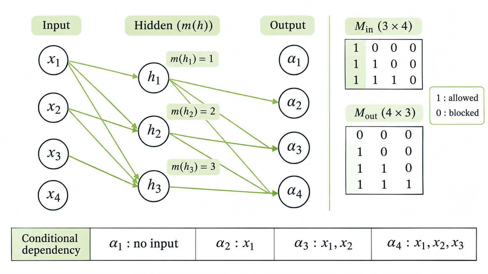

> 작성자 검토 전

앞 절에서는 NADE를 통해 여러 조건부 확률분포가 하나의 신경망에서 가중치를 공유하는 방법을 살펴봤다.

그런데 조금 다른 방법도 생각해볼 수 있다. 입력의 앞부분을 차례대로 처리하는 대신, **전체 데이터를 신경망에 한 번에 넣고 모든 조건부 확률을 동시에 계산할 수는 없을까?**

일반적인 신경망에서는 문제가 생긴다. 모든 입력과 출력이 자유롭게 연결되어 있다면, \(x_2\)의 확률을 예측하면서 이미 입력된 \(x_2\)의 값을 참조할 수도 있기 때문이다.

Autoregressive Model에서는 이런 일이 일어나면 안 된다. \(x_i\)의 조건부 확률은 반드시 이전 변수 \(x_{<i}\)에만 의존해야 한다.

Masked Autoencoder for Distribution Estimation(MADE)는 신경망의 일부 연결을 차단하는 **Masking**으로 이 조건을 만족시킨다.

## 1. MADE의 목표

우선 \(D\)개의 이진변수로 이루어진 데이터

\[
x=(x_1,\ldots,x_D)\in\{0,1\}^D
\]

를 생각해보자.

Autoregressive Model에서는 결합확률분포를 다음과 같이 분해한다.

\[
p_\theta(x)
=\prod_{i=1}^{D}p_\theta(x_i\mid x_{<i}).
\]

각 변수가 이진변수라면 조건부 분포는 Bernoulli Distribution으로 표현할 수 있다. 이때

\[
\alpha_i
=p_\theta(x_i=1\mid x_{<i})
\]

라고 하자.

우리가 원하는 신경망은 입력 \(x\)를 받아

\[
(\alpha_1,\alpha_2,\ldots,\alpha_D)
=f_\theta(x)
\]

를 한 번에 계산하는 것이다.

다만 출력마다 사용할 수 있는 입력이 다르다.

예를 들어 \(D=4\)라면 다음 조건을 만족해야 한다.

| 출력 | 의미 | 참조 가능한 입력 |
|---|---|---|
| \(\alpha_1\) | \(p_\theta(x_1=1)\) | 없음 |
| \(\alpha_2\) | \(p_\theta(x_2=1\mid x_1)\) | \(x_1\) |
| \(\alpha_3\) | \(p_\theta(x_3=1\mid x_1,x_2)\) | \(x_1,x_2\) |
| \(\alpha_4\) | \(p_\theta(x_4=1\mid x_1,x_2,x_3)\) | \(x_1,x_2,x_3\) |

특히 \(\alpha_1\)은 이전에 관측된 변수가 없으므로 입력 \(x\)에 의존하지 않는다. 데이터로 학습한 하나의 확률값이 되는 것이다.

반면 \(\alpha_4\)는 앞의 세 변수를 모두 참조할 수 있지만, 자기 자신인 \(x_4\)는 참조해서는 안 된다.

이 조건을 만족하도록 신경망의 연결을 제한하는 것이 MADE의 핵심이다.

## 2. Mask Construction — 연결을 어떻게 제한할까?

입력변수 4개와 Hidden Unit 3개를 가진 신경망을 생각해보자.

일반적인 Fully Connected Network라면 모든 입력이 모든 Hidden Unit에 연결되고, 각 Hidden Unit은 모든 출력으로 연결된다.

하지만 MADE에서는 각 Hidden Unit이 참조할 수 있는 입력을 제한한다.

이를 위해 Hidden Unit \(h_k\)마다 Degree \(m(k)\)를 부여한다.

\[
m(k)\in\{1,\ldots,D-1\}.
\]

Degree는 해당 Hidden Unit이 참조할 수 있는 **입력변수의 최대 인덱스**를 나타낸다.

예를 들어 다음과 같이 정했다고 하자.

\[
m(1)=1,\qquad m(2)=2,\qquad m(3)=3.
\]

그러면 각각의 Hidden Unit은 다음 입력을 사용할 수 있다.

- \(h_1\): \(x_1\)
- \(h_2\): \(x_1,x_2\)
- \(h_3\): \(x_1,x_2,x_3\)

이제 이 Hidden Unit들을 적절한 출력에 연결하면 된다.

*Figure 5.6-1. MADE의 Masked Network와 Mask Matrix.*

예를 들어 \(\alpha_3\)은 \(x_1,x_2\)까지만 참조해야 한다. 따라서 \(h_1,h_2\)에는 연결할 수 있지만, \(x_3\)까지 참조하는 \(h_3\)에는 연결하면 안 된다.

\(\alpha_4\)는 \(x_1,x_2,x_3\)을 모두 참조할 수 있으므로 세 Hidden Unit에 모두 연결할 수 있다.

이 규칙을 매번 직접 연결하는 대신, 행렬로 표현하면 훨씬 간단해진다.

### Input Mask

먼저 입력에서 Hidden Layer로 향하는 연결을 생각하자.

Hidden Unit \(k\)가 입력 \(x_j\)를 사용할 수 있는지 여부를 다음과 같이 정의한다.

\[
\boxed{
M^{\mathrm{in}}_{kj}
=
\mathbf 1\{j\le m(k)\}
}
\]

여기서 \(\mathbf 1\{\cdot\}\)은 조건이 참이면 1, 거짓이면 0을 반환하는 Indicator Function이다.

따라서 \(M^{\mathrm{in}}_{kj}=1\)이면 연결을 허용하고, 0이면 차단한다.

앞의 \(D=4\), \(m=(1,2,3)\) 예시에서는

\[
M^{\mathrm{in}}
=
\begin{pmatrix}
1&0&0&0\\
1&1&0&0\\
1&1&1&0
\end{pmatrix}
\]

이다.

행은 \(h_1,h_2,h_3\), 열은 \(x_1,x_2,x_3,x_4\)에 대응한다.

세 번째 행을 보면 \(h_3\)은 처음 세 입력을 사용할 수 있지만 \(x_4\)와는 연결되지 않는다.

### Output Mask

이제 Hidden Layer에서 출력으로 향하는 연결을 제한하자.

출력 \(\alpha_i\)가 Hidden Unit \(h_k\)를 사용하려면, 해당 Hidden Unit이 \(x_i\)보다 앞의 입력만 참조해야 한다.

따라서 출력 마스크는 다음과 같이 정의한다.

\[
\boxed{
M^{\mathrm{out}}_{ik}
=
\mathbf 1\{m(k)<i\}
}
\]

앞의 Input Mask에서는 \(\le\)를 사용했지만, 여기서는 \(<\)를 사용한다.

이 부등호의 차이가 중요하다. 출력 \(\alpha_i\)에 자기 자신인 \(x_i\)의 정보가 전달되지 않도록 하기 때문이다.

같은 예시에서 Output Mask는

\[
M^{\mathrm{out}}
=
\begin{pmatrix}
0&0&0\\
1&0&0\\
1&1&0\\
1&1&1
\end{pmatrix}
\]

이다.

첫 번째 행이 모두 0인 이유는 \(\alpha_1\)이 어떤 입력에도 의존해서는 안 되기 때문이다.

반면 마지막 행은 모두 1이다. \(\alpha_4\)는 세 Hidden Unit을 전부 사용할 수 있다.

### Masked Network의 계산

이제 실제 신경망에 Mask를 적용해보자.

입력 가중치 행렬을 \(W\), 출력 가중치 행렬을 \(V\)라고 하면

\[
\begin{aligned}
h
&=\phi\left((W\odot M^{\mathrm{in}})x+c\right),\\[4pt]
o
&=(V\odot M^{\mathrm{out}})h+b,\\[4pt]
\alpha_i&=\sigma(o_i).
\end{aligned}
\]

여기서 \(\odot\)는 행렬의 같은 위치에 있는 원소끼리 곱하는 Hadamard Product이다.

Mask의 값이 0인 위치에서는 가중치도 0이 되므로 해당 연결이 사라진다. 반대로 Mask가 1인 위치에서는 원래 가중치를 그대로 사용한다.

\(\phi\)는 Hidden Layer의 활성화 함수이고, 마지막의 Sigmoid 함수 \(\sigma\)는 각 출력을 \(0\)과 \(1\) 사이의 확률로 바꾼다.

결국 MADE는 특별한 확률 연산을 새로 도입하는 것이 아니라, **기존 신경망의 가중치에 Mask를 적용해 정보가 전달되는 경로를 제한하는 방법**이다.

## 3. Autoregressive Property — 정말 미래 정보를 차단할까?

앞에서 정한 Mask가 실제로 Autoregressive 조건을 만족하는지 확인해보자.

입력 \(x_j\)의 정보가 Hidden Unit \(h_k\)를 거쳐 출력 \(\alpha_i\)까지 전달된다고 하자.

이 경로가 존재하려면 두 조건을 모두 만족해야 한다.

입력에서 Hidden Unit으로 연결되려면

\[
j\le m(k)
\]

이고, Hidden Unit에서 출력으로 연결되려면

\[
m(k)<i
\]

여야 한다.

두 조건을 합치면

\[
\boxed{j\le m(k)<i}
\]

가 된다.

따라서

\[
j<i.
\]

즉, 출력 \(\alpha_i\)까지 정보가 전달될 수 있는 입력은 반드시 \(x_i\)보다 앞에 있는 변수뿐이다.

이제 Mask가 Autoregressive 조건을 보장한다는 사실을 확인할 수 있다.

\[
\boxed{\alpha_i=f_{\theta,i}(x_{<i})}
\]

신경망의 중간 계산이 얼마나 복잡하든, Mask가 허용하지 않는 경로를 통해서는 정보가 전달될 수 없다.

[demo:made-mask-explorer]

위 예시에서 \(\alpha_2,\alpha_3,\alpha_4\)를 차례대로 선택해보면, 출력마다 참조할 수 있는 입력이 어떻게 달라지는지 확인할 수 있다.

특히 \(\alpha_3\)을 선택했을 때 \(x_3\)에서 \(\alpha_3\)으로 이어지는 경로가 없다는 점을 확인해보자. \(x_3\)은 예측해야 할 값이지, 그 값을 예측하기 위한 입력이 아니기 때문이다.

## 4. 한 번의 Forward Pass로 Likelihood 계산하기

Mask를 적용하는 이유는 조건부 확률을 정확하게 정의하기 위해서만은 아니다. 계산 방법에도 중요한 차이가 생긴다.

NADE에서는 Prefix가 늘어날 때마다 해당 Prefix를 이용한 Hidden Representation을 계산했다. 반면 MADE는 전체 데이터 \(x\)를 한 번에 입력받아

\[
\alpha_1,\alpha_2,\ldots,\alpha_D
\]

를 동시에 계산할 수 있다.

전체 데이터를 입력에 넣어도 각 출력이 참조할 수 있는 변수는 Mask에 의해 제한되어 있으므로 문제가 되지 않는다.

각 \(x_i\)가 이진변수라면 결합확률은

\[
\boxed{
p_\theta(x)
=
\prod_{i=1}^{D}
\alpha_i^{x_i}(1-\alpha_i)^{1-x_i}
}
\]

이다. 여기서 각 \(\alpha_i\)는 앞의 변수 \(x_{<i}\)에 따라 계산된 값이다.

따라서 Log-Likelihood는

\[
\begin{aligned}
\log p_\theta(x)
&=\sum_{i=1}^{D}\bigl[x_i\log\alpha_i \\
&\qquad +(1-x_i)\log(1-\alpha_i)\bigr]
\end{aligned}
\]

로 계산할 수 있다.

예를 들어 \(x=(1,0,1,0)\)이 관측되었다면

\[
p_\theta(x)
=
\alpha_1(1-\alpha_2)\alpha_3(1-\alpha_4)
\]

이다.

이때 필요한 네 개의 \(\alpha_i\)를 모두 하나의 Forward Pass에서 계산할 수 있다는 것이 MADE의 장점이다. 이전 절에서 배운 Bernoulli NLL도 이 출력들을 이용해 바로 계산할 수 있다.

다만 **Likelihood Evaluation과 Sampling은 구분해야 한다.**

Likelihood를 계산할 때는 관측된 \(x\) 전체를 알고 있으므로 한 번에 입력할 수 있다. 반면 새로운 데이터를 생성할 때는 아직 \(x_1,x_2,\ldots\)의 값이 정해져 있지 않다.

따라서 Sampling에서는 먼저 \(x_1\)을 생성하고, 그 값을 이용해 \(x_2\)를 생성하는 과정을 순차적으로 진행해야 한다.

\[
x_1\longrightarrow x_2\longrightarrow
\cdots\longrightarrow x_D.
\]

MADE가 모든 조건부 확률을 한 번에 계산할 수 있다는 것은 **관측 데이터에 대한 Likelihood Evaluation이 병렬화될 수 있다는 뜻**이지, 생성 과정까지 한 번에 끝난다는 뜻은 아니다.

---

NADE와 MADE는 모두 Autoregressive Factorization을 이용하고, 조건부 확률들을 계산할 수 있으므로 Exact Likelihood Evaluation이 가능하다.

차이는 그 조건부 확률들을 계산하는 방식에 있다.

NADE는 Prefix별 Hidden Representation을 공유된 가중치로 효율적으로 계산한다. MADE는 가중치에 Mask를 적용해 하나의 신경망에서 모든 조건부 확률을 동시에 얻는다.

결국 **Autoregressive 조건을 만족하기 위해 반드시 신경망을 순차적으로 실행할 필요는 없다.** 정보가 전달되는 경로만 올바르게 제한하면, 일반적인 Feedforward Network에서도 같은 확률적 구조를 구현할 수 있다.
