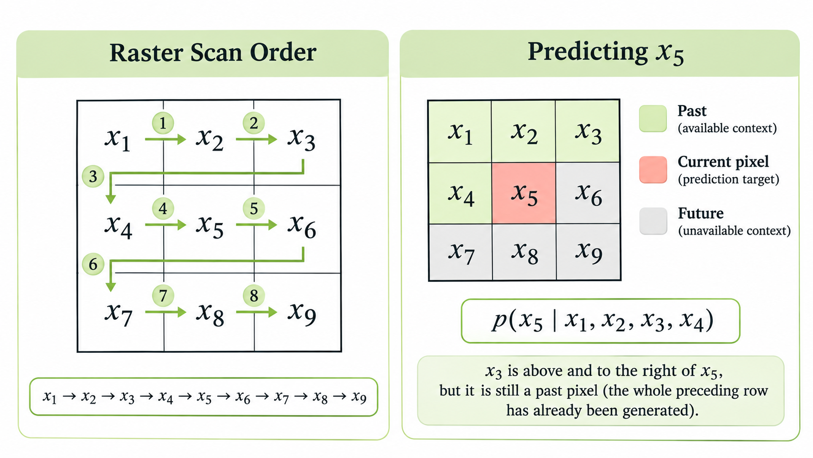
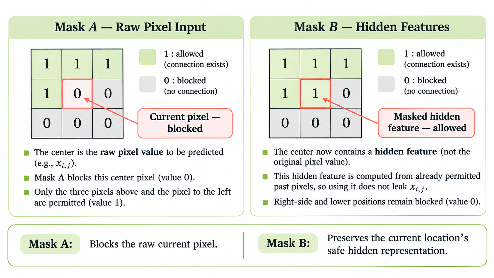

> 작성자 검토 전

앞에서는 FVSBN, NADE, MADE를 통해 Autoregressive Model을 구현하는 여러 방법을 살펴봤다.

모델의 구조는 조금씩 달랐지만, 기본 아이디어는 같았다. 결합확률분포를 조건부 확률분포들의 곱으로 나누고, 각각의 조건부 분포를 신경망으로 계산하는 것이다.

이 방법을 이미지에도 적용할 수 있을까?

이미지는 여러 픽셀이 가로와 세로로 배열된 데이터다. 게다가 픽셀 사이에는 복잡한 관계가 있다. 하늘을 나타내는 픽셀 주변에는 비슷한 색이 나타날 가능성이 높고, 물체의 경계에서는 색이 급격하게 달라질 수도 있다.

이러한 관계를 모델링하려면 단순히 앞의 픽셀값을 이용하는 것만으로는 부족할 수 있다. 이미지의 공간적 구조를 잘 처리하는 신경망이 필요하다.

PixelCNN과 PixelRNN은 이 문제에 각각 CNN과 RNN을 적용한 Autoregressive Image Model이다.

## 1. Autoregressive Image Modeling

### 이미지를 하나의 시퀀스로 표현하기

먼저 \(3\times3\) 크기의 흑백 이미지를 생각해보자.

이미지는 다음처럼 아홉 개의 픽셀로 이루어져 있다.

| | | |
|---|---|---|
| \(x_1\) | \(x_2\) | \(x_3\) |
| \(x_4\) | \(x_5\) | \(x_6\) |
| \(x_7\) | \(x_8\) | \(x_9\) |

이 픽셀들을 왼쪽에서 오른쪽으로, 위에서 아래로 읽으면 하나의 시퀀스가 된다.

\[
x=(x_1,x_2,\ldots,x_9).
\]

이러한 순서를 Raster Scan Order라고 한다.

*Figure 5.7-1. Raster Scan Order와 현재 픽셀의 Context.*

이제 5장에서 계속 사용했던 Chain Rule을 적용해보자.

\[
\begin{aligned}
p_\theta(x)
&=p_\theta(x_1)\,
p_\theta(x_2\mid x_1)\\
&\quad\cdots\,
p_\theta(x_9\mid x_1,\ldots,x_8).
\end{aligned}
\]

일반적인 \(H\times W\) 이미지라면 픽셀의 개수는 \(D=HW\)이므로 다음과 같이 나타낼 수 있다.

\[
\boxed{
p_\theta(x)
=\prod_{i=1}^{D}p_\theta(x_i\mid x_{<i})
}
\]

여기서 \(x_{<i}=(x_1,\ldots,x_{i-1})\)는 현재 픽셀보다 먼저 생성된 픽셀들을 의미한다.

예를 들어 가운데에 있는 \(x_5\)를 생성하는 상황을 생각해보자.

\[
p_\theta(x_5\mid x_1,x_2,x_3,x_4).
\]

\(x_5\)를 예측할 때는 첫 번째 행의 세 픽셀과 두 번째 행의 왼쪽 픽셀을 참조할 수 있다.

하지만 \(x_6,x_7,x_8,x_9\)는 아직 생성하지 않은 픽셀이므로 사용해서는 안 된다.

여기서 주의할 점이 있다. 현재 픽셀의 오른쪽에 있다고 해서 항상 미래 정보인 것은 아니다. **현재 픽셀보다 위쪽 행에 있는 픽셀들은 오른쪽에 있더라도 이미 생성된 값**이다.

따라서 Raster Scan에서 참조할 수 있는 영역은 현재 픽셀의 왼쪽뿐 아니라, 그보다 위에 있는 모든 행이다.

이 순서를 따르면 이미지를 생성하는 과정도 자연스럽게 정의된다. 첫 번째 픽셀을 뽑고, 그 값을 이용해 두 번째 픽셀을 뽑는 식으로 반복하면 된다.

### RGB 이미지에서는 어떻게 할까?

지금까지는 픽셀 하나를 하나의 확률변수처럼 다뤘다. 그런데 컬러 이미지는 조금 더 복잡하다.

하나의 픽셀은 Red, Green, Blue라는 세 가지 채널값을 갖는다.

\[
x_i=(x_{i,R},x_{i,G},x_{i,B}).
\]

각 채널이 8-bit 정수로 표현된다면 가능한 값은 \(0,1,\ldots,255\)이다.

따라서 하나의 픽셀값을 예측한다는 것은 세 채널의 값을 함께 예측한다는 뜻이다.

여기에서도 Chain Rule을 사용할 수 있다.

\[
\begin{aligned}
&p_\theta(x_i\mid x_{<i})\\[4pt]
&=p_\theta(x_{i,R}\mid x_{<i})\\
&\quad\times p_\theta(x_{i,G}\mid x_{<i},x_{i,R})\\
&\quad\times p_\theta(x_{i,B}\mid x_{<i},x_{i,R},x_{i,G}).
\end{aligned}
\]

즉, R 채널을 먼저 생성하고, 그 결과를 참고하여 G 채널을 생성한 다음, R과 G를 모두 참고하여 B 채널을 생성할 수 있다.

이 순서를 사용한다면 G 채널은 같은 픽셀의 R 값을 참조해도 되지만, B 채널은 아직 생성하지 않았으므로 참조할 수 없다.

결국 RGB 이미지에서도 원칙은 같다. **현재 예측하는 값보다 먼저 생성된 정보만 사용할 수 있어야 한다.**

## 2. PixelCNN — CNN으로 조건부 확률 계산하기

이제 각 픽셀의 조건부 확률을 신경망으로 계산해보자.

이미지 처리에서는 CNN이 익숙한 선택이다. CNN은 작은 필터를 이미지 위에서 이동시키며 주변 픽셀들의 정보를 결합한다.

예를 들어 \(3\times3\) Convolution Filter를 사용하면 현재 위치와 그 주변의 아홉 위치를 함께 참조할 수 있다.

그런데 Autoregressive Model에 일반적인 Convolution을 그대로 사용하면 문제가 생긴다.

앞에서 \(x_5\)를 예측할 때 \(x_6\)은 참조해서는 안 된다고 했다. 하지만 일반적인 \(3\times3\) Convolution은 \(x_5\)의 오른쪽에 있는 \(x_6\)도 입력으로 사용한다.

심지어 현재 예측하려는 \(x_5\) 자체도 입력에 포함된다.

모델이 정답을 예측하면서 이미 정답을 보고 있는 셈이다.

이를 막으려면 Convolution Filter의 일부 연결을 제거해야 한다.

### Masked Convolution

5.6절의 MADE에서는 Mask를 이용해 각 출력이 이전 변수만 참조하도록 만들었다.

PixelCNN에서도 같은 아이디어를 사용한다. 다만 이번에는 가중치 행렬 전체가 아니라 **Convolution Filter에 Mask를 적용**한다.

우선 \(3\times3\) 필터를 생각해보자.

현재 예측하려는 픽셀을 가운데에 놓으면, 참조할 수 있는 위치는 다음과 같다.

- 위쪽 세 위치: 모두 이전 행이므로 사용 가능
- 가운데 행의 왼쪽: 먼저 생성된 픽셀이므로 사용 가능
- 가운데 위치: 현재 예측할 값이므로 사용 불가
- 가운데 행의 오른쪽과 아래쪽: 미래 픽셀이므로 사용 불가

이 조건을 행렬로 표현하면

\[
\boxed{
M_A=
\begin{pmatrix}
1&1&1\\
1&0&0\\
0&0&0
\end{pmatrix}
}
\]

이다.

값이 1인 위치는 연결을 허용하고, 0인 위치는 연결을 차단한다.

원래 Convolution Filter를 \(K\)라고 하면 실제로 사용하는 필터는

\[
K_{\mathrm{masked}}=K\odot M_A
\]

이다. 여기서 \(\odot\)는 원소별 곱셈을 뜻한다.

따라서 Mask가 0인 위치의 가중치는 모두 0이 되어 계산에 영향을 주지 못한다.

이 마스크를 적용하면 현재 픽셀이나 미래 픽셀을 직접 참조하지 않으면서 Convolution을 수행할 수 있다.

### Mask A와 Mask B는 왜 다를까?

그런데 PixelCNN에서는 Mask를 한 종류만 사용하지 않는다. 첫 번째 Layer에서는 Mask A를 사용하고, 이후의 Layer에서는 Mask B를 사용한다.

두 마스크를 비교해보자.

\[
\boxed{
M_A=
\begin{pmatrix}
1&1&1\\
1&0&0\\
0&0&0
\end{pmatrix},
\qquad
M_B=
\begin{pmatrix}
1&1&1\\
1&1&0\\
0&0&0
\end{pmatrix}
}
\]

두 행렬의 차이는 가운데 원소 하나다.

Mask A에서는 가운데가 0이지만, Mask B에서는 1이다.

*Figure 5.7-2. Mask A와 Mask B의 연결 비교.*

왜 이후 Layer에서는 가운데 위치를 사용할 수 있을까?

핵심은 **원본 픽셀값과 Hidden Feature를 구분하는 것**이다.

첫 번째 Layer에 입력되는 것은 실제 이미지의 픽셀값이다. 따라서 현재 픽셀을 사용하면 정답이 그대로 입력으로 전달될 수 있다.

하지만 첫 번째 Layer를 통과한 뒤에는 각 위치에 원본 픽셀값 대신 Hidden Feature가 존재한다.

이 Hidden Feature는 이미 Mask A를 거쳐 계산되었기 때문에 현재 픽셀의 정답을 포함하지 않는다.

예를 들어 \(x_5\) 위치에서 첫 번째 Layer의 Hidden Feature를 \(h_5^{(1)}\)라고 하자.

\[
h_5^{(1)}
=f_\theta(x_1,x_2,x_3,x_4).
\]

이 값은 주변의 이전 픽셀들을 이용해 계산했지만 \(x_5\) 자체는 사용하지 않았다.

따라서 두 번째 Layer에서 \(h_5^{(1)}\)를 다시 사용하는 것은 문제가 되지 않는다.

Mask B가 가운데 연결을 허용하는 이유가 바로 이것이다.

이후 Layer에서도 미래 위치로 향하는 연결은 계속 차단하므로, 신경망을 깊게 쌓아도 Autoregressive 조건은 유지된다.

참고로 위의 행렬은 흑백 이미지를 기준으로 한 공간적 마스크다. RGB 이미지에서는 같은 픽셀의 R, G, B 사이에도 생성 순서가 있으므로 채널 간 연결까지 함께 제한해야 한다.

예를 들어 B 채널을 예측할 때 현재 픽셀의 R, G를 참조하는 것은 허용되지만, G 채널을 예측할 때 B를 참조하는 것은 허용되지 않는다.

### PixelCNN의 전체 구조

실제 PixelCNN에서는 이러한 Masked Convolution을 여러 Layer에 걸쳐 사용한다.

원래 PixelCNN 논문에서 사용한 구조는 첫 번째 \(7\times7\) Mask A Convolution으로 시작하고, 이후 여러 Residual Block에서 \(3\times3\) Mask B Convolution을 사용한다.

여러 Layer를 통과한 후에는 각 픽셀 위치에서 조건부 확률분포를 출력한다.

8-bit RGB 이미지라면 채널마다 256개의 가능한 값이 있으므로 Softmax를 사용할 수 있다.

예를 들어 R 채널의 조건부 확률은

\[
p_\theta(x_{i,R}=k\mid x_{<i}),
\qquad k\in\{0,\ldots,255\}
\]

와 같은 256개 값으로 표현된다.

이 값들을 모두 더하면 1이 되어야 하므로 Softmax가 적합하다.

반면 각 픽셀이 0 또는 1인 이진 이미지에서는 Bernoulli Distribution을 사용하고 Sigmoid로 확률을 계산할 수 있다.

결국 PixelCNN은 CNN을 이용해 복잡한 픽셀 간 관계를 학습하면서도, Masking을 통해 올바른 조건부 확률분포를 계산할 수 있도록 만든 모델이다.

## 3. Likelihood Evaluation과 Sampling

이러한 구조에는 계산상의 장점도 있다.

이미 관측된 이미지가 있다면 모든 픽셀값을 알고 있다. 따라서 전체 이미지를 한 번에 신경망에 입력할 수 있다.

Mask가 각 출력에서 미래 정보를 차단하므로, 모든 픽셀의 조건부 확률을 하나의 Forward Pass에서 계산해도 Autoregressive 조건을 위반하지 않는다.

그 결과

\[
\log p_\theta(x)
=
\sum_{i=1}^{D}\log p_\theta(x_i\mid x_{<i})
\]

를 계산할 수 있다.

반면 Sampling에서는 모든 픽셀값이 주어져 있지 않다.

먼저 \(x_1\)을 생성해야 \(x_2\)를 생성할 수 있고, 같은 방법으로 마지막 픽셀까지 순차적으로 진행해야 한다.

따라서 **PixelCNN은 학습과 Likelihood Evaluation에서는 여러 위치의 계산을 병렬화할 수 있지만, 이미지 생성은 순차적으로 진행한다.**

이 차이는 앞서 배운 MADE에서도 나타났던 특징이다.

그런데 Masked Convolution을 사용하면 모든 문제가 해결되는 것은 아니다.

현재 픽셀보다 이전에 생성된 값이라면 원칙적으로 모두 조건부 확률 계산에 사용할 수 있어야 한다. 하지만 PixelCNN에서는 이러한 과거 픽셀 중 일부가 신경망의 계산 경로에 포함되지 않을 수 있다.

이 문제를 **Blind Spot**이라고 부른다.

다음 글에서는 실제 Convolution 경로를 따라가며 Blind Spot이 왜 발생하는지 확인하고, 이를 해결하기 위해 PixelRNN이 어떤 구조를 사용하는지 살펴보자.
