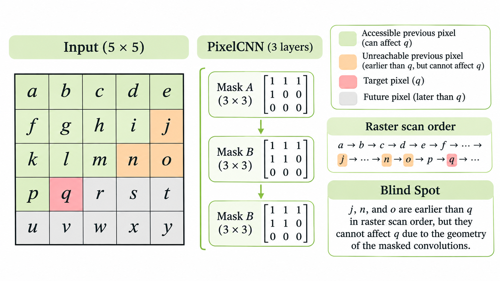
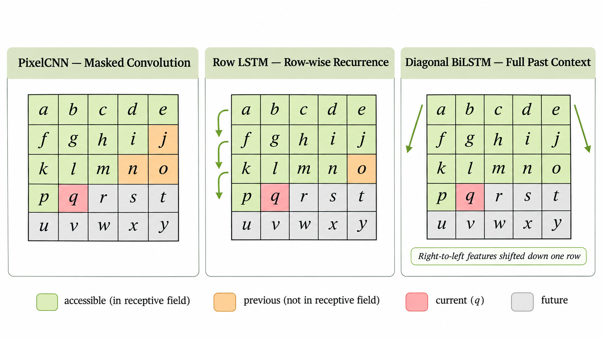
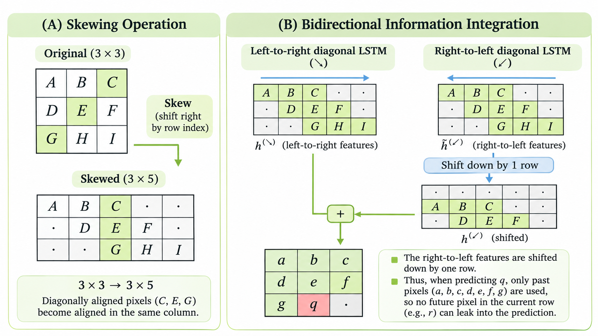

> 작성자 검토 전

앞에서는 PixelCNN이 Masked Convolution을 이용해 이미지의 조건부 확률분포를 계산하는 방법을 살펴봤다.

Mask를 적용하면 현재 픽셀이나 미래 픽셀의 정보가 예측에 사용되는 것을 막을 수 있다. 따라서 Autoregressive Model이 요구하는 조건을 만족한다.

그런데 여기에는 또 다른 문제가 있다.

현재 픽셀보다 먼저 생성된 값이라면 모두 참조할 수 있어야 하는데, **일부 과거 픽셀의 정보가 Convolution을 거쳐도 현재 위치까지 전달되지 않는 경우**가 있다.

이를 Blind Spot이라고 한다.

## 1. Blind Spot — 이전 픽셀인데 왜 보이지 않을까?

먼저 \(5\times5\) 이미지를 생각해보자. 각 픽셀을 구분하기 위해 알파벳을 붙이면 다음과 같다.

| | | | | |
|---|---|---|---|---|
| a | b | c | d | e |
| f | g | h | i | j |
| k | l | m | n | o |
| p | **q** | r | s | t |
| u | v | w | x | y |

현재 예측하려는 픽셀은 \(q\)라고 하자.

Raster Scan Order를 사용하므로 \(q\)보다 먼저 생성되는 픽셀은 첫 번째부터 세 번째 행의 모든 픽셀과 네 번째 행의 \(p\)이다.

따라서 \(q\)의 조건부 확률을 계산할 때는 원칙적으로 이 모든 픽셀을 참조할 수 있다.

그런데 실제 PixelCNN에서는 그렇지 않을 수 있다.

### Convolution의 계산 경로 따라가기

앞에서 정의한 \(3\times3\) Mask A를 다시 보자.

\[
M_A=
\begin{pmatrix}
1&1&1\\
1&0&0\\
0&0&0
\end{pmatrix}.
\]

현재 위치를 \(q\)라고 하면 첫 번째 Masked Convolution에서 직접 참조할 수 있는 픽셀은 \(k,l,m,p\)이다.

이 네 픽셀은 모두 \(q\)보다 먼저 생성된 값이므로 문제가 없다.

이제 Layer를 하나 더 쌓아보자.

두 번째 Layer에서는 \(q\) 주변의 Hidden Feature를 사용한다. 그런데 그 Hidden Feature들도 각각 앞선 Layer에서 허용된 픽셀들만 이용해 계산된 값이다.

따라서 여러 Layer를 통과하면 처음에는 직접 참조할 수 없었던 더 먼 픽셀의 정보도 간접적으로 전달될 수 있다.

예를 들어 \(q\)에서 위쪽에 있는 \(l\)을 거쳐, 다시 그 위쪽에 있는 \(g\)의 정보까지 전달받는 식이다.

그렇다면 Convolution Layer를 충분히 많이 쌓으면 모든 이전 픽셀을 참조할 수 있을까?

꼭 그렇지는 않다.

### Blind Spot이 생기는 이유

Masked Convolution의 연결 방향을 조금 더 자세히 생각해보자.

현재 위치에서 이전 픽셀의 정보를 찾기 위해 계산 경로를 거슬러 올라간다고 하자.

\(3\times3\) Masked Convolution에서는 위쪽으로 한 칸 이동하면서 오른쪽으로도 최대 한 칸 이동할 수 있다.

하지만 **같은 행에서 오른쪽으로 이동하는 연결은 허용되지 않는다.** 오른쪽 픽셀은 Raster Scan Order에서 미래 정보이기 때문이다.

이 규칙 때문에 접근할 수 없는 영역이 생긴다.

앞의 예에서 \(q\)는 네 번째 행의 두 번째 열에 있다.

그런데 \(n\)은 세 번째 행의 네 번째 열에 있다. \(q\)에서 \(n\)까지는 위로 한 칸, 오른쪽으로 두 칸 이동해야 한다.

위쪽으로 이동할 기회는 한 번뿐인데, 오른쪽으로는 두 칸 이동해야 하므로 허용된 연결만으로는 \(n\)까지 도달할 수 없다.

마찬가지로 \(o\)나 \(j\)에도 도달할 수 없다.

이 픽셀들은 모두 \(q\)보다 먼저 생성된 값이다. 따라서 참조해도 문제가 없지만, 신경망의 계산 경로가 존재하지 않아 실제 예측에는 사용되지 못한다.

*Figure 5.7-3. PixelCNN의 Blind Spot: q에서 보이지 않는 j, n, o.*

이것이 Blind Spot이다.

여기서 두 가지 문제를 구분해야 한다.

첫 번째는 단순히 Layer가 부족해 멀리 있는 픽셀까지 정보가 도달하지 못하는 경우다. 이런 경우에는 Layer를 더 쌓아 Receptive Field를 넓힐 수 있다.

두 번째는 **Mask의 연결 방향 때문에 특정 영역에 아예 경로가 생기지 않는 경우**다. 일반적인 \(3\times3\) Masked Convolution을 계속 쌓더라도 이 문제는 남을 수 있다.

즉, Masking은 미래 정보를 차단한다는 점에서는 올바르지만, 모든 과거 정보를 활용한다는 것까지 보장하지는 않는다.

[demo:pixelcnn-blind-spot]

위 격자에서 현재 픽셀과 Convolution Layer의 개수를 바꿔보면 어떤 과거 픽셀까지 정보가 전달되는지 확인할 수 있다.

특히 \(q\)를 선택한 상태에서 Layer를 늘려보자. 참조할 수 있는 영역은 점점 넓어지지만, 위쪽 오른편의 일부 픽셀은 여전히 접근할 수 없다는 점을 확인할 수 있다.

## 2. PixelRNN — Row LSTM

이러한 한계를 해결하기 위한 다른 접근은 CNN 대신 RNN을 이용하는 것이다.

일반적인 RNN에서는 이전 시점의 Hidden State를 다음 시점으로 전달한다.

\[
h_t=f_\theta(x_t,h_{t-1}).
\]

따라서 현재 상태에는 이전에 처리한 정보가 요약되어 들어 있다.

이미지도 Raster Scan Order로 읽으면 하나의 시퀀스이므로, RNN을 이용해 이전 픽셀의 정보를 전달할 수 있다.

하지만 이미지 전체를 한 픽셀씩 처리한다면 시퀀스가 상당히 길어진다.

예를 들어 \(32\times32\) 이미지에는 1,024개의 픽셀이 있다. RGB 채널을 각각 하나의 생성 단계로 세면 3,072개의 값을 순서대로 다뤄야 한다.

모든 위치를 RNN의 한 Time Step으로 처리하는 것은 계산상 부담이 크다.

PixelRNN에서는 이러한 문제를 줄이기 위해 이미지의 공간적 구조를 활용한 LSTM을 사용한다.

그중 하나가 **Row LSTM**이다.

### 픽셀 단위가 아니라 행 단위로 처리하기

Row LSTM에서는 이미지의 한 행을 하나의 처리 단계로 생각한다.

이미지의 \(r\)번째 행에 대한 Hidden State를

\[
H_r=(h_{r,1},h_{r,2},\ldots,h_{r,W})
\]

라고 하자.

여기서 \(W\)는 이미지의 너비이고, \(h_{r,c}\)는 \(r\)번째 행, \(c\)번째 열에 해당하는 Hidden State다. 각 \(h_{r,c}\)는 일반적으로 하나의 숫자가 아니라 벡터이다.

Row LSTM은 이전 행의 Hidden State와 현재 행의 입력 정보를 이용해 새로운 Hidden State를 계산한다.

개념적으로는

\[
H_r
=\operatorname{RowLSTM}(H_{r-1},\widetilde X_r)
\]

와 같이 표현할 수 있다.

여기서 \(\widetilde X_r\)는 Autoregressive 조건을 만족하도록 Masking된 현재 행의 입력 특징이다. 현재 예측할 픽셀값을 그대로 보여주는 입력이 아니라는 점에 주의하자.

일반적인 RNN과 다른 점은, Hidden State가 픽셀 하나가 아니라 **한 행 전체에 대응한다는 것**이다.

### 이전 행의 정보는 어떻게 전달될까?

간단한 \(3\times3\) 이미지를 생각해보자.

| | | |
|---|---|---|
| 1 | 0 | 1 |
| 0 | **?** | ? |
| ? | ? | ? |

두 번째 행의 가운데 픽셀을 예측하려 한다.

우리는 첫 번째 행의 \(1,0,1\)과 두 번째 행의 첫 번째 값 \(0\)을 알고 있다.

Row LSTM에서는 첫 번째 행을 처리하면서 얻은 Hidden State가 다음 행으로 전달된다.

예를 들어 현재 위치의 Hidden State를 계산할 때 이전 행의 같은 열뿐 아니라 양옆 열의 Hidden State도 함께 참고할 수 있다.

\[
h_{1,1},\quad h_{1,2},\quad h_{1,3}.
\]

이렇게 주변 Hidden State를 결합하려면 Convolution을 사용하면 된다.

따라서 Row LSTM은 **LSTM의 순환 구조와 Convolution의 공간적 정보 결합을 함께 사용**한다.

*Figure 5.7-4. PixelCNN과 Row LSTM의 정보 전달 경로.*

여기서 중요한 점은 이전 행의 오른쪽에 있는 정보도 사용할 수 있다는 것이다.

현재 픽셀의 오른쪽에 있는 같은 행의 값은 미래 정보지만, 이전 행의 픽셀은 오른쪽에 있더라도 모두 과거 정보다.

Row LSTM은 이 차이를 이용해 이전 행의 여러 위치에 있는 정보를 현재 행으로 전달할 수 있다.

### Row LSTM의 계산

조금 더 구체적으로 살펴보자.

일반적인 LSTM에는 세 가지 Gate와 하나의 새로운 Cell 후보값이 있다.

Input Gate는 새 정보를 얼마나 받아들일지, Forget Gate는 이전 정보를 얼마나 유지할지, Output Gate는 현재 상태를 얼마나 출력할지를 조절한다.

Row LSTM에서도 같은 계산을 수행한다. 다만 이전 Hidden State의 정보를 가져올 때 Convolution을 사용한다.

먼저 현재 행에 대한 Gate 계산의 입력을

\[
A_r
=
K^{ss}*H_{r-1}
+
K^{is}*\widetilde X_r
\]

로 나타내자.

여기서 \(*\)는 Convolution이고,

- \(K^{ss}\): 이전 Hidden State에서 현재 State로 정보를 전달하는 Convolution Kernel
- \(K^{is}\): 입력 특징에서 Hidden State로 정보를 전달하는 Convolution Kernel

이다.

\(A_r\)의 출력 채널을 네 부분으로 나누면

\[
A_r=(A_r^i,A_r^f,A_r^o,A_r^g)
\]

라고 쓸 수 있다.

이제 각 Gate를 계산한다.

\[
\begin{aligned}
I_r&=\sigma(A_r^i),\\
F_r&=\sigma(A_r^f),\\
O_r&=\sigma(A_r^o),\\
G_r&=\tanh(A_r^g).
\end{aligned}
\]

이전 Cell State를 \(C_{r-1}\)이라고 하면 새로운 Cell State와 Hidden State는

\[
\boxed{
\begin{aligned}
C_r&=F_r\odot C_{r-1}+I_r\odot G_r,\\[4pt]
H_r&=O_r\odot\tanh(C_r)
\end{aligned}
}
\]

로 계산된다.

여기서 \(\odot\)는 원소별 곱셈이다.

일반적인 LSTM에서 보던 식과 거의 같지만, Gate 계산에 Convolution이 사용된다는 차이가 있다.

이 덕분에 Row LSTM은 이전 행의 여러 위치에 있는 Hidden Feature를 결합하면서 새로운 행의 상태를 계산한다.

또한 입력에서 Hidden State로 가는 Convolution 부분은 전체 이미지에 대해 미리 계산할 수 있다.

물론 행 사이의 순환 의존성은 여전히 존재하므로 모든 행을 완전히 동시에 계산할 수 있는 것은 아니다. 하지만 **한 행 안의 여러 위치에 대한 Hidden State는 병렬로 계산할 수 있다.**

이는 픽셀 하나씩 처리하는 단순한 RNN보다 효율적인 구조다.

### Row LSTM도 Blind Spot이 있을까?

그런데 Row LSTM도 모든 과거 픽셀을 참조할 수 있는 것은 아니다.

앞에서 이전 행의 주변 Hidden State를 Convolution으로 가져온다고 했다.

이때 Convolution Kernel은 한정된 너비를 가지므로, 한 행 위로 올라갈 때 정보를 가져올 수 있는 범위도 제한된다.

여러 행을 거치며 정보가 전달되는 영역은 대체로 삼각형 모양으로 넓어진다.

따라서 현재 픽셀보다 훨씬 위쪽 오른편에 있는 정보는 여전히 전달되지 못할 수 있다.

즉, Row LSTM은 기존 PixelCNN보다 넓은 Context를 활용할 수 있지만, **모든 과거 픽셀을 참조한다는 조건을 완전히 만족시키지는 못한다.**

이 한계를 해결하기 위해 등장한 구조가 Diagonal BiLSTM이다.

## 3. Diagonal BiLSTM — 대각선 방향으로 정보를 전달하기

Row LSTM에서는 위쪽 행의 Hidden State를 현재 행으로 전달했다.

그렇다면 이번에는 정보를 대각선 방향으로 전달하면 어떨까?

예를 들어 다음 이미지를 생각해보자.

| | | |
|---|---|---|
| A | B | C |
| D | E | F |
| G | H | I |

이 이미지에는 왼쪽 위에서 오른쪽 아래로 향하는 대각선도 있고, 오른쪽 위에서 왼쪽 아래로 향하는 대각선도 있다.

Diagonal BiLSTM은 이러한 대각선 방향을 따라 Hidden State를 계산한다.

그런데 일반적인 Convolution과 LSTM은 직사각형 형태의 배열을 다루기 쉽다. 대각선 방향의 계산을 그대로 구현하려면 인덱스 처리가 복잡해질 수 있다.

이를 단순하게 만드는 방법이 **Skewing**이다.

### Skewing — 대각선을 열로 바꾸기

원래 이미지를 다시 보자.

| A | B | C |
|---|---|---|
| D | E | F |
| G | H | I |

두 번째 행을 오른쪽으로 한 칸, 세 번째 행을 오른쪽으로 두 칸 이동해보자.

그러면 다음과 같은 배열이 된다.

| | | | | |
|---|---|---|---|---|
| A | B | C | · | · |
| · | D | E | F | · |
| · | · | G | H | I |

여기서 `·`는 원래 이미지에 없는 Padding 위치다.

이렇게 행마다 한 칸씩 추가로 이동시키는 연산을 Skewing이라고 한다.

원래 \(n\times n\) 이미지에 이 연산을 적용하면 배열의 크기는

\[
\boxed{
n\times n
\quad\longrightarrow\quad
n\times(2n-1)
}
\]

이 된다.

예를 들어 \(3\times3\) 이미지는 \(3\times5\) 배열이 된다.

*Figure 5.7-5. Diagonal BiLSTM의 Skewing과 두 방향의 계산.*

이렇게 변환하면 어떤 점이 편리해질까?

원래 이미지에서 \(C,E,G\)는 오른쪽 위에서 왼쪽 아래로 내려가는 대각선 위에 있다.

그런데 Skewing을 적용한 뒤에는 세 값이 같은 열에 놓이게 된다.

즉, **원래 이미지의 대각선이 변환된 배열에서는 하나의 열로 정렬된다.**

이제 변환된 배열을 열 단위로 처리하면 원래 이미지의 대각선을 따라 계산하는 것과 같은 효과를 얻을 수 있다.

### 대각선 방향의 LSTM 계산

Diagonal BiLSTM에서도 기본적으로 LSTM의 Gate 계산을 사용한다.

Row LSTM과의 차이는 Hidden State를 전달하는 방향이다.

Row LSTM은 이전 행의 Hidden State를 참고했다면, Diagonal BiLSTM은 Skewing된 배열에서 이전 열의 Hidden State를 참고한다.

원래 이미지의 대각선을 하나씩 처리하는 셈이다.

이때 이전 Hidden State의 정보를 전달하는 데 \(2\times1\) Convolution Kernel을 사용할 수 있다.

이 작은 Kernel은 이전 단계의 인접한 Hidden State를 결합하고, LSTM은 그 정보를 이용해 현재 상태를 갱신한다.

중요한 것은 대각선 하나에 속하는 여러 위치의 계산을 병렬로 처리할 수 있다는 점이다.

따라서 이미지 전체의 픽셀을 한 개씩 처리하는 것보다 효율적으로 공간적 의존성을 계산할 수 있다.

계산이 끝나면 Skewing 과정에서 추가한 Padding을 제거하고 각 위치를 원래 이미지의 위치로 되돌린다.

그런데 여기까지는 아직 한 방향으로만 정보를 전달하는 구조다.

### 왜 Bidirectional이어야 할까?

왼쪽에서 오른쪽으로 대각선을 처리한다고 하자.

이 방법을 사용하면 현재 픽셀의 왼쪽과 위쪽 일부에 있는 정보를 전달받을 수 있다.

하지만 Raster Scan에서는 현재 픽셀보다 위에 있는 행 전체가 과거 정보다. 그중 오른쪽에 있는 픽셀들의 정보까지 활용하려면 다른 방향으로부터 정보가 전달되어야 한다.

따라서 Diagonal BiLSTM은 왼쪽에서 오른쪽으로 처리하는 방향뿐 아니라, 오른쪽에서 왼쪽으로 처리하는 방향도 사용한다.

두 방향의 결과를 결합하면 하나의 방향으로는 참조하지 못했던 영역까지 정보를 가져올 수 있다.

그런데 여기서 조심해야 할 문제가 있다.

**오른쪽에서 왼쪽으로 정보를 전달하면 미래 픽셀의 정보까지 들어오지 않을까?**

실제로 같은 행의 오른쪽 픽셀은 Raster Scan에서 미래 정보이므로, 그 값을 현재 픽셀의 조건부 확률 계산에 사용하면 안 된다.

따라서 두 방향의 결과를 단순히 합쳐서는 안 된다.

### 오른쪽 방향의 정보를 한 행 아래로 이동시키는 이유

Diagonal BiLSTM에서는 오른쪽에서 왼쪽으로 계산한 Output Map을 원래 배열로 되돌린 뒤, **한 행 아래로 Shift**한다.

그다음 왼쪽에서 오른쪽으로 계산한 Output Map과 결합한다.

\[
\boxed{
H
=
H^{\rightarrow}
+
\operatorname{ShiftDown}(H^{\leftarrow})
}
\]

이는 두 방향의 결과를 결합하는 과정을 개념적으로 나타낸 식이다.

왜 한 행을 내려야 할까?

Raster Scan Order에서는 현재 픽셀보다 위쪽 행의 모든 픽셀이 이미 생성된 값이다.

따라서 오른쪽에서 왼쪽으로 정보를 모으더라도, 그 정보가 **현재 행이 아니라 이전 행에서 계산된 결과**라면 사용할 수 있다.

반대로 현재 행의 오른쪽 정보를 그대로 가져오면 아직 생성되지 않은 미래 픽셀을 참조하는 문제가 생긴다.

Output Map을 한 행 아래로 이동시키는 것은 오른쪽에서 왼쪽으로 모은 정보가 현재 픽셀의 예측에 사용될 때, 현재 행의 미래 픽셀이 포함되지 않도록 하기 위한 조치다.

이렇게 하면 왼쪽에서 오른쪽으로 전달된 정보와 오른쪽에서 왼쪽으로 전달된 이전 행의 정보를 함께 활용할 수 있다.

여기서 말하는 Bidirectional은 일반적인 언어모델처럼 현재 토큰의 앞뒤 문맥을 모두 자유롭게 사용한다는 뜻이 아니다.

**두 방향으로 계산하되, 최종 출력에서는 Raster Scan Order상 이미 생성된 픽셀의 정보만 사용하도록 제한하는 것**이다.

이 구조를 통해 Diagonal BiLSTM은 이전의 PixelCNN이나 Row LSTM에서 빠뜨리던 영역까지 포함하여, 현재 픽셀보다 앞에 있는 전체 Context를 활용할 수 있다.

## 4. 세 구조의 차이

지금까지 PixelCNN, Row LSTM, Diagonal BiLSTM을 살펴봤다.

세 모델 모두 같은 Autoregressive Factorization을 사용한다.

\[
p_\theta(x)
=\prod_{i=1}^{D}p_\theta(x_i\mid x_{<i}).
\]

차이는 각 조건부 확률을 계산하기 위해 과거 픽셀의 정보를 전달하는 방법에 있다.

| 모델 | 정보 전달 방식 | 특징 |
|---|---|---|
| PixelCNN | Masked Convolution | 병렬 계산에 유리하지만 Blind Spot이 생길 수 있음 |
| Row LSTM | 행 단위 LSTM + Convolution | 한 행의 상태를 병렬 계산하지만 삼각형 모양의 Receptive Field가 남음 |
| Diagonal BiLSTM | 대각선 방향의 양방향 LSTM | 이전 픽셀들의 전체 Context를 활용하도록 설계 |

PixelCNN은 Convolution을 이용해 계산하기 때문에 학습 속도 측면에서 유리하다.

반면 PixelRNN은 LSTM을 이용해 더 넓은 의존성을 모델링할 수 있지만, Hidden State 사이의 순환적 계산이 필요하다.

특히 Diagonal BiLSTM은 Blind Spot을 해결하기 위해 대각선 방향의 정보 전달과 양방향 계산을 결합했다.

다만 이 세 모델 모두 이미지의 **Sampling은 픽셀 순서에 따라 진행**한다. 학습이나 Likelihood Evaluation에서 병렬 계산이 가능하다는 것과 이미지의 모든 픽셀을 한 번에 생성할 수 있다는 것은 서로 다른 이야기다.

---

여기까지 살펴보면 PixelCNN의 핵심 문제가 조금 더 분명해진다.

미래 정보가 들어오지 않도록 Mask를 적용하는 것은 어렵지 않다. 하지만 **미래 정보는 차단하면서도 과거 정보는 빠짐없이 전달하도록 만드는 것**은 별개의 문제다.

Diagonal BiLSTM은 RNN의 순환 구조를 이용해 이를 해결했다.

그렇다면 RNN 없이, CNN만으로도 Blind Spot을 없앨 수는 없을까?

다음 5.8절에서 다룰 Gated PixelCNN은 이 질문에서 출발한다.
