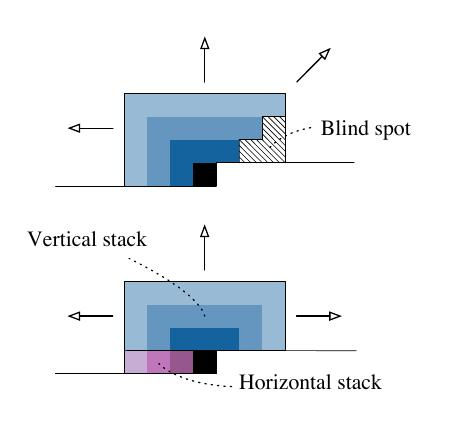
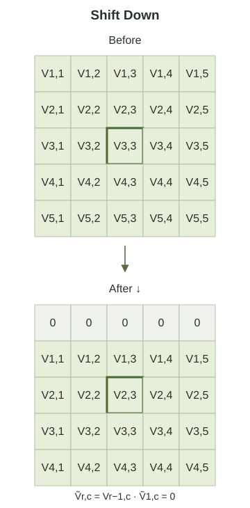

> 작성자 검토 전

앞 절에서 PixelCNN과 PixelRNN을 살펴봤다.

PixelCNN은 Convolution을 이용하므로 여러 픽셀의 조건부 확률을 병렬로 계산하기 쉽다. 하지만 Masked Convolution에는 Blind Spot이라는 문제가 있었다. 현재 픽셀보다 먼저 생성된 픽셀인데도, 신경망의 계산 경로가 없어 그 정보를 참조하지 못하는 경우다.

반면 PixelRNN의 Diagonal BiLSTM은 더 넓은 Context를 활용할 수 있었지만, LSTM의 순환적 계산이 필요했다.

그렇다면 **CNN의 병렬 계산이라는 장점은 유지하면서 Blind Spot을 해결할 수는 없을까?**

Gated PixelCNN은 이 문제를 해결하기 위해 신경망을 두 개의 Stack으로 나눈다. 하나는 위쪽 행의 정보를 처리하고, 다른 하나는 현재 행의 왼쪽 정보를 처리한다.

## 1. Blind Spot이 생기는 이유부터 다시 생각해보자

Autoregressive Image Model에서는 이미지를 Raster Scan Order로 생성한다. 왼쪽에서 오른쪽으로 한 행을 생성한 다음, 그 아래 행으로 이동하는 순서다.

따라서 현재 픽셀이 \(x_{r,c}\)라면 참조할 수 있는 위치는 다음과 같다.

\[
\boxed{
\mathcal C_{r,c}
=
\{x_{i,j}:i<r\}
\cup
\{x_{r,j}:j<c\}
}
\]

여기서 \(r\)은 행, \(c\)는 열을 나타낸다.

첫 번째 집합은 현재 픽셀보다 위에 있는 모든 픽셀이고, 두 번째 집합은 현재 행에서 왼쪽에 있는 픽셀이다.

예를 들어 \(5\times5\) 이미지에서 \((3,3)\) 위치의 픽셀을 예측한다고 하자.

이때 첫 번째와 두 번째 행의 픽셀 10개, 세 번째 행의 왼쪽 픽셀 2개를 사용할 수 있다.

중요한 점은 \((2,5)\)에 있는 픽셀도 과거 정보라는 것이다. 현재 픽셀의 오른쪽 위에 있지만, 두 번째 행은 이미 전부 생성되었기 때문이다.

그런데 5.7절에서 배운 일반적인 Masked Convolution에서는 이런 위치의 정보를 현재 픽셀까지 전달하지 못할 수 있다.

Convolution Filter의 연결 방향이 제한되어 있기 때문이다. Layer를 쌓더라도 접근 가능한 영역은 특정한 모양으로 확장되고, 그 바깥의 일부 과거 픽셀은 여전히 Blind Spot으로 남는다.

Gated PixelCNN은 이 문제를 해결하기 위해 **서로 다른 두 영역의 정보를 별도로 처리**한다.

## 2. Vertical Stack과 Horizontal Stack

현재 픽셀의 과거 정보를 다시 살펴보자.

\[
\mathcal C_{r,c}
=
\underbrace{\{x_{i,j}:i<r\}}_{\text{Above}}
\cup
\underbrace{\{x_{r,j}:j<c\}}_{\text{Left}}.
\]

생각해보면 이 식은 과거 정보를 정확히 두 영역으로 나눈 것이다.

Gated PixelCNN에서는 이 구조를 그대로 신경망에 반영한다.

**Vertical Stack**은 현재 픽셀보다 위에 있는 행의 정보를 처리하고, **Horizontal Stack**은 현재 행의 왼쪽에 있는 정보를 처리한다.

*Figure 5.8-1. Vertical Stack과 Horizontal Stack.*

### Vertical Stack — 위쪽 행의 모든 정보를 활용하기

Vertical Stack에서 가장 중요한 것은 위쪽 행의 정보가 왼쪽이나 오른쪽 어느 한쪽으로 제한되지 않는다는 점이다.

예를 들어 현재 픽셀이 \((3,3)\)이라면, 두 번째 행의 첫 번째 픽셀뿐 아니라 다섯 번째 픽셀도 참조할 수 있어야 한다.

두 위치 모두 현재 픽셀보다 먼저 생성되었기 때문이다.

따라서 Vertical Stack에서는 일반적인 PixelCNN의 삼각형 Receptive Field 대신, **위쪽 행을 가로로 넓게 포함하는 직사각형 형태의 Receptive Field**를 만들어간다.

이를 위해 위쪽 행의 정보를 모을 때는 왼쪽뿐 아니라 오른쪽으로도 Convolution을 적용할 수 있다.

다만 한 가지 조건은 반드시 지켜야 한다.

현재 픽셀을 예측하는 데 사용될 Vertical Feature에는 현재 행이나 그 아래 행의 원본 픽셀값이 포함되면 안 된다.

따라서 실제 구현에서는 Convolution의 계산 위치를 이동시키거나, Padding과 Cropping을 이용해 현재 행보다 위쪽에서 온 정보만 사용하도록 만든다.

이와 같은 Causal 제약이 지켜진 뒤라면, 위쪽 영역 안에서는 일반적인 Convolution처럼 가로 양방향의 정보를 결합할 수 있다.

여기서 흔히 말하는 'Vertical Stack에는 Mask가 필요 없다'는 설명도 이 맥락에서 이해해야 한다. **미래 행의 정보가 애초에 들어오지 않도록 계산 영역을 정렬해두었기 때문에, 그 영역 내부에서는 일반적인 Convolution을 사용할 수 있다는 뜻**이다.

Vertical Stack이 한 번에 이미지의 위쪽 전체를 볼 수 있다는 뜻은 아니다. 유한한 크기의 Kernel을 사용하므로 처음에는 가까운 영역만 참조하고, Layer를 쌓으면서 Receptive Field를 확장한다.

충분히 넓은 Receptive Field를 확보하면 기존 PixelCNN에서 놓쳤던 위쪽 오른편의 픽셀까지 활용할 수 있다.

### Horizontal Stack — 현재 행의 왼쪽 정보 활용하기

Horizontal Stack의 역할은 조금 더 단순하다.

현재 픽셀과 같은 행에서, 왼쪽에 있는 픽셀들의 정보를 처리하는 것이다.

예를 들어 \((3,3)\)의 조건부 확률을 계산한다면 같은 행의 \((3,1)\), \((3,2)\)를 참조할 수 있다.

반면 \((3,4)\), \((3,5)\)는 아직 생성되지 않은 미래 픽셀이므로 참조해서는 안 된다.

따라서 Horizontal Stack에서는 가로 방향으로 Convolution을 적용하되, 오른쪽의 미래 정보가 전달되지 않도록 연결을 제한한다.

또한 첫 번째 Layer에서는 현재 픽셀값 자체를 사용하지 않도록 하고, 이후 Layer에서는 안전하게 계산된 현재 위치의 Hidden Feature를 다시 사용할 수 있다. 이는 5.7절에서 배운 Mask A와 Mask B의 차이와 같은 원리다.

이렇게 두 Stack의 역할을 나누면 다음과 같이 생각할 수 있다.

- Vertical Stack: 이전 행들의 정보
- Horizontal Stack: 현재 행에서 이미 생성된 픽셀의 정보

이 두 정보를 결합하면 현재 픽셀의 조건부 확률을 계산하는 데 필요한 Context를 구성할 수 있다.

## 3. 두 Stack의 정보를 어떻게 결합할까?

이제 두 Stack을 따로 계산하는 것만으로는 충분하지 않다.

우리가 원하는 것은 현재 픽셀의 조건부 확률 하나를 계산하는 것이므로, 두 경로에서 얻은 정보를 결합해야 한다.

이를 위해 Gated PixelCNN은 **Vertical Stack에서 계산한 Feature를 Horizontal Stack으로 전달한다.**

개념적으로는 다음과 같다.

\[
\begin{aligned}
v&=\text{Vertical Features},\\
h&=\text{Horizontal Features},\\
\widetilde h
&=h+\operatorname{Conv}_{1\times1}(v).
\end{aligned}
\]

위 식은 두 정보의 결합을 단순하게 나타낸 것이다. 실제 네트워크에서는 Convolution과 활성화 함수를 적용하는 중간 단계에서 두 경로의 정보를 더한다.

여기서 \(1\times1\) Convolution은 주변 픽셀을 새로 참조하기 위한 연산이 아니다. 각 위치에 있는 Feature Channel들을 섞어 Horizontal Stack에 전달하기 위한 연산이다.

특히 정보의 전달 방향을 주의해야 한다.

Vertical Stack에서 Horizontal Stack으로 정보를 전달하는 것은 가능하지만, 반대로 Horizontal Stack의 정보를 Vertical Stack으로 전달해서는 안 된다.

Horizontal Stack의 Feature에는 현재 행의 왼쪽 픽셀 정보가 포함되어 있을 수 있기 때문이다. 이를 Vertical Stack으로 다시 전달하면, 다른 위치에서 사용할 때 현재 행의 미래 정보가 섞일 위험이 생긴다.

따라서 **Vertical → Horizontal이라는 방향 자체가 Autoregressive 조건을 유지하는 데 중요하다.**

그런데 여기서 아직 해결해야 할 문제가 하나 남아 있다.

## 4. Shift Down — 왜 정보를 한 행 아래로 이동시킬까?

앞에서 Vertical Stack이 위쪽 행의 정보를 처리한다고 설명했다.

하지만 Convolution을 실제로 계산할 때는 Filter의 중심 위치와 출력 Feature의 위치를 어떻게 맞추느냐가 중요하다.

예를 들어 \(3\times3\) Convolution을 현재 행에 적용하면, 정렬 방식에 따라 현재 행의 픽셀 정보가 출력에 포함될 수 있다.

그런 Feature를 그대로 Horizontal Stack으로 전달하면 어떻게 될까?

현재 \((3,3)\)을 예측하는데, 같은 행의 \((3,4)\)나 \((3,5)\)의 정보가 Vertical 경로를 통해 전달될 수도 있다.

이는 Autoregressive 조건을 위반한다.

그렇다고 Convolution에서 현재 행을 모두 제외하는 것만 생각할 필요는 없다. **계산된 Feature를 한 행 아래로 이동시키는 방법**도 사용할 수 있기 때문이다.

*Figure 5.8-2. Shift Down 전후의 Feature Map.*

### 한 행 아래로 이동시키면 무엇이 달라질까?

어떤 Feature Map을 \(V\)라고 하자.

이 Map을 아래로 한 칸 이동시킨 결과를 다음과 같이 정의할 수 있다.

\[
\boxed{
\begin{aligned}
\widetilde V_{1,c}&=0,\\
\widetilde V_{r,c}&=V_{r-1,c},
\qquad r\ge2.
\end{aligned}
}
\]

즉, 현재 위치에는 바로 위쪽 행에서 계산한 Feature가 들어오게 된다.

예를 들어 세 번째 행에서 사용할 Feature는 두 번째 행에서 계산한 값이 된다.

두 번째 행에서 가로로 오른쪽에 있는 픽셀까지 정보를 모았더라도, 그것을 세 번째 행에서 사용하는 것은 문제가 없다. 두 번째 행 전체는 이미 생성된 값이기 때문이다.

따라서 이렇게 이동시킨 Feature는 Horizontal Stack에 안전하게 전달할 수 있다.

이 과정은 실제로 배열 맨 위에 0으로 이루어진 행을 추가하고, 맨 아래의 한 행을 잘라내는 **Zero Padding과 Cropping**으로 구현할 수 있다.

다만 모든 구현에서 Convolution 뒤에 반드시 동일한 Shift를 또 적용하는 것은 아니다. 이미 Kernel의 위치를 조정해서 현재 행을 제외했다면, 같은 효과를 내는 Shift가 계산에 반영된 셈이다.

중요한 것은 구현 방식 자체보다 다음 조건이다.

\[
\boxed{
\text{현재 위치에 전달되는 Vertical Feature}
\;\text{는 이전 행의 정보만 포함해야 한다.}
}
\]

Shift Down은 이 조건을 만족시키기 위한 한 가지 방법이다.

### Blind Spot은 어떻게 사라질까?

이제 두 Stack을 다시 결합해보자.

현재 예측하려는 픽셀이 \((3,3)\)이라고 하자. 이전 PixelCNN에서는 \((2,5)\)와 같은 위쪽 오른편의 정보가 Blind Spot으로 남을 수 있었다.

하지만 Gated PixelCNN에서는 Vertical Stack이 위쪽 행의 정보를 가로 방향으로 결합한다.

따라서 Receptive Field가 충분히 넓어지면 \((2,5)\)의 정보도 Vertical Feature에 반영될 수 있다.

이 Feature는 올바른 Causal 정렬을 거쳐 Horizontal Stack으로 전달된다.

Horizontal Stack은 이 정보와 현재 행 왼쪽의 정보를 함께 이용해 \((3,3)\)의 조건부 확률을 계산한다.

결국 기존 PixelCNN에서 빠졌던 위쪽 오른편의 정보가 새로운 경로를 통해 전달될 수 있게 된다.

[demo:gated-pixelcnn-stacks]

여기서 현재 픽셀을 선택하고 Vertical Context와 Horizontal Context를 차례대로 표시해보자.

두 영역을 합쳤을 때 참조 가능한 과거 픽셀의 전체 영역이 어떻게 구성되는지 확인할 수 있다.

또한 Vertical Feature를 Shift하지 않은 경우와 Shift한 경우를 비교하면, 같은 행의 미래 정보가 들어오는 것을 왜 방지해야 하는지도 볼 수 있다.

두 Stack을 사용하는 핵심은 모든 픽셀을 자유롭게 연결하는 것이 아니다.

**사용할 수 있는 과거 정보는 빠뜨리지 않으면서, 사용할 수 없는 미래 정보는 전달하지 않도록 계산 경로를 설계하는 것**이다.

이제 Blind Spot을 해결하는 구조는 이해했다.

그런데 이름에 들어 있는 'Gated'는 아직 설명하지 않았다. Gated PixelCNN은 정보가 어디에서 오는지만 바꾼 것이 아니라, Convolution으로 얻은 정보를 처리하는 방식도 바꿨다.

다음 글에서는 Gated Activation이 무엇이고, 왜 PixelCNN에 도입되었는지 살펴보자.
