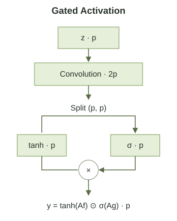
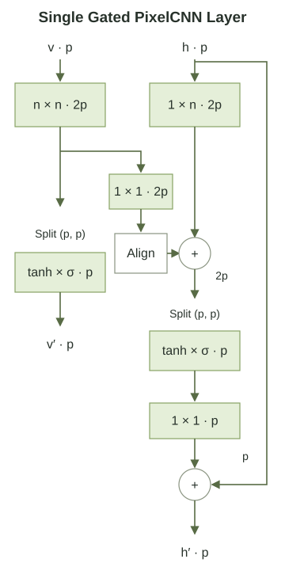
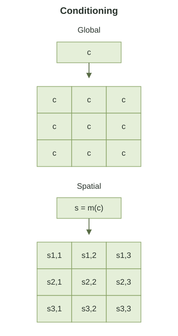

> 작성자 검토 전

앞에서는 Gated PixelCNN이 Vertical Stack과 Horizontal Stack을 이용해 Blind Spot을 해결하는 방법을 살펴봤다.

그런데 Gated PixelCNN에는 한 가지 변화가 더 있다. 일반적인 PixelCNN에서 사용하던 활성화 함수를 **Gated Activation**으로 바꾼 것이다.

이 변화는 Blind Spot과는 다른 문제를 해결하기 위한 것이다.

Blind Spot은 필요한 정보가 신경망에 전달되지 못하는 문제였다. 반면 Gated Activation은 **전달된 정보를 어떻게 조합하고 조절할 것인가**에 관한 문제다.

## 1. Gated Activation은 왜 필요할까?

앞에서 배운 PixelRNN은 LSTM을 이용했다.

LSTM의 중요한 특징 중 하나는 Gate를 통해 정보의 전달량을 조절한다는 것이다.

예를 들어 Forget Gate에서는 이전 Cell State에 어떤 값을 곱해 정보를 얼마나 유지할지 결정한다.

\[
C_t=F_t\odot C_{t-1}+I_t\odot G_t.
\]

여기서 \(F_t\)는 이전 정보를 얼마나 남길지 결정하고, \(I_t\)는 새 정보를 얼마나 받아들일지 결정한다.

이처럼 LSTM은 단순히 입력을 더하고 활성화 함수를 적용하는 것뿐 아니라, **서로 다른 계산 결과를 곱해 정보의 흐름을 조절**한다.

Gated PixelCNN은 이 아이디어를 Convolutional Network에도 적용한다.

물론 LSTM 전체를 CNN 안에 넣는 것은 아니다. LSTM에서 사용하는 곱셈 기반의 정보 조절 방식만 가져오는 것이다.

## 2. Gated Activation의 정의

일반적인 Convolutional Layer에서는 입력 \(z\)에 Convolution을 적용하고 활성화 함수를 통과시킨다.

예를 들어 ReLU를 사용하면

\[
y=\operatorname{ReLU}(W*z+b)
\]

와 같이 표현할 수 있다.

여기서 \(*\)는 Convolution 연산이다.

Gated PixelCNN에서는 이 계산을 두 갈래로 나눈다.

\[
\boxed{
y=
\tanh(W_f*z+b_f)
\odot
\sigma(W_g*z+b_g)
}
\]

여기서

- \(W_f\): 전달할 Feature를 계산하는 Convolution Kernel
- \(W_g\): Gate 값을 계산하는 Convolution Kernel
- \(\tanh\): Feature 값을 \((-1,1)\) 범위로 변환하는 함수
- \(\sigma\): Gate 값을 \((0,1)\) 범위로 변환하는 Sigmoid 함수

이다.

\(\odot\)는 두 결과를 같은 위치, 같은 Channel끼리 곱하는 원소별 곱셈을 나타낸다.

이 식을 조금 나누어 생각해보자.

먼저

\[
F=\tanh(W_f*z+b_f)
\]

는 신경망이 전달하려는 Feature다.

그리고

\[
G=\sigma(W_g*z+b_g)
\]

는 그 Feature를 얼마나 통과시킬지 조절하는 Gate다.

최종 출력은

\[
\boxed{y=F\odot G}
\]

가 된다.

### 숫자로 생각해보기

어떤 위치에서 Feature 값이 \(0.8\)이라고 하자.

만약 Gate 값이 \(0.1\)이라면 출력은

\[
y=0.8\times0.1=0.08
\]

이 된다.

반대로 Gate 값이 \(0.9\)라면

\[
y=0.8\times0.9=0.72
\]

가 된다.

같은 Feature를 계산하더라도 Gate에 따라 출력되는 값이 달라지는 것이다.

즉, 신경망은 어떤 Feature를 만드는 것뿐 아니라 그 Feature가 얼마나 강하게 전달되어야 하는지도 학습한다.

다만 Gate가 어떤 Feature의 중요도를 사람이 해석할 수 있는 형태로 직접 나타내는 것은 아니다. Gate 역시 학습되는 신경망의 계산 결과다.

이러한 곱셈 구조는 일반적인 활성화 함수만 사용하는 경우와 다른 형태의 비선형 상호작용을 가능하게 한다.

*Figure 5.8-3. Gated Activation: 2p → (p, p) → p.*

## 3. 두 갈래의 Convolution을 한 번에 계산하기

이제 이 계산을 실제 CNN에서 어떻게 구현하는지 살펴보자.

Hidden Feature Map의 Channel 수가 \(p\)개라고 하자.

Gated Activation에서는 다음 두 값을 계산해야 한다.

\[
F=\tanh(W_f*z+b_f),
\qquad
G=\sigma(W_g*z+b_g).
\]

두 결과를 원소별로 곱하려면 두 Feature Map의 크기가 같아야 한다.

따라서 각각 \(p\)개의 Channel을 출력하도록 만들 수 있다.

하지만 실제로는 두 Convolution을 별도의 연산으로 처리하는 대신, **한 번의 Convolution으로 \(2p\)개의 Channel을 만든 다음 두 부분으로 나눌 수도 있다.**

먼저

\[
A=\operatorname{Conv}(z)
\in\mathbb R^{H\times W\times 2p}
\]

를 계산한다.

여기서 \(H,W\)는 Feature Map의 높이와 너비다.

이제 Channel을 절반씩 나누면

\[
A=(A_f,A_g),
\qquad
A_f,A_g\in\mathbb R^{H\times W\times p}
\]

가 된다.

마지막으로

\[
\boxed{
y=\tanh(A_f)\odot\sigma(A_g)
}
\]

를 계산한다.

전체 과정을 정리하면

\[
\underbrace{p}_{\text{Input}}
\longrightarrow
\underbrace{2p}_{\text{Convolution}}
\longrightarrow
\underbrace{(p,p)}_{\text{Split}}
\longrightarrow
\underbrace{p}_{\text{Gate Output}}
\]

로 생각할 수 있다.

따라서 Figure에서 보이는 \(2p\)는 Feature Map의 공간적 크기가 두 배가 된다는 뜻이 아니다. **Channel 수가 두 배로 늘어난다는 뜻**이다.

Gated PixelCNN의 구조도에 있는 Split Feature Maps는 바로 이 계산을 나타낸다.

## 4. Single Gated PixelCNN Layer

이제 앞에서 배운 두 가지 아이디어를 결합해보자.

첫 번째는 Vertical Stack과 Horizontal Stack을 분리해 Blind Spot을 해결하는 것이다.

두 번째는 Convolution 결과에 Gated Activation을 적용하는 것이다.

Gated PixelCNN의 하나의 Layer에는 이 두 구조가 모두 들어 있다.

*Figure 5.8-4. Gated PixelCNN Layer의 채널 수와 Residual Connection.*

처음 보면 그림이 상당히 복잡하다. 하지만 위쪽 화살표와 Convolution을 모두 한꺼번에 이해하려고 할 필요는 없다.

먼저 왼쪽 Vertical Stack을 살펴보고, 그다음 오른쪽 Horizontal Stack을 보면 된다.

### Vertical Stack

Vertical Stack의 입력 Feature를 \(v\)라고 하자.

먼저 Vertical Convolution을 적용한다.

\[
A_v=\operatorname{VConv}(v).
\]

이 연산으로 얻은 \(2p\)개의 Channel을 두 부분으로 나눈다.

\[
A_v=(A_{v,f},A_{v,g}).
\]

이후 Gated Activation을 적용하면

\[
\boxed{
v'=
\tanh(A_{v,f})
\odot\sigma(A_{v,g})
}
\]

가 된다.

이 결과는 다음 Layer의 Vertical Stack으로 전달된다.

하지만 Vertical Stack의 역할은 여기서 끝나지 않는다. 계산된 Feature의 일부는 Horizontal Stack에도 전달된다.

### Horizontal Stack

Horizontal Stack의 입력 Feature를 \(h\)라고 하자.

먼저 현재 행의 왼쪽 정보만 이용해 Horizontal Convolution을 계산한다.

\[
A_h^{\mathrm{local}}
=\operatorname{HConv}(h).
\]

그다음 Vertical Stack에서 전달받은 정보를 더한다.

\[
\boxed{
A_h
=
A_h^{\mathrm{local}}
+
A_h^{\mathrm{vertical}}
}
\]

여기서 \(A_h^{\mathrm{vertical}}\)은 Vertical Feature를 \(1\times1\) Convolution으로 변환한 결과다. 필요한 경우 앞에서 설명한 Shift Down을 적용해 현재 위치에서 이전 행의 정보만 사용하도록 정렬한다.

이제 \(A_h\)를 두 부분으로 나누어 Gated Activation을 적용한다.

\[
A_h=(A_{h,f},A_{h,g}),
\]

\[
G_h=
\tanh(A_{h,f})
\odot\sigma(A_{h,g}).
\]

이렇게 하면 Horizontal Stack은 현재 행 왼쪽의 정보와 위쪽 행의 정보를 함께 활용할 수 있다.

### Residual Connection은 왜 있을까?

그림을 보면 Horizontal Stack의 입력 \(h\)에서 출력 \(h'\)으로 바로 연결되는 경로도 있다.

이를 Residual Connection이라고 한다.

Gated Activation으로 계산한 결과를 \(1\times1\) Convolution에 통과시킨 다음, 원래 입력 \(h\)에 더한다.

\[
\boxed{
h'=h+\operatorname{Conv}_{1\times1}(G_h)
}
\]

이렇게 하면 새로운 Feature를 계산하면서도 이전 Layer에서 전달된 정보를 유지하는 경로가 생긴다.

깊은 신경망에서는 여러 Layer를 통과하는 동안 정보를 전달하고 기울기를 전파하는 것이 중요하다. Residual Connection은 이 과정을 돕는 역할을 한다.

원래 Gated PixelCNN 구조에서는 Horizontal Stack에 Residual Connection을 사용했다. Vertical Stack에도 적용해보았지만, 초기 실험에서 성능 향상이 확인되지 않아 최종 구조에서는 사용하지 않았다.

### 전체 Layer의 정보 흐름

지금까지의 내용을 정리해보자.

Vertical Stack은 위쪽 행의 정보를 처리하고, 그 결과를 다음 Vertical Layer와 Horizontal Stack에 전달한다.

Horizontal Stack은 현재 행 왼쪽의 정보와 전달받은 Vertical Feature를 결합한 뒤, Gated Activation과 Residual Connection을 거쳐 다음 Layer로 전달한다.

이 구조를 여러 번 반복하면 이미지의 더 넓은 영역에 있는 픽셀 사이의 관계를 학습할 수 있다.

여기서 **Blind Spot을 없애는 것은 Stack의 분리와 올바른 정보 전달 경로이고, Gated Activation은 전달받은 Feature를 조절하는 연산**이라는 점을 구분해야 한다.

## 5. Conditional Image Generation

지금까지는 이미지의 이전 픽셀만 이용해 다음 픽셀을 생성하는 상황을 생각했다.

그런데 이미지를 생성할 때 추가적인 조건을 주고 싶을 수도 있다.

예를 들어 동물 이미지를 생성하는 모델에 '고양이'라는 조건을 주면 고양이 이미지를 생성하고, '강아지'라는 조건을 주면 강아지 이미지를 생성하도록 만들고 싶은 것이다.

이를 Conditional Image Generation이라고 한다.

### 조건부 확률분포

추가 조건을 \(c\)라고 하자.

우리가 모델링하려는 분포는 이제

\[
p_\theta(x\mid c)
\]

이다.

Autoregressive Factorization을 적용하면

\[
\boxed{
p_\theta(x\mid c)
=
\prod_{i=1}^{D}
p_\theta(x_i\mid x_{<i},c)
}
\]

가 된다.

각 픽셀을 생성할 때 이전 픽셀뿐 아니라 조건 \(c\)도 함께 참조한다는 뜻이다.

예를 들어 '고양이'라는 조건을 주었다면 모델은 이미 생성한 픽셀들을 참고하면서, 동시에 고양이에 어울리는 다음 픽셀의 확률분포를 계산한다.

그렇다면 이 조건을 Gated PixelCNN에 어떻게 전달할 수 있을까?

### Global Conditioning — 이미지 전체에 같은 조건 주기

가장 간단한 방법은 조건을 하나의 벡터로 표현하는 것이다.

예를 들어 '고양이', '강아지', '새'라는 세 가지 Class가 있다면 각각을 One-Hot Vector로 나타낼 수 있다.

\[
\begin{aligned}
c_{\mathrm{cat}}&=(1,0,0),\\
c_{\mathrm{dog}}&=(0,1,0),\\
c_{\mathrm{bird}}&=(0,0,1).
\end{aligned}
\]

이 조건 벡터를 Gated Activation의 계산에 추가할 수 있다.

\[
\boxed{
\begin{aligned}
y
&=\tanh(W_f*z+V_fc+b_f)\\
&\quad\odot\sigma(W_g*z+V_gc+b_g).
\end{aligned}
}
\]

여기서 \(z\)는 해당 Layer의 입력 Feature이고, \(V_fc\), \(V_gc\)는 조건 벡터를 변환한 값이다.

공간적 위치마다 같은 조건을 전달하므로 이 값은 Feature Map 전체에 적용된다.

One-Hot Vector를 사용한다면 조건마다 서로 다른 값을 더하는 것과 같기 때문에, **Class에 따라 달라지는 Bias를 추가하는 방식**으로 이해할 수 있다.

이처럼 이미지 전체에 동일한 조건을 제공하는 것을 Global Conditioning이라고 한다.

Global Conditioning은 이미지에 무엇이 나타나야 하는지를 알려줄 수 있다. 하지만 그 물체가 정확히 어느 위치에 있어야 하는지를 직접 지정하는 정보는 아니다.

### Spatial Conditioning — 위치마다 다른 조건 주기

이번에는 고양이 이미지를 생성하되, 고양이는 왼쪽에, 배경은 오른쪽에 배치하고 싶다고 하자.

단순히 '고양이'라는 Class Label만 전달해서는 이런 공간적 위치를 직접 지정하기 어렵다.

이럴 때는 각 위치마다 다른 조건을 제공할 수 있다.

이를 Spatial Conditioning이라고 한다.

예를 들어 이미지의 크기가 \(H\times W\)라면 조건을 같은 공간적 크기의 Feature Map으로 나타낼 수 있다.

\[
s=m(c)\in\mathbb R^{H\times W\times q}.
\]

여기서 \(m\)은 조건 벡터를 공간적 Feature Map으로 변환하는 함수이고, \(q\)는 Feature Channel의 개수다.

각 위치마다 다른 값을 가질 수 있으므로, 이미지의 어느 부분에 어떤 정보가 필요한지를 더 구체적으로 표현할 수 있다.

Gated Activation에는 이 Spatial Feature를 추가한다.

\[
\boxed{
\begin{aligned}
y
&=\tanh(W_f*z+V_f*s+b_f)\\
&\quad\odot\sigma(W_g*z+V_g*s+b_g).
\end{aligned}
}
\]

여기서 \(V_f*s\), \(V_g*s\)는 조건 Feature Map에 Convolution을 적용하는 연산이다. 원래 Gated PixelCNN에서는 \(1\times1\) Convolution을 사용해 위치별 조건을 전달할 수 있다.

Global Conditioning과 Spatial Conditioning의 차이는 다음과 같다.

- **Global Conditioning:** 이미지 전체에 동일한 조건을 제공한다.
- **Spatial Conditioning:** 이미지의 위치에 따라 다른 조건을 제공할 수 있다.

*Figure 5.8-5. Global Conditioning과 Spatial Conditioning.*

두 방법 모두 Autoregressive 구조를 유지한다.

조건이 추가되더라도 이미지를 생성할 때는 이전 픽셀을 바탕으로 다음 픽셀의 조건부 확률을 계산해야 한다.

차이는 이전 픽셀 외에 어떤 정보를 조건으로 제공하느냐에 있다.

## 6. Gated PixelCNN이 개선한 것

이제 5.7절의 PixelCNN과 5.8절의 Gated PixelCNN을 비교해보자.

원래 PixelCNN에는 서로 다른 두 가지 한계가 있었다.

첫 번째는 일부 과거 픽셀의 정보가 전달되지 않는 Blind Spot이다.

Gated PixelCNN에서는 Vertical Stack과 Horizontal Stack을 분리하고, Causal 조건을 만족하도록 정보를 결합해 이 문제를 해결한다.

두 번째는 복잡한 픽셀 사이의 관계를 표현하는 능력이다.

이를 위해 일반적인 활성화 함수 대신 Gated Activation을 도입했다. 신경망은 Feature 자체뿐 아니라 그 Feature가 얼마나 전달될지도 학습할 수 있게 된다.

마지막으로 추가 조건을 Gated Activation에 전달하면 특정 Class나 Spatial Feature에 따라 이미지를 생성할 수도 있다.

그렇다고 Gated PixelCNN이 Autoregressive Model의 근본적인 생성 방식을 바꾼 것은 아니다.

관측한 이미지에 대한 조건부 확률들은 CNN으로 병렬 계산할 수 있지만, 새로운 이미지를 생성할 때는 여전히 픽셀을 순서대로 Sampling해야 한다.

\[
x_1\rightarrow x_2\rightarrow\cdots\rightarrow x_D.
\]

결국 Gated PixelCNN은 **Autoregressive Factorization은 그대로 유지하면서, 조건부 확률분포를 계산하는 신경망의 구조를 개선한 모델**이다.

5.7절에서 등장한 Blind Spot과 표현력의 문제를 각각 다른 방법으로 해결했다는 점이 이 모델을 이해하는 핵심이다.
