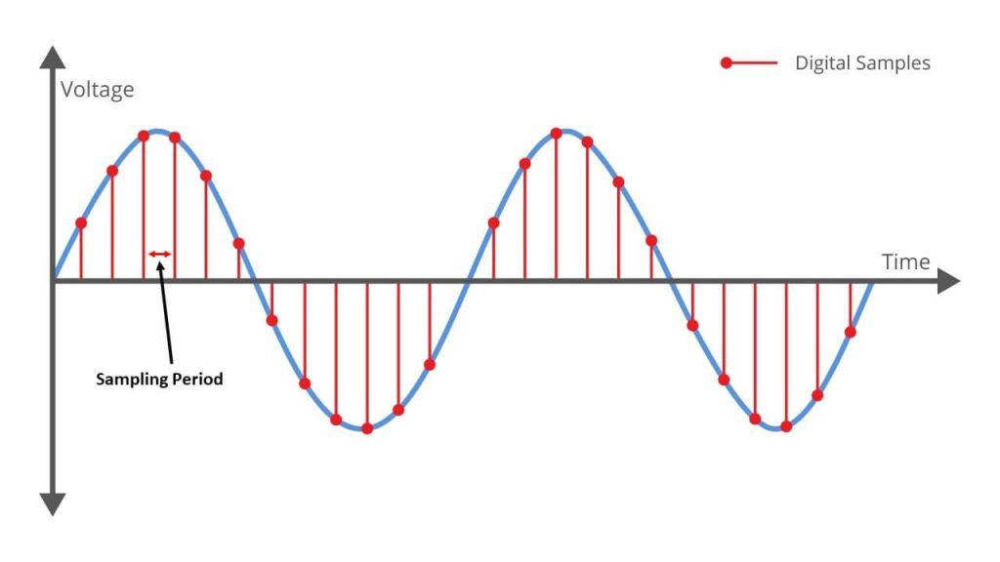
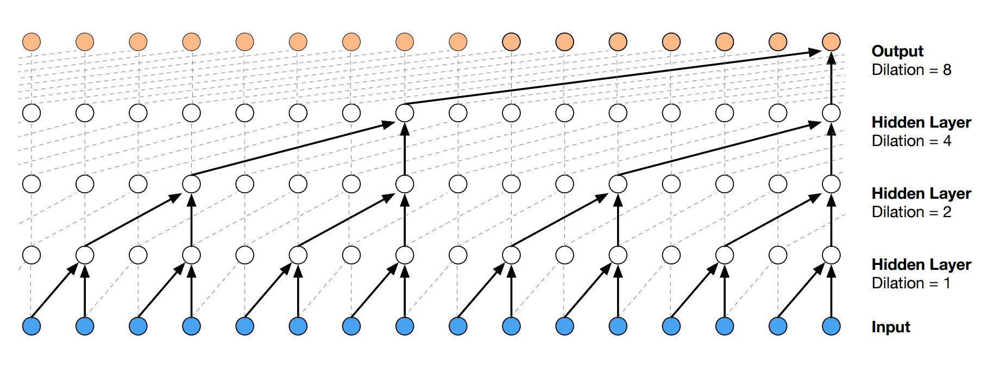
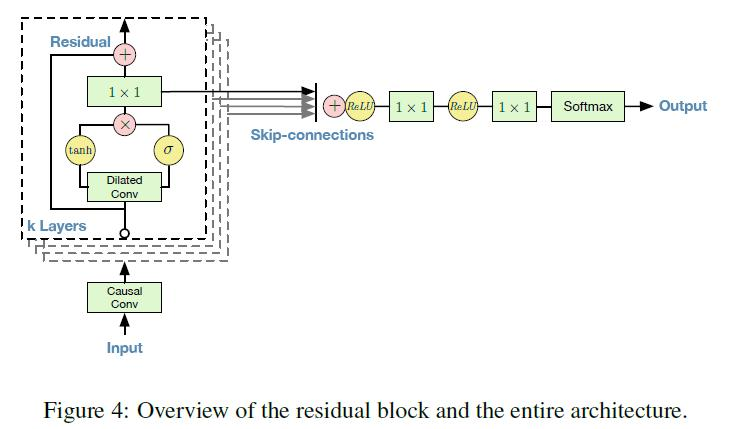
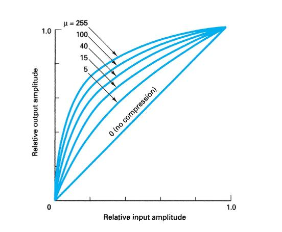

> 작성자 검토 전

앞에서는 PixelCNN과 Gated PixelCNN을 이용해 이미지를 생성하는 방법을 살펴봤다. 이미지의 픽셀을 일정한 순서로 나열하고, 이전 픽셀들을 이용해 다음 픽셀의 조건부 확률을 계산하는 방식이었다.

그런데 이 방법을 이미지가 아니라 소리에 적용하면 어떨까?

소리도 시간에 따라 측정한 값들을 순서대로 나열할 수 있다. 이전에 발생한 소리의 정보를 이용해 다음 순간의 소리를 예측한다면, Autoregressive Model로 새로운 오디오를 생성할 수 있을 것이다.

이러한 아이디어를 구현한 모델이 **WaveNet**이다.

다만 이미지와 오디오에는 중요한 차이가 있다. 오디오는 1초만 녹음해도 수만 개의 값이 만들어진다. 따라서 이전 정보를 순서대로 이용한다는 기본 원리는 같지만, 훨씬 긴 시퀀스를 효율적으로 처리할 방법이 필요하다.

## 1. 오디오를 Autoregressive Model로 표현하기

### 소리는 어떻게 데이터가 될까?

사람의 목소리나 악기를 녹음하면 시간에 따라 변하는 파형(Waveform)을 얻는다.

컴퓨터는 이 파형을 일정한 간격으로 측정해 숫자로 저장한다. 이렇게 얻은 각각의 값을 Sample이라고 한다.

예를 들어 Sampling Rate가 44.1kHz라면 1초 동안 44,100개의 값을 측정한다는 뜻이다.

따라서 1초 분량의 Mono Audio는 다음과 같은 시퀀스로 표현할 수 있다.

\[
x=(x_1,x_2,\ldots,x_{44100}).
\]

여기서 \(x_t\)는 \(t\)번째 시점에서 측정한 파형의 진폭(Amplitude)이다.

*Figure 5.9-1. Audio Waveform과 Sampling.*

이제 익숙한 Chain Rule을 적용해보자.

\[
\boxed{
p_\theta(x)
=
\prod_{t=1}^{T}p_\theta(x_t\mid x_{<t})
}
\]

여기서 \(x_{<t}=(x_1,\ldots,x_{t-1})\)는 현재 시점보다 이전에 관측된 모든 Sample을 나타낸다.

이미지의 다음 픽셀을 예측하는 대신 오디오의 다음 Sample을 예측한다는 점만 다를 뿐, 확률모형의 구조는 앞에서 배운 것과 같다.

### 오디오에서는 왜 긴 Context가 필요할까?

그런데 오디오에서는 바로 이전의 몇 개 Sample만 참조하는 것으로 충분하지 않을 수 있다.

사람이 말하는 소리를 생각해보자. 파형에는 짧은 시간에 반복되는 진동이 있지만, 음의 높이나 발음, 말의 리듬처럼 더 긴 시간에 걸쳐 유지되는 구조도 존재한다.

이런 정보를 활용하려면 현재 시점에서 상당히 멀리 떨어진 과거까지 참고해야 한다.

44.1kHz 오디오를 기준으로 과거 100개의 Sample은 약 2.3ms에 해당한다. 과거 1,000개를 참고하더라도 약 23ms다.

따라서 의미 있는 시간적 관계를 학습하려면 많은 과거 Sample이 현재 예측에 영향을 줄 수 있어야 한다.

여기서 필요한 개념이 **Receptive Field**다.

Receptive Field는 신경망의 특정 출력을 계산할 때 영향을 줄 수 있는 입력의 범위를 뜻한다.

WaveNet에서는 이 범위를 넓히는 것이 중요하다. 다만 무작정 Layer를 깊게 쌓는 방법은 계산 비용이 많이 든다.

그렇다면 적은 Layer를 사용하면서도 먼 과거까지 참조할 수는 없을까?

## 2. Causal Convolution — 미래 정보를 사용하지 않기

WaveNet은 RNN 대신 1차원 Convolution을 사용한다.

일반적인 Convolution은 현재 위치를 중심으로 주변 입력값들을 함께 사용한다. 하지만 Autoregressive Model에서는 현재 시점을 예측하면서 미래 Sample을 사용하면 안 된다.

예를 들어 \(x_t\)를 예측하는데 \(x_{t+1}\)을 참조한다면 아직 생성하지 않은 값을 보고 예측하는 셈이다.

따라서 WaveNet은 미래 정보를 차단하는 **Causal Convolution**을 사용한다.

Causal Convolution에서는 어떤 시점의 Hidden Feature를 계산할 때 현재 위치와 그 이전 위치의 Feature만 사용할 수 있다.

### Input Shifting은 왜 필요할까?

여기서 한 가지 주의할 점이 있다.

Convolution이 미래 정보를 참조하지 않는다고 해서 현재 예측하려는 \(x_t\)를 그대로 입력에 넣어도 된다는 뜻은 아니다.

우리가 계산하려는 것은

\[
p_\theta(x_t\mid x_{<t})
\]

이므로, \(x_t\) 자체를 참조해서도 안 된다.

이를 해결하는 방법은 입력을 한 시점 이동시키는 것이다.

예를 들어 관측한 오디오가

\[
(x_1,x_2,x_3,x_4)
\]

라면 신경망에는

\[
(x_{\mathrm{start}},x_1,x_2,x_3)
\]

를 입력해 네 시점의 조건부 확률을 계산하도록 할 수 있다.

여기서 \(x_{\mathrm{start}}\)는 첫 번째 Sample을 예측하기 위한 초기값이다.

이렇게 하면 \(t\)번째 출력에서는 최대 \(x_{t-1}\)까지만 사용할 수 있다. 이후 Layer에서 현재 위치의 Hidden Feature를 사용하는 것은 문제가 되지 않는다. 그 Feature 자체가 이미 이전 Sample만으로 계산되었기 때문이다.

이 방식은 앞에서 PixelCNN의 첫 번째 Layer에 Mask A를 적용했던 것과 같은 목적을 갖는다.

### 일반 Causal Convolution의 한계

이제 Kernel Size가 2인 Causal Convolution을 생각해보자.

한 Layer의 출력은 현재 위치와 바로 이전 위치의 Feature를 이용해 계산된다.

Layer를 하나 더 쌓으면 더 먼 입력의 정보까지 전달받을 수 있다. 하지만 Receptive Field가 증가하는 속도는 빠르지 않다.

Stride가 1이고, 모든 Layer의 Kernel Size가 \(k\)라면 일반 Causal Convolution을 \(L\)개 쌓았을 때

\[
\boxed{
R=1+L(k-1)
}
\]

이 된다.

예를 들어 \(k=2\), \(L=4\)라면

\[
R=1+4(2-1)=5.
\]

네 개의 Layer를 사용했지만 참조할 수 있는 입력의 범위는 다섯 개에 불과하다.

오디오처럼 긴 시퀀스를 처리하려면 훨씬 넓은 Receptive Field가 필요하다.

WaveNet은 이 문제를 해결하기 위해 **Dilated Convolution**을 사용한다.

## 3. Dilated Causal Convolution

Dilated Convolution의 아이디어는 간단하다.

인접한 입력만 참조하는 대신, **일정한 간격으로 떨어진 위치의 입력을 참조하는 것**이다.

Kernel Size가 2인 Convolution을 생각해보자.

Dilation이 1이면 현재 위치와 한 칸 이전 위치를 참조한다.

Dilation이 2라면 현재 위치와 두 칸 이전 위치를 참조하고, Dilation이 4라면 네 칸 이전 위치를 참조한다.

| Dilation \(d\) | 참조하는 Feature 위치 |
|---|---|
| 1 | \(t,\ t-1\) |
| 2 | \(t,\ t-2\) |
| 4 | \(t,\ t-4\) |
| 8 | \(t,\ t-8\) |

여기서 \(t\)는 Hidden Feature의 위치를 나타낸다. 실제로 \(x_t\)의 조건부 확률을 계산할 때는 앞에서 설명한 Input Shifting이 적용되어 있으므로 현재 정답이 입력되는 것은 아니다.

Dilation을 크게 설정하더라도 Kernel의 가중치 개수는 그대로다. Kernel Size가 2라면 두 위치의 Feature를 결합한다는 점은 달라지지 않는다.

다만 그 두 위치 사이의 간격이 넓어진다.

수식으로 표현해보자.

Layer \(\ell\)의 Hidden Feature를 \(h_t^{(\ell)}\), Dilation을 \(d_\ell\)이라고 하자. Kernel Size가 2인 경우

\[
\boxed{
h_t^{(\ell)}
=
\phi\left(
W_0^{(\ell)}h_t^{(\ell-1)}
+
W_1^{(\ell)}h_{t-d_\ell}^{(\ell-1)}
+b^{(\ell)}
\right)
}
\]

로 쓸 수 있다.

여기서 \(W_0^{(\ell)},W_1^{(\ell)}\)는 학습할 가중치이고 \(\phi\)는 활성화 함수다.

일반적인 Convolution과 비교하면 달라진 부분은 입력을 참조하는 위치뿐이다.

### 여러 Layer를 쌓으면 어떻게 될까?

WaveNet에서는 Dilation을 Layer마다 두 배씩 증가시키는 방법을 사용한다.

\[
d_1=1,\quad d_2=2,\quad
d_3=4,\quad d_4=8.
\]

이때 Receptive Field가 어떻게 증가하는지 직접 살펴보자.

첫 번째 Layer에서는 인접한 두 위치를 참조한다.

\[
\{t-1,t\}
\]

두 번째 Layer에서는 Dilation이 2이므로 두 칸 떨어진 Hidden Feature를 참조한다.

그런데 각 Hidden Feature는 이미 첫 번째 Layer에서 두 위치의 정보를 가지고 있다. 따라서 최종적으로 영향을 줄 수 있는 입력은

\[
\{t-3,t-2,t-1,t\}
\]

가 된다.

세 번째 Layer에서는 이 범위가 여덟 개로 확장된다.

\[
\{t-7,\ldots,t\}
\]

네 번째 Layer까지 계산하면

\[
\boxed{
\{t-15,\ldots,t\}
}
\]

가 된다.

*Figure 5.9-2. Dilated Causal Convolution의 연결 구조.*

이제 같은 네 개의 Layer를 비교해보자.

| Layer 수 | 일반 Causal Conv | Dilation을 두 배씩 증가 |
|---|---:|---:|
| 1 | 2 | 2 |
| 2 | 3 | 4 |
| 3 | 4 | 8 |
| 4 | 5 | 16 |

일반 Causal Convolution에서는 Receptive Field가 Layer마다 하나씩 증가하지만, Dilation을 두 배씩 늘리면 두 배씩 증가한다.

같은 네 개의 Layer를 사용하면서도 훨씬 많은 과거 입력을 참조할 수 있게 된 것이다.

### Receptive Field의 일반식

모든 Layer의 Kernel Size가 \(k\), Stride가 1이고 Dilation이 \(d_1,\ldots,d_L\)이라면 Receptive Field가 차지하는 전체 범위는

\[
\boxed{
R=1+(k-1)\sum_{\ell=1}^{L}d_\ell
}
\]

로 나타낼 수 있다.

여기서 \(k=2\)이고 Dilation이

\[
d_\ell=2^{\ell-1}
\]

이라면

\[
\begin{aligned}
R
&=1+\sum_{\ell=1}^{L}2^{\ell-1}\\
&=1+(2^L-1)\\
&=\boxed{2^L}
\end{aligned}
\]

이 된다.

따라서 \(L\)이 하나 증가할 때마다 Receptive Field의 크기가 두 배가 된다.

[demo:wavenet-dilation]

여기서 직접 Layer 수와 Dilation을 바꿔보면 차이가 더 분명하게 드러난다.

모든 Layer의 Dilation을 1로 설정한 경우와 \(1,2,4,8\)로 설정한 경우를 비교해보자.

특히 맨 위 출력에서 출발해 입력까지 연결된 경로를 따라가면, 적은 수의 가중치를 사용하면서도 어떻게 먼 과거의 정보를 가져올 수 있는지 확인할 수 있다.

### Remark — Dilation을 크게 하면 언제나 좋을까?

여기서 구분해야 할 것이 있다.

Receptive Field의 범위가 넓어졌다고 해서, 그 안에 있는 모든 입력에 실제로 정보 전달 경로가 존재하는 것은 아니다.

예를 들어 Kernel Size가 2이고 두 Layer의 Dilation을 모두 2로 설정했다고 하자.

첫 번째 Layer는 \(t,t-2\)를 참조하고, 두 번째 Layer에서도 두 칸 떨어진 Hidden Feature를 참조한다.

따라서 최종 출력에 영향을 줄 수 있는 위치는

\[
\{t,t-2,t-4\}
\]

뿐이다.

Receptive Field의 전체 범위는 5개 위치에 걸쳐 있지만, 그 사이의 일부 입력은 실제 계산에 사용되지 않는다.

반면 Dilation을 \(1,2,4,8\)로 늘리는 경우에는 앞에서 살펴본 것처럼 연속된 16개의 입력을 모두 포함할 수 있다.

따라서 **Dilation을 어떻게 조합하는지도 중요하다.**

원래 WaveNet에서는 Dilation을

\[
1,2,4,\ldots,512
\]

까지 증가시킨 뒤, 이 패턴을 반복하는 구조를 사용했다.

Kernel Size가 2라면 이러한 10개 Layer의 Receptive Field는

\[
R=1+(1+2+4+\cdots+512)=1024
\]

가 된다.

일반적인 Causal Convolution 10개를 쌓았을 때의 Receptive Field는 11개다.

Dilation을 사용하면 매우 깊은 네트워크를 만들지 않고도 먼 과거까지 참조할 수 있다는 차이가 분명해진다.

또한 Dilated Convolution은 입력을 건너뛰며 참조하지만, Strided Convolution처럼 출력 시퀀스의 길이를 줄이지 않는다. 적절한 Padding을 사용하면 입력과 출력의 시간축 길이를 동일하게 유지할 수 있다.

결국 **Dilated Causal Convolution은 시퀀스의 해상도를 유지하면서 Receptive Field를 효율적으로 넓히는 방법**이다.

## 4. Gated WaveNet Architecture

이제 WaveNet이 긴 과거 정보를 어떻게 가져오는지는 이해했다.

하지만 멀리 떨어진 과거의 정보를 활용할 수 있다는 것과, 그 정보를 잘 처리한다는 것은 다른 문제다.

WaveNet은 이를 위해 5.8절의 Gated PixelCNN에서 배운 Gated Activation을 사용한다.

### Gated Activation

일반적인 Convolution에서는 입력에 가중치를 적용한 뒤 ReLU 같은 활성화 함수를 사용한다.

반면 Gated Activation은 계산을 두 갈래로 나눈다.

\[
\boxed{
z=
\tanh(W_f *_d h)
\odot
\sigma(W_g *_d h)
}
\]

여기서 \(*_d\)는 Dilated Causal Convolution이고 \(\odot\)는 원소별 곱셈이다.

첫 번째 갈래에서는 \(\tanh\)를 이용해 Feature를 계산한다.

\[
F=\tanh(W_f *_d h).
\]

두 번째 갈래에서는 Sigmoid를 이용해 Gate 값을 계산한다.

\[
G=\sigma(W_g *_d h).
\]

최종 출력은

\[
z=F\odot G
\]

이다.

예를 들어 어떤 Feature가 \(0.8\)이고 Gate 값이 \(0.1\)이라면 출력은 \(0.08\)이 된다. 반대로 Gate 값이 \(0.9\)라면 출력은 \(0.72\)가 된다.

같은 Feature라도 Gate 값에 따라 전달되는 정도가 달라지는 것이다.

이 방식은 앞에서 배운 Gated PixelCNN과 동일하다. 차이는 이미지에 대한 공간적 Convolution 대신 오디오의 시간축에 대한 Dilated Causal Convolution을 사용한다는 점이다.

### Residual Connection과 Skip Connection

실제 WaveNet은 Gated Activation만 사용하지 않는다.

여러 Dilated Convolution Layer를 깊게 쌓기 위해 Residual Connection과 Skip Connection도 사용한다.

두 가지 이름이 비슷하지만 역할은 다르다.

Residual Connection은 현재 Layer의 입력을 다음 Layer로 직접 전달하는 경로다.

Layer \(\ell\)의 입력을 \(h^{(\ell)}\), Gated Activation의 결과를 \(z^{(\ell)}\)라고 하면 개념적으로

\[
\boxed{
h^{(\ell+1)}
=
h^{(\ell)}
+
W_r^{(\ell)}*_{1}z^{(\ell)}
}
\]

와 같이 표현할 수 있다.

여기서 \(*_1\)은 Kernel Size가 1인 Convolution이다.

이 구조에서는 새로운 Feature를 계산하면서 원래 입력을 그대로 전달하는 경로도 유지된다.

반면 Skip Connection은 각 Layer에서 계산한 Feature를 최종 출력 부분으로 전달하는 경로다.

\[
s^{(\ell)}
=
W_s^{(\ell)}*_{1}z^{(\ell)}.
\]

여러 Layer에서 얻은 Skip Feature들은 합쳐져 최종 출력층으로 전달된다.

\[
S=\sum_{\ell=1}^{L}s^{(\ell)}.
\]

이후 ReLU와 \(1\times1\)에 해당하는 시간축의 Pointwise Convolution 등을 거쳐 다음 오디오 Sample의 확률분포를 계산한다.

*Figure 5.9-3. WaveNet의 Gated Residual Block과 Skip Connection.*

여기서 두 연결의 차이를 구분하자.

Residual Connection은 **다음 Layer로 정보를 전달하는 경로**이고, Skip Connection은 **여러 Layer의 정보를 최종 출력에 전달하는 경로**다.

WaveNet은 이러한 구조를 사용해 많은 Dilated Convolution Layer를 쌓으면서도 학습을 수행할 수 있도록 설계되었다.

## 5. μ-law Companding — 오디오 값을 어떻게 예측할까?

지금까지는 WaveNet이 이전 Sample의 정보를 이용해 다음 Sample을 예측하는 방법을 살펴봤다.

그런데 한 가지 문제가 남아 있다.

**다음 Sample의 값이 가질 수 있는 경우의 수는 얼마나 될까?**

디지털 오디오에서는 Sampling Rate뿐 아니라 Bit Depth도 중요하다.

Sampling Rate가 1초 동안 몇 번 측정하는지를 결정한다면, Bit Depth는 한 번 측정한 진폭을 몇 가지 값 중 하나로 표현할 수 있는지를 결정한다.

예를 들어 16-bit 오디오는 하나의 Sample을

\[
2^{16}=65,536
\]

가지 값 중 하나로 표현할 수 있다.

WaveNet이 각 Sample의 조건부 확률을 Categorical Distribution으로 모델링한다면, 가능한 값마다 확률을 출력해야 한다.

16-bit 값을 그대로 사용한다면 매 시점마다 65,536개의 확률을 계산해야 하는 것이다.

이는 출력층이 지나치게 커지는 문제가 있다.

따라서 원래 WaveNet은 오디오에 **μ-law Companding**을 적용한 뒤, 256개의 값으로 Quantization하는 방법을 사용했다.

### μ-law Companding이란?

Quantization은 연속적이거나 매우 많은 값을 가진 데이터를 정해진 개수의 대표값으로 바꾸는 과정이다.

가장 간단한 방법은 진폭의 전체 범위를 동일한 간격으로 나누는 것이다.

그런데 오디오에서는 작은 진폭의 차이도 중요할 수 있다. 모든 진폭 구간에 같은 간격을 사용한다면 작은 진폭의 미세한 변화를 충분히 표현하지 못할 수 있다.

μ-law Companding은 이를 개선하기 위해 진폭에 비선형 변환을 적용한다.

진폭을 \([-1,1]\) 범위로 정규화했다고 하자.

μ-law 변환은 다음과 같다.

\[
\boxed{
f_\mu(x)
=
\operatorname{sign}(x)
\frac{\ln(1+\mu|x|)}{\ln(1+\mu)}
}
\]

원래 WaveNet에서는

\[
\mu=255
\]

를 사용했다.

이 식은 처음 보면 복잡하지만, 그래프를 살펴보면 의미가 분명해진다.

*Figure 5.9-4. μ-law Companding 곡선.*

양의 진폭 구간에서 이 함수는 작은 \(x\)일수록 더 가파르게 증가하고, \(x\)가 커질수록 증가 속도가 느려진다.

따라서 원래 진폭이 작은 영역은 변환 후 상대적으로 넓은 범위를 차지하고, 큰 진폭 영역은 압축된다.

이 상태에서 변환된 값의 범위를 일정한 간격으로 256개로 나누면, 원래 진폭 기준으로는 **0 근처에 더 촘촘한 Quantization Level이 배치되는 효과**가 생긴다.

반대로 진폭의 절댓값이 큰 영역에는 상대적으로 넓은 간격이 배정된다.

이것이 μ-law Companding의 핵심이다.

### 왜 μ-law를 적용한 다음 Quantization할까?

두 연산의 역할을 구분해보자.

μ-law Companding은 진폭의 범위를 비선형적으로 변환한다.

Quantization은 변환된 값을 256개의 이산적인 값 중 하나로 바꾼다.

따라서 전체 과정은

\[
\boxed{
x_t
\xrightarrow{\;\mu\text{-law}\;}
f_\mu(x_t)
\xrightarrow{\;\text{Quantization}\;}
q_t\in\{0,\ldots,255\}
}
\]

로 표현할 수 있다.

이제 WaveNet은 원래의 65,536개 값 대신 256개의 Quantization Level에 대한 조건부 확률을 예측한다.

\[
p_\theta(q_t=k\mid q_{<t}),
\qquad k=0,\ldots,255.
\]

출력층에는 256-way Softmax를 사용할 수 있다.

\[
\boxed{
\alpha_{t,k}
=
\frac{\exp(o_{t,k})}
{\sum_{j=0}^{255}\exp(o_{t,j})}
}
\]

여기서 \(o_{t,k}\)는 \(t\)번째 시점에서 \(k\)번째 Quantization Level에 대응하는 Logit이다.

이렇게 하면 각 시점의 조건부 확률분포를 256개의 값으로 표현할 수 있다.

다만 Quantization은 정보를 일부 잃는 과정이라는 점에 주의해야 한다. μ-law는 이 정보 손실을 줄이는 데 도움이 되는 방법이지, 원래의 16-bit 오디오를 손실 없이 8-bit로 바꾸는 방법은 아니다.

## 6. WaveNet의 학습과 생성

이제 전체 구조를 연결해보자.

WaveNet에서는 관측한 오디오 시퀀스를 이용해 각 시점의 조건부 확률을 계산한다.

원본 오디오에 μ-law Quantization을 적용해 얻은 시퀀스를

\[
q=(q_1,\ldots,q_T)
\]

라고 하면

\[
p_\theta(q)
=
\prod_{t=1}^{T}
p_\theta(q_t\mid q_{<t})
\]

이다.

따라서 Log-Likelihood는

\[
\boxed{
\log p_\theta(q)
=
\sum_{t=1}^{T}
\log p_\theta(q_t\mid q_{<t})
}
\]

로 계산할 수 있다.

각 시점의 출력이 256개 범주에 대한 확률분포이므로, 학습에서는 관측된 Quantization Level에 대한 Categorical Cross-Entropy를 최소화한다.

이는 앞에서 배운 Autoregressive Model의 MLE와 같은 원리다.

### 학습과 Sampling의 차이

학습할 때는 관측된 오디오 시퀀스 전체를 알고 있다.

따라서 Input Shifting과 Causal Convolution을 적용하면 모든 시점의 조건부 확률을 병렬로 계산할 수 있다.

반면 새로운 오디오를 생성할 때는 아직 미래의 Sample을 알 수 없다.

먼저 첫 번째 값을 생성하고, 그 값을 다음 시점의 입력으로 사용해야 한다.

\[
\begin{aligned}
q_1&\sim p_\theta(q_1),\\
q_2&\sim p_\theta(q_2\mid q_1),\\
q_3&\sim p_\theta(q_3\mid q_1,q_2),\\
&\;\vdots
\end{aligned}
\]

이 과정을 마지막 Sample까지 반복한다.

이렇게 생성한 이산값들은 μ-law에 대응하는 역변환을 통해 오디오 진폭으로 복원할 수 있다. 물론 Quantization 과정에서 잃은 정보까지 정확히 복원할 수 있는 것은 아니다.

결국 WaveNet 역시 **Likelihood Evaluation은 병렬화할 수 있지만, 새로운 Sample을 생성하는 과정은 순차적**이라는 Autoregressive Model의 특징을 갖는다.

---

WaveNet은 PixelCNN에서 사용한 아이디어를 오디오의 긴 시간축에 적용한 모델이다.

Causal Convolution은 미래 정보가 예측에 사용되지 않도록 하고, Dilated Convolution은 적은 Layer로도 먼 과거까지 참조할 수 있도록 한다.

Gated Activation과 Residual·Skip Connection은 이러한 정보를 처리하는 신경망의 구조를 담당하며, μ-law Quantization은 각 Sample의 조건부 확률분포를 계산하기 쉬운 크기로 줄인다.

이 모든 방법이 해결하려는 문제는 하나로 연결된다.

**긴 오디오 시퀀스의 확률분포를 다루기 쉬운 조건부 확률들의 곱으로 표현하면서, 각 조건부 확률을 효율적으로 계산하는 것**이다.

이미지에서 출발한 Autoregressive Modeling이 오디오까지 확장되는 과정이라고 볼 수 있다.
