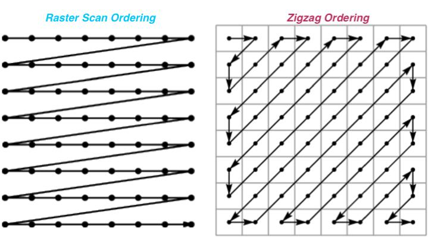
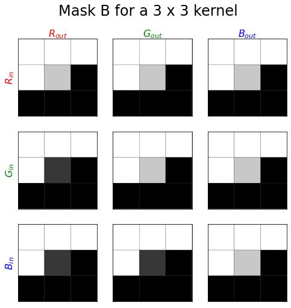
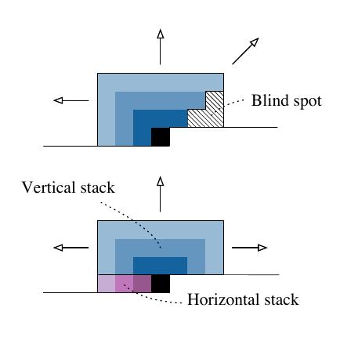
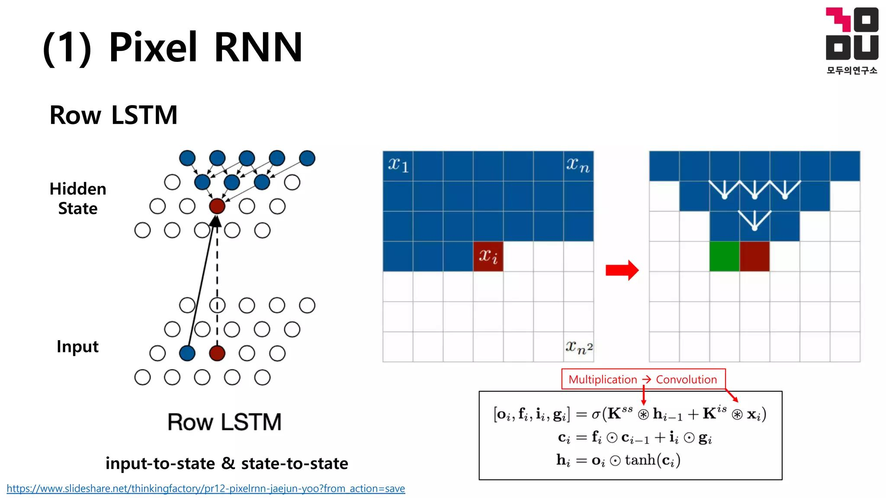
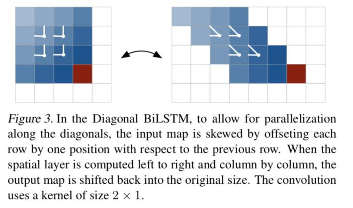
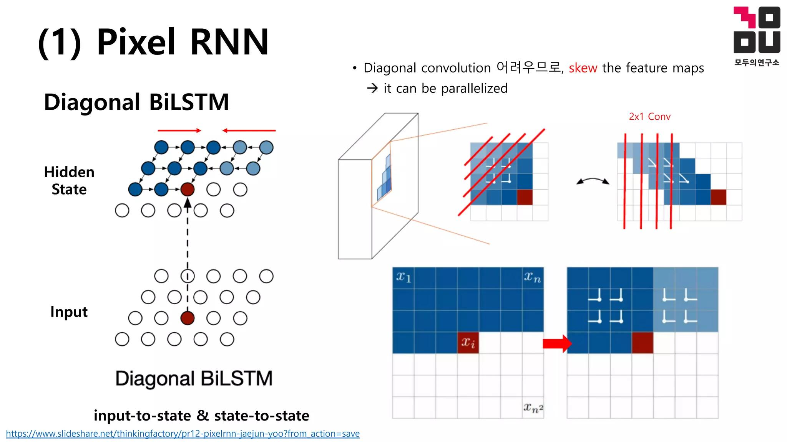

# 5.7 PixelRNN and PixelCNN

이미지 생성에도 Autoregressive Modeling을 적용할 수 있다. 문장을 단어 또는 토큰의 순서로 분해하듯, 이미지는 픽셀의 순서로 분해한다. **PixelCNN**과 **PixelRNN**은 이전에 관측한 픽셀을 조건으로 다음 픽셀의 확률분포를 계산하는 대표적인 모델이다.

이 절에서는 다음 세 가지 문제를 중심으로 두 모델을 살펴본다.

1)이미지의 픽셀을 어떻게 Autoregressive하게 모델링하는가?

2)CNN에서 아직 생성하지 않은 픽셀의 정보를 차단하면서 조건부 확률을 어떻게 계산하는가?

3)PixelCNN의 **Blind Spot** 문제를 PixelRNN, 특히 **Diagonal BiLSTM**에서는 어떻게 다루는가?

## 5.7.1 Autoregressive Image Modeling

### 이미지를 하나의 수열로 표현하기

일반적으로 이미지는 높이와 너비를 가진 2차원 격자이다. 흑백 이미지라면 각 위치에 하나의 픽셀값이 있고, RGB 이미지라면 한 위치에 빨강(R), 초록(G), 파랑(B) 채널의 값이 있다.

Autoregressive Model을 적용하려면 이 픽셀들에 **순서(Ordering)** 를 부여해야 한다. 가장 기본적인 방법은 **Raster Order**이다. 이미지의 왼쪽 위에서 시작하여 오른쪽으로 이동하고, 한 행이 끝나면 다음 행의 왼쪽에서 다시 시작한다.

예를 들어 $3\times3$ 이미지의 픽셀을 다음과 같이 나열할 수 있다.

$$

\begin{pmatrix}

 x_1 & x_2 & x_3

 x_4 & x_5 & x_6

 x_7 & x_8 & x_9

\end{pmatrix}

$$

이제 이미지 전체를 하나의 벡터로 표현한다.

$$

 x=(x_1,x_2,\ldots,x_D),\qquad D=H\times W

$$

여기서 $H$와 $W$는 각각 이미지의 높이와 너비이며, $x_i$는 $i$번째 위치의 픽셀을 의미한다. 이 표기에서는 RGB 이미지의 경우에도 한 위치의 픽셀을 세 채널로 이루어진 벡터로 볼 수 있다.



*Figure 5.7-1. Raster Scan Ordering(왼쪽)과 Zigzag Ordering(오른쪽)의 비교. 본문에서는 왼쪽 순서를 사용한다.*

출처: The Gradient, *Likelihood-based Generative Models I: Autoregressive Models* (사용자 제공 이미지).

### Chain Rule을 이용한 확률분포 분해

확률의 **Chain Rule**에 따르면, 이미지 전체의 결합확률분포는 다음과 같이 분해할 수 있다.

$$

\boxed{

 p_\theta(x)

 =\prod_{i=1}^{D}p_\theta(x_i\mid x_{<i})

}

$$

여기서

$$

 x_{<i}=(x_1,\ldots,x_{i-1})

$$

는 Raster Order에서 $i$번째 픽셀보다 먼저 등장한 픽셀들을 의미한다. 첫 번째 픽셀의 경우 이전 픽셀이 없으므로 첫 번째 항은 $p_\theta(x_1)$이다.

$3\times3$ 이미지의 다섯 번째 픽셀 $x_5$를 생성한다고 하자. 조건부 분포는

$$

 p_\theta(x_5\mid x_1,x_2,x_3,x_4)

$$

이다. $x_5$를 생성할 때는 첫 번째 행의 세 픽셀과 두 번째 행의 첫 픽셀만 사용할 수 있다. $x_6,\ldots,x_9$는 아직 생성되지 않았으므로 조건에 포함할 수 없다.

실제 생성 과정에서는 모델이 이 조건부 분포를 예측하고, 그 분포에서 $x_5$를 하나 뽑는다. 같은 과정을 반복하면 이미지 전체가 완성된다.

$$

\begin{aligned}

 x_1 &\sim p_\theta(x_1),

 x_2 &\sim p_\theta(x_2\mid x_1),

 &\ \vdots

 x_D &\sim p_\theta(x_D\mid x_{<D}).

\end{aligned}

$$

즉, 이미지는 **픽셀 하나씩 조건부 확률분포에서 샘플링한 결과**이다.

### RGB 채널에 대한 Chain Rule

RGB 이미지에서는 픽셀 하나도 세 개의 채널로 이루어져 있다.

$$

 x_i=(x_{i,R},x_{i,G},x_{i,B})

$$

따라서 픽셀 $x_i$의 조건부 분포를 채널 단위로 한 번 더 분해할 수 있다.

$$

\boxed{

\begin{aligned}

 p_\theta(x_i\mid x_{<i})

 &=p_\theta(x_{i,R}\mid x_{<i})

 &\quad\times p_\theta(x_{i,G}\mid x_{<i},x_{i,R})

 &\quad\times p_\theta(x_{i,B}\mid x_{<i},x_{i,R},x_{i,G}).

\end{aligned}

}

$$

이 식은 각 픽셀의 R, G, B 값을 순서대로 생성할 수 있음을 뜻한다. 먼저 이전 픽셀들로부터 빨간색 채널을 생성하고, 이어서 생성한 빨간색 값까지 고려해 초록색 채널을 생성한다. 마지막으로 빨간색과 초록색 값을 모두 고려해 파란색 채널을 생성한다.

여기까지는 **확률분포를 어떻게 분해할 것인가**에 관한 이야기이다. 다음 문제는 이 조건부 분포들을 어떤 신경망 구조로 계산할 것인가이다.

---

## 5.7.2 PixelCNN: Masked Convolution

### 일반적인 CNN을 그대로 사용할 수 없는 이유

CNN은 주변 픽셀들을 함께 살펴보는 **Convolution** 연산을 수행한다. 일반적인 $3\times3$ Convolution에서는 한 픽셀의 출력을 계산할 때 그 픽셀의 위·아래·왼쪽·오른쪽에 있는 픽셀들이 모두 사용될 수 있다.

하지만 Autoregressive Modeling에서는 Raster Order를 따라 **미래 픽셀의 정보를 사용해서는 안 된다.** 예를 들어 $x_5$를 예측하면서 오른쪽 픽셀 $x_6$을 참조한다면, 아직 생성하지 않은 값을 미리 보고 정답을 예측하는 셈이다.

PixelCNN은 이를 방지하기 위해 **Masked Convolution**을 사용한다. Convolution Kernel의 일부 위치에 0을 곱해, 현재 픽셀의 예측에 허용되지 않는 방향의 정보가 전달되지 않도록 한다.

### Mask A와 Mask B

현재 위치가 $3\times3$ Kernel의 가운데라고 가정하자. 필기에서 정의한 두 종류의 Mask는 다음과 같다.

$$

\boxed{

M_A=

\begin{pmatrix}

1&1&1

1&0&0

0&0&0

\end{pmatrix},

\qquad

M_B=

\begin{pmatrix}

1&1&1

1&1&0

0&0&0

\end{pmatrix}

}

$$

Mask의 숫자 **1은 해당 위치의 연결을 허용한다**는 뜻이고, **0은 연결을 차단한다**는 뜻이다. 실제 Convolution에서는 Kernel의 가중치 $W$에 Mask $M$을 원소별로 곱한 $W\odot M$을 사용한다.

두 Mask의 차이는 가운데 원소 하나이다.

- **Mask A:** 가운데가 0이다. 첫 번째 Layer에서 사용하며, 현재 예측할 **원본 픽셀값**을 직접 참조하지 못하게 한다.
- **Mask B:** 가운데가 1이다. 이후 Layer에서 사용한다. 앞선 Layer가 이미 과거 픽셀만 이용해 만든 **Hidden Feature**이므로 현재 위치의 Hidden Feature를 참조하는 것은 허용된다.

Mask A에서 가운데를 0으로 두는 이유는 데이터 누출(Data Leakage)을 막기 위해서다. 예를 들어 이미지의 중앙 픽셀이 0인지 1인지 예측하는 문제에서, 모델이 그 픽셀값을 입력으로 직접 받아버리면 조건부 분포를 학습할 필요가 없어진다.

반면 Mask B가 참조하는 가운데 값은 원본 픽셀값이 아니다. 첫 번째 Masked Convolution을 통과하면서 이미 허용된 과거 정보만 담도록 구성된 표현이다.



*Figure 5.7-2. 3×3 커널에서 입력·출력 RGB 채널 조합에 따른 Mask B.*

출처: [Minibatch AI, *PixelCNN*](https://minibatchai.com/2023/01/27/pixel-cnn.html) (사용자 제공 이미지).

### Masked Convolution과 조건부 확률

PixelCNN은 여러 Masked Convolution Layer를 쌓아 이전 픽셀들의 정보를 모으고, 각 위치에서 해당 픽셀의 조건부 분포를 예측한다.

예를 들어 흑백 이미지의 픽셀값이 0과 1뿐이라면, 다섯 번째 픽셀에 대해 모델은

$$

 p_\theta(x_5=1\mid x_1,x_2,x_3,x_4)

$$

같은 조건부 확률을 계산할 수 있다. 픽셀값이 $0,1,\ldots,255$ 중 하나라면, 출력은 해당 256개 값에 대한 확률분포가 될 수도 있다.

학습 시에는 실제 이미지 전체가 주어져 있으므로 모든 위치의 조건부 분포를 Masked Convolution으로 함께 계산할 수 있다. 다만 **이미지를 새로 생성할 때는** 이전에 생성한 픽셀의 값이 필요하기 때문에 Raster Order에 따라 순차적으로 샘플링해야 한다.

### Blind Spot 문제

Mask를 사용한다고 해서 모든 과거 픽셀의 정보를 충분히 활용할 수 있는 것은 아니다.

**Blind Spot**은 Raster Order상으로는 과거에 속하지만, 신경망의 계산 경로(Computational Path)가 연결되지 않아 현재 위치의 예측에 영향을 주지 못하는 영역을 의미한다.

예를 들어 현재 픽셀의 오른쪽 위에 위치한 픽셀은 이전 행에 있으므로 이미 생성된 과거 픽셀이다. 그러나 Masked Convolution을 여러 층 쌓았을 때 연결 가능한 경로가 제한되면, 이러한 과거 픽셀 중 일부는 현재 위치까지 정보를 전달하지 못할 수 있다.

따라서 **미래 정보를 차단하는 것**과 **사용 가능한 과거 정보를 모두 활용하는 것**은 서로 다른 문제이다.



*Figure 5.7-3. Masked Convolution의 Blind Spot(위)과 Vertical·Horizontal Stack의 결합(아래).*

출처: van den Oord et al., *Conditional Image Generation with PixelCNN Decoders* (2016), Figure 2. 사용자 제공 이미지: Francisco Ingham의 동명 논문 소개 글(Medium).

---

## 5.7.3 PixelRNN: Row LSTM

### 행 단위 Hidden State

PixelRNN은 이미지의 공간적 의존성을 RNN 구조로 모델링한다. 이 중 **Row LSTM**은 한 행을 하나의 처리 단위로 삼아, 이전 행에서 계산한 정보를 다음 행으로 전달한다.

이미지의 $r$번째 행에 있는 Hidden State들을 다음과 같이 묶어 표현하자.

$$

H_r=(h_{r,1},h_{r,2},\ldots,h_{r,W})

$$

여기서 $h_{r,c}$는 $r$번째 행, $c$번째 열에 대응하는 Hidden State이며, $W$는 이미지의 너비이다.

필기의 Row LSTM 계산을 추상적으로 쓰면 다음과 같다.

$$

\boxed{

H_r=\operatorname{RowLSTM}(H_{r-1},X_r)

}

$$

$X_r$는 현재 행의 입력 표현을 뜻한다. 실제 구현에서는 Autoregressive 조건을 지키도록 입력에 적절한 Mask나 Shift를 적용해야 한다.

이 식은 현재 행의 Hidden State를 계산할 때 **이전 행의 Hidden State와 현재 행에서 허용된 입력 정보**를 사용한다는 뜻이다. Row LSTM은 열 방향으로도 Convolution을 활용하므로, 이전 행의 같은 열뿐 아니라 이웃한 열의 정보도 현재 Hidden State 계산에 전달할 수 있다.

### $3\times3$ 이미지의 예시

다음과 같은 이진 이미지에서 가운데 픽셀을 예측한다고 하자.

$$

X=

\begin{pmatrix}

1&0&1

0&?&?

?&?&?

\end{pmatrix}

$$

Raster Order상 현재 생성할 픽셀은 $x_{2,2}$이다. 첫 번째 행의 세 픽셀과 두 번째 행의 첫 번째 픽셀은 이미 알려져 있다.

따라서 목표는 다음 조건부 확률을 계산하는 것이다.

$$

p_\theta\left(

 x_{2,2}=0

 \mid x_{1,1}=1,x_{1,2}=0,x_{1,3}=1,x_{2,1}=0

\right)

$$

필기의 그림에서는 이전 행의 Hidden State

$$

h_{1,1},\quad h_{1,2},\quad h_{1,3}

$$

로부터 현재 위치의 Hidden State $h_{2,2}$로 정보가 전달되는 모습을 보여준다. 각 Hidden State는 해당 위치까지 모인 정보를 압축한 표현이므로, 여러 위치의 정보를 다음 행으로 전달하는 데 사용할 수 있다.

$h_{2,2}$를 계산한 뒤 모델은 이를 이용해 가운데 픽셀에 대한 조건부 분포를 예측하고, 예를 들어 $x_{2,2}=0$을 샘플링할 수 있다.



*Figure 5.7-4. Row LSTM의 input-to-state·state-to-state 연결과 삼각형 형태의 수용 영역.*

출처: 모두의연구소 슬라이드, *Pixel RNN to Pixel CNN++* (사용자 제공). 슬라이드에 표시된 원 출처: [Jaejun Yoo, *PR12: PixelRNN*](https://www.slideshare.net/thinkfactory/pr12-pixelrnn-jaejun-yoo).

Row LSTM은 과거 행의 정보를 Recurrent Hidden State에 누적한다는 점에서 단순히 국소적인 Convolution을 적용하는 것과 다르다. 다만 행 단위의 정보 전달만으로 모든 방향의 과거 정보를 완전히 활용하는 것은 별개의 문제이다. 이를 더 적극적으로 다루는 구조가 **Diagonal BiLSTM**이다.

---

## 5.7.4 Diagonal BiLSTM

### 대각선 방향의 정보 전달

Row LSTM이 행 단위로 정보를 전달한다면, **Diagonal BiLSTM**은 이미지를 대각선 방향으로 처리한다.

다음 $3\times3$ 격자를 생각하자.

$$

\begin{pmatrix}

A&B&C

D&E&F

G&H&I

\end{pmatrix}

$$

왼쪽 위에서 오른쪽 아래로 진행하면서, 같은 반대각선(Anti-diagonal)에 속하는 위치들을 묶으면 다음과 같다.

$$

\begin{aligned}

\mathcal G_1&=A,

\mathcal G_2&=B,D,

\mathcal G_3&=C,E,G,

\mathcal G_4&=F,H,

\mathcal G_5&=I.

\end{aligned}

$$

이처럼 같은 대각선 위의 위치들은 함께 처리하고, 대각선들 사이에는 Recurrent하게 정보를 전달하도록 구성할 수 있다. 한 대각선의 픽셀 수가 여러 개이므로, 이를 하나씩 순차 처리하는 대신 **같은 대각선에 속한 위치들을 병렬로 계산**하는 것이 핵심이다.

### Skewing: 대각선을 열로 정렬하기

대각선 단위 계산을 효율적으로 수행하기 위해 **Skewing** 연산을 사용한다. 각 행을 그 행의 번호에 따라 오른쪽으로 이동시켜, 같은 반대각선에 있던 원소들을 같은 열에 정렬하는 방식이다.

예를 들어 원래의 $3\times3$ 배열이

```

A B C

D E F

G H I

```

였다면 Skewing을 적용한 배열은 다음과 같다. 점`·`)은 계산을 위한 빈 위치이다.

```

A B C · ·

· D E F ·

· · G H I

```

이제 $B$와 $D$, $C$와 $E$와 $G$, $F$와 $H$가 각각 같은 열에 놓인다.

일반적인 $n\times n$ 이미지에서는 $r$번째 행을 오른쪽으로 $r-1$칸 이동한다. 따라서 배열의 크기는 다음과 같이 변한다.

$$

\boxed{

 n\times n\quad\longrightarrow\quad n\times(2n-1)

}

$$

행의 수는 유지되지만, 오른쪽으로 이동한 부분을 담기 위해 열의 수가 늘어나는 것이다. 이렇게 정렬하면 같은 대각선에 속하는 위치들을 병렬로 처리하기 쉬워진다.

필기에 첨부한 강의 슬라이드에서는 이 변환과 함께 **$2\times1$ Convolution Kernel**을 사용한다고 설명한다. 이는 Skewing된 배열에서 인접한 행의 정보가 연결되도록 처리하는 구조이다.



*Figure 5.7-5. 각 행을 한 칸씩 이동해 대각선을 열로 정렬하고, 계산 후 원래 배치로 되돌린다.*

출처: [van den Oord et al., *Pixel Recurrent Neural Networks* (2016)](https://proceedings.mlr.press/v48/oord16.html), Figure 3. 사용자 제공 캡처. [CC BY 4.0](https://creativecommons.org/licenses/by/4.0/).

### Bidirectional 계산과 미래 정보 차단

**BiLSTM(Bidirectional LSTM)** 은 정보를 한 방향으로 전달하는 LSTM과 반대 방향으로 전달하는 LSTM을 함께 사용한다.

Diagonal BiLSTM에서는 대각선 방향의 정보를 양쪽에서 모아, 더 넓은 과거 문맥을 반영하려 한다. 하지만 Autoregressive Model에서는 양방향 처리를 그대로 결합할 수 없다.

예를 들어 오른쪽에서 왼쪽으로 처리한 Hidden State를 현재 픽셀의 예측에 그대로 사용하면, 현재 행에서 **아직 생성하지 않은 오른쪽 픽셀의 정보**가 포함될 수 있다. 이는 조건부 확률 $p_\theta(x_i\mid x_{<i})$의 정의에 위배된다.

이 문제를 막기 위해 필기의 Diagonal BiLSTM에서는 **오른쪽에서 왼쪽으로 계산한 Output Map을 한 행 아래로 Shift한 뒤**, 왼쪽에서 오른쪽으로 계산한 Output Map과 합친다.

한 행 아래로 옮기는 이유는 오른쪽에서 왼쪽으로 모은 정보가 **현재 행이 아니라 이전 행의 정보**로만 사용되게 하기 위해서다. 이전 행의 픽셀들은 Raster Order상 모두 과거에 속하므로, 이 방식으로 미래 픽셀의 정보가 예측에 섞이지 않도록 한다.



*Figure 5.7-6. Diagonal BiLSTM의 양방향 Hidden State와 Skewing을 이용한 대각선 계산.*

출처: 모두의연구소 슬라이드, *Pixel RNN to Pixel CNN++* (사용자 제공). 슬라이드에 표시된 원 출처: [Jaejun Yoo, *PR12: PixelRNN*](https://www.slideshare.net/thinkfactory/pr12-pixelrnn-jaejun-yoo).

Diagonal BiLSTM의 핵심은 **대각선 방향으로 넓은 공간적 의존성을 학습하면서도, 이미 생성된 픽셀만 사용한다는 Autoregressive 조건을 유지하는 것**이다.

---

